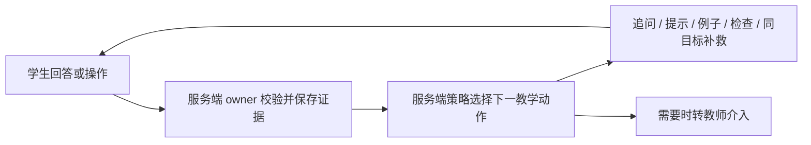

# 启途智学 UI 优化方案与验收清单

依据：[线上体验报告](体验报告.md)与[截图图库](index.html)。本文件保留审查时的实施建议；后续源码修复与本地验收见 [U01–U20 修复记录](07-remediation/README.md)，生产尚未发布。

## 1. 实施原则

保留冻结的客户端导航、路由职责与现有 PBL owner。优先在已有页面和组件内调整信息顺序、默认展开状态、密度和反馈，不新增平行项目/掌握度/计划状态库。任何新增或删除主导航的建议另走产品文档与评审，不混入视觉修复。

Admin 仍控制模型、运行时技能、模板、团队和 IMA 授权。学生端只呈现服务端确认的项目、任务、证据与动作；不能用 UI 选项直接授予 TheoryMastered、实践许可、作品通过或成长事实。未确认意图前继续使用探索或草稿语义。

## 2. 建议按四个变更包交付

| 顺序 | 变更包 | 目的 | 完成条件 |
|---|---|---|---|
| 0 | 演示与正式入口的部署边界 | 确认公开演示管理员是否与真实环境隔离 | 环境归属和数据范围有明确结果；若不是隔离演示，先关闭公开演示管理能力 |
| 1 | 展示事实与访问恢复 | 修复账号/项目/统计口径、日期、错误路径和误导文案 | 同一对象在四端的授权投影一致，数据不足不伪装为成功或 0 |
| 2 | Tutor 与窄屏任务流 | 让当前教学动作、输入区、消息与配置操作更易到达 | 核心阅读和操作在窄屏可完成，必要二维区有明确局部滚动 |
| 3 | 视觉组件与官网转化 | 统一密度、标题、按钮、图标、空态与 CTA | 共享组件与代表性页面通过视觉回归，保留产品导航 |

每个变更包独立提交可审查 diff；后端行为变化应另列权限、错误码、日志、幂等性与数据风险。不要把这些建议合成一个没有 Issue 的大范围重构。

## 3. 优先任务清单

| 编号 | 优先级 | 具体修改 | 责任范围 | 可验证的验收条件 |
|---|---|---|---|---|
| U01 | 条件性 P0 | 区分正式登录与演示环境；约束公开管理员演示能力 | 部署、认证、Admin | 在正式入口无法通过公开演示按钮获得真实管理权限；演示数据和环境标识清楚 |
| U02 | P1 | 四端无会话时统一登录与安全 `next` 返回 | auth / 四端 shell | 在干净会话分别进入四端深链，登录后回到允许访问的原目标；跨站 next 被拒绝 |
| U03 | P1 | 当前项目由同一 owner 选择，列表标记当前对象 | projects / today / Tutor | 今天、Tutor 与项目列表能对应同一 projectId；其他项目不会被误称为当前；百分比来源明确 |
| U04 | P1 | 画像身份、证据和成长投影对齐 | profile / growth / API owner | 姓名和账号匹配；分数、徽章有授权证据与时间；证据缺失展示不足态；演示内容有标识 |
| U05 | P1 | 教师工作台和学生页采用可解释的统计范围 | teacher / 聚合 API | 待处理、进行中、阶段分布可复算；未知与真实 0 区分；不同范围在 UI 标明 |
| U06 | P1 | 家长孩子选择器、首页、进展与消息共享当前对象 | parent | A→B→A 快速切换，延迟响应不串孩子；切换区计数与内容范围一致 |
| U07 | P1 | “今天”按学校/账号时区计算 | today / 日期工具 | 中国时区凌晨、跨日、浏览器不同时区均按产品约定显示，避免 UTC 截日 |
| U08 | P1 | 修复或受控迁移独立工作台路由 | student 项目路由 | 当前授权项目的旧链接不出现无出口错误；有返回项目、重试和诊断编号 |
| U09 | P1 | 登录离线和无任务空态使用场景专用文案 | 公共反馈组件 / today | 离线不承诺缓存登录；无任务不自动断言阶段完成；每种状态有明确下一步 |
| U10 | P1 | Tutor 按视口默认收起辅助面板 | Tutor / shell | 1440px 下主教学区明显宽于当前约 439px 的预览容器；390px 下当前动作与输入操作可到达 |
| U11 | P1 | 管家模型能力校验与权限说明 | Admin copilot / 模型 owner | 默认模型适合当前任务并保留 provider+model 身份；目录不可用禁止盲选；UI 权限描述与后端一致 |
| U12 | P1 | 授权矩阵的定位与保存反馈 | Admin skills/tools | 固定行名和表头；局部滚动清楚；写入经过幂等 PATCH 与回读；部分失败逐项展示 |
| U13 | P2 | 内部状态映射为学生语言 | contracts 显示映射 / Tutor / inspiration | 学生主界面不出现裸 `intent_confirmed`、`physics_optics`；仍正确区分草稿、确认、门禁与证据状态 |
| U14 | P2 | 项目标题、封面和无数据占位压缩 | ProjectCard / EmptyState | 390px 项目卡标题有合理行数；无封面不占大块空图；详情可访问完整标题 |
| U15 | P2 | 家长消息统计与详情在手机上改为适合纵向阅读的结构 | parent/messages | 无“左侧”错误指示；消息先于大段统计；返回列表位置保留；不自动确认已读 |
| U16 | P2 | 官网 CTA 和标题语义换行 | auth-portal | 同一目标只有一个突出主 CTA；体验条件在点击前可知；中文词语不在不合适位置拆开 |
| U17 | P2 | 手机统计与演示控制压缩 | 官网首页 | 保留真实数字和合成标识；具体项目示意更早进入阅读序列；暂停按钮可用 |
| U18 | P2 | Admin 设置目录和技术信息渐进展示 | settings layout | 保持原分组/顺序；窄屏能找到全部项；当前项清楚；调试描述不淹没操作 |
| U19 | P2 | 统一图标、中文操作词、卡片与按钮规范 | packages/ui / design-tokens | 共用组件的尺寸、焦点、颜色、状态一致；语义相同按钮使用相同样式 |
| U20 | P2 | 光学预览从批准模型域内初始化 | optics 可视化 / 注册模型参数 | 默认参数不立即触发域外警告；域外不推断结果；预览不伪装为测量或已保存证据 |

## 4. 重点页面的具体调整

### 4.1 官网与统一登录

官网保留品牌、项目实物示意和合成内容标识。首屏可按“一个真实问题 → 与 AI 如何探究 → 能留下什么作品 → 进入已有账号空间”排列内容。标题在宽屏按“一个问题，/ 长成一件作品”断行，窄屏使用流式字号和合理宽度，不依赖插入大量硬换行。

登录仍保留四角色选择与机构邮箱、密码。将账号恢复说明压缩为一句可执行提示，联系入口链接到已存在的合作联系页面；测试角色按钮使用两列布局并有明确环境标识。保持标签与输入关联，密码显示按钮有状态名称；所有错误信息关联字段或表单，不只改变颜色。

### 4.2 学生 Tutor

在现有页面内逐步调整默认展开状态：

| 视口 | 会话历史 | 教学区 | 项目/团队详情 |
|---|---|---|---|
| 大桌面 | 可展开，支持缩窄 | 当前动作与动态板书为主 | 按需展开，避免长期占满侧边 |
| 普通桌面/平板 | 默认收起，可快速切换会话 | 提供足够宽度容纳公式、BoardBlock、图和实验 | 使用现有抽屉/面板开关 |
| 手机 | 单入口展开 | 当前目标、当前问题/反馈和输入区优先 | 同页抽屉，关闭后恢复阅读位置 |

这些是建议的行为分段，最终断点依据真实内容和现有 CSS 确定。不要仅通过 `overflow:hidden` 消除检测到的溢出，因为那可能把按钮一起裁掉。

保留 Mermaid、KaTeX、BoardBlock 和固定注册实验模型。宽图可以使用独立缩放/全屏查看入口；公式和数据表允许局部滚动，普通文字自动换行。将工程说明压缩成学生能理解的当前任务提示，状态词由闭合集合映射。

动态反馈继续遵循既有双循环：

UI 显示“已保存”必须等到 owner 回执；发送中、待确认、失败重试不能提前变为完成。TheoryMastered 之前只提供允许的低风险预览，正式实验校验继续由服务端执行。

### 4.3 教师与家长

教师工作台先显示可行动的关注事项和必要证据；统计卡服务于判断，不承担主导视觉。学生详情将“为什么需要关注、最近证据、可以做什么”放在前面，Agent 执行图与内部日志默认折叠。

家长首页继续保留“今天可以怎么支持孩子”的具体建议；增加数据来源/更新时间，不让能力分数取代可理解的成长证据。手机消息页将统计压成摘要，先显示待确认或最近消息。同一孩子切换操作有请求标识或 abort 约束，禁止展示上个孩子的迟到响应。

### 4.4 Admin

设置导航仍是唯一设置切换源。可在现有侧栏内部提供检索或折叠分组；手机的目录展开不改变各项顺序与 URL。宽矩阵增加行/列定位、可见滚动提示和批量影响摘要。

工具/技能等状态至少区分“目录中存在”“配置已保存”“当前已启用”“真实请求已核验”。字段旁显示最近核验时间与失败原因。技能绑定只存 runtime catalog 的 canonical ID，目录不可用时不得覆盖整数组。项目模板显示已冻结版本与绑定摘要；锁定不是“保存失败”，应解释正确的版本流转入口。

管家页面保留任务上下文和可用操作边界，模型高级选项按需展开。不能用“完全访问”文案作为权限放行依据，也不应因目录加载失败退回同名裸模型 ID。

## 5. 共享视觉规范建议

以下值是设计起点，应先对齐现有 `packages/design-tokens` 和 `packages/ui`，不另建一套并行 token。

| 项目 | 建议 | 注意事项 |
|---|---|---|
| 色彩 | 保留品牌蓝、浅背景和深色正文；状态用文字+图形+颜色 | 分数/成功不能只靠颜色；不要把所有技术状态都涂绿 |
| 字号 | 正文以 14–16px 为起点，辅助文本慎用 12px；主标题与卡片标题建立稳定层级 | 具体值由现有字体与中文可读性验证 |
| 间距 | 用统一的 4/8px 基础节奏组织 12/16/24/32px 间距 | 减少每个页面各写一组相近数值 |
| 卡片 | 统一同层级圆角、边框、标题间距，减少卡片内再次套大卡片 | 信息分组来自任务关系，不能只为装饰增加容器 |
| 按钮 | 主操作、次操作、文本操作、危险操作各有单一语义 | 保留 disabled、loading、成功回读、部分失败反馈 |
| 图标 | 同一区域优先同一图标集，机器人作为品牌与导师形象 | 保留必要文字，不把 emoji 当作唯一可访问名称 |
| 手机触摸 | 主要操作可用 44px 作为项目设计目标 | WCAG AA 最小目标需按 24px 和例外条件逐项核对 |
| 表格 | 身份/状态优先，必要时固定列、局部滚动或卡片投影 | 不通过隐藏关键列假装适配 |
| 空态 | 明确对象、原因、下一步；高度与信息量相称 | “没有记录”不等于“已完成”或“已掌握” |

标准参考：[W3C 重排](https://www.w3.org/WAI/WCAG22/Understanding/reflow.html)、[目标尺寸](https://www.w3.org/WAI/WCAG22/Understanding/target-size-minimum.html)、[文字对比度](https://www.w3.org/WAI/WCAG22/Understanding/contrast-minimum.html)。本次没有宣称通过这些标准的完整认证。

## 6. 建议从这些现有实现入口开始

这些路径已在工作区存在；定位不是对线上部署版本的承诺。

| 方向 | 当前入口 |
|---|---|
| 官网与登录 | [首页](../../apps/auth-portal/app/page.tsx)、[统一登录](../../apps/auth-portal/app/login/page.tsx)、[官网样式](../../apps/auth-portal/app/home.css) |
| 日期与项目列表 | [Today 数据源](../../apps/student-center/features/today/data/apiTodayDataSource.ts)、[ProjectCard](../../apps/student-center/features/projects/components/ProjectCard.tsx)、[项目 API 数据源](../../apps/student-center/features/projects/data/api-projects-data-source.ts) |
| 画像 | [ProfilePage](../../apps/student-center/features/profile/ProfilePage.tsx) |
| Tutor | [TutorHeader](../../apps/student-center/features/tutor/components/TutorHeader.tsx)、[TutorStream 样式](../../apps/student-center/features/tutor/components/TutorStream.module.css) |
| 教师端 | [teacher-shell](../../apps/teacher-workspace/components/teacher-shell.tsx)、[页面样式](../../apps/teacher-workspace/app/globals.css) |
| 家长端 | [ParentShell](../../apps/parent-companion/features/ParentShell.tsx)、[页面样式](../../apps/parent-companion/app/globals.css) |
| Admin | [设置布局](../../apps/admin-console/app/(console)/settings/layout.tsx)、[管家](../../apps/admin-console/app/(console)/copilot/page.tsx)、[工具矩阵样式](../../apps/admin-console/app/(console)/settings/tools/tools.module.css) |
| 公共组件 | [共享 shell](../../packages/ui/src/shell.tsx)、[共享样式](../../packages/ui/src/styles.css) |

管家、技能中心和相关合同/后端文件当前已有其他工作修改，具体清单见 [审查开始时的状态](06-evidence/workspace-before.txt)。后续实现应先复查这些 diff，不能以本报告为由覆盖它们。

## 7. 验收清单

### 可见与可操作

- [ ] 1440×1000、1024×768、768×1024、390×844、320px 宽度检查；主要页面内容不依赖页面级横向滚动。
- [ ] 真实 iOS Safari 和 Android Chrome 打开 Tutor，软键盘不遮挡发送、当前题和错误提示。
- [ ] 所有主导航、抽屉、弹窗、标签页和输入可用键盘操作；焦点可见，关闭后回到触发控件。
- [ ] 200% 文本缩放与 400% 页面缩放检查关键任务；二维表格等例外不影响周边内容重排。
- [ ] 普通文字/大字对比度按标准测量，图标按钮有可访问名称；小目标按尺寸和间距检查。
- [ ] 官网动画可暂停；减少动态效果偏好下内容仍完整，不以截图隐藏态作为验收结论。

### 状态与事实

- [ ] 六类区域逐项检查 loading、empty、error、offline、permission-denied，不用同一“空白卡片”覆盖所有状态。
- [ ] 日期跨日、当前项目对象、教师统计、孩子选择器、画像证据与成长时间线有一致且可说明的口径。
- [ ] 无会话和会话过期均能返回原目标；权限失败不泄露未授权对象存在性。
- [ ] 断网/重试不会制造重复项目、任务、作品或配置变更；owner 回执前不显示完成。
- [ ] Admin 目录读取失败、部分 PATCH 失败、回读失败分别有反馈，未知技能绑定不被静默删除。
- [ ] 家长切换孩子采用延迟/乱序响应测试，不将上一个孩子的数据覆盖到当前孩子。
- [ ] 光学预览、模拟观察和真实测量有清楚标签；正式工具的门禁、参数、版本和幂等证据仍由服务端校验。

### 工程与发布

- [ ] 改动前保存目标文件 diff；本报告记录的既有修改保持独立。
- [ ] 纯样式改动优先使用代表性页面截图和真实交互验证，不为每个 CSS 属性编写镜像测试。
- [ ] 涉及行为、权限或竞态时增加针对用户结果的测试；不能以 typecheck 替代行为验收。
- [ ] 跨 workspace 类型检查前按实际依赖顺序构建 contracts、database、ai-client 等包。
- [ ] 每个 PR 说明影响范围、截图前后对比、验证方式及数据/权限风险。
- [ ] 发布后以线上新截图、实际接口结果和版本标识验收；本地源码通过不代表线上已生效。
