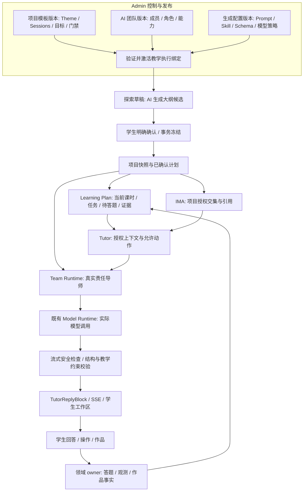
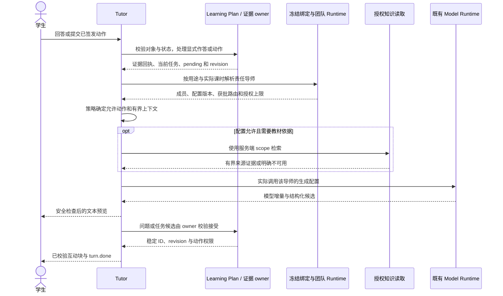

# 实时 AI 生成与项目团队绑定架构

> 状态：最新架构提案，待关联 Issue 与评审。新增类型、字段和接口不会因文档更新而自动实现。
> 更新：2026-10-19。参考 HEAD `8e8f9b4` 与本轮读取的工作区；用户有并行修改，不能视为已验收发布版本。
> 本文替代旧版“确定性课表为主、模型规划可选”的决策。确定性代码负责约束和验证，真实 AI 生成是新教学链路的必需能力。
> 关联：[实施计划](./implementation-plan.md) · [课时与知识授权](./theme-session-team-ima-design.md) · [差距审计](./gap-audit-20261019.md) · [验证记录](./validation-20261019.md)。

## 1. 目标与已有基础

项目模板定义目标、课时约束、门禁、实验和量规。AI 团队版本定义真实成员及教学能力。教学执行绑定将两者组合，决定每次生成由谁执行、允许生成什么、可以访问哪些知识。

新链路必须实际调用 Admin 批准的模型，生成个性化大纲、课时教学内容、回答驱动的追问和评审候选。固定模板回复、模拟打字动画和只切换导师头像不满足验收。

| 能力 | 已有基础 | 本方案增量 |
| --- | --- | --- |
| 正式立项与团队冻结 | `da18a9d` 已要求冻结成功，否则拒绝立项 | 补完整内容、角色、生成配置及知识授权的版本一致性 |
| 冻结导师恢复 | 已按团队版本恢复成员，`8e8f9b4` 修正空闲导师 ready 状态 | 展示身份与实际执行配置一致 |
| 计划与问答 | 已有光学 8/16 节生成、pending、answer、mastery 和 gates | 消费实际冻结内容，接通真实生成与当前任务 |
| 实时与可视化 | 已有 SSE、TutorReplyBlock、Board、公式及实验卡 | 校验后激活结构化块，保存观测，恢复中断生成 |

已有能力不从零建设。此前测试数字与网站检查的适用基线见验证记录，本轮没有重新认证整个业务工作区。

## 2. 架构选择和整体结构

| 方案 | 结构 | 决定 |
| --- | --- | --- |
| Agent 自治主控 | Agent 自行维护课程进度、工具调用和学习事实 | 不采用，会重复领域 owner，难以保证门禁、幂等与权限 |
| 计划和证据驱动，团队真实生成 | 服务端提供事实与允许动作，绑定角色调用模型，候选验证后由 owner 接受 | 采用，保留真实生成并复用已有计划、问答、实验和作品链路 |



不新增 PBL 微服务、课程数据库、第二套 pending/mastery 或独立多 Agent 引擎。生成能力放入现有 ai-tutor，模型执行仍使用现有 Runtime。不要按加载、校验、转换、保存的调用顺序拆出一串只转发参数的服务。

## 3. 项目与团队通过版本化绑定连接

### 3.1 绑定合同

扩展现有 PblTemplateTeamBinding，不新建平行绑定库。以下是拟议形状，实施时合入 @qitu/contracts 的现有合同，不另立第二份 curriculum schema。

```ts
type GenerationPurpose = 'outline' | 'session' | 'dialogue' | 'experiment' | 'review';

type GenerationActorSelector =
	| { kind: 'phase_owner' }
	| { kind: 'fixed_member'; memberSlotId: string };

interface GenerationRouteSpec {
	actor: GenerationActorSelector;
	profileVersionByMemberSlot: Readonly<Record<string, string>>;
}

interface TeachingExecutionBindingSpec {
	specVersion: 'qitu.teaching-binding.v2';
	templateVersionId: string;
	templateContentHash: string;
	teamVersionId: string;
	teamSpecHash: string;
	phaseRoles: Readonly<Record<PblPhase, {
		memberSlotId: string;
		assistantId: string;
	}>>;
	generationRoutes: Readonly<Record<GenerationPurpose, GenerationRouteSpec>>;
	imaGrant: {
		serverId: 'ima-knowledge';
		knowledgeBaseIds: readonly string[];
		allowedTools: readonly ImaReadToolId[];
	} | null;
	policyVersion: string;
	bindingHash: string;
}
```

PblPhase 复用现有类型；ImaReadToolId 表示四只读工具导出的闭集，名称需在实施时统一。slot 来自真实冻结成员。旧版成员先规范化，不能在授权时靠角色名称正则猜助手。

| 生成用途 | 责任导师选择 | 允许产出 |
| --- | --- | --- |
| outline | 固定主导导师 slot | 个性化项目大纲候选 |
| session | 实际当前课时的 phase owner | 本节活动、开场、支架和问题候选 |
| dialogue | 实际当前课时的 phase owner | 依据当前回答生成下一步内容 |
| experiment | 固定实验向导 slot，且任务和门禁允许 | 注册实验参数候选、预测问题和观测追问 |
| review | 固定评审导师 slot | 引用作品版本和量规的反馈候选 |

一个模板版本同时只有一个 active 绑定。团队能否复用到多模板遵循现有治理约束，不在本次顺带放宽反向唯一性。学生不能提交 team/model/grant 来改变绑定。

### 3.2 生成配置必须可回放

生成配置版本引用不可变提示词内容或内容 hash、角色指令、canonical skill ID 及版本、输出 Schema 版本、允许 block/action、模型策略版本和调用预算。仅给可变提示词文件贴一个版本标签不够。

模型策略仍由 Admin Runtime 管理。绑定只引用策略，不存凭据或供应商 URL。实际调用记录完整 `(modelProviderId, modelId)`；同名裸模型 ID 不足以确定路由。

生成配置允许的模型集合是历史项目上限，当前 Admin 授权可进一步收紧。主模型不可用时，只能在批准候选中切换并记录，不能悄悄换导师或通用默认模型。没有合法路由就明确失败。

### 3.3 激活与冻结

激活时校验真实成员、角色和生成用途覆盖、提示词/技能/Schema 兼容、当前模型可用、实验注册和知识授权。规范化模板内容、角色映射、生成配置版本、grant 和策略版本都进入 binding hash。

hash 使用约定的规范 JSON 和摘要算法，包含 specVersion 及引用内容 hash，不包含 bindingHash 自身、审计时间和凭据。解析时校验快照和引用内容一致；不一致就拒绝生成，不能换用当前 active 绑定兜底。

正式确认时冻结 templateVersionId、bindingId、teamVersionId、binding hash、审核排期及已确认计划引用。保存不可变引用和必要投影，不重复复制整套模板。后续修改不改变历史教学语义，当前禁用和撤权仍立即阻断新调用。

## 4. 三层真实生成

| 层次 | 输入与触发 | AI 生成 | 服务端保留的控制权 |
| --- | --- | --- | --- |
| 项目大纲 | 探索草稿、选定模板、兴趣、基础和审核排期 | 个性化驱动问题、任务情境、活动安排和支架候选 | 核心目标、DAG、阶段、时长、必做证据和门禁 |
| 课时教学 | 进入真实当前课时，读取已有证据和 pending | 本节开场、活动、板书、示例和问题候选 | 课时身份、目标范围、题目入库和实验权限 |
| 每轮交互 | 回答、求助、操作或作品评审结果 | 追问、提示、对照、迁移问题和反馈 | 允许动作、判分、掌握、阶段、作品通过与计划 revision |

确定性代码生成排期骨架、验证候选并计算物理模型。AI 在骨架内实际生成教学设计与内容。不能把常量课表换个标题就标为 AI 大纲。

### 4.1 大纲草稿与正式确认分开

先在现有 exploration/plan draft 下解析候选绑定，调用规划导师，校验并保存大纲候选。此时不创建正式项目。预览携带模板/绑定 hash、排期及 draft revision。

学生明确确认时，在现有确认事务中重新核验这些引用。绑定变化、草稿过期或内容不符，返回冲突并重新预览。项目、计划关系、快照和确认记录必须全有或全无。不能先创建项目再等待模型补救半成品。

### 4.2 课时按需展开，交互不重写全计划

PlanOutline 和 SessionTeachingPlan 继续属于 learning-plan。大纲确认后只读，课时教学按需生成并持久化。刷新返回既有版本，显式重新生成才创建新候选。

planRevision 表示正式计划变更，interactionRevision 表示当前交互被接受的状态变化。Token、滑块预览和每次聊天不递增正式计划 revision。同目标可选补救走现有调整 owner，包含 evidence refs、base revision、策略版本和必要确认，不覆盖大纲或删除必做目标。

## 5. 一次真实教学调用



上下文只包含授权学生所需的模板内容、当前任务、pending、有限近期对话、证据、提示等级、实时门禁和可用动作。project/session/objective 来自服务端关系，不信任浏览器或模型自报。

同一次解析结果决定 author、提示词、Runtime 配置、技能和知识授权。不得展示概念教练却执行通用搭档默认配置。角色共用模型可以，但要由 Admin 明确配置，而非隐式兜底。

## 6. 候选、互动块和正式事实

模型输出经过结构、范围、教学和安全检查。AI 可提出动作候选，服务端策略最终选择并签发动作。禁止接受模型返回的 advance_stage、mark_mastered 或 approve_artifact。

- 一般文本按安全片段增量展示。当前题答案、危险指令和隐私内容在展示前阻断，不能指望流完再撤回。
- Board、KaTeX 和 Mermaid 使用现有受控 renderer，限制长度、语法和外部资源。学生材料与检索材料不能成为系统指令。
- Quiz 的答案和解析保留在服务端。数值题使用审核题型与可验证答案规则；无法验证的新题保留候选，不直接计分。开放预测/CER 不强行当唯一答案题。
- optics_experiment 只引用注册模型。AI 可生成参数和探究任务候选，不能下发任意 HTML、JavaScript、工具 URL 或权限。
- question/action/experiment 实例 ID 由服务端分配，绑定项目、课时、目标和 revision。模型输出 ID 只是候选引用。
- 求助不判错、不覆盖 pending。opening turn 只能在无既有待答内容时幂等创建，并基于真实当前课时，不能硬编码从第 1 节开始。

正式判分只走一个现有 answer owner，不同时从 Tutor quiz 和 learning-plan 重复写 mastery。实验摘要可作为对话，但参数、预测、观测和 CER 引用必须由证据 owner 接受，收到回执后才显示已保存。

## 7. 实时传输、重放和失败

复用 `POST /api/v1/tutor/sessions/:id/stream` 及现有 tutor.delta、tutor.block、tutor.tool_call、tutor.tool_result、turn.done、error。大纲和课时生成也复用此传输，拟增加类型化 purpose/command，由服务端验证其会话归属。不再建立第二套 WebSocket 或 SSE 协议。

复用现有 learning-plan 创建、确认、next-step、answers 和 evidence 接口。实验操作无法表达时才增加版本化 `.../sessions/:sessionId/actions`。purpose、恢复游标和 action DTO 均是待实施字段，现有端点并未因此已经支持。

| 情况 | 要求 |
| --- | --- |
| 模型正在输出 | 有真实上游增量与生成记录；完整结果切片播放不算实时模型生成 |
| 文本未完成 | 仅是预览，不作为判分、任务完成或可执行配置 |
| 结构化块完成 | 校验、相关 owner 持久化、签发权限后才发可操作 tutor.block |
| SSE 断开 | 不撤销已接受证据；刷新读取已提交块和当前 pending |
| 恢复生成 | 使用 generation ID 与保存游标重放，不以重新调模型冒充原结果恢复 |
| 同键重试 | 同 actor/scope/key/request hash 复用结果或进行中的尝试；不同输入返回冲突 |
| 两标签页并发 | 按会话/任务租约及 base revision 接受一次；旧候选不可覆盖新状态 |
| 取消、超时或撤权 | 停止尚未接受的生成，保留已提交学习事实，返回明确状态 |
| 模型或知识不可用 | 明确失败或只读审核材料并标记来源，不伪装生成或检索成功 |

现有 Tutor seq 与团队帧 frameSeq 的语义不同。恢复改造需形成有版本的游标合同并适配旧帧，不能假定已有 Last-Event-ID 持久恢复。建议稳定 generationId 加 eventId；服务端保存已提交内容和检查点，不必逐 token 长期保存。心跳和“正在检索”等状态不包含内部思维链。

领域提交必须幂等，但不能宣称外部模型在网络超时后也恰好调用一次。生成重试记录新 attempt 与原请求的关系，先回读已接受结果，再按预算重试；证据和题目不能因此重复提交。

## 8. 持久化与代码落点

| 责任 | 现有落点 | 增量与边界 |
| --- | --- | --- |
| 唯一教学合同 | packages/contracts/src/pbl-learning.ts、curriculum.ts | 合并或显式投影，扩展生成与绑定 DTO，禁止两个独立真源 |
| 模板、团队和绑定 | templates、platform-registry | 现有版本/绑定/快照保存不可变引用、map、grant、hash |
| 大纲和课时 | learning-plan、plan-outline.ts | 接实存储；候选、确认、revision 归原 owner，不新建计划库 |
| 教学生成和流式输出 | ai-tutor/tutor.service.ts、tutor.controller.ts | 提取明确的生成能力，复用 SSE 和上下文，避免继续堆大文件 |
| 真实模型执行 | team-runtime、model-registry、packages/model-runtime | 角色配置驱动调用，保留 provider/model pair、预算、取消和错误映射 |
| 教材和引用 | ima-mcp.client.ts、Knowledge Center、IMA bridge | 项目授权交集、四工具范围和文档 provenance |
| 学习事实和评审 | learning-plan、mastery、works、feedback | 答题、观测、作品、量规和门禁事实仍由原 owner 写入 |
| 学生体验 | apps/student-center/features/tutor、features/projects | 当前任务、生成预览、可操作块、错误、离线草稿和恢复 |

生成尝试元数据放入现有 Tutor/Team Runtime 持久化域，确有字段缺口才做小范围 additive migration。它记录执行，不维护第二套教学状态。至少关联用途、绑定 hash、成员、配置/策略版本、实际 provider/model、输入 revision、输入摘要 hash、结果引用、状态、延迟和预算消耗。

候选内容和可见回复保存在计划或 Tutor owner。跨域接受使用事务或现有 outbox，记录待处理、成功和失败，不把多个 HTTP 请求全部成功当作原子性。日志不复制学生原始对话、教材全文、提示词秘密或供应商响应。

## 9. IMA 与光学边界

有效权限为冻结项目 grant、当前 Admin 全局范围、当前助手/工具授权和对象权限的交集。四工具全部检查，含列库过滤、搜索/列文档参数和读文档的 KB/project provenance。签名引用不天然等于项目授权，新增库不扩大旧项目。

IMA 接通前可用审核本地材料验证真实模型生成，但不能提前开放无项目 scope 的 IMA。需要教材证据而检索失败时明确未核验，不以模型常识伪装引用，不虚构页码。摘录和留存范围另需内容授权审核。

光学试点沿用 12 核心目标、四阶段及 8 周每周两节的 16 课时方案。散射和衍射是非门禁波动活动，不新增 TheoryMastered 目标。第 8 节是检查点，未过门禁不能因排程到了第 9 节就开放实践。

实验微循环为观察、预测、单变量操作、模拟读数、解释、质疑、提交。只开放注册单缝衍射和封闭细雾室散射模型。参数、单位与近似域服务端验证；模型计算、模拟观察、真实测量分开记录。Rayleigh 域外不能沿用其定量关系，单色弹性散射不变成白光。详见 [领域方案](./optics-scattering-diffraction-analysis.md)。

## 10. 验收与发布

第一条可用链路是一个真实绑定的光学项目：责任导师实际调用模型，因学生不同回答生成不同追问，实验操作产生可重放观测，刷新和重试不丢失或重复计分。

真实生成验收需要隔离环境中的受控实际模型请求，记录生成 ID、角色/配置/模型、来源、首个安全片段延迟、互动块就绪延迟和提交结果。Mock 单测、ready 状态或动画不能证明它。延迟目标由目标环境测量后配置，不承诺未经验证的秒数或学习效果。

发布前覆盖跨学生/项目权限、缺绑定、撤权、答案隔离、门禁、SSE 中断、幂等、过期 revision、教师 assignment、移动/键盘和错误状态。回滚关闭新立项或新生成入口，不改历史快照、不删观测、不撤销已成立学习事实。已有项目保留安全继续或只读恢复路径。

PR、依赖与验收见 [实施计划](./implementation-plan.md)。入口仍为 [AI搭档](../../student/tutor.md)、[项目](../../student/projects.md) 与 [学习计划](../../student/learning-plan.md)，不新增一级导航。OpenMAIC/DeepTutor 是交互模式参考，不代表已集成其运行引擎。
