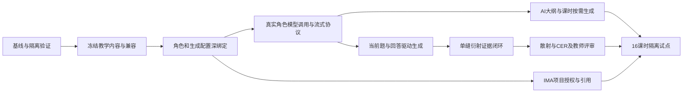

# 实时生成 PBL 最新实施计划

> 更新：2026-10-19。参考 HEAD `8e8f9b4`，工作区含用户并行修改；不是已验收发布快照。
> 状态：待实施和 Issue 评审。真实 AI 大纲、课时与回答驱动生成是必需项，不再作为可选增强。
> 依据：[总架构](./architecture.md) · [课时/团队/IMA 细则](./theme-session-team-ima-design.md) · [差距审计](./gap-audit-20261019.md)。
> 关联现有 #54(PBL)、#49(知识)、#53(Runtime)、#52(E2E)、#57(Admin)，见 docs/issues/README.md。本轮不创建远程 Issue、不改业务源码。

## 1. 先区分完成部分和剩余任务

| 能力 | 本轮计划中的状态 | 处理方式 |
| --- | --- | --- |
| 模板/团队版本、绑定治理、项目快照 | 已有基础 | 扩展与回归，不重建同名表 |
| confirmIntent 缺绑定拒绝立项 | 已由 da18a9d 实现 | 不再列为待修复的 warning-only 成功路径；补隔离 DB 和并发验收 |
| 冻结团队恢复与空闲导师 ready | da18a9d、8e8f9b4 已补 | 回归禁用、真实执行和配置缺失，不伪造 running |
| 光学 8/16 节、pending/answer/mastery/gates | 已有基础 | 统一冻结内容，打通当前任务与 Tutor |
| SSE、Board/公式/实验卡、Runtime | 已有基础 | 验证真实角色执行、真实流和证据写入 |
| 三层真实生成、完整生成配置绑定 | 待接通与验收 | 本计划新增 G3A/G3B，不能用规则回复代替 |
| 项目级 IMA、实验动作证据与 CER | 闭环尚未验收 | 保留 K3/E5/S6，不把现有原型字段当完成 |

此前 28 项冻结/导师相关定向测试通过，只证明当次编译产物与测试范围。旧基线全量失败与网站结果不能直接当作当前工作区结果，详见验证记录。

## 2. 依赖和交付顺序



K3 可与生成链路开发并行。未完成项目授权前，只用审核本地材料，不开放 IMA；任何 IMA 专项验收必须等待 K3。G3B 与 Q4 可在同一稳定生成合同上推进，最终发布两者都必须完成。

## 3. 工作项与验收

### B0：固定可复现基线

Owner：工程验证；关联 #52。

- 记录 HEAD、目标文件 hash、用户变更与实际依赖解析位置。实现前与并行修改方划分文件，不覆盖其 Runtime/renderer/知识探测改动。
- 在干净本地 checkout 冻结安装，按 API 实际依赖图构建。UNC 安装副本问题单独归因，不用假类型声明掩盖。
- 建立隔离模板、团队、学生、教师及知识 fixture。集成测试与实际模型冒烟分开，不接共享未成年人数据或解密探测密钥。
- 复验冻结确认、导师恢复和当前工作区相关回归。旧 mermaid、知识链接及 Model Gateway 失败重新分类，不能直接宣称仍然失败或已经解决。

验收：形成当前基线报告，受影响检查可复现；未验证项与发布阻断项明确。后续每个 PR 先运行自身测试，再扩大回归。

### C1：统一冻结教学内容

Owner：contracts、templates、learning-plan；关联 #54。

- 以 ProjectTemplateSpec 为治理 envelope，显式合并或投影 Theme/Session。保留 v1 读取兼容，不维护独立 curriculum 真源。
- 生成器读取真实模板版本 content/hash，不给全局常量结果贴版本 ID。16 课时创建新版本和 bootstrap identity，旧 optics-physical-inquiry:v1 不改义。
- 排期 profile、实际课时标题、目标 DAG、门禁、量规和注册实验引用稳定持久化或投影。索引、时长、目标、闭集和近似域有 validator。
- 接通现有 PlanOutlineStore 的生产存储和事务边界，不新建计划库；已有计划可安全读取。

验收：改代码常量不改变旧项目；8/16 节与旧排期 fixture 兼容；复习目标可重复；时长/标题正确；第 8 节不自动过门。

### B2：将团队绑定扩展为可执行生成配置

Owner：Template Binding、Team Runtime、Admin；关联 #54/#53/#57。

- 保存真实成员 roleMap、用途到导师的路由、生成配置版本、技能/Schema/策略版本及 IMA grant，并纳入 hash/快照。
- 激活校验成员、用途覆盖、模型策略、canonical skill ID、工具与库范围。缺失拒绝，不正则匹配、不默认授予两库。
- 服务端解析实际 frozen session/task。展示 author、角色提示词、Runtime 和知识授权使用同一解析结果，拒绝非法索引和缺映射。
- 保留已完成的 fail-closed 确认；补大纲草稿与绑定一致性、两确认入口集成验收及历史无快照显式迁移，不重新实现一套确认状态机。
- Admin 在现有设置页面完成配置、验证、激活、回读和部分失败提示，不新增学生导航。

验收：同一请求可追溯到真实成员与生成配置；后台更名/改绑不改变旧项目；禁用立即生效；项目/计划关系/快照无半提交；真实 tplv ID 不依赖名称猜测。

### G3A：接通真实模型执行与实时输出

Owner：ai-tutor、Team Runtime、Model Runtime、学生 Tutor；关联 #53/#54。

- 在现有 ai-tutor 内形成生成能力，直接消费 B2 的授权执行上下文，调用现有 Runtime/Gateway，不创建第二引擎。
- 按导师使用实际 prompt/skills/model policy，保留 provider/model pair、预算、取消和结构化输出约束。禁止只换头像仍隐式调用通用配置。
- 复用 Tutor SSE，兼容增加 purpose、generation ID 和恢复游标；安全文本片段先流式预览，完整合法块接受后激活。
- 保存生成尝试与已提交检查点，区分失败、取消、完成和过期。已有 seq/frameSeq 做显式适配，不能假装已有持久恢复。
- 处理同键重放、同任务并发、断线、模型失败及撤权。只读审核回退必须标记来源，不能冒充生成成功。

验收：协议单测用受控 transport；隔离实际模型冒烟另外证明真实上游增量。展示身份、prompt 配置和模型调用关联一致；半截 JSON 不可操作；重试不重复触发学习写入；日志不含秘密或原始学生对话。

### G3B：AI 大纲生成与课时按需展开

Owner：learning-plan、ai-tutor、Projects；关联 #54。

- 未立项时在 exploration/plan draft 调主导导师，生成个性化大纲候选。AI 生成任务情境、活动和支架，服务端控制核心目标、DAG、时长、交付物和门禁。
- 校验并持久化候选，预览带绑定/模板 hash 与 draft revision。失败不自动创建项目。
- 学生确认时复验并冻结同一版本，变化则冲突重预览；确认后不可覆盖原大纲。
- 进入真实课时才由责任导师生成 SessionTeachingPlan，读取既有证据和 pending；刷新返回既有内容，显式重新生成创建新候选。

验收：不同兴趣/基础输入得到合理不同活动，不只是改标题；核心目标和门禁不变；未确认无正式项目；生成超时可恢复；更换绑定不能确认旧草稿；重复确认和课时加载不重复生成。

### Q4：当前题与回答驱动生成

Owner：Tutor、Learning Plan、Mastery、学生项目适配器；关联 #54。

- 后端提供当前 session/task/objective/pending，项目页不遍历全部理论课时或靠本地缓存授权；stage index 不当 session index。
- 显式作答走唯一 answer owner；求助、澄清与预测不自动判错，不覆盖原题。option/action 使用稳定实例 ID 和 revision。
- 策略根据真实证据确定允许追问、分层提示、例子、检查或同目标补救，再由责任导师实时生成具体内容。
- 新题答案服务端隔离，使用可验证审核题型；无法验证题只作候选。opening turn 基于真实当前课时，不能重开或覆盖 pending。
- 任务完成不再误用整个项目 advance；跨请求作品/证据写入有幂等恢复。宏观补救引用证据和 planRevision，普通对话不重写全计划。

验收：至少两类不同回答产生内容与教学动作均合理不同的下一轮；刷新仍是同一待答题；同答案一次计分；求助不判错；并发和过期动作不覆盖新状态；失败保留已成立证据。

### K3：项目级 IMA 授权与引用

Owner：Knowledge Center、ImaSettings、ImaMcpClient、IMA bridge；关联 #49。

- 冻结 grant 与当前全局、助手/工具、对象权限取交集。撤权立即阻断，新增库不扩大旧项目。
- 四工具均校验，含列库结果、搜索/列文档参数和 document_ref 的 KB/project provenance，不能只检查签名格式。
- 调用预算和返回内容有界，检索内容当不可信材料。保存真实引用元数据，不虚构页码，不复制全文到成长/家长。
- 无授权、无命中、服务不可用和过期引用分别处理。缺依据明确未核验，受控重新检索，不以模型猜测替代教材。

验收：跨 KB/项目、列结果泄漏、伪造/重放文档引用、撤权/重启/过期、提示注入、答案隔离和断线恢复全部覆盖。实际 IMA 成功与“配置存在”分开记录。

### E5：一个可重放的单缝衍射任务

Owner：Learning Plan actions/evidence、注册实验模型、Tutor/UI；关联 #54/#52。

- 从冻结内容和真实课时签发实验权限，不匹配标题或版本前缀。模型版本、参数、单位和远场/小角适用域服务端验证。
- 扩展现有 session 动作合同，跑通预测、单变量操作、run、模拟读数、解释与质疑；滑块预览不逐帧落学习事实。
- 保存原始预测、参数、观测、来源和 modelVersion。AI 根据这些数据生成追问，不修改学生预测或读数凑结论。
- 收到证据 owner 回执后才显示已保存，摘要不直接作为证据；run 不记掌握、不自动完成任务。

验收：通过正常领域流程成立的 TheoryMastered 后可操作；未过门禁、跨项目、NaN、越界、过期 spec/revision 被拒；重复 action 一份事件；刷新可恢复；不同预测触发不同真实生成；不靠手工造 mastery 完成冒烟。

### S6：散射、CER 和教师评审

Owner：实验、Works/Feedback、Teacher 投影、学生端；关联 #54/#49。

- 封闭细雾室先做定性对照。定量关系仅用于批准 Rayleigh 域；非 Rayleigh 不一律标白色 Mie，单色弹性散射不变白。
- CER 引用真实 observation IDs、图表、误差、材料来源和作品版本。AI 生成证据缺口及答辩问题，不代写最终可抄报告。
- Agent rubric 反馈只是候选，正式通过由既有 owner/教师命令处理。教师只看到有 assignment 的学生最小必要摘要。
- 同目标可选补救与教师介入可解释、可追溯、可拒绝。不删必做目标、不自动跳阶段；reflection 无正式合同则明确未支持。

验收：从一条报告论证能追溯到观测和量规；模拟/实测不混淆；教师越权拒绝；重复提交与部分失败可恢复；宏观 revision 不覆盖历史。

### R7：完整 16 课时隔离试点

Owner：教研、四端、工程验证与隐私/安全审核；关联 #52/#54/#57。

先单个隔离学生和有 assignment 的教师走完整周期，再扩大试点。16 节为 8 周每周两节，8 节兼容冒烟不替代完整验收。第 8/14/16 节均不是自动过门事件。

验收同时覆盖 AI 大纲、按需课时、回答驱动生成、IMA、实验观测、CER、教师评审、断网/重试和移动体验。记录实际生成来源、延迟、失败恢复、证据完整性及提示/独立作答，样本不足不宣称学习增益。

## 4. 下一批可执行 PR

| PR | 内容 | 独立验收结果 |
| --- | --- | --- |
| 1 | B0 + C1 的最小冻结内容 fixture 与合同测试 | 不改旧 v1；生成器不依赖可变全局内容 |
| 2 | B2 的角色、生成配置和 hash/快照接线 | 一个真实项目解析到正确导师及获批配置 |
| 3 | G3A 的真实调用、受控输出及失败协议 | 一次隔离实际模型流可追溯，重复请求不多写 |
| 4 | Q4 当前题和动态追问，先接一组光学任务 | 学生不同回答获得不同真实生成，刷新不换题 |
| 5 | E5 单缝观测闭环和物理正确性 | 预测、动作、观测、追问可重放 |
| 6 | G3B 大纲/课时生成，K3 授权专项各自交付 | 确认草稿版本一致；IMA 真实调用有项目范围 |
| 7 | S6 + R7 | 散射/CER/教师评审到全周期试点 |

这是依赖顺序，不是未经估算的工期承诺。G3B 和 K3 可在合同稳定后提前推进，但不与其他 PR 同时改同一个文件。每个 PR 写明影响范围、权限/数据风险、测试和回滚方式。

## 5. 错误、验证和发布门槛

现有确认缺绑定错误为 `503 PROJECT_TEAM_BINDING_UNAVAILABLE`，先保留兼容；不要把文档建议的 409 当现有事实。若统一错误语义，单独做合同迁移。拟新增生成不可用、输出无效、草稿过期、动作过期和 revision 冲突的稳定错误，先入 contracts/tests 再供 UI 使用。

```bash
pnpm -r --workspace-concurrency=1 --filter '@qitu/api^...' build
pnpm --filter @qitu/api typecheck
pnpm --filter @qitu/api test
pnpm --filter @qitu/ai-client test
pnpm --filter @qitu/student-center typecheck
pnpm --filter @qitu/admin-console typecheck
pnpm check:basepath
```

先验证工作项单测、契约、权限和事务，再用隔离 DB/worker 和受控实际模型/IMA 冒烟。Mock、ready、配置读回、源代码存在分别证明不同事实，不能相互代替。

发布要求相关回归通过，已知全量失败均有当前基线归因与处置，无已知门禁旁路、越权、重复计分或不可恢复证据丢失。移动、键盘、离线及 loading/empty/error/permission 状态验收通过，部署 commit、资源与 schema 对齐。

用新模板版本、绑定和 feature flag 渐进开放。回滚关闭新生成或新立项，不改旧快照、不删观测、不回滚已成立学习事实；已有项目保留安全继续或只读恢复路径。不开放任意 HTML/JS、浏览器工具或危险激光指令。
