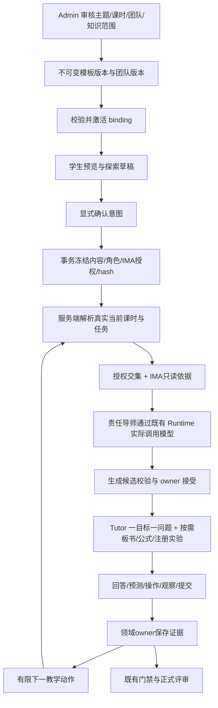

# Theme-Session-Team-IMA 一体化架构

> 状态：方案，待 Issue/架构评审；不表示已实现。
> 2026-10-19 方案同步至参考 HEAD `8e8f9b4`；旧源码测试仍按原基线记录。
> 生成路由、真实模型执行和 SSE 以 [总架构](./architecture.md) 为准；本文细化同一方案，不定义第二份运行合同。

## 1. 接纳新思路，复用原 owner

Theme 定义驱动问题、目标 DAG、产物/量规/安全；Session 是教学原子，周仅是排期容器；Deep Binding 定义 AI 团队责任和知识权限；IMA 提供来源，不替学生作答，不拥有掌握/阶段/作品/成长写权。

OpenMAIC 的结构化规划/任务锚点、DeepTutor 的题卡/pending 循环迁入现有 Projects、Learning Plan、Mastery、Tutor、Team Runtime、Works，不复制第二后台或数据库。

真实 AI 生成是必需能力。模板提供教学约束，绑定团队实际生成大纲、课时教学和逐轮内容；确定性代码验证目标、时长、工具与证据，不用常量话术代替生成。



## 2. 单一版本合同

curriculum.ts 已跟踪/导出并可构建，但不等于它已成为 bootstrap/API 唯一真源。推荐把 v2 纳入 ProjectTemplateSpec 治理 envelope，保留显式 v1 兼容读取：

```text
ProjectTemplateSpec(versioned)
  theme + objective DAG + gates + deliverables + rubric refs
  curriculum(scheduleProfiles + TemplateSessionSpec[])
  registered interactive spec refs

PblTemplateTeamBinding(bindingSpecVersion)
  templateVersionId + templateContentHash
  teamVersionId + teamSpecHash
  roleMap + roleMapHash
  generationRoutes + immutable generationProfile refs/hashes
  imaGrant + imaGrantHash
  policyVersion + bindingHash

ProjectBindingSnapshot
  immutable refs + role/generation/grant projection + hashes + boundAt
```

当前 pbl-learning、curriculum、ai-client 内容和 server modules 的兼容投影需自动比对；生成器读取该版本保存的内容，不只贴版本 ID。16 节创建新版本/bootstrap identity，不原地改 v1。若新版本支持两种排期，冻结审核 profile，不按 weeks 临时换语义。

校验：sessionIndex 连续唯一正整数；内部旧表 0-based 只在一处适配；总课时/分钟自洽；五块时长为非负整数且合计正确；目标存在/DAG 无环；重复复习合法；阶段/门禁/工具/动作使用注册闭集，不用 `| string` 逃逸。interactiveSpec 只引用注册版本，模型不得提供 HTML/JS/URL/参数权限。

## 3. 深绑定与确认事务

一个 template version 同时最多一个 active binding；历史可保留多个 retired。反向团队版本能否复用于多模板由产品确认，不能从“每模板一团队”自行推出双向一对一。

激活检查 Leader 和四角色均为真实成员、助手/技能/模型配置获批、phase/session 覆盖、路由与 IMA server/tool/KB 合法；缺角色拒绝，不靠 ID 正则和默认助手填空。模型凭据/路由仍属于 Admin Runtime，模板只引用版本，不另存密钥/供应商 URL。

生成用途包含 outline、session、dialogue、experiment 和 review。按用途选择固定成员或实际课时 owner，并解析该成员的不可变生成配置。配置含真实提示词内容/hash、canonical skill 及版本、Schema、模型策略和预算，不能只冻结助手名称。

两个确认入口共用事务：校验学生草稿/显式确认 → 锁定或版本检查 active binding → 核验内容/排期/角色/授权/hash → 创建项目/计划关系/快照/确认大纲 revision → 审计或可靠 outbox → 提交。任一步失败回滚，同幂等键回放同一结果。通用项目也走明确受治理路径。

当前 confirmIntent 的缺绑定拒绝已完成，接下来补完整生成绑定和集成验收。大纲在正式确认前由真实 AI 生成并作为草稿保存；确认时重新核验该草稿的模板/绑定 hash 与 revision，不重新取一份 active 绑定接到旧大纲上。

历史缺快照项目走来源可追溯的迁移候选/确认，不能在读时按当前 active 绑定静默授予。课时 1–2 可由已有 exploration/plan draft 承载，确认后关联探索证据；不得因第 1 节开始而自动立项。8/14/16 节为检查点，不按时间自动通过。

## 4. 课时角色解析

```text
actor/project 对象权限
 -> frozen snapshot + hash
 -> frozen content + scheduleProfile
 -> 当前 session/task/objective/pending question
 -> roleMap 中真实成员与获批 Runtime
 -> generation purpose + 该成员的生成配置版本
 -> 实时门禁/撤权
 -> 有限 action / TutorReplyBlock
```

禁止客户端按 teamName/title、版本 ID 前缀、裸 modelId、缓存 session 自行路由。全局 1–16 阶段范围只能是具体教案辅助，不是所有模板的策略；非法索引或缺映射直接拒绝。展示中的助手身份必须与真实模型/知识授权使用同一个服务端解析结果。

## 5. IMA 项目授权交集

复用已有知识中心 allow-list、MCP 只读限制和桥级签名引用；补冻结项目 scope 到每次调用。

```text
effectiveGrant = frozen project grant
               intersect current Admin global grants
               intersect current assistant/tool grants
               intersect actor/project permissions
```

- 快照是授权上限；撤权立即阻断，新增库不自动扩大旧项目。
- 四工具全覆盖：列库过滤，搜索/列文档验证或注入 KB；读文档核验签名引用到 KB/project 的服务端 provenance，不能只检查 token 格式。
- opaque document_ref 不天然是本项目 capability；服务端映射有期限，过期/重启后重新检索，不信任模型/浏览器声明。
- /opt/qitu-ima 为部署细节，URL/凭据仅服务端；调用次数、耗时、响应和引用数量有界。
- 保存实际可得的 KB/document/version/section/page 与摘录 hash，不虚构页码，不复制教材全文到成长/家长投影。
- 检索内容是不可信证据，不是指令，不能改角色、工具、门禁或答案披露；活动题答案/最终可抄报告结论需隔离。
- 只读不等于教材版权许可；摘录/留存范围需学校与平台审核，不在本文作法律结论。
- 不可用则显示 knowledge_unverified，使用已审核本地材料或教师核实，不把模型猜测标成教材事实。

## 6. 回答驱动双循环

微循环选下一教学动作，宏观循环仅产生带 evidence/revision 的同目标可选补救或教师支持候选；不另建 mastery/pending store。

微循环不是只挑固定话术。策略确定允许动作，责任导师读取学生当前回答和已提交证据，实时生成具体追问、提示或图解。planRevision 与 interactionRevision 分开，普通对话不重写整份 16 节计划。

| 可观察信号 | 下一动作 | 禁止捷径 |
| --- | --- | --- |
| 有待答题但学生先求助 | 保留题，给符合 hint level 的支架 | 求助自动判错/覆盖原题 |
| 控制变量不清 | 追问只改变哪个量 | 关键词正确就记掌握 |
| 预测缝越窄亮纹越窄 | 保存预测，做单变量对照并要求读数 | 直接写最终 CER |
| 解释与数据冲突 | 指向 observation，给比较/反例 | 修改预测或读数凑结论 |
| 散射参数超出模型域 | 提示边界，定性/教师支持 | 域外套 lambda^-4 或一律白色 Mie |
| 多次独立证据重复卡点 | owner 提补救候选，按 revision 确认 | 删必做目标/自动过门/贴情绪标签 |
| 提交报告/答辩 | 绑定作品版本/rubric 的候选反馈 | Agent 批准作品/写成长分 |

策略先授权/快照/门禁，再识别作答与求助，再选一个目标的一步动作。预测/CER 不天然是唯一答案测验。DeepTutor 已答卡披露答案的做法不直接照搬，继续执行启途 hint 策略；必要物理事实可按教学规则引用，不借检索代写最终作业。

## 7. 16 课时教案

8 周 × 2 节 × 60 分钟；复用 12 核心目标，散射/衍射为非门禁实践活动。

| 节 | 教学任务 | 责任角色 | 证据/检查点 |
| --- | --- | --- | --- |
| 1 | 观察折光、光束可见性、条纹 | Lead | 现象记录；无实践工具 |
| 2 | 聚焦驱动问题与产物 | Lead | 显式确认；此前草稿 |
| 3 | 反射与法线 | Concept Coach | 概念题尝试/解释 |
| 4 | 镜像与模型边界 | Concept Coach | 作图/反例，重复反射目标 |
| 5 | 折射/介质光速/波前 | Concept Coach + IMA | 引用与启发式问答 |
| 6 | 全反射条件 | Concept Coach | 临界条件诊断 |
| 7 | 透镜实像/虚像 | Concept Coach | 光路与概念检查 |
| 8 | 综合诊断 | Concept Coach | owner 判 TheoryMastered；未过继续补救 |
| 9 | 校准与变量控制 | Lab Guide | 门禁后实验 action/单位检查 |
| 10 | 单缝预测与测量 | Lab Guide | prediction/参数/observations/modelVersion |
| 11 | 封闭细雾室散射对照 | Lab Guide | 观察角/粒径/波长/适用域 |
| 12 | 图表拟合/误差 | Lab Guide | 多次读数/趋势/局限 |
| 13 | CER 草稿与质疑 | Lab Guide | 引用具体证据，不代写结论 |
| 14 | 报告修订提交 | Lab + Works owner | 作品/证据/量规，不自动批准 |
| 15 | 评审答辩 | Review Assessor | 候选反馈与教师决策 |
| 16 | 反思归档 | Review + Growth owner | 基于事实，不从聊天臆测雷达分 |

五段式 practice 在理论门禁前仅为纸笔/现象材料/概念练习，不因 block 名称而开放实践工具。

## 8. 最小动作协议（建议，尚未实现）

扩展现有 session 合同，建议 `POST /learning-plans/:planId/sessions/:sessionId/actions`，不新建 pbl-dynamic API。

```ts
type OpticsActionInput = {
  actionId: string; // 服务端签发的具体实例，不是 'run' 字符串
  actionKind: 'predict' | 'set_parameter' | 'run' | 'record_observation' | 'submit_cer';
  experimentId: string;
  specVersion: string;
  baseRevision: number;
  payload: unknown; // 按 actionKind 的闭集 schema 在系统边界验证
};
```

幂等键走 header；project/session/objective/actor/团队/grant 从服务器签发 scope 解析。拒绝跨项目、过期动作、非有限/越界参数和不相容模型。accepted action 追加事件，保存 revision、参数/单位、modelVersion、模拟/真实标记、预测/观察和证据引用；响应返回 owner eventId/revision/nextAction。run 不等于完成，SSE 重放不重复计分。

## 9. 验收

先一个可重放衍射任务，再散射/CER/16 节。覆盖冻结回滚、真实 tplv ID、角色覆盖、非法索引、跨 KB/document、撤权、pending 恢复、动作幂等、CER 引用、门禁、断网和移动端。配置缺失不得默默改绑或 demo 成功。工作项见实施计划。

真实生成另需受控实际模型请求记录，证明显示的导师与执行的提示词、技能、provider/model 相同来源。安全文本可以流式预览，完整互动块必须先校验、持久化和签发权限。模型接口存在、ready 状态和动画都不能替代此验收。
