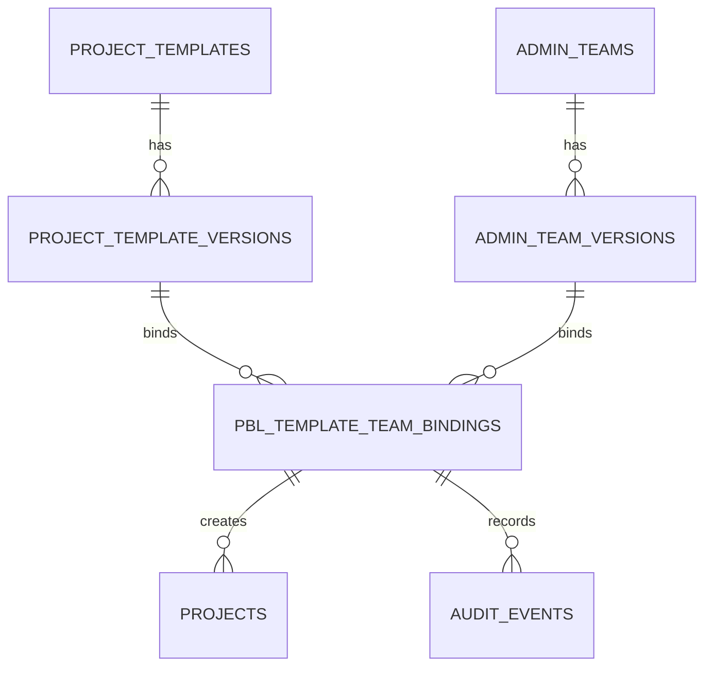
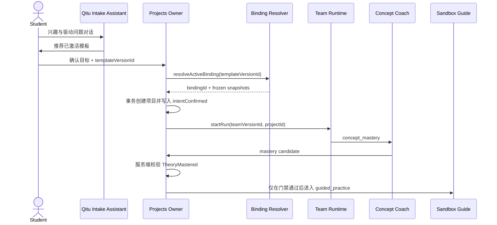

# 启途智学 PBL 参考实现与对话历史体验开发规范

> **版本**：v1.0.0  
> **状态**：可实施设计（本文件是实现合同，不是历史 ADR）  
> **生效基线**：2026-10-17  
> **责任域**：`projects` / `ai-tutor` / `team-runtime` / `admin-registry` / `student-center`  
> **上级规则**：[`../../AGENTS.md`](../../AGENTS.md) · [`../README.md`](../README.md)

本文把 PBL 教学方法、模板与团队治理、对话公式渲染和复制体验收敛为一份可直接拆分 Issue 的开发文档。它补充而不替代 [`pbl-template-team-binding-architecture.md`](./pbl-template-team-binding-architecture.md)：旧文档描述当前四阶段和门禁，本文件定义可发布的版本绑定、API、迁移和前端验收标准。

## 1. 决策摘要

### 1.1 采用的 PBL 方案

启途智学采用 **Gold Standard PBL + 启途四阶段服务端门禁**：

| Gold Standard PBL 要素 | 启途实现 | 责任方 | 验收证据 |
| --- | --- | --- | --- |
| Challenging Problem or Question | `exploration` 中的驱动问题和意图确认 | `qitu-intake-assistant` + 学生 | 已确认的目标、兴趣和驱动问题 |
| Sustained Inquiry | `concept_mastery` 的连续追问、证据提交和理论检查 | 概念教练 | 理论检查记录、`TheoryMastered` |
| Authenticity | `guided_practice` 中的真实数据、代码或实验约束 | 沙箱向导 + Team Runtime | 可复现运行日志、实验或作品 |
| Student Voice & Choice | 推荐课题可选，学生决定问题表述、方案和产物形式 | 学生 | 选择记录和版本差异 |
| Reflection | `deliverable_review` 的答辩、反思和成长归档 | 评审导师 + 教师 | 反思文本、评价量规和反馈 |
| Critique & Revision | 形成性反馈后允许产物版本迭代 | 导师团队 | `artifact_version`、反馈引用和修订记录 |
| Public Product | 经过脱敏和授权后生成作品展示或班级分享 | 项目服务 + 权限域 | 公开投影授权记录 |

**硬性顺序**：`exploration` → `concept_mastery` → `guided_practice` → `deliverable_review`。学生未确认意图不得创建正式项目；未通过 `TheoryMastered` 不得进入实践；客户端不能写入阶段、门禁、AI 决策或成长档案。

### 1.2 “团队 ↔ 模板”一一绑定的定义

“一一绑定”不是数据库中永久只能出现一对记录，而是 **同一时刻的有效版本唯一**：

1. 一个 `published` 模板版本最多有一个 `active` 团队版本。
2. 一个 `active` 团队版本最多服务一个 `active` 模板版本。
3. 历史绑定允许 `retired`，用于已开始项目、审计和回放；不能重新激活旧绑定，需复制为新草稿。
4. 一个绑定可以产生多个项目；项目创建时冻结模板版本、团队版本和绑定快照。
5. 学生只选择课题/模板，不直接选择团队；服务端从唯一有效绑定解析团队。

这样可以在管理端用一个绑定对象控制“教学脚手架、Agent 拓扑、工具白名单和门禁”，同时保证进行中的项目不受后续配置编辑影响。

### 1.3 对话体验决定

- 历史持久化 **纯文本 Markdown + TeX 源**，不持久化 HTML。
- 公式由 KaTeX 以 `output: 'htmlAndMathml'` 渲染，`trust: false`、`throwOnError: false`；非法公式显示可读的源文本，不阻塞整条历史。
- `ChatBubble` 为每个可见对话气泡提供复制按钮；公式复制为 TeX 源，便于粘贴到 Markdown、作业或 LaTeX 编辑器。
- 复制是本地 UI 行为，不上传正文、不记录未成年人对话内容，不改变会话序列号。

## 2. 调研依据与适用边界

### 2.1 结论

PBLWorks 的 Gold Standard PBL 将项目设计拆成七个要素，并强调持续探究、真实性、学生选择、反思、批判修订和公开成果；Learning Policy Institute 的深度学习网络案例也把真实评价、导师制和持续专业学习作为规模化落地条件。对启途而言，最合适的不是另起一个“AI 问答课程”，而是把每个模板变成有目标、证据、量规和阶段门禁的项目运行包，再由团队负责执行。

### 2.2 联网工具说明

本次运行环境没有暴露可调用的 GrokSearch MCP 工具；不能伪造 GrokSearch 调用或结果。已使用可用的联网搜索能力，并优先核对 PBLWorks、Learning Policy Institute、KaTeX、MDN 和 W3C/WCAG 资料。后续若接入 GrokSearch，应把同一检索词和返回时间补录到本节，不改变下述架构结论。

### 2.3 参考资料

- PBLWorks，Gold Standard PBL Essential Project Design Elements：<https://www.pblworks.org/blog/gold-standard-pbl-essential-project-design-elements>
- PBLWorks，Gold Standard PBL 参考材料：<https://www.gvsu.edu/cms4/asset/8FD27608-AF95-77B5-29623F385B8819C8/gold_standard_pbl_essential_v2019.pdf>
- Learning Policy Institute，Deeper Learning Networks：<https://learningpolicyinstitute.org/press-release/three-school-networks-deeper-learning-approaches-student-centered-learning-equity>
- KaTeX options（`output`、`throwOnError`、`trust`）：<https://katex.org/docs/options>
- MDN Clipboard API：<https://developer.mozilla.org/en-US/docs/Web/API/Clipboard>
- MDN `Clipboard.writeText()`：<https://developer.mozilla.org/en-US/docs/Web/API/Clipboard/writeText>
- WCAG 2.2 Target Size / Focus Visible 参考：<https://www.w3.org/TR/WCAG22/>

## 3. 当前代码基线与缺口

### 3.1 已有能力

- `packages/contracts/src/pbl-learning.ts` 已有 `ProjectTemplateSpec`、四阶段、目标、交付物、量规和 `teamId`。
- `packages/database/src/schema/project-templates.ts` 已有不可变的 `project_template_versions`；项目应引用版本而不是可变模板主表。
- `packages/database/src/schema/admin-ai-config.ts` 已有 `admin_teams`、`admin_team_members` 和服务端规范化的 `pbl_spec`。
- `packages/ai-client/src/pbl-team.ts`、`services/api` 的 Team Runtime 已实现 leader、mailbox、任务、事件和门禁协同的基础能力。
- `apps/student-center/features/tutor/components/MarkdownMathView.tsx` 已支持 `$...$` 和 `$$...$$`，`ChatBubble.tsx` 已统一承载气泡级操作区。

### 3.2 必须补齐的缺口

1. `ProjectTemplateSpec.teamId` 只是配置字段，不能表达模板版本与团队版本的一一约束；需要独立绑定实体和数据库唯一索引。
2. `admin_teams.pbl_spec` 会被更新，缺少不可变团队版本快照；项目不能依赖当前团队行回放历史。
3. 当前公式渲染使用 `trust: true`，不符合不信任输入原则；需要改为 `trust: false` 并限制公式长度和命令集合。
4. 普通 `ChatBubble` 尚无复制按钮和统一的可复制文本序列化器；不能从 DOM 反解析 KaTeX HTML。
5. 管理端需要绑定验证、激活、退休和依赖查看 API；学生端只消费 `active` 绑定产生的推荐。

迁移期间 `ProjectTemplateSpec.teamId` 仅作为兼容读取字段保留，服务端不得接受客户端对它的写入；新代码通过 `active` 绑定派生团队，完成回填后再删除该字段。

## 4. 目标领域模型

### 4.1 实体关系



### 4.2 团队版本

新增 `admin_team_versions`（或等价的团队版本表），每次发布得到不可变版本：

```ts
interface AdminTeamVersion {
  id: string;
  teamId: string;
  version: string; // semver or monotonic revision, e.g. 1.2.0
  spec: PblTeamWorkflowSpec; // normalized, server-owned snapshot
  status: 'draft' | 'published' | 'archived';
  specHash: string;
  createdBy: string;
  publishedAt: string | null;
  createdAt: string;
}
```

`admin_teams` 保留名称、启用状态和当前指针；项目、绑定和审计只引用 `admin_team_versions.id`。若短期不新增表，第一阶段可把 `team_version`、`team_spec_snapshot` 和 `spec_hash` 放入绑定表，但第二阶段必须迁移为独立版本表。

### 4.3 绑定实体

```ts
interface PblTemplateTeamBinding {
  id: string;
  templateVersionId: string;
  teamVersionId: string;
  status: 'draft' | 'validated' | 'active' | 'retired';
  validation: {
    valid: boolean;
    errors: string[];
    warnings: string[];
    checkedAt: string | null;
    checkedBy: string | null;
  };
  templateSnapshot: Record<string, unknown>;
  teamSnapshot: Record<string, unknown>;
  bindingHash: string;
  activatedAt: string | null;
  retiredAt: string | null;
  createdBy: string;
  createdAt: string;
  updatedAt: string;
}
```

快照只用于审计和一致性校验，运行时优先读取同一不可变版本记录。`bindingHash` 使用规范化 JSON（排序键、去掉运行时状态）计算，排查“界面显示的团队”和“实际执行的团队”不一致。

### 4.4 项目冻结字段

项目创建命令必须在同一事务中写入：

```ts
interface PblProjectBindingSnapshot {
  bindingId: string;
  templateVersionId: string;
  teamVersionId: string;
  bindingHash: string;
  boundAt: string;
}
```

之后管理员退休绑定或发布新版本，不影响已创建项目。项目重试和恢复只能使用冻结字段，不能重新按模板 slug 解析团队。

## 5. 数据库与迁移设计

### 5.1 建议表结构

```sql
create table admin_team_versions (
  id text primary key,
  team_id text not null references admin_teams(id) on delete restrict,
  version text not null,
  spec jsonb not null,
  status text not null check (status in ('draft', 'published', 'archived')),
  spec_hash text not null,
  created_by text references users(id),
  published_at timestamptz,
  created_at timestamptz not null default now(),
  unique (team_id, version)
);

create table pbl_template_team_bindings (
  id text primary key,
  template_version_id text not null references project_template_versions(id) on delete restrict,
  team_version_id text not null references admin_team_versions(id) on delete restrict,
  status text not null check (status in ('draft', 'validated', 'active', 'retired')),
  validation jsonb not null default '{}'::jsonb,
  template_snapshot jsonb not null,
  team_snapshot jsonb not null,
  binding_hash text not null,
  activated_at timestamptz,
  retired_at timestamptz,
  created_by text references users(id),
  created_at timestamptz not null default now(),
  updated_at timestamptz not null default now()
);

create unique index pbl_binding_active_template_uq
  on pbl_template_team_bindings(template_version_id)
  where status = 'active';

create unique index pbl_binding_active_team_uq
  on pbl_template_team_bindings(team_version_id)
  where status = 'active';

create index pbl_binding_status_idx
  on pbl_template_team_bindings(status, updated_at desc);
```

激活必须由事务完成：锁定绑定、再次校验模板和团队版本、检查两个部分唯一索引、写入激活时间和审计事件。数据库唯一索引是最终并发保护，服务端预检查只是为了返回可读错误。

### 5.2 回填策略

1. 为每个当前启用团队从 `admin_teams.pbl_spec` 生成 `admin_team_versions` 的 `1.0.0`，保存规范化哈希。
2. 为每个可推荐模板版本按现有 `teamId` 生成唯一 `draft` 绑定。
3. 运行验证器，修复缺失助手、阶段覆盖和门禁错误。
4. 只将验证通过且模板为 `published`、团队版本为 `published` 的绑定激活。
5. 在项目表回填 `binding_id`、`team_version_id`；无法确定绑定的历史项目保持原字段并标记 `legacy_binding = true`，不得自动猜测团队。

### 5.3 幂等与并发

- 管理写 API 必须接受 `Idempotency-Key`；键作用域为 `actor + route + key`。
- `activate` 重放同一键返回原绑定；不同键并发激活依赖数据库唯一索引并返回 `PBL_BINDING_CONFLICT`。
- 退休操作不能删除版本；删除请求只做软删除/归档，保留审计和项目引用。

## 6. 绑定验证器与治理 API

### 6.1 验证规则

`validateBinding(templateVersionId, teamVersionId)` 必须检查：

1. 模板版本为 `published`，阶段顺序完整且只有四个受支持阶段。
2. 团队版本为 `published` 且所属团队 `enabled = true`。
3. leader 存在、助手均存在且 `enabled/teamSelectable = true`，成员没有重复槽位。
4. 每个阶段有且只有一个主要接管助手；`concept_mastery` 强制存在 `TheoryMastered` 门禁。
5. `guided_practice` 的先决条件引用 `TheoryMastered`；不存在从探索直接进入实践的路径。
6. 工具、MCP 服务和技能全部在服务端白名单；学生数据访问范围不超过项目和学校作用域。
7. 并发限制为正整数，session mode 与 workspace mode 组合合法。
8. 模板的交付物、评价量规和证据可见范围完整；未成年人证据默认最小可见。

错误返回结构：

```json
{
  "code": "PBL_BINDING_VALIDATION_FAILED",
  "message": "binding validation failed",
  "errors": [
    { "path": "teamVersion.spec.members[1].assistantId", "reason": "ASSISTANT_DISABLED" },
    { "path": "templateVersion.phases[2].gateCondition", "reason": "THEORY_GATE_REQUIRED" }
  ],
  "requestId": "req_..."
}
```

### 6.2 管理 API

```http
GET  /api/v1/admin/pbl/bindings?status=active&templateVersionId=...
POST /api/v1/admin/pbl/bindings
POST /api/v1/admin/pbl/bindings/:id/validate
POST /api/v1/admin/pbl/bindings/:id/activate
POST /api/v1/admin/pbl/bindings/:id/retire
GET  /api/v1/admin/pbl/bindings/:id/dependencies
```

创建请求只接受 `templateVersionId`、`teamVersionId` 和幂等键；快照、哈希、验证结果、激活者和时间由服务端产生。管理端必须展示：当前生效版本、依赖项目数、最后验证结果、门禁和工具白名单摘要。

学生侧接口仍保持：

```http
GET  /api/v1/tutor/templates
POST /api/v1/projects/from-intent
```

`GET /tutor/templates` 只返回有 `active` 绑定的已发布模板。`POST /projects/from-intent` 接受学生确认的目标、兴趣和 `templateVersionId`；服务端解析唯一 `active` 绑定，客户端不能提交或覆盖 `teamId`、`teamVersionId`、stage、gate 或 assistant。

### 6.3 权限矩阵

| 操作 | 平台管理员 | 教研管理员 | 教师 | 学生 | 家长 |
| --- | --- | --- | --- | --- | --- |
| 查看绑定摘要 | 是 | 是 | 仅被授权项目 | 否 | 否 |
| 创建/验证草稿 | 是 | 是 | 否 | 否 | 否 |
| 激活/退休绑定 | 是 | 按学校范围 | 否 | 否 | 否 |
| 创建项目 | 代办/测试 | 代办/测试 | 代办/测试 | 仅本人确认意图 | 否 |
| 查看会话正文 | 按对象权限 | 按对象权限 | 被授权学生 | 本人 | 只读脱敏投影 |

所有对象级权限在 API 再校验；前端隐藏按钮不构成授权。

## 7. 运行时流程



Team Runtime 返回的是候选结果和事件，不是最终项目事实。阶段、门禁、成长档案和审计由领域 owner 通过事务写入。

## 8. 对话历史公式实现

### 8.1 数据合同

继续使用 `TutorReplyBlock` 的 `text`、`hint`、`questions` 等结构；文本字段保存 Markdown + TeX 源：

```md
动能定理可写成 $W_{\text{合}}=\Delta E_k$。

$$
W_{\text{合}}=\frac{1}{2}mv_2^2-\frac{1}{2}mv_1^2
$$
```

禁止把 KaTeX HTML、React 节点或浏览器 DOM 写入数据库。历史回放必须能够在没有前端版本升级的情况下重新渲染。

### 8.2 解析规则

1. 先识别并保护 fenced code block（`````），代码块内的 `$` 不当公式。
2. 再识别 `$$...$$` 块公式，最后识别单行 `$...$`。
3. 限制单条文本长度（建议 16 KiB）、单个公式长度（建议 4 KiB）和公式数量（建议 64 个）；超限按纯文本显示并返回可观测警告。
4. 不解析原始 HTML；文本节点使用 React 转义。
5. 公式解析失败不丢弃整条回复，显示 TeX 源并给出“公式格式暂不支持”的轻提示。

### 8.3 KaTeX 安全配置

`MarkdownMathView.tsx` 的渲染器应改为：

```ts
katex.renderToString(latex, {
  displayMode,
  output: 'htmlAndMathml',
  throwOnError: false,
  trust: false,
  strict: 'warn',
  errorColor: '#b42318',
});
```

`trust: true` 必须移除。KaTeX 官方说明中，`trust` 会允许 `\url`、`\href`、`\includegraphics` 等输入能力；未成年人对话历史不应允许模型或用户注入外链、图片或 HTML 属性。若未来确需链接，只能使用服务端白名单和函数式 `trust`，不接受任意 URL。

依赖基线不得低于 KaTeX `0.16.21`（仓库当前锁定 `0.19.0`）；依赖升级和安全公告应进入常规 CI 检查，不能通过打开 `trust` 绕过升级。

### 8.4 无障碍和错误降级

- 使用 `htmlAndMathml`，保留 MathML 语义层；块公式容器允许横向滚动。
- 对无法解析的公式保留源文本和 `title` 错误提示，不能出现空白气泡。
- 公式颜色增强只应用于已识别的物理变量，不改变源文本和复制结果。
- 流式回复中半截公式先按文本展示，收到完整块后再渲染，避免布局抖动。

## 9. 对话气泡复制按钮

### 9.1 交互合同

每个包含可复制内容的 `ChatBubble` 的操作区提供 `复制`：

| 可复制内容 | 序列化方式 |
| --- | --- |
| `text` | 原始 Markdown + TeX |
| `hint` | 提示正文 |
| `questions` | 按编号拼接问题 |
| `options` | 选项文本和标签 |
| `pbl_card` | 标题、阶段、摘要、标签和动作 |
| `artifact` | 标题、摘要、正文（不复制下载 URL） |
| `tool` | 面向学生的 `label/result`，不复制原始参数 |
| `think` | 默认不提供复制，避免暴露内部思考链 |
| `attachment` | 文件名和类型，不复制未授权 URL |

复制按钮适用于学生和助手可见内容；工具参数、系统提示词、模型原始思考、未授权附件 URL 永不进入剪贴板。

### 9.2 文本序列化

新增纯函数 `serializeTutorTurnForClipboard(turn)`，输入为结构化 `TutorTurn`，输出纯文本；它不读取 DOM，也不依赖 KaTeX HTML。示例：

```ts
export function serializeTutorTurnForClipboard(turn: TutorTurn): string {
  return turn.blocks
    .flatMap((block) => serializeBlock(block))
    .filter(Boolean)
    .join('\n\n')
    .trim();
}
```

函数必须有单元测试覆盖公式、代码块、选项、空块、未知块和超长文本。复制公式时保留 `$...$` / `$$...$$`，不要复制渲染后的 `span.katex`。

### 9.3 剪贴板实现与回退

点击必须发生在用户手势中，优先使用 `navigator.clipboard.writeText`；不安全上下文、权限拒绝或浏览器不支持时回退到隐藏 `textarea + document.execCommand('copy')`，两者都失败则显示“复制失败，请手动选择文本”。成功提示只在当前气泡显示 1.5 秒。

```ts
async function copyText(text: string): Promise<boolean> {
  try {
    if (window.isSecureContext && navigator.clipboard?.writeText) {
      await navigator.clipboard.writeText(text);
      return true;
    }
  } catch {
    // Fall through to the legacy path without logging message content.
  }
  return copyWithTemporaryTextarea(text);
}
```

实现要求：

- 按钮有 `aria-label="复制这条消息"`、`aria-live="polite"` 状态提示和可见 focus ring。
- 触控目标至少 24×24 CSS px，建议 32×32；不依赖 hover 才能发现。
- 离线历史仍可复制；复制不触发网络请求、不改变 `lastSeq`、不写 localStorage 正文。
- 不记录复制正文到日志或埋点；若需要统计，只记录匿名的 `copy_success/copy_error` 计数。
- streaming 时禁用或只复制已完成内容，避免把半条公式放入剪贴板。

### 9.4 前端文件落点

- `apps/student-center/features/tutor/components/ChatBubble.tsx`：操作按钮、状态和无障碍属性。
- `apps/student-center/features/tutor/lib/serializeTutorTurnForClipboard.ts`：纯文本序列化器。
- `apps/student-center/features/tutor/components/MarkdownMathView.tsx`：安全 KaTeX 配置、错误降级和公式分段。
- `apps/student-center/styles/tutor.css`：按钮尺寸、focus ring、复制成功状态和窄屏布局。
- `packages/contracts/src/tutor.ts`：仅在确有新字段时扩展合同；不要把复制状态持久化为领域事实。

## 10. API、错误码和审计

### 10.1 错误码

| 错误码 | HTTP | 触发条件 |
| --- | ---: | --- |
| `PBL_BINDING_NOT_FOUND` | 404 | 绑定不存在或不在授权作用域 |
| `PBL_BINDING_VALIDATION_FAILED` | 422 | 模板/团队组合不满足规则 |
| `PBL_BINDING_CONFLICT` | 409 | 同一有效版本已被其他绑定占用 |
| `PBL_BINDING_NOT_ACTIVE` | 409 | 项目创建时绑定已退休 |
| `THEORY_MASTERED_REQUIRED` | 403 | 请求跳过理论掌握门禁 |
| `TUTOR_FORMULA_TOO_LARGE` | 422 | 公式或文本超过限制 |
| `TUTOR_MODALITY_UNAVAILABLE` | 409 | 模型不支持请求通道 |

错误响应不泄露其他学校、学生或项目是否存在；返回 `requestId` 供排查。

### 10.2 审计事件

记录 `pbl.binding.created`、`validated`、`activated`、`retired`、`project.bound`、`gate.blocked`，字段包含 actor、作用域、对象 ID、版本、结果和 requestId。禁止记录原始对话、公式全文、复制正文、模型提示词和未脱敏附件。

## 11. 测试与验收清单

### 11.1 绑定与项目

- [ ] 同一模板版本不能激活两个团队版本。
- [ ] 同一团队版本不能激活两个模板版本。
- [ ] 退休绑定保留，不能直接重新激活；新版本必须复制为草稿。
- [ ] 模板未发布、团队未发布、助手禁用、阶段缺失和门禁错误均返回可读验证错误。
- [ ] 两个并发激活请求只有一个成功；重放相同幂等键返回同一结果。
- [ ] 项目创建事务保存绑定快照；后续模板/团队修改不改变项目运行时。
- [ ] 学生请求伪造 `teamId`、`stage` 或 `theoryMastered` 被拒绝并写审计。

### 11.2 公式与历史

- [ ] 行内、块级、代码块内美元符号、转义美元符号均按规则渲染。
- [ ] 非法 TeX、未知命令和超长公式只降级该公式，不丢整条消息。
- [ ] 输出包含 MathML；`trust: true` 不再出现于生产代码。
- [ ] 刷新、分页、SSE 重放后公式显示一致；数据库只保存源文本。
- [ ] 原始 HTML、`\includegraphics`、任意 `\href` 不执行。

### 11.3 复制与无障碍

- [ ] 助手和学生气泡均可复制；复制内容不含内部思考、原始工具参数或未授权 URL。
- [ ] 公式复制保留 TeX 源；代码块保持换行和缩进。
- [ ] Clipboard API 成功、权限拒绝、HTTP/不支持浏览器和 textarea 回退均有测试。
- [ ] 键盘可聚焦和触控可点击；成功/失败状态可被屏幕阅读器感知。
- [ ] 离线历史可以复制；复制不会产生网络请求或改变会话状态。

### 11.4 页面状态

绑定管理、模板推荐和对话历史都必须覆盖 `loading`、`empty`、`error`、`offline`、`permission-denied`；模型不可用时不能静默改绑其他助手或团队。

## 12. 分阶段实施与回滚

### Phase 0：合同和验证器（1 个迭代）

新增绑定/团队版本合同、错误码、纯函数验证器和测试；不改变学生流量。

### Phase 1：数据库与回填（1 个迭代）

创建表和部分唯一索引，回填草稿绑定，生成哈希，建立审计；以只读 shadow mode 比较旧 `teamId` 与新解析结果。

### Phase 2：管理端治理（1 个迭代）

接入绑定列表、验证、激活、退休和依赖查看；只有激活绑定出现在模板推荐接口。

### Phase 3：项目创建切换（1 个迭代）

`from-intent` 改为服务端解析 active binding，并写入项目冻结快照；开启 `pbl.binding.resolve.v1` feature flag，观察冲突和门禁拒绝率。

### Phase 4：公式安全与复制（1 个迭代）

先切换 KaTeX 安全配置，再上线复制按钮；设置 `copy_ui_enabled` 和 `formula_safe_renderer` 两个独立开关，便于单独回滚。

### 回滚策略

- 绑定解析异常：关闭 feature flag，保留只读新表和审计，不删除已生成的绑定。
- 公式渲染异常：切回纯文本渲染器，不回退到 `trust: true`。
- 复制异常：隐藏复制按钮，历史和项目流程继续可用。
- 任何回滚都不得删除项目冻结快照、团队版本或审计事件。

## 13. Definition of Done

只有以下条件全部满足，才可把本方案标记为完成：

1. 活跃模板版本和团队版本满足双向部分唯一约束，且管理 API 有对象级权限和幂等测试。
2. 项目从意图确认创建，服务端写入不可变绑定快照，`TheoryMastered` 门禁仍由领域 owner 强制执行。
3. 历史对话使用安全 KaTeX 渲染，公式失败可降级，MathML、键盘和窄屏验收通过。
4. 复制按钮覆盖结构化回复，公式复制为源 TeX，不记录正文，Clipboard 回退路径有测试。
5. loading/empty/error/offline/permission-denied 状态、错误码、审计和回滚说明已同步到代码与部署清单。
6. 运行 `pnpm typecheck`、`pnpm test`、`pnpm build` 和 `pnpm check:basepath` 通过；PR 说明影响范围、验证方式和数据/权限风险。

## 14. 相关代码和文档

- [`pbl-template-team-binding-architecture.md`](./pbl-template-team-binding-architecture.md)
- [`../student/tutor.md`](../student/tutor.md)
- [`../../packages/contracts/src/pbl-learning.ts`](../../packages/contracts/src/pbl-learning.ts)
- [`../../packages/contracts/src/tutor.ts`](../../packages/contracts/src/tutor.ts)
- [`../../packages/database/src/schema/project-templates.ts`](../../packages/database/src/schema/project-templates.ts)
- [`../../packages/database/src/schema/admin-ai-config.ts`](../../packages/database/src/schema/admin-ai-config.ts)
- [`../../apps/student-center/features/tutor/components/ChatBubble.tsx`](../../apps/student-center/features/tutor/components/ChatBubble.tsx)
- [`../../apps/student-center/features/tutor/components/MarkdownMathView.tsx`](../../apps/student-center/features/tutor/components/MarkdownMathView.tsx)
