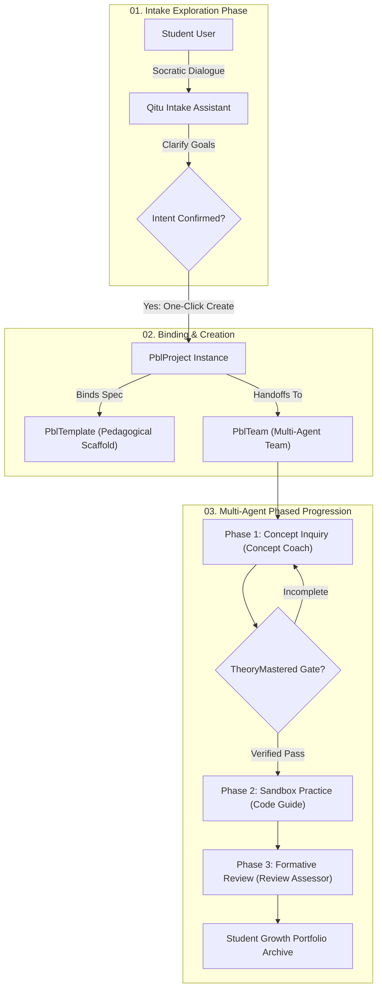
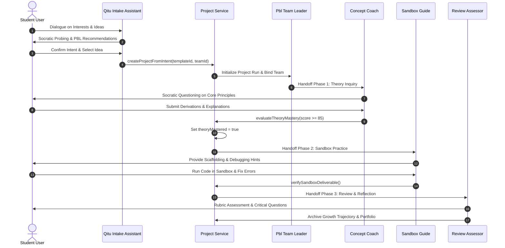

# 启途智学 PBL 项目、模板与团队深度绑定架构规范

> **版本标识**：v1.1.0  
> **生效基线**：2026-10-17 · 启途智学核心教学与多智能体协同引擎  
> **责任领域**：`projects` / `ai-tutor` / `team-runtime` / `admin-registry`  
> **上级基线**：[`../../AGENTS.md`](../../AGENTS.md) · [`../README.md`](../README.md)

---

## 1. 核心设计理念与背景

在传统教学系统或简单问答智能体中，学生与 AI 的交互往往局限于单一上下文的“即问即答”，缺乏系统性项目进展、阶段门禁与角色分工。
启途智学实现**真正的 PBL（Project-Based Learning，项目式学习）**，核心在于将**教学设计（模板 PblTemplate）**与**执行单元（多智能体团队 PblTeamWorkflowSpec）**深度解耦并动态绑定。



---

## 2. 领域模型与绑定契约

### 2.1 教学模板定义 (`PblTemplate`)

`PblTemplate` 是教育专家与教研团队沉淀的数字化探究脚手架，定义课题从开题到结项的教学目标、阶段划分与证据链。

```typescript
export interface PblPhaseSpec {
  id: string;                       // e.g. 'phase-theory-derivation'
  orderIndex: number;               // 0, 1, 2, 3
  name: string;                     // e.g. '动能定理公式推导与验证'
  stagePrompt: string;              // 阶段系统约束与苏格拉底发问策略
  assignedRole: 'leader' | 'coach' | 'teammate' | 'reviewer';
  assignedAssistantId?: string;     // 默认绑定的助手ID
  gateRule: string;                 // 门禁达标准则
  requiresGateApproval: boolean;    // 是否为强硬门禁（如 TheoryMastered）
  requiredDeliverables: string[];   // 需提交产物清单（推导草稿、仿真脚本、实验报告）
}

export interface PblTemplate {
  id: string;                       // e.g. 'template-kinetic-energy'
  title: string;                    // e.g. '动手学动能定理：极速过山车探究'
  summary: string;
  defaultLinkedTeamId: string;      // 默认绑定的团队ID: 'team-kinetic-energy'
  phases: PblPhaseSpec[];           // 阶段阶梯定义
  rubrics: PblRubricItem[];         // 形成性评价量规
  status: 'draft' | 'published';
}
```

### 2.2 团队协同编排 (`PblTeamWorkflowSpec`)

`PblTeamWorkflowSpec` 定义了执行该模板的多智能体协同拓扑结构，确保各角色职责分明。

```typescript
export interface PblTeamMember {
  assistantId: string;              // 助手 ID，如 'fighter-concept-coach'
  role: 'leader' | 'coach' | 'teammate' | 'reviewer';
  roleLabel: string;                // 显示标签，如 '概念教练'
  orderIndex: number;
  assignedPhases: string[];         // 接管的阶段 ID 列表
  toolPermissions: string[];        // 允许调用的 MCP 工具白名单
}

export interface PblTeamWorkflowSpec {
  id: string;                       // e.g. 'team-thunder-fighter-pbl'
  name: string;                     // '雷霆战机游戏设计协同研学团队'
  workspaceMode: 'shared' | 'isolated';
  sessionMode: 'supervised' | 'autonomous';
  leaderAssistantId: string;        // 总负责人助手 ID
  members: PblTeamMember[];         // 团队成员阵列
  concurrencyLimit: number;
}
```

### 2.3 正式项目实例 (`PblProject`) 状态机

当学生确认意图后，服务端原子化创建 `PblProject`，将三者严格绑定：

```typescript
export interface PblProject {
  id: string;                       // 项目唯一 ID: 'proj-123456'
  studentUserId: string;            // 所属学生 ID
  templateId: string;               // 绑定的模板 ID
  teamId: string;                   // 绑定的协同团队 ID
  title: string;                    // 确立的课题名称
  status: 'exploration' | 'theory_inquiry' | 'practice_sandbox' | 'review_reflection' | 'completed';
  currentPhaseId: string;           // 当前激活阶段
  activeAssistantId: string;        // 当前对话接管助手
  gates: {
    intentConfirmed: boolean;       // 意图确认门禁（开题前提）
    theoryMastered: boolean;        // 理论掌握门禁（实践前提）
    sandboxVerified: boolean;       // 沙箱验证门禁（答辩前提）
  };
  masteryScore: number;             // 理论掌握度量化指标 (0-100)
}
```

---

## 3. 跨角色协同生命周期时序



---

## 4. 核心门禁硬性约束与工程保障

根据平台基线与领域硬规则，下列门禁必须在服务端强制拦截：

1. **意图确认门禁 (`IntentConfirmed`)**：
   - 学生未完成探究意图确认时，禁止创建正式项目与写入项目数据库。
   - 必须通过启途智学助手在对话内引导确认并一键立项。
2. **理论掌握硬门禁 (`TheoryMastered`)**：
   - 在学生进入实践编码（如 Python Pygame 沙箱或物理数值拟合）前，必须经由**概念教练**确认其推导掌握度 $\ge 85\%$。
   - 任何试图直接调用实践接口或跳过阶段的客户端请求，后端拦截器均返回 `403 FORBIDDEN (TheoryMastered required)`。
3. **团队接管与会话上下文隔离**：
   - 开题前由“启途智学助手”独立接管；
   - 团队启动后，左侧与右侧边栏清晰呈现团队所有子智能体状态、对话流水与工具调用，杜绝“助手身份混淆”。

---

## 5. 持续演进与验证命令

- **合同定义目录**：`packages/contracts/src/projects.ts` 与 `packages/ai-client/src/pbl-team.ts`
- **管理端配置中心**：`/settings/templates`（模板库）与 `/settings/teams`（团队协同）
- **类型检查与验证命令**：
  ```bash
  pnpm typecheck
  pnpm test
  ```
