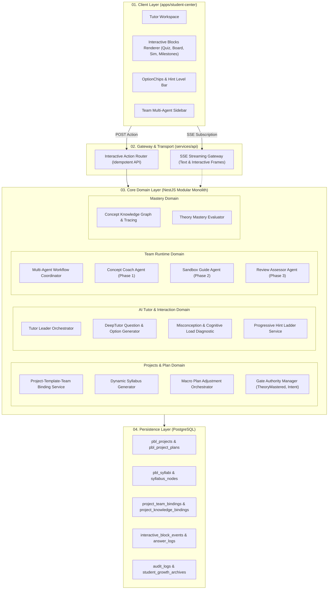
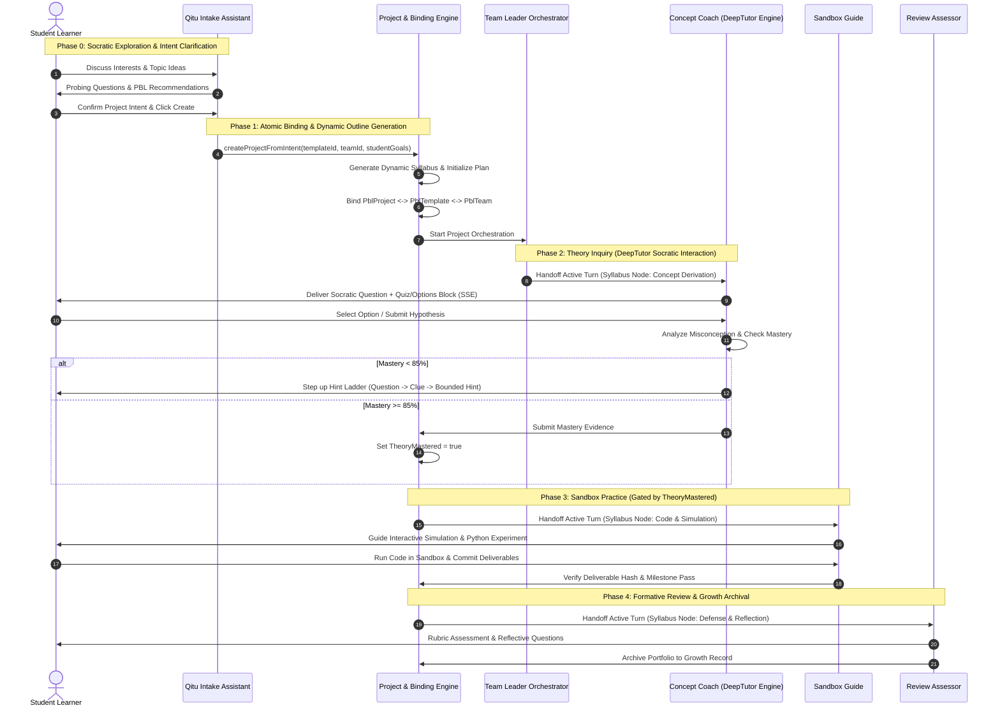
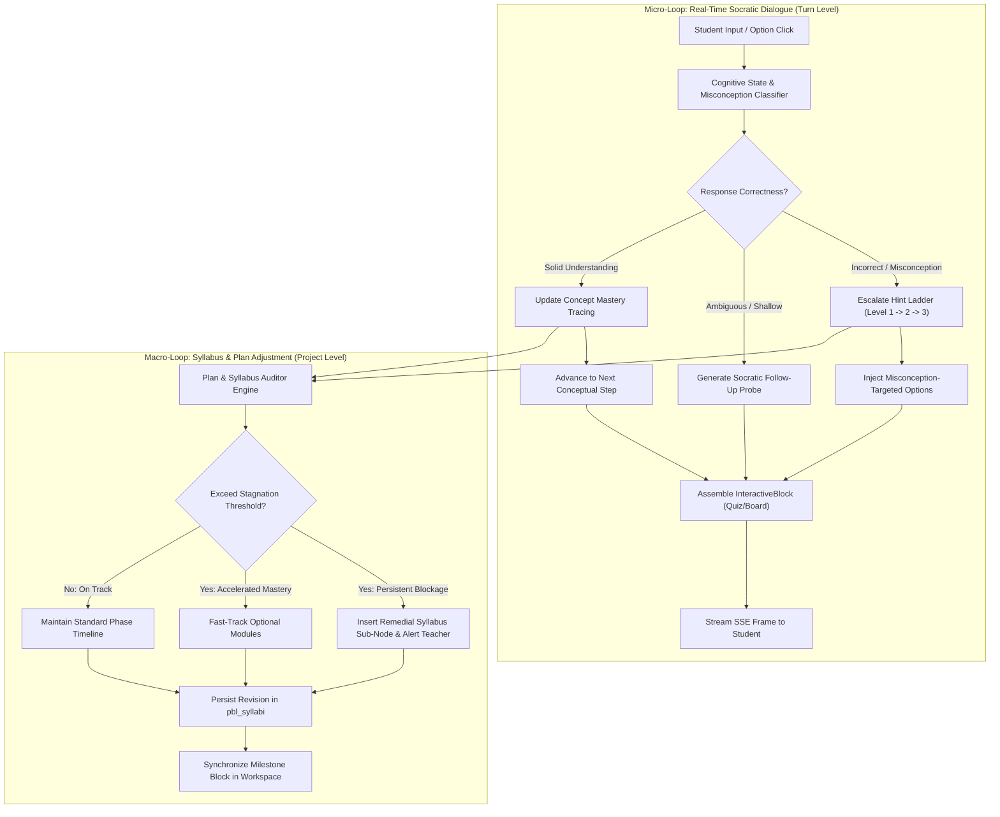

# 启途智学自适应 PBL 与多智能体协同架构设计方案
> HISTORICAL COMPARISON ONLY: use `docs/plan/codex` as the canonical proposal. This document must not define a parallel PBL state, binding, or plan store.


> **文档标识**：`docs/plan/antigravity/architecture-design.md`  
> **版本**：v1.0.0  
> **生效基线**：2026-10-18  
> **上级基线**：[`../../AGENTS.md`](../../AGENTS.md) · [`../design/pbl-template-team-binding-architecture.md`](../design/pbl-template-team-binding-architecture.md) · [`../design/20261018-pbl-dynamic-interaction-openmaic.md`](../design/20261018-pbl-dynamic-interaction-openmaic.md)  
> **责任领域**：`projects` / `ai-tutor` / `team-runtime` / `mastery` / `apps/student-center`  

---

## 1. 架构总览与拓扑结构

本架构方案旨在通过**项目与团队深度绑定**、**动态大纲生成**、**自适应计划编排**以及**跟随学生回答的微观/宏观双循环调谐**，全面落地 OpenMAIC 式多模态交互资产与 DeepTutor 式苏格拉底选项问答机制。



---

## 2. 核心领域契约与数据结构

所有前后端交互与领域存储严格遵循 Monorepo 统一契约（`packages/contracts/src/pbl-dynamic.ts`）。

### 2.1 动态大纲与自适应计划契约 (`PblSyllabus` & `PblProjectPlan`)

项目开题后，系统不仅绑定静态模板（`PblTemplate`），还动态具象化生成该学生的**专属项目大纲与自适应执行计划**：

```typescript
export interface SyllabusNode {
  id: string;                             // e.g. 'node-kinetic-derivation'
  orderIndex: number;
  title: string;                          // 节点名称
  description: string;                    // 探究重点
  learningObjectives: string[];           // 关联知识点编码
  assignedRole: 'leader' | 'coach' | 'guide' | 'reviewer';
  assignedAssistantId: string;            // 接管智能体ID
  status: 'pending' | 'in_progress' | 'mastered' | 'skipped';
  isRemedial: boolean;                    // 是否为动态插入的补救节点
  prerequisiteNodeIds: string[];          // 前置依赖节点
  estimatedMinutes: number;               // 预计耗时
  deliverableType?: 'derivation_note' | 'simulation_data' | 'code_repo' | 'reflection_essay';
}

export interface PblSyllabus {
  id: string;                             // 'sylb-proj-123456'
  projectId: string;
  templateId: string;
  version: number;                        // 大纲版本，随宏观调整递增
  title: string;
  coreInquiryQuestion: string;            // 核心驱动问题
  nodes: SyllabusNode[];
  createdAt: string;
  updatedAt: string;
}

export interface PblProjectPlan {
  id: string;
  projectId: string;
  syllabusId: string;
  activeNodeId: string;                   // 当前推进中的大纲节点
  overallProgress: number;                // 0 - 100
  phaseGateStates: {
    intentConfirmed: boolean;             // 开题确认
    theoryMastered: boolean;              // 理论掌握（强硬门禁）
    sandboxVerified: boolean;             // 沙箱验证
    reflectionApproved: boolean;          // 答辩通过
  };
  adaptationHistory: PlanAdjustmentEvent[]; // 历史动态调整日志
}

export interface PlanAdjustmentEvent {
  timestamp: string;
  triggerType: 'misconception_repetition' | 'fast_mastery' | 'student_reschedule' | 'teacher_override';
  reason: string;
  affectedNodeIds: string[];
  action: 'insert_remedial' | 'split_node' | 'fast_forward' | 'extend_timeline';
  expectedRevision: number;
}
```

### 2.2 OpenMAIC 交互资产协议 (`InteractiveBlock`)

Tutor 会话下发不再受限于纯文本，而是由服务端按需注入**交互资产块（Interactive Blocks）**：

```typescript
export type InteractiveBlock =
  | QuizBlock
  | OptionsBlock
  | BoardBlock
  | SimulationBlock
  | MilestoneBlock;

export interface BaseBlock {
  blockId: string;                        // 唯一且幂等的块ID
  turnId: string;                         // 关联的会话轮次
  createdAt: string;
  required: boolean;                      // 是否必须交互后才能推进后续对话
  resolved: boolean;                      // 是否已完成交互
}

export interface QuizBlock extends BaseBlock {
  kind: 'quiz';
  question: string;                       // Markdown + LaTeX
  options: {
    key: string;                          // 'A', 'B', 'C', 'D'
    content: string;
    isMisconceptionTarget?: boolean;      // 是否为特定迷思针对项
  }[];
  mode: 'single' | 'multiple';
  linkedConceptIds: string[];             // 关联掌握度概念
  maxHintLevel: number;                   // 允许请求的最大提示阶梯
}

export interface OptionsBlock extends BaseBlock {
  kind: 'options';
  title?: string;
  options: {
    optionId: string;
    label: string;
    summaryText: string;                  // 选择该项的后续探究走向
    actionType: 'deep_dive' | 'give_example' | 'skip_ahead' | 'retry_step';
  }[];
}

export interface BoardBlock extends BaseBlock {
  kind: 'board';
  title: string;
  steps: {
    stepIndex: number;
    caption: string;
    visualType: 'mermaid' | 'tex' | 'svg_chart';
    payload: string;                      // 绘图指令或LaTeX公式串
  }[];
}

export interface SimulationBlock extends BaseBlock {
  kind: 'simulation';
  templateId: string;                     // 服务端登记的安全沙箱组件ID
  title: string;
  initialParameters: Record<string, number | string>;
  targetVerificationRule: string;         // 目标验证规则
}

export interface MilestoneBlock extends BaseBlock {
  kind: 'milestone';
  nodeId: string;
  phaseName: string;
  requiredDeliverables: string[];
  gateStatus: 'locked' | 'evaluating' | 'passed';
}
```

---

## 3. 项目与团队绑定全生命周期时序

项目从探索到结项，经历清晰的四阶段生命周期。每个阶段均由团队内特定的智能体接管，并由 Leader 统一协调。



---

## 4. 双循环自适应调谐引擎（Dual-Loop Adaptation Engine）

为解决传统课程“静态不改”与纯大模型“漫无边际跑偏”的双重问题，本系统设计了**双循环调谐引擎**：



### 4.1 微观循环（对话级实时调谐）
- **触发机制**：学生每发送一条消息或点击一次 `OptionChip`/提交一次 `Quiz`。
- **调谐动作**：
  1. **迷思概念捕获**：若学生选中了特定干扰项，识别其底层误区（如混淆“速度”与“加速度”）；
  2. **提示阶梯（Hint Ladder）**：从反思性提问（Level 1）$\to$ 关键事实线索（Level 2）$\to$ 边界限定提示（Level 3）逐步递进，严禁直接提供答案或完整代码；
  3. **交互资产生成**：调用 `QuestionGeneratorService` 即时动态生成下一轮问题、选项集合或白板分步图。

### 4.2 宏观循环（计划级自适应调整）
- **触发机制**：同一概念节点内提示阶梯达到 Level 3 仍未突破，或掌握度评估在多次小测后显著滞后/超前。
- **调谐动作**：
  1. **动态大纲重构**：大纲生成器在大纲树中自动挂载一个前置补救节点（`isRemedial: true`，例如“回顾动能基本定义与功的物理意义”），并重新计算阶段预期耗时；
  2. **阶段门禁协同**：未完成补救节点前，不允许触发 `TheoryMastered` 门禁评估；
  3. **班主任协同**：系统在不打断学生探究的前提下，向班主任仪表盘下发一条“学习卡点预警”，便于教师发起人工干预。

---

## 5. 服务端模块拆分与实现规范

系统遵循模块化单体（Modular Monolith）架构，所有新功能落入 `services/api/src/modules/`：

```text
services/api/src/modules/
├── projects/                           # 项目核心领域
│   ├── pbl-project.service.ts          # 项目CRUD与生命周期状态机
│   ├── pbl-syllabus.service.ts         # 动态大纲生成与版本更新
│   ├── pbl-plan-adaptor.service.ts     # 宏观计划调谐与事件持久化
│   └── pbl-gate.service.ts             # 门禁权威校验（IntentConfirmed / TheoryMastered）
├── tutor/                              # AI 教学交互领域
│   ├── tutor-orchestrator.service.ts   # Leader 协调与 SSE 流装配
│   ├── question-generator.service.ts   # DeepTutor 式苏格拉底问题与选项生成
│   ├── interactive-block.service.ts    # 交互块生命周期与幂等动作处理
│   └── hint-ladder.service.ts          # 渐进式提示阶梯策略
├── team-runtime/                       # 多智能体团队运行时
│   ├── team-workflow.service.ts        # 团队拓扑与阶段接管调度
│   └── team-boundary.policy.ts         # 角色边界校验与工具权限过滤
└── mastery/                            # 掌握度追踪领域
    ├── mastery-tracing.service.ts      # 概念掌握度状态机
    └── misconception-catalog.service.ts# 常见迷思概念库与干扰项聚类
```

---

## 6. 安全、审计与工程红线

根据平台基线与法规要求，系统严格执行以下工程红线：

1. **状态转换与决策权威在服务端**：
   - 所有的掌握度评定、大纲节点变更、门禁放行必须由服务端领域服务在数据库事务中确认并写入。客户端仅具有动作发起与状态展示权限。
2. **`TheoryMastered` 强硬门禁拦截**：
   - 沙箱（Workbench）代码运行与实践工具调用接口强制校验 `project.gates.theoryMastered === true`。若未通过，拦截器统一抛出 `403 FORBIDDEN: TheoryMastered gate not passed`，彻底杜绝跳过理论直接做实验。
3. **未成年人数据隐私与审计**：
   - 会话内容、交互动作日志、迷思概念评估记录均在写入前完成敏感实体脱敏；
   - 所有的计划动态调整与门禁状态变更必须伴随产生持久化的 `audit_logs` 记录。
