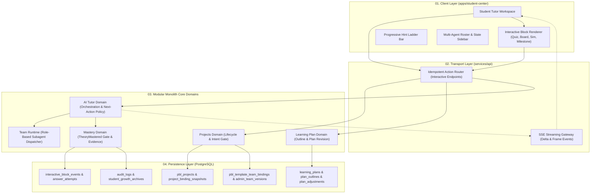

# 启途智学自适应 PBL 与多智能体协同融合架构设计方案

> **文档标识**：`docs/plan/combined/architecture.md`  
> **版本**：v1.0.0  
> **生效基线**：2026-10-18  
> **方案来源**：综合 [`../antigravity/architecture-design.md`](../antigravity/architecture-design.md) 与 [`../codex/architecture.md`](../codex/architecture.md)  
> **上级基线**：[`../../AGENTS.md`](../../AGENTS.md) · [`../design/pbl-template-team-binding-architecture.md`](../design/pbl-template-team-binding-architecture.md) · [`../design/20261018-pbl-dynamic-interaction-openmaic.md`](../design/20261018-pbl-dynamic-interaction-openmaic.md)  
> **责任领域**：`projects` / `learning-plan` / `ai-tutor` / `mastery` / `team-runtime` / `apps/student-center`  

---

## 1. 架构总览与拓扑结构

本架构方案融合了 **OpenMAIC 多模态富交互资产协议**、**DeepTutor 启发式选项问答体系** 以及 **Codex 单体强所有权边界与不可变版本绑定机制**。在确保系统继续运行于现有 NestJS 模块化单体与数据模型基线的前提下，为学生提供具身认知与自适应探究能力。



---

## 2. 核心领域契约与数据结构

所有前后端交互与领域存储收敛至 Monorepo 统一契约（`packages/contracts`），杜绝平行制造第二套课程或大纲体系。

### 2.1 不可变团队绑定与立项快照 (`PblTemplateTeamBinding` & `ProjectBindingSnapshot`)

由管理端教研组完成模板发布与团队版本绑定，学生端在确认意图立项时冻结版本快照，后续模板或团队的迭代均不污染在研项目：

```typescript
export interface PblTemplateTeamBinding {
  id: string;
  templateVersionId: string;
  teamVersionId: string;
  status: 'draft' | 'validated' | 'active' | 'retired';
  bindingHash: string;
  validation: {
    valid: boolean;
    errors: string[];
    warnings: string[];
    checkedAt: string | null;
  };
  activatedAt: string | null;
  retiredAt: string | null;
}

export interface ProjectBindingSnapshot {
  projectId: string;
  templateVersionId: string;
  bindingId: string;
  teamVersionId: string;
  bindingHash: string;
  boundAt: string;
}
```

* **约束铁律**：每个模板版本在同一时间最多存在一个 `active` 绑定；立项请求只接受模板 ID 与意图确认凭证，由服务端解析唯一激活绑定并保存快照哈希。

### 2.2 计划大纲与自适应执行计划 (`PlanOutlineNode` & `ProjectPlanAdjustment`)

复用既有的 `PlanOutline` 概念，不新增平行的 `PblSyllabus`，而在节点上扩展支持自适应插入的补救节点与乐观锁版本号：

```typescript
export interface PlanOutlineNode {
  id: string;
  orderIndex: number;
  title: string;
  objectiveId: string;                    // 关联标准知识点与学习目标
  assignedRole: 'leader' | 'coach' | 'guide' | 'reviewer';
  assignedAssistantId: string;            // 绑定的智能体 ID
  status: 'pending' | 'in_progress' | 'mastered' | 'skipped';
  isRemedial: boolean;                   // 标识是否为动态插入的补救微节点
  prerequisiteNodeIds: string[];          // 前置依赖
  estimatedMinutes: number;               // 预计耗时
  deliverableType?: 'derivation_note' | 'simulation_data' | 'code_repo' | 'reflection_essay';
}

export interface ProjectPlanAdjustment {
  id: string;
  projectId: string;
  planId: string;
  baseRevision: number;                   // 基础版本号（乐观锁校验）
  nextRevision: number;                   // 调整后版本号
  trigger: 'repeated_assessment_error' | 'explicit_stuck' | 'teacher_request';
  evidenceRefs: string[];                 // 支撑调整的作答与事件引用
  action: 'append_optional_remediation' | 'recommend_teacher_support';
  status: 'proposed' | 'accepted' | 'rejected' | 'applied';
  policyVersion: string;
  idempotencyKey: string;
}
```

### 2.3 OpenMAIC 结构化交互块协议 (`TutorReplyBlock`)

在现有 `packages/contracts/src/tutor.ts` 基础上扩展结构化互动块，由服务端下发并在前端沙箱内受控渲染，杜绝直接渲染外部不可控 HTML/JS：

```typescript
export type TutorReplyBlock =
  | { kind: 'text'; content: string }
  | QuizBlock
  | OptionsBlock
  | BoardBlock
  | SimulationBlock
  | MilestoneBlock;

export interface BaseBlock {
  blockId: string;                        // 唯一且幂等的块 ID
  turnId: string;
  required: boolean;                      // 是否必须完成交互后才能推进后续对话
  resolved: boolean;
}

export interface QuizBlock extends BaseBlock {
  kind: 'quiz';
  quizId: string;
  objectiveId: string;
  question: string;                       // 支持 Markdown + KaTeX LaTeX
  options: {
    key: string;                          // 'A', 'B', 'C', 'D'
    content: string;
  }[];
  mode: 'single' | 'multiple';
  maxHintLevel: number;                   // 允许请求的最大提示阶梯 (通常为 3)
}

export interface OptionsBlock extends BaseBlock {
  kind: 'options';
  title?: string;
  options: {
    optionId: string;
    label: string;
    summaryText: string;
    actionType: 'deep_dive' | 'give_example' | 'skip_ahead' | 'retry_step';
  }[];
}

export interface BoardBlock extends BaseBlock {
  kind: 'board';
  title: string;
  steps: {
    stepIndex: number;
    caption: string;
    visualType: 'mermaid' | 'tex' | 'svg_chart';
    payload: string;
  }[];
}

export interface SimulationBlock extends BaseBlock {
  kind: 'simulation';
  templateId: string;                     // 平台已登记的安全受控沙箱组件模板
  title: string;
  initialParameters: Record<string, unknown>;
  targetVerificationRule: string;
}

export interface MilestoneBlock extends BaseBlock {
  kind: 'milestone';
  milestoneId: string;
  title: string;
  phase: 'inspiration' | 'exploration' | 'practice' | 'reflection';
  isTheoryMastered: boolean;
}
```

### 2.4 面向回答的有限教学动作决策 (`TutorNextAction`)

模型与策略引擎只能在白名单动作中决策，禁止直接输出非类型化命令驱动系统状态：

```typescript
export type TutorNextAction =
  | { kind: 'ask_socratic'; objectiveId: string; promptIntent: string }
  | { kind: 'offer_hint'; objectiveId: string; hintLevel: number }
  | { kind: 'offer_example'; objectiveId: string; exampleRef: string }
  | { kind: 'ask_check'; objectiveId: string; questionRef: string }
  | { kind: 'review_evidence'; evidenceRef: string }
  | { kind: 'recommend_remediation'; adjustmentId: string }
  | { kind: 'recommend_teacher_support'; reasonCode: string };
```

---

## 3. 双循环教学交互机制与门禁状态机

### 3.1 微观调谐循环（Micro-Loop：会话交互层）
1. **选项交互触发**：学生点击 `options` 或作答 `quiz`，前端向统一接口提交（必须携带 `idempotency_key`）。
2. **唯一判分路径**：由 `mastery` 与 `learning-plan` 领域作为唯一权威判分点，写入 `answer_attempts`，计算并投射掌握度。
3. **渐进式提示阶梯（Hint Ladder）**：
   * Level 1（微线索）：引导概念边界，提供思考方向反问。
   * Level 2（支架比对）：提供伪代码骨架或错误推导与正确原理的对照。
   * Level 3（定位排错）：圈定错误发生的具体环节并提供最终修正思考题。
   * 达到 Level 3 后仍未突破，系统封顶提示并触发宏观调整机制。

### 3.2 宏观计划自适应循环（Macro-Loop：执行计划重构层）
1. **卡点信号捕获**：
   * 学生在同一概念连续 3 次选择认知迷思干扰项；
   * 在当前探究节点停留对话轮次超过 6 轮且未掌握；
   * 主动触发“向班主任求助”。
2. **安全计划重构**：
   * `PlanAdjustment` 服务利用乐观并发控制（`baseRevision` 校验）在大纲当前目标下原子插入 `isRemedial: true` 练习节点。
   * **禁止越权**：自适应调谐严禁移除模板必做目标、修改前置依赖、自动跳过阶段门禁或放行未掌握的实践。
3. **教师与家长协同**：
   * 向班主任仪表盘输出脱敏卡点摘要（包含错误类型编码、滞留节点与引用证据，禁止暴露学生原始未成年人长文本）。

### 3.3 系统安全与不可穿透门禁（Hard Gates）
* **学生意图确认门禁**：学生在灵感空间未进行明确意图确认操作前，服务端杜绝生成正式项目行。
* **`TheoryMastered` 理论门禁**：在掌握度评估器未确认理论达标（掌握分 $\ge 85\%$）前，服务端硬拦截所有代码沙箱执行、硬件模拟器写操作与实践提交接口，直接返回 `403 FORBIDDEN`。

---

## 4. 采用原因分析 (Rationale for Adoption)

1. **避免 Antigravity 方案的架构膨胀与数据双写风险**：
   * 原 Antigravity 方案设计了整套平行的 `PblSyllabus`、`PblProjectPlan` 实体表与独立微服务倾向，与启途现有的 `learning-plan`、`PlanOutline` 以及模块化单体基线产生冲突。
   * 融合方案吸收其优秀的大纲节点表达（如 `isRemedial` 补救节点），但底层数据实体完全收敛至既有单体表结构中，确保单一数据权威源。
2. **弥补 Codex 方案在前端探究体验与多模态交互上的缺失**：
   * 原 Codex 方案侧重工程防御和状态机限制，对学生端的交互表现过于克制，缺少具体的组件形态与渲染规范。
   * 融合方案完整保留了 OpenMAIC 结构化交互块（`quiz`、`board`、`simulation`、`milestone`）以及三级提示阶梯组件，让学生获得直观、身临其境的 PBL 探究体验。
3. **严格收敛大模型权力，杜绝状态越权**：
   * 采纳 Codex 方案的“模型仅输出候选，状态机与门禁由领域 Owner 独占写入”铁律，防止大模型幻觉直接修改学生成长档案、项目阶段或强行跳过 `TheoryMastered` 门禁。
4. **渐进式演进，零冗余重写**：
   * 既有接口（如 `TutorReplyBlock`、SSE 事件、`PlanOutline`）均采用向后兼容的增量扩展，降低迁移与回归成本。
