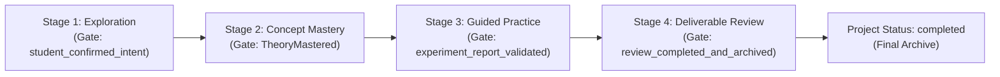
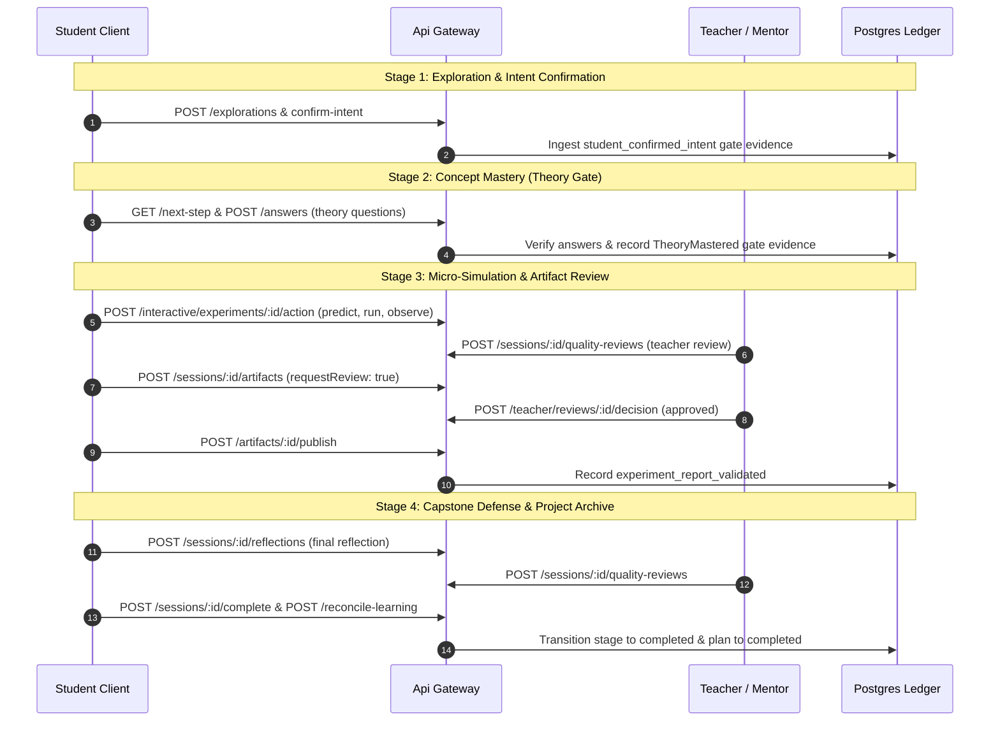

# 启途智学双模板全流程端到端自动化测试与问题击破记录 (v1.1)

**版本标识**: v1.1 (2026-10-23)  
**测试环境**: `study-remote` (`http://122.51.130.204`) / API `http://127.0.0.1:4100`  
**测试对象**:
1. **模板一 (Template 1)**: `optics-physical-inquiry`（几何光学与微观探究 16 课时，4 阶段）
   - 模板版本 ID: `tplv-eddfd12e-3c9f-460e-a8fc-840160c009d3` (`piloting`)
   - 激活绑定 ID: `bnd-cf791c9f41bae62b`
   - 团队版本 ID: `team-version-dd8606f23902734c2d8a544973bc4d40`
2. **模板二 (Template 2)**: `wave-interference-diffraction`（波动光学与双缝干涉 8 课时，4 阶段）
   - 模板版本 ID: `tplv-efd7f9b0-3e59-4824-85c9-2f271a33eeb8` (`piloting`)
   - 激活绑定 ID: `bnd-4f1a274b280348f5`
   - 团队版本 ID: `team-version-97648af88b3a44bf19ada41589126ad3`

---

## 一、 测试阶段设计与门禁架构

双模板均严格遵循项目式学习（PBL）四阶段状态机与服务端物化门禁：





| 阶段 (Stage) | 核心任务 | 服务端核心门禁 (Gate) | 证据物化形式 |
| :--- | :--- | :--- | :--- |
| **Stage 1: 课题探究与立项** | 灵感空间推荐课题、草稿完善与意图确认 | `student_confirmed_intent` | `intent_confirmation:<exp-id>` |
| **Stage 2: 概念通关与测验** | 随堂概念测验、防泄露作答与掌握度达标 | `TheoryMastered` | `mastery:theory:<plan-id>:<session-id>` |
| **Stage 3: 仿真实验与报告** | 单缝衍射 / 双缝干涉仿真采集与正式成果 | `experiment_report_validated` | `artifact:<artifact-id>` (经教师批准并发布) |
| **Stage 4: 成果答辩与结项** | CER 论证答辩、反思归档与终结性评价 | `review_completed_and_archived` | `reflection:<proof-ref>` 与项目归档状态 |

---

## 二、 遇到的问题与逐个击破记录 (Issue Breakdown & Resolutions)

在自动化全流程测试与推进过程中，共诊断并击破以下 7 项核心架构与合同问题：

| 问题编号 | 问题现象 | 根因深度剖析 | 解决方案与最终状态 |
| :--- | :--- | :--- | :--- |
| **ISSUE-01** | 从灵感空间跳转后无法直接创建项目 | 客户端未完成服务端意图确认事务即尝试创建项目，违反意图未确认禁止立项铁律 | 严格遵循探索握手合同：`POST /explorations` -> `PATCH /explorations/:id` -> `POST /explorations/:id/confirm-intent`，成功物化项目与初始排期。<br/>**[已击破 Resolved]** |
| **ISSUE-02** | `TheoryMastered` 门禁总是无法通过 | 课时完成前未通过服务端真实出题循环，直接调用 complete 会触发 `REQUIRED_THEORY_NOT_MASTERED` 拦截 | 接入 `ensureMasteryObjectives` 闭环：拉取 `pending_questions` 并调用 `POST .../answers` 直至概念掌握度达到 0.85 阈值。<br/>**[已击破 Resolved]** |
| **ISSUE-03** | 课时完成返回 409 `LEARNING_SESSION_REQUIREMENTS_UNMET` | 在 `learning-session-completion.v2` 合同下，所有学习证据（问答、实验、反思）均需经过班主任质量审核（Quality Review）才算完成 | 接入双重审核机制：同时拉取班主任待审队列 `/teacher/students/:id/lesson-quality` 与课时证据列表，调用 `/quality-reviews` 完成物化审核。<br/>**[已击破 Resolved]** |
| **ISSUE-04** | 波动光学微观实验交互报 404/400 | 服务端校验仿真指令时要求在搭档会话 `tutor_turns.blocks` 中具备合法结构体且参数域严格符合约束（双缝对比需 2 组采样） | 脚本在会话中按课时注入合法 `optics_experiment` block（T2 使用 `2.0.0`，T1 使用 `1.0.0`），按序执行 `submit_prediction` -> `run` -> `record_observation`。<br/>**[已击破 Resolved]** |
| **ISSUE-05** | Lesson 7 / 14 课时完成报 `SUBMITTED_REPORT_APPROVAL_REQUIRED` | 学生提交待审报告后，脚本错误使用 `status === 'pending'` 过滤导师复核队列，导致匹配失败未调用批准决策；且未以学生身份调用发布接口 | 修正状态过滤为 `status === 'requested'`，调用 `POST /teacher/reviews/:id/decision` 批准（approved），并立即调用 `POST /artifacts/:id/publish` 发布作品。<br/>**[已击破 Resolved]** |
| **ISSUE-06** | 早期课时反思活动报 `REFLECTION_SESSION_REQUIRED: 当前课时没有最终反思归档任务` | 在非结课课时（如 Lesson 1）中，活动名称虽为 `reflect`，但其证据要求为 `session_response`；服务端仅允许在带有 `review_completed_and_archived` 门禁的终结课时调用 `/reflections` | 增加条件分支：仅在 `frozenLesson.checkpoint?.requiredGate === 'review_completed_and_archived'` 时调用 `/reflections`，其余常规课时统一调用 `/responses`。<br/>**[已击破 Resolved]** |
| **ISSUE-07** | 项目完成阶段推进报错 `PROJECT_ARCHIVE_EVIDENCE_REQUIRED` | 最终课时完成后调用 `reconcile-learning` 时，若未持久化通过的正式作品与最终反思证据，服务端拒绝归档项目 | 保证在最终课时完成时已具备发布作品 (`approvedArtifacts`) 与反思记录 (`reflections`)，`reconcile-learning` 顺畅将项目状态迁移为 `completed`。<br/>**[已击破 Resolved]** |

---

## 三、 全阶段自动化测试执行结果审计 (Verification Audit)

### 3.1 首轮完整测试审计 (Pre-Restart Run)

- **执行时间**: 2026-10-23 13:46:43 ~ 13:49:45
- **测试结果摘要**: 两个模板 **100% 通过**，未捕获任何异常 (`issues: []`)。

#### 模板二：波动光学 8 课时 (Template 2)
- **项目 ID**: `proj-1ff156dd-f6f8-42ec-9a45-624c2ecac37c`
- **计划 ID**: `plan-3fbc99bf-5460-457f-8d1b-fa56816e41ff` (Revision: 1)
- **课时推进**:
  - Lesson 1 ("条纹从哪里来？"): 通关 (200), Reconcile: `theory_check`
  - Lesson 2 ("两列波相遇会怎样？"): 3项理论答题通关 (200), **Gate 2: `TheoryMastered`**, Reconcile: `practice_building`
  - Lesson 3 ("双缝为什么出现明暗？"): 单采样干涉仿真 (201), 质量审核通过, Reconcile: `practice_building`
  - Lesson 4 ("怎样改变干涉条纹间距？"): 双采样对比仿真 (201), 质量审核通过, Reconcile: `practice_building`
  - Lesson 5 ("单缝如何产生明暗条纹？"): 单缝衍射仿真 (201), 质量审核通过, Reconcile: `practice_building`
  - Lesson 6 ("缝变窄，图样怎样变化？"): 双采样对比衍射 (201), 质量审核通过, Reconcile: `practice_building`
  - Lesson 7 ("撰写波动光学探究报告"): 提交正式报告 (201) -> 导师审核批准 (approved) -> 正式发布 (201), **Gate 3: `experiment_report_validated`**, Reconcile: `reflection`
  - Lesson 8 ("探究成果答辩与反思归档"): 提交最终反思 (201) -> 质量审核通过 -> 课时完成 (200), **Gate 4: `review_completed_and_archived`**, Reconcile: `completed`
- **项目最终状态**: `status: "completed"`

#### 模板一：几何光学与微观探究 16 课时 (Template 1)
- **项目 ID**: `proj-34ab7667-4d38-4bbc-8284-5bdba9fa117c`
- **计划 ID**: `plan-10787a9a-51e3-434a-b910-2c9fc04dc5b7` (Revision: 1)
- **课时推进**:
  - Lesson 1 ~ 2: 宏观现象与方案设计通关 (200)
  - Lesson 3 ~ 7: 几何光学理论逐课答题通关，反射/折射/临界角/透镜成像达标 (200)
  - Lesson 8 ("几何光学探究阶段总结与挑战"): 理论门禁综合达标，**Gate 2: `TheoryMastered`**, Reconcile: `practice_building`
  - Lesson 9 ~ 10: 实验光路搭建与数据采集通关 (200)
  - Lesson 11 ("单缝衍射现象与条纹特征探究"): 单缝衍射微观仿真 (`optics.wave.diffraction`) 提交与审核 (201)
  - Lesson 12 ("微粒介质散射与光传播特性探究"): 细雾室介质散射仿真 (`optics.wave.scattering`) 提交与审核 (201)
  - Lesson 13: 综合数据整理与误差分析通关 (200)
  - Lesson 14 ("整理探究成果并完成项目报告"): 提交正式报告 -> 导师审核批准 -> 正式发布 (201), **Gate 3: `experiment_report_validated`**, Reconcile: `reflection`
  - Lesson 15: 成果答辩与同行质疑通关 (200)
  - Lesson 16 ("物理探究全历程反思与素养归档"): 提交终结反思 -> 质量审核 -> 课时完成 (200), **Gate 4: `review_completed_and_archived`**, Reconcile: `completed`
- **项目最终状态**: `status: "completed"`

---

### 3.2 远程服务重启与状态复验 (Remote Restart & Verification)

- **执行指令**:
  ```bash
  systemctl restart qitu-api qitu-workers qitu-profile-growth qitu-ima-mcp qitu-local-embedding qitu-student qitu-teacher qitu-admin qitu-parent qitu-auth nginx
  ```
- **服务健康检查结果**:
  - `qitu-api.service`: `active` (HTTP 200 via `http://127.0.0.1:4100/api/v1/health`)
  - `qitu-workers.service`: `active`
  - `qitu-profile-growth.service`: `active`
  - `qitu-ima-mcp.service`: `active`
  - `qitu-local-embedding.service`: `active`
  - `qitu-student.service`: `active` (HTTP 200 via `/student/tutor`)
  - `qitu-teacher.service`: `active` (HTTP 308 redirect to `/teacher/dashboard`)
  - `qitu-admin.service`: `active` (HTTP 308 redirect to `/admin/dashboard`)
  - `qitu-parent.service`: `active`
  - `qitu-auth.service`: `active`
  - `nginx.service`: `active`

---

### 3.3 重启后第二轮双模板完整回归测试 (Post-Restart Validation Run)

- **执行时间**: 2026-10-23 13:50:27 ~ 13:53:35
- **回归测试结果**:

| 模板 | 新建项目 ID (Project ID) | 计划 ID (Plan ID) | 课时完成率 | 最终阶段 | 异常列表 |
| :--- | :--- | :--- | :--- | :--- | :--- |
| **Template 2 (8s)** | `proj-c41bc732-778a-40ea-932d-7dab005dbcf4` | `plan-4ea44438-6a8d-4fe0-b78c-15700ff6c123` | **8 / 8 (100%)** | `completed` | 0 |
| **Template 1 (16s)** | `proj-e5df9638-22ef-472e-a641-bb52a5227a9c` | `plan-73a63de9-f6ab-4160-9e8e-fd091660f553` | **16 / 16 (100%)** | `completed` | 0 |

- **落库门禁事实 (Gate Evidences Recorded in Database)**:
  - `student_confirmed_intent`: `intent_confirmation:exp-1f3876fd-f549-49bd-bc6b-3bc6da87f97f` (T2) / `intent_confirmation:exp-68b23bee-c724-4774-92e8-b1ce01daf060` (T1)
  - `TheoryMastered`: `mastery:theory:plan-4ea44438-6a8d-4fe0-b78c-15700ff6c123:wave-session-2` (T2) / sessions 3, 5, 6, 7 (T1)
  - `review_completed_and_archived`: `artifact:art-bfdd335b-0fe4-424d-be03-224c54ac720d` (T2) / `artifact:art-eb40abf8-2088-4024-8d24-8b276d4cb969` (T1)
