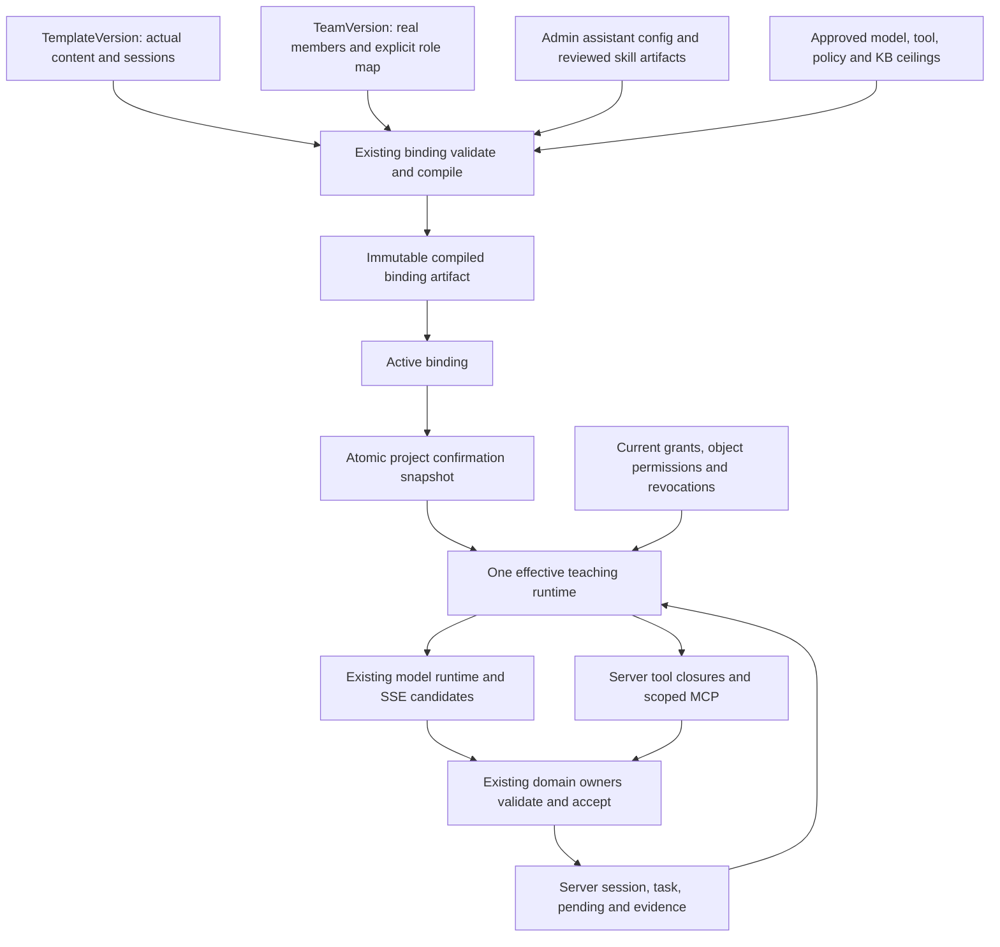

> 状态：历史记录恢复（2026-10-26）。正文保留 df05d5b 中的原始日期与验收边界，不代表当前部署状态；现行规则见 [工程入口](../../README.md) 和各责任域文档。

# PBL 版本化能力链总架构

> 状态：capability-v1-m1 / 2026-10-19，首批源码已实现，本地全量离线验证已通过（1040 项 API 测试），生产未验收；源码基线 `43a0307` 加工作树。以下完整链仍是目标设计，不能将首批源码等同发布。事实见 [差距审计](./gap-audit-20261019.md)，实测见 [验证记录](./validation-20261019.md)，外部依据见 [研究报告](./research-report.md)。

## 1. 目标与非目标

每个冻结项目应能回答：本课为何由这位导师发言、实际调用哪个模型、采用哪些教学方法、能读取哪些资料、允许哪些动作、失败后怎样恢复。技能数量不是成功指标，证据相关的下一动作、权限一致、历史可复核才是。

继续使用模块化单体、现有网关和 SSE/TutorReplyBlock。禁止平行 PBL/课程/掌握数据库、客户端自主路由、学生执行任意脚本、模型直接写阶段/掌握/作品通过。Admin 统一控制；未成年人数据最小可见；写入幂等。

## 2. 三个平面

| 平面 | 内容 | 权限边界 |
| --- | --- | --- |
| 开发协作 | `.pi/agents`、开发 Skills、研究用 Grok/浏览器 | 开发工具不自动进入学生运行时 |
| Admin 编写与发布 | 模板版本、真实成员、助手配置、canonical Skill 制品、工具/MCP/模型/KB 策略 | 草稿、导入、批准、绑定、执行分别展示 |
| 学生教学运行 | 冻结项目、当前课时/任务、最小有效能力、候选流 | 仅向既有 owner 提交候选，不能自授权限或制造事实 |

Skill 是“如何教学”的指令与资源包；Tool 是可执行的服务端能力；MCP 是连接外部能力的协议；KB grant 是对象授权。`allowed-tools`、MCP annotation 和模型输出的工具名都不能授予权限。

### 2.1 本轮已经接通与尚未接通

`ProjectTemplateSpec` 已增加 `theme.drivingQuestion` 与 `curriculum.profiles`，严格解析实际 schedule、stable session ID、checkpoint、引用/DAG/分钟/阶段。旧 curriculum 类型改为派生别名。新 16 节 identity 为 `pbl-optics-inquiry-16s@v2-16s`、profile `optics-16x60-v2`；新 API slug 和显式 bootstrap 分离，旧 v1 不变。新草稿生成器消费实际版本正文；课时标题已接入 0036 可空列与回读（迁移未部署），block kind 反思已修正。逐课时活动与证据要求沿用既有 blocks JSON，不构成评测事实。

`teaching-bundle.compiler.ts` 是无 I/O 的编译核心，输出 payload/canonicalPayload/digest，尚未入库或接 validate/activate/confirm。现有 `bindingHash` 未改，两个正式确认仍只冻结旧同版本 binding snapshot；没有冻结 profile、模板正文 digest 或 Skill 制品。

Tutor 已按真实 phase assistant 调用 `getAssistantRuntime`，同身份贯穿显示、SDK、模型 pair、技能、trace 与当前 IMA 授权。SDK 每轮回读并检查配置 hash 和模型身份，变化时拒绝重试，不能把旧 prompt 与新模型混用。这是单轮一致性，不是历史能力快照。

### 2.2 当前过渡写源与目标选择

当前教学 `getAssistantRuntime` 以 `admin_assistants` 的 instructions/model/skills/tools/MCP 为编写源，避免旧矩阵保存后 Tutor 仍读另一个角色配置。只允许精确身份及显式历史 leader 别名提供限制；现存 Agent 的 enabled、capabilities、MCP allowed tools 可继续收紧。runtime-only 的 `getAgentRuntime` 及 Worker 配置路径仍保留，未做全局表迁移、双写或历史冻结。

第 3 节选择 `agent_configs` 为长期统一编写源，属于后续迁移目标，不能写成当前已完成。迁移前要对比并解决冲突、迁移所有教学调用者和 Admin 写端、保留兼容读，然后删废字段。在此之前不得将两表任一称为全平台唯一真源。

## 3. 结构与版本链



### 3.1 唯一真源

| 制品/owner | 冻结内容 | 不复制什么 |
| --- | --- | --- |
| `ProjectTemplateSpec` / templates | Theme、目标 DAG、rubric、Session、审核排期、安全和角色需求 | 不另建 curriculum schema，不保存提供商密钥 |
| 现有 runtime registry 的 `SkillVersion` 增量 | canonical ID、版本、完整包 hash、许可/来源、审核结果、正文与资源清单 | 不镜像整个开发市场，不授予工具 |
| 目标 `agent_configs` / platform-registry | 后续统一助手能力编写源；Admin assistant 页面届时降为兼容投影 | 当前 M1 教学仍读 Admin assistant，不冒称已全局迁移 |
| TeamVersion | 实际成员及显式 role slot → member → assistant 映射 | 不按名称、正则或 ID 前缀猜角色 |
| binding 的 compiled artifact | 实际模板 hash、排期、团队、助手配置投影、精确 Skill 版本、工具 schema/handler、知识上限、策略 | 无独立 PBL 状态或“Bundle 发布中心” |
| ProjectBindingSnapshot | 现有 template/binding/team/hash 加 artifact ref/digest、schedule profile | 不把指令全文复制到每个项目 |
| 当前治理 | enabled/deny/revocation、对象权限、当前安全硬约束 | 不改写历史制品，不因新增授权扩张旧项目 |

`agent_configs` 作为长期编写源是本提案的选择，尚未迁移。当前教学源明确为 `admin_assistants`，并非两表自由合并提示词或取并集扩权。目标迁移后 `admin_assistants` 可保留展示元数据，同一能力字段只保留一个写端。先比较并人工解决冲突，再迁移调用者、降为兼容读、删除废字段；禁止长期双写脚本掩盖冲突。

首期不新增独立 AssistantProfileVersion 发布状态机：binding 编译时保存不可变助手配置投影和 hash。真正跨模板共享的方法使用 SkillVersion；模板独有情境和教学参数仍属模板，不把局部文本伪装 canonical Skill。

### 3.2 不可变与哈希

Skill 包 hash 覆盖 `SKILL.md`、实际可加载的 `references/assets` 及包清单。候选脚本也必须纳入审核，但学生 runtime 不执行上游脚本。禁止只 hash 正文，却在运行时加载当前同名资源。首个试点可只接受无外部资源的 Markdown/JSON，随后再接完整有界资源闭包。

对规范化语义 payload 求 hash：schema/compiler 版本、模板内容、排期、真实角色映射、助手指令与模型用途、Skill package refs、工具 schema/handler refs、KB grant 和内容/教学策略版本。排除时间、随机 artifact ID、审计字段、凭据和 digest 自身；明确集合排序、有序教学序列及换行/Unicode 规范，拒绝重复键、引用和非法数值。相同语义输入 digest 相同，语义改变 digest 必变。冻结后不得因 loader 预算不同静默截断关键指令。

发布/编译成功起不可变，由数据库写权限/约束与应用追加写共同保证，不是仅靠 `readonly` 或“首次使用后冻结”。本地文件只作导入源；已发布正文/资源按 hash 从保留的服务端制品读取，缺旧版本拒绝，绝不回退当前文件。可复用现有数据库/受控存储，不要求新建 CAS 服务。

增加明确的 binding 合同/hash 版本，不原地把旧 `bindingHash` 改成新语义。artifact 是唯一 frozen 授权上限；项目只保存引用/完整性投影，不另存可编辑 grant 副本。

### 3.3 冻结与实时变化

冻结的是教学语义和授权上限，不是永久通行证。`deprecated` 禁止新绑定但允许旧项目 pin；`revoked/disabled` 阻止后续调用。必需依赖失效暂停，明确可选依赖可显示降级；不能移除教学安全约束后继续。

```text
effective = frozen ceiling
          ∩ current Admin grant
          ∩ resolved assistant/tool/model grant
          ∩ actor/project/session/object permission
          ∩ current gate/task constraints
          − active deny/revocation
```

模型请求前、每次工具执行前、动作签发和 owner 接受前重检授权 revision。制品可按 hash 缓存；实时权限不可用则拒绝新调用，不拿陈旧缓存放行。安全底线永远由服务端执行，不是可关闭 Skill。

## 4. 调用者接口草图

以下是完整目标接口，不是本轮已发布 API。已实现的纯编译核心只接收数据并返回 payload/digest，不实现下列数据库调用或候选 Runtime。复杂度收在现有 owner 内，不拆成仅转发的 load/validate/hash/save 服务链。

```ts
type Purpose = 'outline' | 'session' | 'dialogue';
interface CompiledRole {
  roleSlotId: string;
  memberId: string;
  assistantId: string;
  assistantConfigDigest: string;
  skills: readonly {
    canonicalId: string;
    version: string;
    packageDigest: string;
  }[];
  modelByPurpose: Readonly<Partial<Record<Purpose, {
    modelProviderId: string;
    modelId: string;
    policyVersion: string;
  }>>>;
  toolGrants: readonly { toolId: string; schemaDigest: string }[];
}
interface CompiledBindingRef {
  artifactId: string;
  digest: string;
  scheduleProfileId: string;
}
interface BindingCompiler {
  validateAndCompile(bindingId: string, expectedRevision: number): Promise<CompiledBindingRef>;
}
interface TeachingCandidateRuntime {
  generate(input: {
    scope: ServerAuthorizedProjectScope;
    purpose: Purpose;
    state: ServerOwnedLearningState;
    learnerInput: BoundedLearnerInput;
    idempotencyKey: string;
  }): AsyncIterable<ValidatedCandidateEvent>;
}
```

`scope/state` 是待定义的服务端领域类型，由 API/owner 构造，浏览器或模型不能自声明可信。Session ID、task revision、当前题、动作实例与证据引用来自已有 owner。缺 `modelByPurpose[purpose]` 拒绝；不能从其他角色或全局列表猜一个 pair。

当前纯核心实际类型为 `TeachingBundleSource → CompiledTeachingBundle`，schema `qitu.teaching-bundle.v1`、compiler `1.0.0`；`TeachingPurpose` 为 outline/session/dialogue。错误为 `TEACHING_BUNDLE_INVALID` 加 issue/path。它校验已解析模板、真实成员/角色、批准模型 pair、published teaching Skill 精确包 ref、tool schema/handler refs 与 IMA ceilings，并拒绝领域事实写工具。它不自行取得目录或重验实时权限，输入只能由后续受控 owner 组装。

每角色/用途明确批准 `(modelProviderId, modelId)` 和策略版本。首期固定精确 pair；备选必须在新策略中显式批准并记录原因，不能凭同名裸 ID 或静默换供应商。凭据轮转留在网关；制品无 key/URL。同名上游模型可能变化，合同可回放不代表输出逐字复现，应记录可得的模型版本和 generation ID。

Admin validate/activate 核对 `expectedRevision/digest` 防配置漂移。`confirmIntent` 与 `confirmPlan` 同事务冻结 artifact，失败则整个确认回滚。探索大纲使用受治理 draft scope，不借正式项目权限，也不预创建正式项目。

## 5. 一次真实执行只有一个身份

`displayAuthor.assistantId = effectiveRuntime.assistantId = executionTrace.assistantId`。同一值驱动角色、指令、Skill、model pair、closures 和知识权限，禁止展示 phase 导师却使用 partner 的能力生成。

Team Runtime 委派还要验证 recipient 是冻结团队真实成员、被批准用于当前 session/purpose 且 route 合法。Worker 没接 broker closures 时只执行明确无工具候选；不能把 MCP metadata 或在线动画当执行成功。`inheritToChildren` 尚无完整父链解析，首期不隐式继承权限：发布前形成显式批准闭包，拒绝循环/缺引用，子助手不能扩大父授权。

三层真实生成：受治理大纲候选 → 当前课时按需展开 → 每轮证据相关反馈，均消费实际冻结内容而非给全局常量贴版本 ID。失败保留最后已接受状态，显示未生成/重试，不伪装 demo 为实时 AI。

输出仍为闭集 TutorReplyBlock/SSE；Board、Mermaid、KaTeX 属安全渲染合同，不是第二种权限 registry。结构化题目/实验候选验证前不可操作；owner 签发稳定实例与回执后才显示可操作/已保存。

## 6. Owner 与失败边界

| Owner | 保留/新增职责 | 禁止越界 |
| --- | --- | --- |
| templates / templates-binding | 唯一模板校验、编译、激活、冻结、重确认迁移 | 不执行模型、不判掌握 |
| platform-registry | 单一助手绑定、Skill 审核制品、当前撤权与模型/Tool/MCP 目录 | 不把 Skill 声明当工具授权 |
| ai-tutor / model-runtime | 一次解析身份、有界上下文、真实生成与候选流 | 不写阶段/成绩/作品通过 |
| learning-plan / mastery | revision、当前题/判分、目标证据、TheoryMastered | 不按课时数字自动掌握 |
| projects / works / feedback | 立项、阶段、作品版本与正式评审 | 不信任模型“已完成” |
| knowledge / IMA adapter | 项目 grant、四工具参数、限期 provenance | 不复制全文到成长/家长投影 |
| team-runtime / workers | 冻结成员授权、幂等任务、真实执行 trace | 不另建学习状态或绕过门禁 |

建议错误码：`CAPABILITY_ARTIFACT_REQUIRED`、`CAPABILITY_DIGEST_MISMATCH`、`TEACHING_ROLE_UNRESOLVED`、`RUNTIME_BINDING_CONFLICT`、`SKILL_REVIEW_REQUIRED`、`RUNTIME_GRANT_REVOKED`、`KNOWLEDGE_SCOPE_DENIED`、`KNOWLEDGE_PROVENANCE_EXPIRED`。正式加入 contracts 时统一 HTTP/重试语义，学生端不暴露 prompt、目录、上游错误或秘密。

日志保留 stable IDs、artifact/skill/schema digest、实际 assistant/model pair、授权 revision、generation/tool request ID、结果类别、耗时/预算；不复制秘密、教材全文或原始学生对话。目录失败、部分绑定失败、断线、撤权、旧 revision、未保存证据均有明确 UI 状态和恢复入口。

## 7. 两种架构的取舍

已有研究轮次独立生成并交叉审阅两个结构不同的候选。本轮复用其记录，未重新运行联网研究，原稿不是规范：

| 维度 | A：独立 catalog + 助手版本 | B：模板内教学 Bundle |
| --- | --- | --- |
| 复用/更新 | 科学方法跨模板共享自然 | 模板间重复，修文案常需升模板 |
| 冻结/运营 | 多生命周期兼容成本较高 | binding 一次编译，发布面较小 |
| Admin 成本 | 版本组合和空壳注册表风险 | 模板作者负担大，技能难单独评测 |
| 主要风险 | 运行时取 current、过度抽象、重复 registry | 本地块绕开 canonical Skills、资源未完整冻结 |

采用“小型共享 Skill catalog + binding 时最小编译制品”：借 A 的许可/来源/独立评测和复用，借 B 的原子编译/确认、助手快照及短运行接口。不采用 A 的多套同义 registry/AssistantProfile 生命周期；不采用 B 把通用方法散落各模板或另造 capability ID 集合的做法。

筛查时剔除 A 的错误快照事实、未测性能/存储估计、仅正文 hash、deprecated=撤权、当前目录替代历史包；补齐 B 的成员映射、每角色模型 pair、资源闭包、deny 差集及确定性 hash。两者的新类型/表都不视为已有能力。

接受代价：编译/迁移工作增加，紧急撤权可能暂停教学，正文修复需新制品/绑定。收益是把组合复杂度留在 Admin 发布侧，而非每轮对话猜路由。成本和延迟需要试点实测，不承诺无依据数字。
