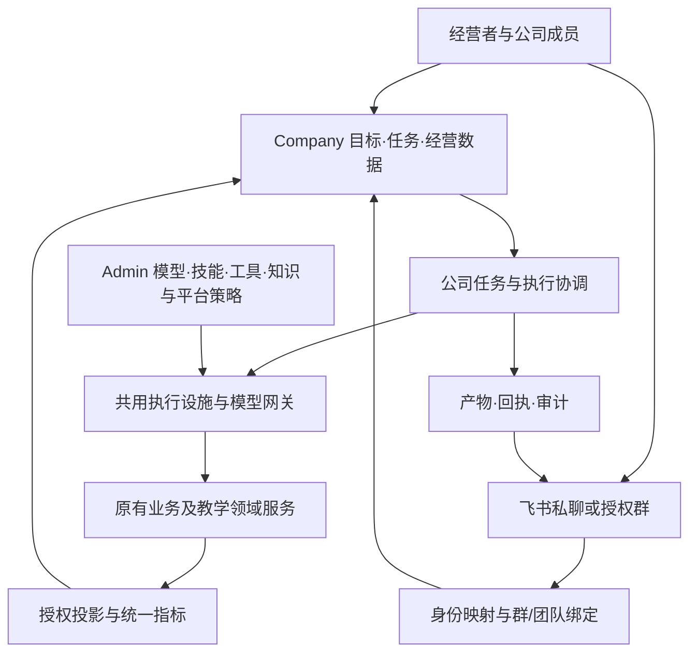

> 状态：2026-10-28 目录整理；保留原记录日期的方案与实施状态，已完成项和未验证项以正文为准。

# Company 公司经营模块实施计划

日期：2026-10-28。状态：方案草案，尚未实施。本轮只核对源码、文档与飞书官方资料并编写计划，没有修改应用、生产配置或发送飞书消息。

## 1. 定位与假设

新增独立 `/company` 公司经营工作台，服务启途智学的一人公司经营者及后续获授权协作者。Admin 继续负责平台治理；Company 负责经营目标、客户、工作任务、公司协作和数据分析；学生、家长、教师继续使用原有产品入口。

按单公司、内部飞书租户、复用认证和模块化单体设计。公司职能可以完整规划，自动执行能力按场景逐步启用。部门、团队、助手、机器人、任务运行分别建模：部门可以拥有多个团队，团队包含多个助手，机器人只是沟通入口。

用户提出新增 Company，本计划给出新增导航与权限合同；本轮不改四端冻结导航。实施前将确认后的方案同步到责任域文档，并建立有界实施 Issue。

## 2. 已有基础和真正缺口

“已有”表示当前工作区源码存在。历史发布和测试不能自动证明本日生产配置、真实飞书请求或经营效果；本轮没有重新验证生产商户和飞书租户。

| 能力 | 源码基础 | 仍缺少 |
| --- | --- | --- |
| 经营业务 | [Business](../../services/api/src/modules/business/business.service.ts) 已有商品、订单、退款、权益、咨询与成本账 | 客户生命周期、商机/报价/跟进、工单、对账和经营周期 |
| 经营看板 | [business.reporting.ts](../../services/api/src/modules/business/business.reporting.ts) 聚合订单、学习完成、咨询、模型用量与费用 | 目前主要是累计数及有限最近列表；缺时间口径、数据目录、趋势/留存/归因和跨域下钻 |
| 自动待办 | [business.automation.ts](../../services/api/src/modules/business/business.automation.ts) 检查咨询、退款和交付 | 可配置 SOP、任务依赖、负责人、产物验收、升级与公司调度 |
| 助手与能力治理 | Admin 维护助手/团队、模型网关、canonical skill、工具和知识授权 | 公司岗位职责、部门预算、经营工具与可执行场景；有提示词不等于完成业务 |
| 管家和团队运行 | [copilot.operations.ts](../../services/api/src/modules/admin-copilot/copilot.operations.ts) 已有配置动作及已有项目中的团队委派；[TeamRuntime](../../services/api/src/modules/team-runtime/team-runtime.service.ts) 有执行设施 | 当前鉴权、leader 和阶段逻辑面向 PBL，不能直接用于财务、营销等公司任务 |
| 持久化执行 | [run/task/message/event](../../packages/database/src/schema/team-runtime.ts) 有持久状态、租约和幂等基础 | 公司 scope、产物合同、预算、可恢复工作流与跨部门协作 |
| 飞书连接 | [bridge](../../services/api/src/modules/feishu/feishu-bridge.service.ts) 已有按助手绑定、加密凭证、长连接、身份映射和回执 | 群授权、群与公司团队绑定、公司成员身份、任务消息及交互卡片 |
| 飞书业务处理 | [入站解析](../../services/api/src/modules/feishu/feishu-inbound.ts) 只允许用户私聊文本；[处理器](../../services/api/src/modules/feishu/feishu-assistant-handlers.ts) 只注册汇报助手 | 仅 `report/help`；群消息被拒绝；其他助手提示尚未接入，不是通用 IM Agent |
| 数据平台 | 有业务表、学习投影和审计；[analytics](../../packages/analytics/src/index.ts) 当前只有事件类型接口 | 统一指标、采集、质量监控、受限明细查询和导出，尚无完整公司数据平台 |
| Company 应用 | 现有 Auth 和四个角色应用 | 尚无独立 company-console、公司成员授权和经营工作流产品 |

正式产品的上线条件还需单独核验：经营主体/条款、真实支付退款、HTTPS、邮箱验证/找回密码、监护关系开通体验、短信、异地备份恢复、故障通知和真实交付。Company 可以管理这些就绪项，但不能代替实际接通。已有邮箱注册只是登录标识，不能自动声称邮箱与监护身份已核验。

## 3. 公司职能与 Agent 岗位

以下是拟建岗位，不是本轮已创建的助手。每个岗位必须有真实输入、工具、产物和验收，不能只增加名称与对话框。

| 公司职能 | 助手/团队 | 接通的业务与工具 | 可验收产物 | 顺序 |
| --- | --- | --- | --- | --- |
| 经营与项目管理 | 经营总管、任务协调 | 目标、预算、经营快照、待办；分解任务、排依赖和跟踪阻塞 | 有来源的日报、周计划、执行进度与待决策事项 | 首批 |
| 产品与用户研究 | 产品经理、反馈分析 | 咨询/工单/授权反馈、需求去重、优先级和版本计划 | 需求、PRD、验收条件、复盘 | 首批 |
| 数据与商业分析 | 数据分析、数据质量 | 指标目录、受控查询、异常检测与成本分析 | 可下钻报表、口径解释、数据缺失清单 | 首批 |
| 客服与客户成功 | 客服、交付跟进 | 工单、服务知识库、受限订单/权益查询、超时提醒 | 回复草稿、已授权回复回执、升级与回访任务 | 首批 |
| 市场与品牌 | 市场研究、文案/设计、活动 | 产品资料、内容日历、渠道适配和归因 | 带素材来源的内容、活动方案、效果报告 | 第二批 |
| 销售与商务 | 线索分析、销售跟进 | CRM、商机阶段、报价版本、约定的客户触达 | 跟进计划、报价草稿、成交/流失原因 | 第二批 |
| 教研与课程产品 | 课程规划、内容制作、质量审查 | 原模板/素材/知识 owner、课程草案、质量验证请求 | 新版本草稿、质量证据和发布建议 | 第二批 |
| 财务与采购 | 对账、成本、发票资料 | 订单/退款/支付回执、账单导入、费用与供应商 | 差异清单、现金收支、费用分类、开票待办 | 第二批 |
| 研发、设计与测试 | 开发、UI、QA | Issue、隔离工作区、代码平台、测试工具 | 可审查变更、测试结果、发布清单 | 后续 |
| 运维与可靠性 | 运维、成本监控 | 只读探针/日志摘要、发布/备份、告警适配 | 故障诊断、告警回执、恢复演练记录 | 后续，基础告警提前 |
| 法务、风险与质量 | 合同资料、隐私/版权检查 | 条款版本、授权/素材来源台账与检查规则 | 待核验问题、修订草稿、到期提醒；专业结论交责任人复核 | 后续，最小权限先做 |
| 行政、组织与知识 | 行政秘书、能力管理员 | 日程/会议、订阅/供应商、知识、岗位权限清单 | 决议、续费提醒、岗位卡与能力评估 | 后续 |

OPC 首期不做完整考勤、薪酬或复杂 ERP。行政与财务先覆盖账单、费用、合同、订阅和协作者权限；出现真实员工后再扩展。没有工具的岗位显示“待配置”，不伪装成正在自主工作。

## 4. Company 与 Admin 的边界

- Admin 统一维护模型供应商、密钥、技能、Agent/团队能力目录、全局知识范围、教学策略与连接准入。
- Company 使用获批准能力，维护目标、经营工作项、部门预算、流程与分析视图；不另存模型路由或绕过 Admin 启用工具。
- 团队配置引用真实 canonical ID。执行时冻结成员/工具/模型选择及配置摘要，当前撤权立即收紧权限，快照不延长已撤销授权。
- 复用现有身份，另授予 company membership/capability；不新增公开“公司注册身份”，不把协作者都提升为平台 Admin。建议 owner/operator/analyst/viewer 预设，按财务、客户、导出等再细分。
- 教师身份本身不获得公司数据。订单、课程、学生项目、TheoryMastered、作品和成长仍由原 owner 管理。经营审批不得用于学生课时放行，教师继续遵守只读规则。
- `/admin/settings/ops` 初期保留。Company 通过共享应用服务复用业务能力，不能为方便而向公司成员开放整个 Admin API。

## 5. 页面与交互

新增 `apps/company-console`，建议 `basePath: /company`。复用认证、组件和 API 合同；后端仍为模块化单体，不按部门拆微服务。

| 页面 | 内容 |
| --- | --- |
| `/company` 总览 | 时间筛选、关键指标/趋势、待决策、异常、部门任务和最近产物 |
| `/company/work` 工作中心 | 待办、看板、日历、任务详情、执行轨迹、依赖、重试与取消 |
| `/company/teams` 部门与团队 | 组织图、岗位卡、真实助手引用、能力就绪、预算与群绑定 |
| `/company/customers` 客户与服务 | 线索、商机、联系人、工单和客户成功任务 |
| `/company/products` 产品与增长 | 商品/课程产品引用、反馈需求、版本计划、内容和活动日历 |
| `/company/finance` 收支与成本 | 订单/退款、实收、费用、用量、账单差异、发票待办 |
| `/company/data` 数据中心 | 指标看板、数据目录、受限明细、筛选/保存视图、质量、导出记录 |
| `/company/knowledge` 公司知识 | SOP、决议、产物、经营资料；复用既有知识授权，与教学资料分隔 |
| `/company/integrations` 连接与通知 | 飞书群/成员绑定、订阅、通知规则、收发与失败回执；凭证准入转 Admin |

首页桌面布局：时间/口径筛选 → 核心指标与完整性 → 经营趋势/交付质量 → 待办与部门运行。手机优先异常和行动项。执行详情提供依赖图、时间线、产物列表、调用摘要，不只显示聊天记录。

所有页面明确区分建议、待确认、已提交、实际完成；覆盖加载、空态、部分数据过期、错误、断网、权限失败、回读失败。切换部门、工作区或时间范围时，旧响应不得覆盖当前选择。

## 6. Agent 的执行合同

每个启用岗位至少定义：职责、输入、工具白名单、数据范围、知识来源、触发器、产物 schema、完成判据、预算、升级路径、状态和审计。提示词只是其中一部分。

流程：接收目标 → 校验授权/预算 → 形成有依赖的任务 → 分配助手 → 调工具 → 验证产物 → 必要的经营者决策 → 领域 owner 落地 → 回读与回执。

工作项与执行分开：“处理退款投诉”可以触发多次分析运行，其业务完成必须读取原工单/订单事实。模型说“完成”或 Worker 接收任务都不是完成证据。

工作项拟用 `draft/ready/running/waiting_input/waiting_confirmation/succeeded/failed/cancelled`。执行层复用现有 run/task/event 设施，增加显式 `pbl/company` 领域与公司 scope。旧运行保留原语义，无公司授权的历史运行不得自动升格。不得伪造学生、项目或教学阶段来启动公司任务。

当前 TeamRuntime 有 PBL 鉴权耦合：先在有界实施 Issue 中提取队列、租约、重试、取消和事件设施，再接入 PBL/Company 领域适配。PBL owner 保留原对象、冻结合同和阶段校验；禁止给现有 PBL 接口添加“Company 跳过校验”开关，禁止新建第二套教学状态机。

限制单次任务数、并发、委派深度、时限、token/费用预算、工具调用次数；支持失败退避、死信恢复、暂停与取消。成本未知时保守限制，不能按零计费放行无限运行。取消后迟到结果不得继续产生外部副作用。

自动化按具体动作授权：

- 受权读取、分析、草稿和内部可撤销待办可自动执行。
- 收件范围、频率、模板与期限明确的内部日报/提醒，规则启用后可自动发送。
- 对外营销、客户承诺、正式商品/课程发布、退款/支出、生产部署和破坏性修改按授权策略处理；必要确认绑定对象、参数摘要、版本、操作者和有效期，参数变化即失效。
- Agent 不能批准自己扩大权限。已有明确授权无需对同一动作反复打断经营者；经营确认不影响自主学习规则。

## 7. 飞书绑定与群组协作

使用企业自建应用机器人承载双向协作。普通群自定义 Webhook 机器人仅适合通知，不能接收并响应用户命令。[官方说明](https://open.feishu.cn/document/client-docs/bot-v3/add-custom-bot?lang=zh-CN)。复用已有长连接、身份绑定、加密凭证和回执设施。

首期推荐一个“公司总管”机器人入口，后端按 `chat_id/thread_id` 关联的公司团队进行委派。例：“@公司总管，分析本周退款原因，并整理产品改进任务。”自然语言产生候选动作，服务端验证后才创建/执行正式工作项。

后续支持部门负责人绑定独立应用机器人，以真实机器人身份进同一群。一个应用不能同时归属多个活动助手，当前服务已拒绝此情况。单入口模式绑定一个 canonical router assistant，内部委派多个 Agent；多机器人模式一应用对应一负责人。

**机器人进群只建立沟通条件；Company 中确认该群绑定哪个团队、谁能发起任务、允许哪些数据与动作，才建立工作团队。** Agent 协作在后端运行，飞书展示请求/进度/结果，不依赖机器人相互聊天来驱动执行。

新增能力：

1. 群绑定包含 company、tenant、app、chat、team/leader ID、操作者、范围和版本。群名仅展示，不做授权依据。
2. 外部身份从 Admin-only 扩展到公司成员；映射键带应用/租户边界。群管理员、公司 owner、平台 Admin 不等价。
3. 保留原私聊 `report/help`，新增公司任务/查询/取消等版本化协议，解析 @ 和话题 scope。首期收私聊和 @机器人事件，不默认读取全群历史。[消息 API](https://open.feishu.cn/document/uAjLw4CM/ukTMukTMukTM/reference/im-v1)。
4. SDK 回调完成校验/入库后交后台执行；按租户、应用和事件/消息 ID 去重。保存有界任务输入或加密引用，有保留期限；审计不存私密聊天正文。
5. 结构化进度和结果采用持久发件箱、稳定 provider UUID、逐目标回执与可恢复重试。HTTP 200 但飞书业务失败不能显示成功。
6. 发起人有权查看不等于群成员有权查看。群内默认聚合/脱敏和授权页面链接；敏感客户/学生明细留在工作台。执行与发送前重新核验身份、绑定、范围及撤权。
7. 首期卡片跳转 Company 处理任务；后续接卡片操作回调。核验平台来源、身份、参数摘要、过期/重复点击后才承接确认，不从任意聊天“批准”文本推断授权。
8. 防止机器人回流、自我触发、无限对话；覆盖断线、重复事件、多人同时请求、超时与部分投递失败。更换应用/租户不得继承旧群和身份权限。

应用须启用机器人、配置必要权限与订阅并完成发布。继续使用 SDK 长连接；企业自建应用可以通过向外建立连接接收事件，不要求新增公网事件回调。[官方回调说明](https://open.feishu.cn/document/event-subscription-guide/callback-subscription/callback-overview)。外部客户群是后续独立范围，不把内部群验收当成已支持对外群。

接通验收：配置保存 → 应用可用 → 连接成功 → 真群消息入站 → 正确团队运行 → 业务/产物回读 → 实际消息回执。必须测试未绑定群/用户、撤权、重复事件及重启；没有实际回执不能称“团队可工作”。

## 8. Dashboard 与全公司数据查看

老板可在一处查看全业务域目录、指标与受权明细。默认聚合/脱敏，敏感数据按用途和对象权限查看；密钥、令牌、密码摘要不进入任何 Dashboard。全域可见不等于给全部助手生产数据库无限读取权限。

| 看板 | 数据与口径 | 需补充 |
| --- | --- | --- |
| 经营 | 确认支付金额、成功退款、净收款、已记录费用、异常 | 商户对账、费用完整度、手续费；未核对结余不称利润 |
| 获客与销售 | 咨询、注册、商机、付费购买人、商品表现 | 渠道来源、最小化访问/咨询/注册事件与关联标识 |
| 产品与用户 | 新用户、激活、同 cohort 留存、需求/工单 | 活跃事件定义与采集；不能把累计计数或登录次数直接当留存 |
| 学习与交付 | 授权项目/课时的启动、完成、阻塞、质量结果 | 稳定事件与版本维度；购买、聊天长度和课时索引不代表完成 |
| 客服 | 待处理、首次响应、解决时长、升级、退款原因 | 工单生命周期与原因分类 |
| Agent 与 AI 成本 | 运行/工具成功、失败、等待、耗时、已记录 token | run/部门归因、账单；估算与实付分开 |
| 技术与数据健康 | 探针、任务堆积、投递失败、数据更新时间 | 时间序列、告警回执、恢复证据、采集延迟 |

指标合同必须包括 ID、来源 owner、口径、分子/分母、去重对象、时间字段、时区、维度、版本、更新时间、缺失及可下钻字段。金额用整数分；退款按成功时间统计，同时支持订单 cohort 视图。分母为零显示“不适用”；未采集、未配置、未知与真实零分开。

数据中心提供指标、目录、明细、质量和导出视图。查询为允许指标/维度/字段的参数化 DSL，限制行数、时间和扫描范围。Agent 不执行任意生产 SQL，不获得数据库密码或无限跨表权限。

初期读取原领域投影和受限查询；增量投影复用事务事件/Outbox 基础。按实际查询压力引入物化视图/分析存储，不先建立第二业务数据库。前端与 Agent 共用同一指标 API。

卡片能查看来源、口径、更新时间并下钻。导出为异步受限操作，冻结筛选/字段范围、审计并在下载时复核权限；链接短期有效，CSV 防公式注入。手机号/邮箱默认脱敏，原始学生对话不发到飞书群。

## 9. 数据和技术拆分

拟新增 Company 前端和 API 内 company、company-work、company-insights 模块；飞书扩展原 feishu 模块。工作消息协议独立于学生 TutorReplyBlock，保持学习合同兼容。

| 对象 | 处理方式 |
| --- | --- |
| workspace/membership/department | 新公司域对象，复用用户身份，首期单公司 |
| work_item/workflow_revision/artifact/action_decision | 经营任务、版本化 SOP、产物与决策；不复制订单和 PBL 状态 |
| assistant/team/skill/model | 引用 Admin canonical ID，不建第二目录 |
| run/task/event/usage | 扩展共用设施的显式领域 scope、公司预算和归因；PBL 权限不放宽 |
| 原 business_tasks/orders/offers/expenses/leads | 原 owner 写入，Company 工作项按唯一引用关联，避免各自标记同一事实 |
| channel/identity binding、delivery | 扩展已有飞书存储/服务的公司、租户、群与话题范围，不复制密钥库 |
| metric_definition/saved_view/projection_checkpoint | 指标合同、查询视图与增量进度；聚合不是第二业务事实源 |

拟 API 前缀 `/api/v1/company/...`，逐次验证成员、capability 与对象 scope；不接受前端声明支付或学习完成。错误码分开表达权限、范围、版本冲突、过期确认、预算、缺群绑定与指标不可用。日志关联 company/workItem/run/tool/request/channel ID，不存秘密或原始学生内容。

增量迁移先兼容合同与 owner，再启用 Company 开关。回退先停 Company 调度/入口/消息处理，再回退代码；外部已发生业务、回执和审计必须保留。

## 10. 分阶段推进

| 阶段 | 交付 | 验收门槛 |
| --- | --- | --- |
| P0 范围与合同 | 导航/权限评审、owner 映射、指标字典、接口/迁移草案、共享执行设施拆分 Issue | 复用/新增边界明确；指标有来源；权限与禁止动作可测试 |
| P1 公司工作台 | `/company`、成员授权、经营首页、数据目录和初版明细、原经营业务入口 | 真实数据可读/下钻；未知明确；非公司成员拒绝；四端回归通过 |
| P2 实际 Agent 工作 | 任务、共享执行设施适配、总管/数据/客服/产品四岗位、预算/重试/取消、产物记录 | 日报、咨询分诊、反馈转需求三条 SOP 完整运行，重试不重复业务写入 |
| P3 飞书群组队 | 总管机器人、成员/群绑定、任务命令、话题关联、回执和工作台链接 | 实际内部群发起、委派、完成回读并回群；撤权/重复/重启/未授权场景通过 |
| P4 部门工具扩展 | 增长/销售/教研/财务、真实需要的代码/账单/工单适配、趋势与归因 | 每个启用岗位至少一条真实可验收 SOP；未接通工具保持待配置 |
| P5 试运营与可靠性 | 按选定真实工作周期运行，验证告警、恢复、备份、性能与成本 | 有真实工作/回执/介入记录，可停用任一部门自动化；效果数字有来源 |

首个可用版本为 P1～P3：公司看板、工作中心、四个实际岗位、一个飞书群入口。其余部门先有岗位卡与流程草案，按真实需求接入工具。

首批完整用例：

1. **经营日报**：读时间范围内订单/退款/成本/交付 → 数据助手核对 → 总管汇总 → 按已启用规则推送群摘要 → 跳转同一快照与来源；缺账单明确。
2. **客户问题变产品需求**：咨询/工单 → 客服分类与回复草稿 → 产品去重与需求 → 总管分配 → 已授权渠道实际回复并留回执；不能凭文案标记问题解决。
3. **退款异常**：已有退款待办 → 查订单 → 财务建议 → 经营者按既有规则决定 → 原业务 owner 执行 → 支付回执更新；实际执行前须商户验收。

## 11. 验证、依赖与本轮边界

按 contracts/database 等真实依赖图构建，避免 UNC 依赖快照误判。验证公司/PBL 隔离、权限、并发/租约、幂等、外部回执、取消迟到结果、预算、指标对账、受限导出、飞书重复/撤权/租户边界、UI 请求竞态与手机布局。

先在可丢弃数据库和合成角色验证，再在真实内部飞书测试群验证完整消息链。支付、短信、对外发布和运维分别验收。界面分别呈现“已配置、已启用、连接成功、执行成功”。

真实飞书阶段才需准备自建应用、可管理的内部群、应用权限/发布批准、首批成员名单。密钥只配置于服务器受限位置。代码、财务和渠道等外部连接逐项确认，计划不假定均存在。

本轮工作区有认证 UI、个人注册、Admin、Tutor、课程/作品等并行修改；编写中还出现文档集中移动/删除与方案索引删除。本轮不恢复或覆盖这些文件，只新增此计划，不将并行成果归为 Company 已完成，也不修改应用与生产。后续实施再接入届时有效的文档索引。

参考：[经营现状](../../docs/admin/business-operations.md)、[Admin 治理](../../docs/admin/platform-governance.md)、[飞书现状](../../docs/admin/feishu-assistant-messages.md)；[飞书历史消息权限](https://open.feishu.cn/document/uAjLw4CM/ukTMukTMukTM/reference/im-v1/message/list)。外部文档核对日期为 2026-10-28，实际接入时再核验租户能力。
