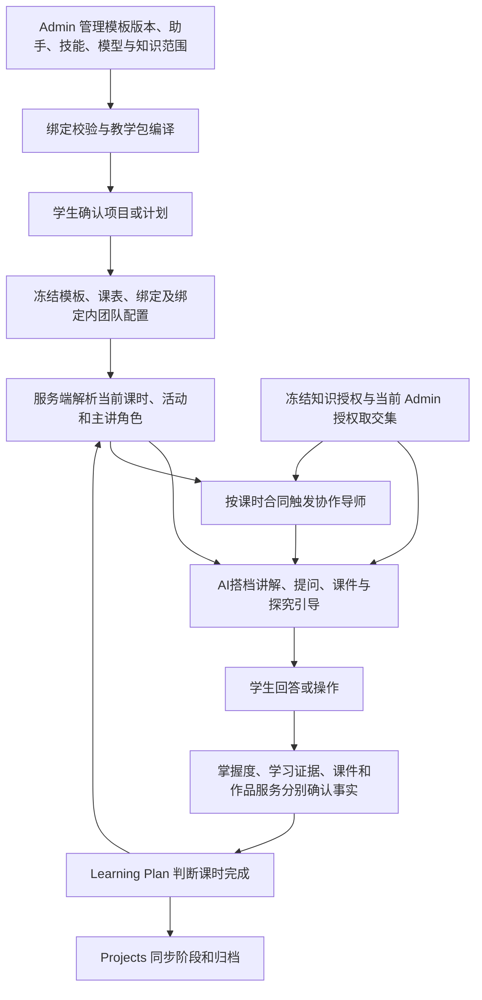
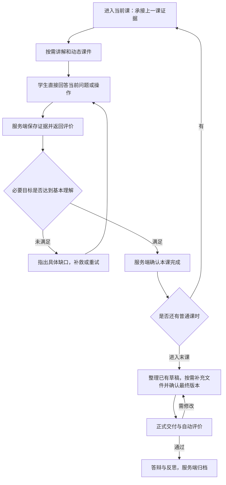

> 状态：2026-10-28 目录整理；保留原记录日期的方案与实施状态，已完成项和未验证项以正文为准。

# AI搭档连续学习与末课成果交付方案

日期：2026-10-26；实施更新：2026-10-27。用户已确认执行，问答连续学习框架与波动光学八课时新版本已实现。实施、验证及发布状态见[实施记录](./pbl-dialogue-implementation-20261027.md)。以下第 2–10 节保留分析时的源码基线与实施要求，不作为当前发布状态。

## 1. 目标与结论

目标是让学生在 AI搭档内，从第一课连续完成理论学习、课件互动、课时检验、探究实践和最后一课的成果交付。日常以简短问答为主，AI 自动组织教学环节、记录学生原始回应和整理过程材料。右侧“进度与团队”用于查看进度、历史和参与导师，不再是每课必须打开的提交入口。

降低门槛同时包括简化操作和简化普通课的通过要求：回顾、讲解、练习和日常反思作为教学安排，不再全部设置为独立阻塞关卡。只保留本课必要目标的最小理解证据；表达完整性、报告格式和拓展挑战默认只给建议。提示后达到基本理解可以完成本课，记录所获帮助，不要求初学者先独立答辩或写完整报告。

建议明确三个不同事实：

| 事实 | 产生方式 | 学生感受 |
| --- | --- | --- |
| 过程证据 | 当前题目的正式回答、已保存的实验观察、草稿版本、实践验证回执 | 我在学习，系统已保存本次回答或操作 |
| 课时完成 | 服务端核对新模板明确的必要目标和真实证据；非必要教学环节与提升建议不阻塞 | 本课已完成，可以继续下一课 |
| 最终成果交付 | 最后一课确认作品版本，自动评价，必要修订，完成答辩/反思和归档 | 我提交了这个项目的最终成果 |

“最后一课交付”不等于“前面没有检查、没有证据”，也不要求把作品创作推迟到最后一课。作品可以逐步形成，平时保存草稿和过程证据，正式交付集中在最后一课；末课未达标时继续修订，不因课次到头自动通过。

最终交付也不一律要求文件上传。站内已有正文或作品版本时直接确认提交；只有课程确实需要外部文件，如源码包、实物照片、视频或数据文件时，才显示对应上传入口。

这一划分参考 PBLWorks 对形成性评价与总结性评价的区分；它不意味着每个课中环节都要独立上传作业，也不作为自动评价效果的证明。[PBLWorks：教学实践](https://www.pblworks.org/gold-standard/pbl-teaching-practices)。本项目按 `autonomous-learning.v1` 由学生与 AI 完成学习，教师只读。

## 2. 核查边界

- 结论基于当前工作区实际源码，涵盖未提交修改；没有读取指定学生的线上项目快照或当前 Admin 配置，不能据此断言某个线上项目已经启用了这些能力。
- 示例采用八课时波动光学、十六课时光学、八课时雷霆战机源码。具体项目必须以其冻结的 templateVersionId、bindingId、课表 profile 和内容 hash 为准。
- 开始时已有大量修改，包括 TutorPage、ChatThread、课件展示、模板治理、学习计划、知识中心及产品文档等。本次未覆盖这些修改，也未对这些并发修改作行为验收。
- `Plan/codex/README.md` 在工作区处于已删除状态，本次未恢复。部分历史文档仍写“等待教师”或“逐课开场未实现”；下文以当前调用链为准。

## 3. 当前协作关系

### 项目模板库

`ProjectTemplateSpec` 包含驱动问题、学习目标及依赖、阶段、排期、逐课目标、主讲角色、活动、教学资源要求、证据要求、评价标准与检查点。它决定“教什么、按什么顺序、凭什么完成”。模板的标题或团队展示名不决定权限。

### 绑定与团队

绑定把模板版本和实际团队成员、逐课角色路由、技能版本、工具、模型及知识授权连接成可校验的教学包。项目确认时冻结绑定与 hash；之后按实际课时读取角色。现有源码也支持冻结的逐课团队/助手分配，但没有配置时不能推断存在。

团队不是每轮所有助手一起回答。当前课有主讲，协作者按 `collaborators` 的活动、触发条件和证据范围派发任务，经 Team Runtime 的任务机制返回建议与追问。协作者不能直接判定课时完成、理论掌握或作品通过。右侧显示名册也不等于所有成员实际参与了请求。

### 知识库与课件

知识检索用于提供材料和可追溯来源。正式项目权限受冻结 grant、当前 Admin 授权、当前助手工具权限及项目对象权限共同约束；新增知识库不会自动进入旧项目，撤权则需即时生效。

知识材料与已审核课件是不同资源。支持零基础课件合同的课程，可查找已审核资产、复用/改编或生成项目内课件，保存来源、目标及版本。课件阅读回执仅证明教学展示，不证明学生掌握。知识库检索结果也不能直接成为学生作品或成长事实。

### AI搭档与服务端

AI搭档负责呈现当前学习任务、启发和反馈，通过闭合结构块与 SSE 展示课件、题目、板书和实验。模型产生候选；正式判题与掌握度、证据接受、作品评价、课时完成及项目阶段分别由既有领域服务负责。

关键源码：

- [模板与逐课合同](../../packages/contracts/src/pbl-learning.ts)，约 230–324 行。
- [教学包编译](../../services/api/src/modules/templates/teaching-bundle.compiler.ts)与[绑定冻结](../../services/api/src/modules/templates/templates-binding.service.ts)。
- [当前课时和主讲解析](../../services/api/src/modules/ai-tutor/tutor-teaching-context.ts)、[逐课团队选择](../../services/api/src/modules/templates/teaching-session-assignments.ts)。
- [协作任务](../../services/api/src/modules/ai-tutor/tutor-lesson-collaboration.ts)。
- [知识授权](../../services/api/src/modules/ai-tutor/tutor-knowledge-access.ts)、[IMA 来源边界](../../services/api/src/modules/ai-tutor/ima-project-scope.ts)。

## 4. 为什么目前总要去右侧“上传结果”

这里主要是保存表达、选择证据和申请完成课时，不是系统要求每课都上传一个最终文件。问题由以下几层叠加造成。

### 4.1 对话与正式证据入口分离

`LessonNextStep` 明确提示聊天回答不会自动成为本活动记录，并让学生“打开本课记录与评价”。`TutorPage` 的回调打开右侧进度栏，记录与评价组件位于该侧栏。学生在中间回答后，仍需到另一个位置保存。

### 4.2 一个课时被拆成多个必须留证的活动

部分模板把 review、theory、check、practice、reflect 中的多个活动都设为 `session_response`。`projectLessonActivities` 按活动 ID 顺序检查质量已接受的证据，一个活动未满足就不进入后续活动。普通对话和单纯看过图示无法替代该证据。

八课时波动光学的零基础版本把 review/theory 改成课件展示回执，但其它活动仍需回答、观察或作品。雷霆战机源码没有同样的 `teachingSpec`，多项活动仍按表达保存和评价。

### 4.3 完成课时又增加了一次手工提交

`LessonWorkPanel` 要求 `canComplete` 为真且至少勾选一项证据，才允许“提交证据并申请完成本课”。后端其实支持空 `evidenceRefs` 时从服务端查找现有证据；前端的手工勾选不是所有课时都必须保留的业务条件。

### 4.4 过程记录复用作品存储，但它不是正式交付

`WorksLearningEvidenceService.submitText` 对回答、反思及作品复用 `works.createArtifact` 保存确切版本，再用 `session_response`、`submitted_artifact` 等回执区分用途。因此底层记录叫 artifact，不代表学生已经完成最终成果交付。建议继续复用存储，同时在产品显示、自动汇总和发布条件中明确用途。

### 4.5 有些模板本来就要求提前交付

| 源码模板 | 当前作品检查点 | 与目标冲突 |
| --- | --- | --- |
| 波动光学 8 课 | 第 7 课要求作品及通过回执，第 8 课复用已通过作品进行展示反思 | 正式交付发生在倒数第二课 |
| 雷霆战机 8 课 | 第 7 课提交作品并要求通过，第 8 课展示反思 | 同上 |
| 光学 16 课 | 第 14 课报告检查点，第 15 课答辩，第 16 课反思归档 | 报告门禁提前到第 14 课 |

还存在必须一起调整的阶段条件：`ProjectLearningLifecycleService.reconcile` 进入 `deliverable_review` 时先要求 `approvedArtifacts`。若仅把作品提交移动到最后一课，就可能在进入该课时先因没有通过作品而被拒绝。

关键源码：

- [对话下一步指引](../../apps/student-center/features/tutor/components/LessonNextStep.tsx)。
- [页面侧栏连接](../../apps/student-center/features/tutor/TutorPage.tsx)，约 272 行开始。
- [保存、勾选与完成按钮](../../apps/student-center/features/tutor/components/LessonWorkPanel.tsx)，约 125–193 行。
- [逐活动证据投影](../../services/api/src/modules/learning-plan/lesson-activity-progress.ts)。
- [课时条件校验](../../services/api/src/modules/learning-plan/learning-session-progress.service.ts)，约 101 行开始。
- [表达与作品保存](../../services/api/src/modules/works/works-learning-evidence.service.ts)，约 180–276 行。
- [阶段同步](../../services/api/src/modules/projects/project-learning-lifecycle.service.ts)，约 74–90 行。
- [波动光学](../../packages/ai-client/src/quiz-bank/optics/wave-curriculum.ts)、[雷霆战机](../../services/api/src/modules/templates/content/thunder-fighter.ts)、[十六课时光学](../../packages/ai-client/src/quiz-bank/optics/curriculum.ts)。

## 5. 已有能力与尚缺环节

| 环节 | 当前源码已有 | 仍需补齐 |
| --- | --- | --- |
| 理论讲解与知识依据 | 冻结目标、知识授权和来源校验 | 所有目标课程都配置可用的资料、来源与概念覆盖；不能仅凭模板名称认定已接入 |
| 课件展示 | 结构化板书、公式、分步课件、来源与项目实例、已审核资产复用 | 按学科补注册的动态演示；区分回顾与新授目标，避免每个活动重复覆盖整课概念 |
| 课时检验 | 正式理论检查、形成性题候选、表达自动评价 | 将当前活动对应的题型与真实工具接通，统一回答后的反馈和补救入口 |
| 过程留证 | 正式回答、观察、表达、反思可持久化并评价 | 直接从当前任务卡或明确的答题上下文提交，减少复制、重复输入和选证据 |
| 课时衔接 | 完成服务、阶段同步、逐课开场和幂等防重已有 | 从各类已接受回执驱动完整后续动作；明确缺什么，达标后直接显示下一课 |
| 团队协作 | 当前课主讲、按合同触发协作者、任务结果投影 | 让协作反馈回到学生当前任务；跨课使用真实证据组织承接，而非重复通用欢迎语 |
| 实践证明 | 注册光学观察回执、代码静态检查 | 编程项目的可信运行/试玩回执链；不能把文本自述、语法检查或模型评价说成真实运行成功 |
| 最终交付 | 作品版本、自动评价、通过后发布、反思和归档 | 统一末课交付规则、逐步形成的作品草稿及最终版本与过程证据的关联 |
| 运营验收 | 编译校验、模块测试及历史验收材料 | 对每个实际启用模板完成自然学习验收；记录源码、配置、发布与真实请求四层状态 |

需特别避免把已做的工作重复列为缺口：

- `autonomous-learning.v1` 已替代历史 `current_teacher` 评价执行角色；看到旧模板字段不能推断还要教师批准。
- `persistTutorOpening` 已按实际课时与计划 revision 去重保存开场，不能声称“完全没有逐课开场”。
- 完成课时入口已调用 lifecycle，后者先持久化完成，再同步项目阶段；正式答题也有同步挂接。缺的是覆盖完整学习循环的自动编排，不能笼统声称“后端没有阶段同步”。
- `coursewareToolSchema` 的当前过滤逻辑在非实验模式只暴露查找、复用和板书，即使定义列表里有 `choice_question`，也不会自动暴露它。这是零基础课中动态检查能力投影的具体缺口，不代表所有正式考核失效。

参考：[自动评价](../../services/api/src/modules/works/lesson-quality-evaluator.ts)、[逐课开场持久化](../../services/api/src/modules/ai-tutor/tutor-opening.store.ts)、[完成控制器](../../services/api/src/modules/learning-plan/learning-session-progress.controller.ts)、[理论答题](../../services/api/src/modules/ai-tutor/tutor-lesson-assessment.service.ts)、[课件工具过滤](../../services/api/src/modules/ai-tutor/courseware-tool-schema.ts)、[代码静态检查边界](../../services/api/src/modules/works/assessor/code-static-check-producer.ts)。

## 6. 建议的学生流程

### 课中只做当前学习动作

在 AI 回复旁展示当前问题、实验或草稿编辑。学生直接在对话中回答或点选，系统沿用服务端发放的当前题目/活动实例，将学生回应交给既有正式答题或学习证据接口；学生无需再选记录类型、复制正文、点保存、勾证据和申请完成。

自动关联必须有明确的当前任务范围，输入区可显示“回答当前问题”。没有当前任务的闲聊不记为作答；“我不会”“再解释一下”等求助保留待答题并进入提示，不自动判错。范围或意图确实不明确时才澄清，不能用模型猜测的题目 ID、标题或旧缓存给学生记成绩。回执保留学生原文/消息引用、目标、版本和帮助程度；AI 整理的小结不能替代学生答案，也不能标为独立完成。

普通课优先用一至两个短问题覆盖本课核心目标，这是交互设计起点，不是固定题数或自动通过规则。必要目标较多时可用综合问答覆盖；漏掉的必要目标仍需补查。允许口语、简短回答、图示选择和在提示后的理解表达；同一回答可以经服务端明确映射后支持多个目标，避免针对同一意思反复填写。措辞、篇幅和非关键细节列为改进建议。

实验运行与保存观察使用既有动作实例和回执。可把参数、运行结果和学生对现象的回答自动保存并关联，学生不手写或上传观察表。确需比较的课保留足以支持比较的实际运行，不能用一段聊天冒充多个实验。保存与评价失败分开显示；已保存但评价失败时只重试评价。断网保留未提交草稿，恢复后用原幂等键核对，不能乐观显示完成。

### 普通课采用最小达标条件

| 项目 | 新版默认规则 |
| --- | --- |
| 核心理解 | 学生能围绕必要目标作出基本正确的判断，或用自己的话说明关键关系；需要时补一个简短理由 |
| 帮助与重试 | 允许提示、例子和再讲解后达标；正常求助不作为扣分动作，也不冒充独立掌握 |
| 教学过程 | 复习、讲解、练习和日常反思按需穿插，不逐段要求学生交记录或等待评价放行 |
| 必要实践 | 仅在课程核心目标确需实践时核验真实工具/运行证据，系统尽量自动留存 |
| 提升建议 | 表达更完整、进一步推导、额外例子、规范报告等默认不阻塞普通课 |
| 最终作品 | 末课按必要交付目标评价；优秀表现和额外美化作为鼓励项，不把所有优化意见变成必须返工 |

服务端仍确认必要证据，不能仅因对话达到某个轮数、学生点击继续或 AI 自己生成了答案而完成课时。学生仍有影响下一步的核心误解时，改用更容易的例子、选择或图示继续帮助；无关紧要的不足记为后续复习点，不要求逐项完美后才能前进。

实践前的 TheoryMastered 保留，所有必需理论目标均须覆盖。正式检查可以融入问答，但必须进入现有判题/掌握度 owner，不能由普通聊天的总体评价替代。现有数值阈值、提示计分和冻结完成条件不在本方案中直接改写；实施时为新版本明确哪些活动产生正式尝试、哪些属于不计分的引导，并按实际政策验证。

### 课末自动整理，服务端确认，学生选择学习节奏

课时服务读取已保存且符合范围的证据，不要求学生逐个勾选。新版必要完成条件满足后，由协调入口触发既有完成命令，回读结果后显示简短小结及“继续下一课”；学生说“继续”也可映射到同一入口。该动作只控制继续学习的时机，不再承担上传、审核或手工选证据。普通反思可融入最后一句追问或跨课回顾，不统一要求另写总结。

下一课开场使用：本课已达标目标、关键证据引用、仍需复习的点、当前作品草稿版本和下一步目标。以现有证据与 Tutor 上下文生成有界投影，不新建一套课程进度或掌握度数据库。新导师继承同一冻结项目与可见证据。

### 最后一课正式交付

最后一课读取前面累积的草稿和证据，提供可追溯目录与必要缺项提示；学生确认或完善自己的最终正文。AI 可帮助组织材料、指出薄弱论证，但不能代写一份作品并冒充学生完成。已有站内内容直接提交，上传只用于尚未在系统内的必要外部产物，不强迫学生把系统已有内容导出再上传。

建议顺序为：整理已有材料 → 用简短问答确认学生理解 → 确认提交版本 → 自动评价与必要修订 → 正式接受 → 简短反思与归档。末课内部有多个活动，不增加额外课时；缺关键成果或依据时修订，非必要的格式优化和拓展建议不一律阻塞。作品版本变化后重新评价相应版本。

交付保留项目授权范围。产品中的作品交付不自动等于互联网公开发布。

## 7. 模板与服务端如何调整

### 7.1 在现有 ProjectTemplateSpec 内表达交付策略

新模板明确最终交付课、最终作品类型、最终质量标准和必须引用的过程证据，并区分必要达标要求、教学建议及拓展挑战。可扩展现有模板合同表达“问答为主、过程自动留证、仅末课正式交付”；具体字段名需实施时确定，当前不存在可直接配置并生效的通用开关。

同步接入 validator、模板发布、教学包编译/hash、bootstrap、运行时投影和 Admin 编辑器，禁止另立平行课程 schema。

非末课保留必要理论检查、模拟观察和可核验实践，但不要求 `approved_artifact`。草稿和课中回应允许形成、修订及评价，不触发最终成果发布。

当前 `activityRequirements` 的顺序阻塞规则和“全部质量条目满足”的评价方式需要一起调整：新版本仅对必要目标/证据阻塞；辅助活动按需执行，其反馈不参与通过条件。不要为了降低门槛把旧版未完成活动伪造为 completed，也不能仅隐藏侧栏而保留原有五道关卡。

对复习、新授分别明确目标子集及展示要求，不再让同一课的两个活动都无差别覆盖全部概念。把有教学意义的检查和反思融入对话；一般讲解不要求学生逐页签收才能开口答题。正式课件展示记录继续如实保存，它只证明发生过教学，不替代必要理解检查。

### 7.2 同步调整阶段条件，消除循环前提

进入最后一课的条件应是前序必要学习及实践证据达标。作品通过是最后一课中的成果验收条件，项目归档再要求最终反思；不能把最后一课将要产生的通过回执作为进入该课的前提。

需要共同调整：

- 新模板的阶段治理策略、作品检查点、活动证据与最终课顺序。
- `ProjectLearningLifecycleService` 对交付阶段的映射：尚未通过时允许进入作品评价流程，通过后进入反思，完成后归档。
- `LearningSessionProgressService` 对最终作品来源课时的筛选、精确版本和必需证据校验。
- Works 的作品提交、评价、发布及反思前置条件，确保最后一课内各步骤可达。
- 原有代码可运行、报告质量等专属门禁仍由对应证据服务证明，不能用文本自动评价代替。

沿用既有状态机和领域 owner，发布新策略/模板版本；不直接删掉门禁或将“点击继续”当作通过。

### 7.3 扩展现有协调链路

在正式答题、当前任务中的自然语言回应、课件展示回执、实验观察和自动评价完成后，统一检查当前范围并决定下一动作。复用现有 lifecycle、learning-plan、mastery、works 和 outbox。评价候选可以指出哪些必要目标已覆盖、哪些只是改进建议，由服务端校验并映射到既有证据；模型自身不能宣布掌握或放行课时。

评价调用失败时证据已持久化，保持待评价；回执已成功而页面断开时可重试和恢复。业务完成写入仍校验项目归属、revision、当前活动和幂等性。不得让模型调用 `advance_stage`、`mark_mastered` 或 `approve_artifact`。

### 7.4 页面保持现有导航

中间对话区承担学习、当前任务回应、反馈和末课交付。右侧保留课表、达标情况、历史证据、团队职责及真实协作状态，默认不展示每课通用作品上传表单。常规下一步无需打开侧栏。

这涉及现有页面内的职责调整，应先更新学生端事实文档并评审，随后实施；本文件是方案，不宣称导航或页面已完成修改。

## 8. 八课时与十六课时调整示例

| 课程 | 普通过程 | 交付前课 | 最后一课 |
| --- | --- | --- | --- |
| 波动光学 8 课 | 1 提问；2 准备理论及正式检查；3–6 探究、比较与留证 | 7 比较两类现象，形成档案草稿并预评，不正式发布 | 8 完善解释、确认最终档案、自动评价、答辩/反思与归档 |
| 雷霆战机 8 课 | 1 设计；2–3 基础概念与检查；4–6 增量开发和实践留证 | 7 集成、可信测试、缺陷修订与草稿预评 | 8 确认源码与运行材料的最终版本、评价、解释设计与归档 |
| 光学 16 课 | 前序理论及实践要求保留，实际 TheoryMastered 仍由目标证据决定 | 14 报告草稿与质量反馈；15 预答辩及修订，不以已发布成果作为进入条件 | 16 正式提交最终报告、评价、反思与归档 |

上述是新版本的课程重排建议。实际课数和安全域采用被选模板，不能用全局固定第 8/14/16 课推断权限。对于没有可信代码执行回执的课程，先补验证路径，再承诺“自动验证可玩”；本方案不制造此回执。

## 9. 实施顺序与验收

1. **先明确合同与影响范围**：建立对应实施 Issue，更新产品文档；选一门课程作新版本试点，区分必要目标与提升建议，取消辅助活动逐段过关，写清最小过程证据、末课作品和阶段前置条件。
2. **先打通证据与课时推进**：当前问题的自然回应直接留证，求助不计错；服务端自动收集符合范围的证据；评价后协调完成与下一动作；保留失败恢复和真实回读。
3. **完成末课交付闭环**：调整模板与阶段条件、草稿延续、最终版本评价、反思及归档，先证明最后一课可进入且不会提前发布成果。
4. **补齐教学质量与模板覆盖**：分开复习与新授目标、接通按活动开放的题型、补动态演示和各学科知识来源；编程类补可信运行验证。
5. **通过 Admin 发布新版本及绑定**：回读确认已启用，再用真实模型和隔离学习账号验证。新项目使用新合同，旧项目保留冻结内容和已完成记录；如需迁移，走显式映射与审计流程。

验收必须覆盖：

- 学生从第一课到末课，常规学习过程中无需打开右侧表单或重复粘贴回答。
- 学生围绕当前问题直接回答即可保存；无需额外点击“作为证据”、选择记录类型或手工勾选记录。
- 新模板的辅助教学环节不单独阻塞推进；简短但正确的回应、提示后理解和合理口语表达能通过必要标准。
- 普通课无统一长篇反思、逐页签收或固定答题轮数门槛；必要目标未覆盖时仍应继续引导，不按聊天次数放行。
- 中间课无最终作品通过/发布前置要求，但理论门禁、必要观察和证据质量仍有效。
- 正式答案、普通聊天、求助能够区分；不会因“我不会”自动交错题，也不覆盖待答题。
- 每次留证可恢复并幂等，切换项目/课时后旧响应不覆盖新状态，撤权后禁止继续写入。
- 课件展示、正式检查、补救与下一活动衔接完整；没有来源或能力不可用时明确停在相应缺口。
- 最后课之前可迭代草稿；只在最后课正式交付。末课可进入、评价失败可修订、改版后旧评价不能授权新版本。
- 已有站内正文可直接交付，不要求导出再上传；外部文件仅按实际课程需要补充。
- 教师全程无需执行学习放行、作品批准或课时恢复。
- 光学观察、模型计算、真实测量分别标识；代码静态检查与真实可运行证据分别核验。
- 最终归档与成长投影来自服务端正式事实；只提供有界授权证据，不复制原始未成年人对话。

分析阶段未运行产品行为测试或线上验收；实施后的实际结果单独记入实施记录。上述清单包含跨学科后续工作，不等于本次光学试点已覆盖所有课程。

## 10. 门禁、团队与框架兼容性复核

本节补充对“低门槛问答式学习”与现有框架的源码对照。结论：产品方向与模块化单体、Admin 统一治理、冻结教学合同和服务端事实写入的架构一致；现有 v1/v2 教学合同中存在必须协调调整的限制，不能仅改提示词或隐藏页面入口。

### 10.1 已确认的合同限制

| 改进目标 | 当前源码限制 | 必须同步处理 |
| --- | --- | --- |
| 回顾、讲解和普通反思不逐项过关 | `validateActivityRequirements` 要求所有有时长的活动都配置证据；`projectLessonActivities` 又按顺序逐个阻塞 | 新版区分教学安排与必要完成条件；保留真实当前动作及稳定实例，但辅助环节不进入课时阻塞判定 |
| 不要求逐页签收才能开始检查 | zero-base 校验要求 review/theory 具有 `teaching_delivery`；当前展示完成又要求该活动覆盖整课概念 | 新版分别定义回顾/新授范围、展示记录和学习完成条件，不伪造旧版阅读回执 |
| 问答直接完成检查 | 正式检查限定当前 check 活动及题目实例；形成性回答不写 mastery；普通表达走另一套证据评价 | 新版保留内部动作类型，服务端将当前任务回应路由到正确 owner；不能用通用聊天评分直接赋予 TheoryMastered |
| 最后一课才交付 | guided_practice 的阶段门禁常是作品通过；进入 deliverable_review 又要求已有通过作品；课时 checkpoint 必须匹配所在阶段 gate | 新版把实践结束的准备条件与最终作品验收拆开，在原状态机内调整策略、编译校验及领域命令 |
| 多余建议不影响完成 | 当前质量回执用全部条目 meets=true 判 accepted | 新版明确必要条目与非阻塞建议，必要集合由冻结合同决定，模型不得自行降级或删除必要标准 |
| 合并教学环节后团队仍参与 | collaborators 绑定具体 activity 和 trigger；当前协作还校验相同 activityId | 同时迁移触发条件和 worker scope 校验，防止删除独立 reflect 环节后点评永远不触发 |
| 辅导后能继续，且不反复考试 | 量化目标仍有次数置信上限及提示扣分；质化目标已有独立判定；同一次答案不能随意重复累计 | 明确不计分引导与正式检查的边界，并为新策略验证最低证据要求；保留帮助程度，不伪称独立掌握 |

源码依据：[活动与课时校验](../../packages/contracts/src/pbl-learning.ts)、[课件合同校验](../../packages/contracts/src/courseware.validation.ts)、[活动进度投影](../../services/api/src/modules/learning-plan/lesson-activity-progress.ts)、[正式检查适配器](../../services/api/src/modules/ai-tutor/tutor-lesson-assessment.service.ts)、[评价判定](../../services/api/src/modules/works/works-lesson-quality.ts)、[逐课协作](../../services/api/src/modules/ai-tutor/tutor-lesson-collaboration.ts)。

“有时长的活动必须有证据”与“所有活动都必须通过”需要一起版本化调整。可以保留课程设计中的五种教学活动，不必强迫学生依次完成五次提交。也不能直接删除所有 activity 身份：题目、实验、课件授权和异步协作仍需知道当前具体任务。

### 10.2 门禁的职责划分

| 类别 | 作用 | 新版处理 |
| --- | --- | --- |
| 对象权限、明确立项、冻结授权 | 决定谁能访问、项目是否正式成立、可用角色和工具 | 保留，不由学生的学习表现或模型建议改变 |
| 实践前必要理论 | 决定是否可使用正式实践工具 | 保留 TheoryMastered，通过简短且绑定目标的问答取得真实判定；理论阶段可用已授权低风险示意 |
| 普通课学习检查 | 判断是否达到继续学习所需的基本理解 | 只阻塞必要目标；引导、日常复习和表达优化不单独卡住课时 |
| 成果验收 | 判断最终作品版本及必要证据是否合格 | 放在末课；按课程的真实交付类型核验，不把模型文字评价当作运行或实测证明 |
| 拓展与优秀标准 | 帮助进一步提高 | 给建议和后续挑战，不默认阻塞 |

必须避免将“低门槛”实现成全局降低掌握度数字、跳过安全域或关掉对象权限。普通课达标、正式理论掌握、最终作品接受是不同的既有事实，可由同一次有范围的学生回应支持相关检查，但仍由各自 owner 作出判断。

旧文档或门禁注册表里出现 `mentor_review` 允许来源，不代表新流程需要教师操作；学习执行策略继续采用 `autonomous-learning.v1`。真实实验的独立安全要求与日常学习审批分开，默认自主课程使用已批准的低风险模拟路径。

### 10.3 末课交付的具体兼容路线

保留现有四个教学阶段和项目状态机，发布新的治理策略版本。实践阶段结束只证明“前序必要实践与学习证据已具备，能够开始整理交付”，不提前要求最终作品发布。该准备事实由既有学习计划和证据服务派生；若运行时需要独立门禁 ID，应在现有注册表登记其生产者、证据类型、错误码及审计，不能重新解释旧的作品通过 gate。

最终课开始时允许没有已通过作品：先整理、提交和评价，再产生作品接受、反思与归档事实。原报告质量、真实代码运行等验收要求在对应最终交付步骤核验，不因移到末课而取消。

当前每课只有一个 `checkpoint`，并要求它等于所在阶段 gate。因此不能简单在最后一课配置两个 checkpoint，或将 guided_practice 的作品 gate 直接写进 deliverable_review 课时。应在新版 `completionSpec` 内表达最终课的必要证据组合和活动依赖，阶段 checkpoint 仍承担该阶段的正式出口；验证器与 owner 同步支持这一组合。

还要核对门禁生产者的阶段限制。例如 `WorksPublicationReview.practiceGate` 对 rubric gate 检查当前课必须位于 guided_practice；移动最终提交以后，此类逻辑也须随新策略调整，不能只改模板中的课次。

依据：[阶段策略和检查点](../../packages/contracts/src/pbl-learning.ts)、[门禁注册表](../../packages/contracts/src/team-runtime.ts)、[项目生命周期](../../services/api/src/modules/projects/project-learning-lifecycle.service.ts)、[作品门禁生产条件](../../services/api/src/modules/works/works-publication-review.ts)。

### 10.4 团队协作与评价职责

建议继续以一个当前课主讲组织对话，协作者在需要解释、对比或点评时参与。学生始终在同一 AI搭档入口学习，实际主讲和协作者身份保持可见。

- 主讲负责教学行动与反馈候选，不直接写完成或掌握事实。
- 协作者返回有范围的建议和追问；“团队任务已完成”不等于“学生已掌握”。可选协作未完成不阻塞普通课，学生已有证据不因团队排队而丢失。
- 评价助手的教学点评与服务端 `learning.evaluate` 评价执行要区分。两者可按 Admin 配置使用模型，但正式接受仍由 Works/学习计划等 owner 决定，不要求多个导师投票通过，也不另起一套评审状态库。
- 合并活动后，协作应绑定新的明确教学时机，例如当前任务接受证据后、学生求助时或最终作品待点评时，并携带项目、revision、课时、动作和证据版本。新触发语义先进入模板合同与校验，不绕过现有授权。
- 当前协作结果要求回读时仍在原 activityId。自动推进可能使异步结果到达时已经换课：可选点评可以丢弃或作为有明确历史范围的回看记录；不能套到下一课。真正必需的最终评价由其专属 owner 流程等待并恢复。

教师的“一个当前班主任”关系、AI 项目 Leader 和每课主讲是不同身份。现有 `startRun` 对学生还有“最多一条活跃运行”的约束，并带有空运行清理和终结运行核对。跨课换团队或切换项目时，应验证有真实未完任务的旧运行如何结束/取消/接续；不能通过混改教师分配或随意放宽数据库约束解决 AI 路由问题。

依据：[冻结逐课路由编译](../../services/api/src/modules/templates/teaching-bundle.compiler.ts)、[主讲角色解析](../../services/api/src/modules/ai-tutor/tutor-teaching-context.ts)、[协作与异步结果校验](../../services/api/src/modules/ai-tutor/tutor-lesson-collaboration.ts)、[Team Runtime](../../services/api/src/modules/team-runtime/team-runtime.service.ts)。

### 10.5 既有框架的写入职责保持清楚

| 模块 | 继续负责的事实 |
| --- | --- |
| templates / binding / Admin | 教学内容、必要标准、角色、技能、模型、工具和知识授权的版本与发布 |
| ai-tutor | 对话、当前教学动作候选、明确任务范围下的回应适配、呈现回执 |
| learning-plan | 当前课与必要目标、待答题、正式答题、课时完成记录 |
| mastery | 目标掌握和理论门禁 |
| works / evidence | 学生原始回应、观察与作品版本、质量评价与作品接受依据 |
| projects | 项目阶段同步、最终完成及归档 |
| team-runtime | 派发任务、运行状态、协作结果和领域事件投影 |

连续学习协调逻辑扩展已有服务与 outbox，不新建全能“AI 自动过关服务”、第二套 PBL 状态机或新的 mastery 数据库。模型输出始终是候选，工具/客户端请求也不能携带最终通过判定。

另外，通用 Team Runtime 阶段接口仍使用核心阶段门禁表；`lesson.collaborate` 则经过专门的课时证据范围检查，不能把通用接口的限制直接说成所有当前课堂协作都受到同样阻塞。实施时列清新策略实际调用的阶段接口、团队投影和各门禁生产者，确保它们与当前冻结模板一致，避免项目已进入末课、团队面板却仍要求旧版实践作品 gate。

### 10.6 建议增加的体验与发布检查

1. **分清卡点原因**：分别显示“还需理解一个概念”“回答已保存，评价处理中”“服务暂不可用”“课程配置待修复”。配置或服务故障不记为学生答错，也不要求学生重交已保存答案；尚未取得评价时不能提前显示达标。
2. **按目标组织补救**：同一必要目标的不同尝试复用已保存证据，普通指导不频繁触发完整评审。必要评价以内容版本去重，节省重复等待；缺少确定依据时继续引导，不根据聊天轮数放行。
3. **保留帮助程度**：课时允许提示后完成，成长投影注明受助情况；未来独立迁移可安排为后续目标，不把每次初学都变成无提示考试。
4. **发布前检查整条路径是否可完成**：模板编译检查每个必要要求是否有已授权生产者、每个阶段是否有可达出口、末课是否存在互相等待的前置条件、协作者是否能在新活动结构中实际触发。缺真实运行工具时不发布承诺自动验证可玩的配置。
5. **保留真实 PBL 主线**：每课的问答服务于同一个项目问题，逐步补充草稿或证据。降低操作成本后仍要让学生完成必要尝试和实际创作，避免课程只剩连续聊天、最后要求突然交一份陌生成果。
6. **分版本验证和迁移**：先完成一种新模板的源码、配置、发布及真实请求验收。旧项目迁移明确保留哪些已完成记录、哪些必要目标仍需补足，不在读取时自动改写标准或追加技能权限。

后续验收额外覆盖：辅助协作失败不阻塞学习；协作迟到不污染新课；换主讲/换团队的运行回收；自然语言求助不生成错误作答；无需复习签收也可按新策略进入检查；辅助质量建议不导致失败；提示后的正确回应按新策略处理；进入末课时尚无最终作品仍可继续；最终提交改版后评价失效；项目阶段与团队投影一致。

以上是源码支持的兼容性分析与待实施要求，并非对当前线上配置、完整可达性或真实模型效果的验收结论。
