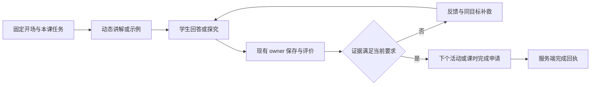

> 状态：原日期的方案或验证记录；2026-10-26 整理仅补充分类与引用，不新增功能完成或生产验收结论。

# 16 课时教学闭环与实施验收

状态：待实施设计。以现有 16 课主题和 v5 逐课基础为起点，不把规划表当作已发布事实。

范围已调整：用户最新明确只考虑干涉与衍射。以下综合 16 课表保留为设计演变记录，不再作为本次推荐课表；最新方案见 [05 干涉与衍射专题](./05-interference-diffraction-curriculum.md)。通用 owner、版本和验收原则仍可复用，具体课号与理论目标需按新合同重新审查。

## 正式课程的导师安排

总导师 `optics-leader` 负责课程协调。表中主讲可以按课时变化，协作为显式任务，不要求每课所有导师同时发言。接待助手不参加正式课程。

| 课 | 主题 | 主讲 | 需要的协作 | 主要学习证据／完成边界 |
| --- | --- | --- | --- | --- |
| 1 | 宏观现象与观察指标 | 概念教练 | 总导师整理探究问题 | 带指标的观察表，能区分观察与解释；不显示理论门禁考核 |
| 2 | 可检验假设与方案 | 总导师 | 实验向导审查变量与安全事项 | 假设、变量和初步方案；不重复确认项目 |
| 3 | 直线传播与平面镜 | 概念教练 | 需要时由评审导师检查解释 | 光路／成像作图与说明、相关目标判分引用 |
| 4 | 反射定律与可逆光路 | 概念教练 | 同目标补救按需触发 | 法线基准、反射角和反向作图的作答证据 |
| 5 | 折射定律与折射率 | 概念教练 | 按授权来源核验公式与条件 | 角度计算、偏折方向与适用条件说明 |
| 6 | 全反射与临界角 | 概念教练 | 评审导师检查条件解释 | 条件判断与临界角推导，不只记公式 |
| 7 | 透镜特殊光线与成像 | 概念教练 | 总导师组织模型关系 | 凸／凹透镜光路及边界条件解释 |
| 8 | 理论综合检查 | 概念教练 | 总导师组织补救；必要时教师介入 | 四个既有理论目标的 owner 判分；仅真实 `TheoryMastered` 放行实践 |
| 9 | 装置与基准校准 | 实验向导 | 概念教练；教师审核安全 | 获准的校准记录；当前没有自动装置工具，不能伪造执行回执 |
| 10 | 角度与物像距数据 | 实验向导 | 数据分析能力；教师核验真实测量 | 有单位、条件和来源的数据表；区分真实测量与模拟 |
| 11 | 单缝衍射探究 | 实验向导 | 概念教练解释模型边界 | 注册仿真的预测、稳定操作事件、已保存观察和比较；非新增理论门禁 |
| 12 | 封闭细雾室散射探究 | 实验向导 | 概念教练与证据评议 | 注册模型域内的预测及观察，说明适用边界；不把公式值标成实测 |
| 13 | 数据拟合与实验求参 | 实验向导 | 评审导师检查 CER 与不确定性 | 拟合、单位、误差说明和结论范围 |
| 14 | 实验报告与 CER | 评审导师 | 实验向导复核来源 | 版本化报告与证据引用；必须由现有作品／教师审核 owner 接受 |
| 15 | 成果答辩与质疑 | 评审导师 | 总导师组织答辩，教师评价 | 答辩记录、回应质疑与修订依据 |
| 16 | 反思与归档 | 评审导师 | 总导师收束；成长助手消费批准事件 | 真正的反思产物、最终审核／归档回执；不自动生成通过事实 |

若某项必须教师评价，明确显示“等待教师评价”和责任人；教师未处理不通过让模型自评代替。需要自动完成的低风险活动，应先为现有质量评价 owner 配置经过审查的执行器、rubric 和接受条件，再纳入发布检查。

## 每课都必须闭合的过程

保存、评价、掌握和课时完成是不同事实。页面必须知道学生当前应执行哪个动作；不能让学生在“开始当前活动”后停留在通用聊天，也不能让独立工作面板与对话分别维护一份进度。

当最后一个活动完成时，由现有课时 owner 校验门禁、学习产物、质量评价和当前 revision。完成回执驱动下一课投影及开场。报告批准、理论门禁和最终归档仍各有 owner；课程已完成但报告待审核时显示真实等待状态。

## 实施顺序与交付范围

| 批次 | 实施内容 | 必须交付的证据 |
| --- | --- | --- |
| A：角色与状态纠正 | 修正开场／handoff 作者；接待助手 leader 服务端禁用；修正不适用考核卡；Admin 分开绑定状态与课程就绪 | 通过 owner API 的拒绝测试、真实作者显示、旧课程缺口提示 |
| B：课程与团队编辑 | 在既有合同补固定开场和活动协作；逐课主讲／协作编辑；同步 parser、编译、发布、hash 和能力检查 | 草稿修改后回读一致，错误能力／角色／知识授权被拒绝，发布后不可原地更改 |
| C：课堂执行贯通 | 当前活动 → 主讲 → 必要协作 → 证据 owner → 完成回执 → 下一课；SSE、恢复与幂等 | 同一课内的完整行为测试，过期 revision／跨课候选拒绝，断线重试不重复写入 |
| D：课程内容与发布 | 调整第 1–2 课及阶段协调引用，核对四位领域导师所需 Skill；完成真实知识库授权、16 课规则和试点发布 | 新课程及团队／绑定版本，课程可执行报告；旧快照不变 |
| E：生产验收 | 使用隔离测试账号走新版本的真实课堂，浏览器验证编排和学生交互；教师完成其真实审核步骤 | 按下表保存脱敏回执和失败记录，不能用造数或人工注入 mastery 代替 |

此前 v5 课程源码可作为 B–D 的基础，但仍继承旧阶段协调关系，不能不经核对直接发布。现有四位导师的 Skill 也需要按逐课能力清单补齐；例如第 1 课新增的数据理解需求不能因导师已有七个技能就假定满足。

## 验收清单

| 编号 | 场景 | 通过条件 |
| --- | --- | --- |
| T01 | 自由探索与接待职责 | 没有正式项目；接待助手不是任何 Team Run 的 leader |
| T02 | 违规团队／运行配置 | API 拒绝接待助手 leader，拒绝正式课时主讲／协作引用；前端隐藏不能代替后端验证 |
| T03 | 模板进入 | 标题、开场、模板版本和团队预览对应所选模板；重复跳转不额外建项目 |
| T04 | 明确立项 | 确认事务冻结版本及 hash；重复请求只产生一个项目及计划 |
| T05 | 第 1 课 | 概念教练主讲；固定开场进入观察活动；没有错误的 leader 标签和不适用考核红框 |
| T06 | 逐课编辑 | 修改草稿第 2 课的主讲／协作、开场和证据规则，发布后在新项目真实生效；旧项目保持原快照 |
| T07 | 团队增加成员 | 新助手经现有 owner 配置及团队版本发布后才能选择；未发布／撤权／能力不足明确拒绝 |
| T08 | 普通知识教学 | 可以讲定义、公式、独立示例与结论；不能因一般答案保护规则被截断 |
| T09 | 正式待答题 | 仅显示公开题目；求助不自动判错、不覆盖 pending；提交后由原 owner 判分与解析 |
| T10 | 动态课件 | 内容来自实际当前活动和证据；合规候选可展示，翻页不改变课时完成数 |
| T11 | 协作触发 | 触发后产生对应导师实际任务和候选；界面状态与任务／owner 回执一致，不只显示成员头像 |
| T12 | 理论未过关 | 第 8 课结束仍不自动解锁实践；未达标可补救及教师介入 |
| T13 | 实践证据 | 注册模型／参数／action 范围验证；重复操作幂等；收到保存回执才计入证据 |
| T14 | 知识权限 | 缺 scope 拒绝；撤权立即生效；旧项目不会因新增授权扩大范围；没有来源不能声称教材已核验 |
| T15 | 报告审批 | 第 14 课报告版本、rubric 与证据引用进入原审核路径；模型建议不等于批准 |
| T16 | 反思与归档 | 真实反思来源及最终 owner 回执；第 16 课索引不自动归档或生成成长事实 |
| T17 | 恢复与历史 | 刷新恢复同一课／活动／pending／观察；项目关联前期探索但保留真实源记录；不重复开场 |
| T18 | 会话与项目删除 | 各自永久删除语义仍有效；折叠关联不改变删除目标；已删除内容不会从缓存恢复 |
| T19 | 异常与窄屏 | 断网、权限、保存回读失败、模型／协作失败均可理解且可恢复；390px 不横向溢出 |
| T20 | 完整课程 | 新冻结课程实际完成第 1–16 课、理论判分、实践取证、教师审核和归档；提供脱敏 owner 回执及真实模型请求记录 |

源码测试、隔离 fixture、配置发布、真实模型成功和完整师生课堂是不同证据层。应分别报告，不能以测试数量或几轮对话成功代替 T20。

本轮只完成问题复核和方案文件，因此没有新增行为测试结果，也没有声称线上教学已修复。
