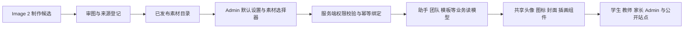

> 状态：历史记录恢复（2026-10-26）。正文保留 df05d5b 中的原始日期与验收边界，不代表当前部署状态；现行规则见 [工程入口](../../../README.md) 和各责任域文档。

# 统一素材库接入计划

> 状态：planned · 全部接口、字段与组件名均为拟议设计，尚未实现。生成清单见 [01-generation](./01-generation.md)，全站展示位见 [03-site-inventory](./03-site-inventory.md)。

## 1. 使用体验

将“选素材”作为现有助手、团队、模板编辑器的一部分，复用同一个选择器；不新增顶级导航。全局默认项放入现有系统/外观设置中的相关区块。需要独立素材管理导航时，另按冻结 IA 规则更新产品文档并评审。

选择器支持：按用途筛选、主题标签、名称检索、网格预览、选中态、实际尺寸预览、当前使用标识、确认与取消。助手编辑器默认只显示适用头像的 10 款；模板编辑器按图标/封面分别筛选；素材可被多个对象引用。选择器不向普通客户端暴露原始生成提示词、管理员信息或跨校使用记录。

**减少逐个配置的关键规则：**

1. 新建助手默认“继承平台头像”，无需多一次配置或生图。
2. 平台默认头像由 Admin 一次设置，所有继承对象自动采用；明确选择过头像的助手保留自己的选择。
3. 现有列表可多选后执行“设为某素材”或“恢复继承”；提交前展示将改变的对象及已定制项。
4. 旧自定义 emoji/头像默认保留。只对缺省或已明确标记为系统默认的对象启用继承；无法区分人工选择与 seed 值时先保留，不靠猜测覆盖。
5. 单个覆盖 > 显式类别默认（如以后配置）> 对象类型默认 > 内置兼容兜底。类别默认必须有受管理的分类 ID，不能按标题、角色字符串或 ID 前缀猜测。
6. 素材仅表示外观。更换“实验探究”头像不会启用实验工具；“评议”头像不会赋予作品通过权限。

团队、模板、知识库也采用相同继承/选择模型。任务类型、文件类型、空态等固定语义展示位通常由系统映射一次，管理员不需要为每一条记录配图。个人身份头像继续按原账号规则处理，不向学生开放平台素材治理权限。

公开站点仅获得公开素材和公开内容；上述图不表示公开站点可以访问内部业务读模型。

## 2. 资产与展示绑定合同

复用 NestJS 模块化单体、现有 platform-registry/模板 owner、platform-config 修订机制、鉴权、幂等和审计。不新建图片微服务，也不建设另一套课程/项目/掌握度系统。

建议新增两类持久化记录，平台默认选择复用现有全局配置：

| 记录 | 最小信息 | 约束 |
| --- | --- | --- |
| `visual_assets` | 不可变 `assetId`/版本、类别、适用槽位、名称、标签、scope、格式/尺寸/摘要、文件 key、来源、发布状态 | 资产文件不可原地覆盖；内置公开与校域私有明确区分；引用永远指向特定版本 |
| `visual_bindings` | owner 类型/ID、可选 owner version ID、槽位、assetId、修订号、scope、修改人/时间 | owner 只允许注册类型；按 scope+对象+版本+槽位唯一，正确处理 NULL 版本；不能存模型/角色/教学策略 |
| 既有 platform-config | 按用途设置的默认 assetId 与配置 revision | Admin-only、事务、审计；不成为第二份模型或教学策略配置 |

绑定 API 通过各业务 owner 校验对象存在性、校域、编辑权限、版本以及素材兼容性；不能只检查 assetId 存在。跨对象通用存储不代替 owner 授权；删除对象、归档和历史引用的保留策略由 owner 明确处理。

拟在 `packages/contracts` 中增加：

- `VisualAssetSummary`：适用于选择器的有限目录元数据。
- `VisualAssetRef`：稳定资产引用，不接受客户端任意远程 URL。
- `EntityVisual`：服务端解析出的 icon/avatar/cover/illustration 槽位及 binding revision。
- `VisualSelection`：`inherit` 或指定 assetId；旧 emoji 是兼容展示，不复用为任意图片地址。

业务读模型在已有响应中携带最小展示投影，避免一个页面为每张卡片再请求目录。UI 可维护 assetId→内置文件的渲染映射；哪些对象有权用什么素材、默认值与绑定均由服务端决定。

## 3. 历史版本与身份一致性

- 助手/团队列表显示当前展示设置；按 `assistantId`/`teamId` 精确绑定。团队成员头像由服务端按成员引用解析，客户端不能提交成员的解析后头像覆盖助手。
- Tutor 使用真实当前助手和每条消息的服务端作者元数据。不能把整个历史聊天改成当前活跃助手的头像。
- 新消息可保留发言时的 assetId；旧消息缺少资产快照时保留原作者首字/旧头像，不猜测历史身份。
- 模板目录可以显示当前展示设置；版本预览、正式项目和导出使用显式版本展示引用。图片选择不得原地改已冻结的 `ProjectTemplateSpec`、binding hash、team version 或课时语义。
- 可新增独立的 `presentationSnapshot`/展示修订引用供未来确认事务附带保存；它只包含图片引用，不承载教学语义。旧项目无此引用时沿用已有封面/通用兜底，或经 Admin 显式回填展示绑定，不在读取时静默套用当前 active 模板。
- 作品真实缩略图优先于模板封面；“模板主题图”“默认作品封面”须与真实作品图可区分。主题图不能充当实验观察、作品证据或成长事实。

## 4. 存储与交付

**首期内置库**：已审核的公开、无个人数据素材以版本文件进入 `@qitu/ui`，静态导入后随应用构建；服务端登记相同资产 ID/摘要。发布步骤先保证文件可取，再启用目录与默认绑定。多个应用必须检查 basePath，不硬编码跨应用 `/assets/...` 路径。

只把实际用到的图片加载到页面，按 64/128/256 等派生尺寸选择资源。显式 width/height，头像 `contain`，封面 `cover` 并保留焦点区域；非首屏延迟加载。资源文件采用内容摘要/版本缓存，不以同路径覆盖来刷新全站。

**后续上传库**：若提供管理员上传或在线生图，落对象存储；公开平台资产与私有校域资产分开处理。私有对象返回经授权的短期地址，不进入公开构建目录；权限撤回后不能继续签发地址，已有签名的失效窗口须记录。数据库只存对象 key/元数据，不存 base64 大图或长期签名 URL。

现有作品预签名接口是学生作品域能力，不能直接拿来上传平台素材。可以复用经过审计的底层存储适配器，必须新增 Admin 资产用途和完成确认；真实存储未配置时明确返回不可用，不用 demo 地址冒充成功。

上传需限制大小/像素总量，检查实际解码格式与摘要，去除不需要的元数据；允许 PNG/WebP 等受控格式。运行时 SVG 仅使用受信任、代码审核后的内置资源，不接收模型任意生成的 HTML/JS 或未经处理的 SVG。

## 5. 拟议 API 与状态

| 用途 | 候选接口形态 | 必须满足 |
| --- | --- | --- |
| Admin 素材目录 | `GET /api/v1/admin/visual-assets?usage=avatar` | 校域过滤、已发布筛选、分页；只读取真实目录 |
| 对象单个选择 | 现有 owner 下 `PATCH .../:id/visual` | assetId/继承模式、幂等键、预期 revision、对象权限 |
| 批量选择 | `PATCH /api/v1/admin/visual-bindings/batch` | 有界对象列表、逐项 owner 校验、逐项结果与回读 |
| 平台默认 | 现有 platform-config 的视觉默认字段 | 修订冲突检测、Admin 权限、影响数量预览 |
| 发布/退役 | Admin 资产 owner 命令 | 发布前文件可达/格式/摘要验证；引用中的资产不直接硬删 |

初次素材注册可以通过受治理的发布脚本完成，选择器不需要等待在线上传/生图功能开发。上述路径须在实施时与现有路由规范统一，不代表已经存在。

选择器 loading 有骨架；空目录有明确空态；读取失败可以重试且不能提交过期目录；断网保留只读预览、禁用保存；403 明确显示权限失败。快速切换对象时采用 request identity/abort，旧回读不能覆盖当前对象。

保存操作依次经历：提交中 → 服务端结果 → 回读校验 → 显示已生效。网络超时但结果未知时使用同幂等键恢复，不能直接显示失败后又以新键重复创建。批量部分成功列出成功/失败对象，仅重试失败项；不能整批乐观宣布成功。

建议错误码：`VISUAL_ASSET_NOT_FOUND`、`VISUAL_ASSET_NOT_PUBLISHED`、`VISUAL_SLOT_MISMATCH`、`VISUAL_SCOPE_DENIED`、`VISUAL_REVISION_CONFLICT`、`VISUAL_STORAGE_UNAVAILABLE`。权限错误不泄漏跨校对象存在性。审计记录 actor、目标、前后 assetId/修订与幂等事件，不记录密钥和原始学生数据。

## 6. 共享组件与具体接线点

| 层/页面 | 实施内容 |
| --- | --- |
| `packages/ui` | `VisualAsset`、`EntityAvatar`、`EntityIcon`、`EntityCover`、`EmptyIllustration` 等小组件；统一尺寸、加载失败兜底、alt、decorative 与打包路径 |
| Admin 助手 | 替换 emoji 轮换按钮为 `AssetPickerDialog`；支持继承、单选、批量；保留自定义旧值 |
| Admin 团队 | `TeamCard`、详情成员、成员选择弹窗使用相同资产投影；团队图与成员头像分开 |
| Admin 模板 | 先替换 `📦` 图标；详情中的现有合适槽位支持图标/封面选择；不为图片重新设计整页 IA |
| Admin 知识/技能/工具/插件 | 内容分类使用共享图，供应商品牌用既有品牌资产；分类配置与 canonical skill/tool ID 分离 |
| 学生今天/灵感 | `DirectionCard`、`ContinueProjectCard`、`TemplateCard`、`RecommendedTemplateDetail` 接服务端投影 |
| 学生 Tutor | `ChatBubble`、`TutorPage`、`TeamAgentHud`、`TutorTeamRail`、`AsideAdvisorCard` 统一真实作者/成员的头像解释 |
| 学生项目/作品/成长 | `ProjectCard`、`ProjectHeader`、`WorkbenchHeader`、`ArtifactEntry`、时间轴与空态接线 |
| 教师与家长 | 授权投影附带项目/内容素材；教师支持、家长周报图复用；切换学生不串图 |
| 官网与登录 | 复用品牌、搭档与主题插画，保留现有互动场景和导航；公开素材不包含内部对象信息 |

图形与旁边文本语义重复时使用空 alt/decorative，只有图形承载语义时才给可读标签。加载失败不显示破图或 URL 字符串；素材目录版本不一致时回退现有图形，不影响学习任务和主操作。

## 7. 验证、发布与回滚

需要验证的行为：

1. 10 款头像可重复选择；新建助手自动继承；修改默认不改已有覆盖；恢复继承可生效。
2. 自定义旧头像保持；旧 emoji 不被当成 URL；新图片不被渲染为文字。
3. Admin-only、跨校隔离、对象权限、类型不匹配与未知资产拒绝；未授权请求不能获得私有素材地址。
4. 保存刷新一致；批量部分失败、回读失败、同键重放、revision 冲突和快速对象切换正确。
5. 历史项目/消息引用稳定；展示绑定不改变教学 binding hash、模型 pair、门禁、mastery 或作品状态。
6. 四端相同对象展示一致；家长切换学生时旧响应不能覆盖当前学生。
7. 图片 404、离线、未发布、目录旧版本、资源路径 basePath 错误均有准确兜底。
8. 32/64px、浅/深背景、桌面与窄屏检查通过；列表不下载全部母版，页面不因图片加载跳动。

按依赖图先构建 contracts、database、ai-client 等真实需要的包，再运行 owner API 与应用的定向行为测试；类型检查不替代选择/保存/权限验证。首轮文档工作无需运行全量业务测试，后续代码修改按实际影响选测试。

发布按“文件 → 目录 → 组件兼容 → 默认/单个绑定 → 批量扩展”推进。先用隔离 fixture 验证，再灰度开启。保留旧素材及引用，回滚通过还原视觉默认/绑定修订或关闭新渲染开关，不回滚课程、团队和 PBL 业务状态。

未来在线生成属于独立增量：Admin 模型用途配置 → 有预算的异步生成任务 → 候选审核 → 素材发布 → 自愿选择；页面打开和每次助手对话都不自动触发生图。
