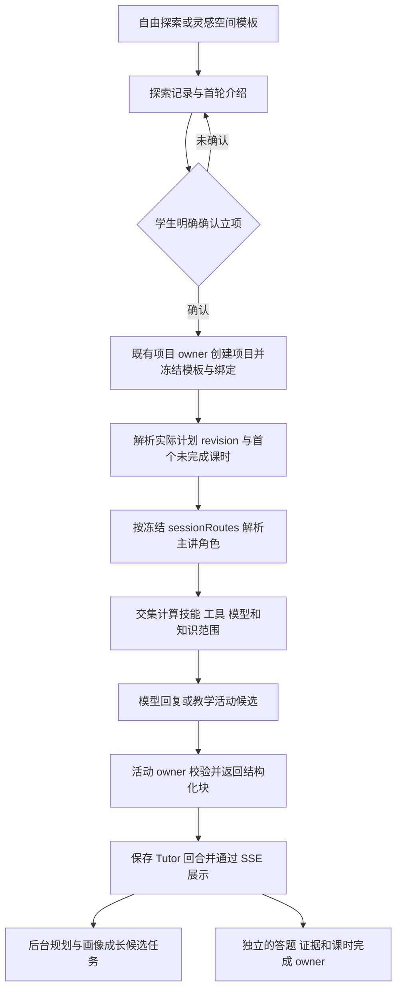

# 01 当前实现与问题证据

状态：只读核查结果。入口见[审查总览](README.md)。

## 1. 当前调用过程

当前存在这些主干，但“模型生成一块板书”和“完成一项教学活动或一课”尚未完整串接。后台规划任务成功也只是候选任务成功。

### 创建和恢复

- 模板入口创建的是 exploration，尚不是正式项目；自由探索先澄清意图或选取受治理模板。
- `ProjectsService.confirmIntent` 通过同一探索已有项目查询、幂等和事务控制正式立项，并冻结模板、binding、团队版本和 hash。学习计划确认另有既有 owner，应复用领域实现，不能新增一条绕过冻结的创建路径。
- 幂等限制的是同一次确认或同一探索。学生反复新建探索并分别确认，仍会得到多个合法项目；不能宣称“同一模板只能有一个项目”。
- 建议模板进入时明确区分“继续已有项目”和“重新开展”，由后端查询本人有权限的模板项目；不能自动把新探索升级为正式项目，也不能以标题合并历史。

### 回复和课件

- `resolveTutorTeachingContext` 读取冻结 profile 和实际 plan，按 completion 记录选择首个未完成课时，再读取该课 `sessionRoutes` 的角色。
- `projectTutorLessonProgram` 注入本课目标、活动时长与指导、证据要求、完成合同和检查点。它当前提供整课活动列表，没有统一的当前活动位置。
- `freezeTutorRuntime` 将冻结 pin 与当前授权相交。动态生成使用 `tutor_propose_lesson_activity`，仅接收闭集板书、受控实验或有来源的形成性题目候选。
- 接受板书后保存 Tutor 回合，经 SSE 展示；答题、实验、作品和课时完成仍由不同 owner 接受，不由聊天直接推进。
- 每轮还可能投递 `pbl.plan`。当前 payload 含阶段和回合摘要等信息，未统一承载完整逐课活动位置。它不能成为第二个课程调度器。

## 2. 为什么仍然显示四阶段

当前同时存在三种身份：`ProjectStage` 是项目生命周期状态，`PblPhase` 是四个治理阶段，`learningSessionId / lessonIndex` 是课时。它们不能互相代替，也不能按序号一一对应。

这是多个位置继续消费宏观阶段的结果：

| 位置 | 当前行为 | 与课时设计的冲突 |
|---|---|---|
| `TutorPage` 的进度 Tab | ProjectCard → TutorTeamRail → CurrentTask → CurrentLessonCard | 四阶段树仍在课表前面，两个层级争夺主进度 |
| `TutorTeamRail` | 展示传入 phases 的“阶段进度” | 数据来自后端仍不代表它适合作为学生主进度 |
| `buildProjectOpeningBlocks` | 按项目 stage 选择宏观阶段开场 | 不能替代当前课固定开场和续学 |
| `buildProjectInteractionBlocks` | 从 phases 拼出“项目阶段图”和 milestone | 固定治理图被展示成开场课件，缺少当前课内容 |
| `projectPhases` | 用 project stage 的宏观位置推导 completed/active/locked | 与逐课完成记录不是同一事实 |

`docs/student/learning-plan.md` 已写明四阶段仅为治理元数据。当前 UI 仍保留旧阶段树，因此是现有界面与课时基线未对齐。方案保留治理和门禁，主展示改为逐课进度，具体版式待人工批准。

另有两项展示风险：`projectPhases` 的交付物投影固定使用 `submitted: false`；门禁集合从学生账本按 studentId 汇总，未在该展示函数内限定项目。因此不能继续用这份宏观投影推导本项目真实交付和完成。这里确认的是源码查询范围，不是已经证明生产存在越权或门禁绕过。

## 3. 线上配置事实

本次读取时间见 [runtime-evidence.json](runtime-evidence.json)，UTC 时间对应北京时间 2026-10-22。

- 模板版本：`tplv-a024e9d6-025e-4b47-876b-d14ab5d6c8b0`。
- active binding：`bnd-ac6adb20d4f27968`，`configurationReady=true`。
- 团队版本：`team-version-a58887ab25161859429dd88ff3cfac06`。
- profile：`optics-16x60-v2`，16 个 session，分布为 1–2 探索、3–8 理论、9–14 实践、15–16 评审反思。
- 所有 16 课的 `completionSpec` 均缺失；`requiredSkillIds`、`teachingRequirements` 也未声明。
- 第 1–2 课实际主讲为 `qitu-intake-assistant`。其冻结提示词写明确认后只做交接、不代替团队教学；该角色目前只有动态课件 Skill。
- 知识库和 MCP grant 数组均为空。概念教练有 legacy `knowledge_search`，不能据此推断拥有项目 IMA 来源权限。

远端 `LearningSessionProgressService` 通过所有课时的完成合同计算 `contractReady`，缺失时返回 `LEARNING_SESSION_CONTRACT_REQUIRED`。结合上面的已发布内容，可以推断该模板无法按当前完成 owner 正常完成课时。本轮没有创建学生项目或执行完成请求验证此推断。

这说明现有 `configurationReady` 只能证明当前绑定通过既有校验，不能代表课程具备完整完成合同。新发布检查应补教学可用性条件。

## 4. “不泄露答案”的现状

当前源码三层规则叠加：

1. Gateway 全局提示词禁止完整答案、最终结论和可照抄解法；1–4 档要求问句结尾，默认限制 160 字，解释档 320 字。
2. `checkAnswerLeak` 对“答案是”“结论是”等措辞统一拦截，对普通陈述追加问句，对长文截断。
3. `tutor-guided-learning` 及多个助手提示词继续要求苏格拉底式引导，禁止完整结论或代码。

只改一个提示词不足以解决冲突。还需修改策略选择、受保护题目范围、输出校验和相关 Skill 的适用方式。

本轮对远端已部署 `checkAnswerLeak` 纯函数进行了两项只读验证，没有调用模型或写学习事实：

| 输入，均使用解释档 5 | 实际结果 | 含义 |
|---|---|---|
| `结论是：反射角等于入射角。` | 拒绝，命中“结论是”并替换成反问 | 正常概念讲解也被误判 |
| `选B就行。` | 通过 | 该函数不理解是否存在待答题，也不能单靠措辞证明没有泄露答案 |

第二项没有绑定真实题目，因此只证明词语过滤存在盲区，不证明某道线上试题已经泄露。

## 5. 本轮事实边界

上轮真实请求证明了动态板书、回合保存、刷新与重试、后台规划任务可运行；没有完成逐课教学验收。本轮没有重跑全课程、修改授权或制造掌握度事实。

本地源码包含尚待发布的合同能力，线上冻结模板仍可能缺少对应字段。源码存在、配置已保存、版本已发布、实际请求成功和课堂通过必须分别记录。

## 6. 核查入口

- [前端工作区](../../../apps/student-center/features/tutor/TutorPage.tsx)：右侧进度组件顺序。
- [阶段树](../../../apps/student-center/features/tutor/components/TutorTeamRail.tsx)、[课表组件](../../../apps/student-center/features/tutor/components/CurrentLessonCard.tsx)。
- [Tutor 服务](../../../services/api/src/modules/ai-tutor/tutor.service.ts)：`projectPhases`、`resolveTeaching`、`runTurn` 和后台委派。
- [教学上下文](../../../services/api/src/modules/ai-tutor/tutor-teaching-context.ts)、[课时节目投影](../../../services/api/src/modules/ai-tutor/tutor-lesson-program.ts)。
- [开场](../../../services/api/src/modules/ai-tutor/tutor-opening.ts)、[阶段交互块](../../../services/api/src/modules/ai-tutor/tutor-interactive-blocks.ts)。
- [提示和文本校验](../../../services/api/src/modules/ai-tutor/tutor.provider.ts)、[模型 Gateway](../../../services/api/src/modules/ai-tutor/gateway-tutor.provider.ts)。
- [课时完成 owner](../../../services/api/src/modules/learning-plan/learning-session-progress.service.ts)、[教学包编译器](../../../services/api/src/modules/templates/teaching-bundle.compiler.ts)。
