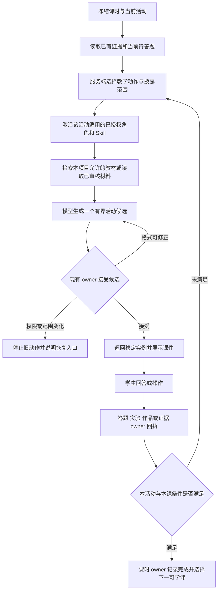

# 02 教学策略、开场与动态课件

状态：设计建议，未实施。待审项 D2、D3、D6，入口见[总览](README.md)。

## 1. 按教学任务决定如何回答

把“保护当前考核”和“怎样教清楚知识”分别处理。建议由服务端根据当前课、活动、题目状态与教师策略选择教学动作，不再把所有自由提问默认为提示升级。

| 情境 | 建议行为 | 答案与证据边界 |
|---|---|---|
| 模板介绍、自由探索 | 解释项目价值、展示可选方向、询问意图 | 不创建正式项目，不制造学习完成 |
| 新概念讲解 | 直接讲定义、原理、公式及适用条件；配图或板书 | 允许完整知识结论，不因“结论是”被改成反问 |
| 教师安排的示例 | 展示一份标注为示例的完整分析，再给不同条件的练习 | 示例不能变成学生自己的产物或掌握证据 |
| 当前待答练习 | 提供概念解释、相近示例和提示，保留原题 | 不提前给当前题的正确选项、私有解析；求助不算作答或判错 |
| 学生已提交答案 | 先读取题目 owner 回执，再讲正确答案、原因和针对性补救 | 披露范围服从形成性练习或考核策略，不从模型自评生成分数 |
| 理论门禁考核 | 提供规则说明及允许的帮助，保护独立作答 | 教师策略决定重试和解析开放；聊天不宣布 TheoryMastered |
| 实践设计与操作 | 先讲清原理、安全限制与操作，再收集真实或模拟证据 | 工具范围、参数和理论门禁仍由 owner 校验 |
| 报告修订与反思 | 具体指出证据与论证的问题，可给局部修改示范 | 不代写成可冒认的整份独立成果，不编造数据或批准报告 |

普通知识问题不需要经过多次反问才允许讲解。“请直接解释”可以进入讲解动作；它不构成放行实践或提前披露当前考核答案的权限。

形成性练习可在首次提交后解释并安排同目标新题；正式考核的解析时机由教师规则决定。这是待审建议，不改变当前判分 owner 合同。

## 2. 重做披露规则，保留真正需要的保护

建议规则针对具体 `questionId / assessmentMode / answerStatus` 和当前计划范围生效：

1. 题目私有答案和解析保留在现有题目 owner，不进入学生题面和无权限模型上下文。
2. 服务端明确本轮允许的教学动作及披露范围；模型不能自行选择“考核已结束”。
3. 对所有学生可见块检查保护规则，包括正文、板书 caption/节点/公式、选项、附件摘要，避免只检查最后一段 narration。
4. 普通知识结论、定义和已获准的示例不以“答案是／结论是”这样的字词决定是否允许。
5. 格式、长度、答案披露、个人信息和不安全操作分别处理，返回准确原因；不能把正常长讲解归类成答案泄露。
6. 当前题的帮助仍关联原 pending 实例；改变目标或开始新活动时，服务端重新选择教学策略，不沿用整段会话此前最高提示等级。

任意自然语言的答案泄露无法靠几个禁词可靠判断。验收同时覆盖私有数据隔离、披露时机和具体教学情境，不承诺“移除禁词后自然不会泄露答案”。

不再每次向学生展示“检查回复不泄露完整答案”。普通工具区显示“整理本课讲解／准备图示”；涉及实际考核时才显示“当前题暂不展示解析”等必要说明。后台日志保留真实校验，学生界面不暴露内部提示词、原始工具参数或私有答案。

## 3. 固定开场与动态教学的关系

| 层级 | 固定内容 | 可动态变化 |
|---|---|---|
| 模板介绍 | 教师审核的项目介绍、驱动问题、预期产物、课时概览 | 对学生意图的澄清、适用的生活例子 |
| 进入课时 | 本课导入语、目标、第一项任务、证据要求、主讲角色 | 从上课已接受证据衔接的短说明 |
| 课内活动 | 教师指导、允许动作、能力范围、评价标准 | 板书、讲解顺序、例子、检查题、提示及同目标补救 |
| 断点续学 | 续学模板和状态显示规则 | 真实已保存进度、未完成任务、尚缺的证据 |

教师已有开场稿需要有版本和来源，迁入同一个模板合同。不能把当前拼接“你好，我是……我们从……开始”的介绍当成已迁入逐课固定开场。

首次进入一课、回到未完成课、完成本课后进入下一课是三种事件。当前“只有空聊天才保存开场”的方式需要扩展为课时范围内的去重；继续使用 Tutor 的事件和幂等存储，不另建课程完成状态机。删聊天不应重置课时或重新计算已接受证据。

## 4. 每一步如何生成

活动选择不能等待“生成课件”“衍射”等关键词。当前活动需要比较关系，就安排板书；需要理解检查，就安排合适题目；错误暴露具体缺口，就围绕同目标补救。

注册的仿真引擎可以固定复用，候选教学任务、参数比较和反馈根据当前课生成。不得由模型输出任意 HTML/JS；模拟、真实测量和教师示例数据必须分开标注。

## 5. 当前活动位置与恢复

现有 `TutorLessonProgram` 描述整节课，`next-step` 主要根据掌握和 pending 题选择动作，不能直接当作 `review/theory/check/practice/reflect` 的通用活动位置。建议在既有 learning-plan owner 中补足该投影，避免 Tutor、前端和后台规划分别推算。

建议增加的内容属于**待实现合同字段**：稳定活动 ID、当前活动状态、关联任务及证据回执、重试关系、允许的下一教学动作。它们进入既有 session/task 及其版本范围，不另建一套 lesson 状态数据库。

每次生成和提交均限定到 `projectId + planId + planRevision + learningSessionId + activity/task + objectiveId`。当前题、实验动作和证据仍各自使用 owner 分配的实例 ID 与幂等键。

- 看完板书或点击“下一幅图”只改变图示页码。
- 生成板书成功只表示本轮内容被接受。
- 提交观察、作答或作品后，收到 owner 接受回执才显示保存状态。
- 满足课时完成规则后，课时 owner 才能记录完成；理论掌握、报告通过和归档继续由各自 owner 决定。
- 页面刷新、模型失败、切换项目、延迟回包和重试均不得回到第一课或覆盖另一个项目的状态。

## 6. 知识不可用与异常

无项目知识 grant 时，可以继续不冒充教材引用的通用概念交流；有明确来源要求的出题和教材结论验证应停止并说明原因，不编造 `sourceRefs`。

若希望教师审核的讲义也成为出题依据，应扩展原知识证据验证 owner，登记真实版本和 provenance。不能把模板文案字符串直接视为已核验教材来源。

候选格式不合规可有界重试；授权撤销、课时变化、没有可用执行器则停止该动作。不得通过给出预设灰色实验卡伪装动态生成成功。

## 7. 教学依据

IES 教学实践指南建议将示例讲解与独立解题交替安排，并结合图示、文字说明和提问。这支持本稿同时保留讲解、示例和练习，而非让所有回复都止于提示。将该原则用于具体 AI 产品策略是本稿的设计推论，不是本项目已有教学效果的证明。[IES 原始报告，建议 2、3、5、7](https://files.eric.ed.gov/fulltext/ED498555.pdf)
