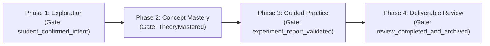
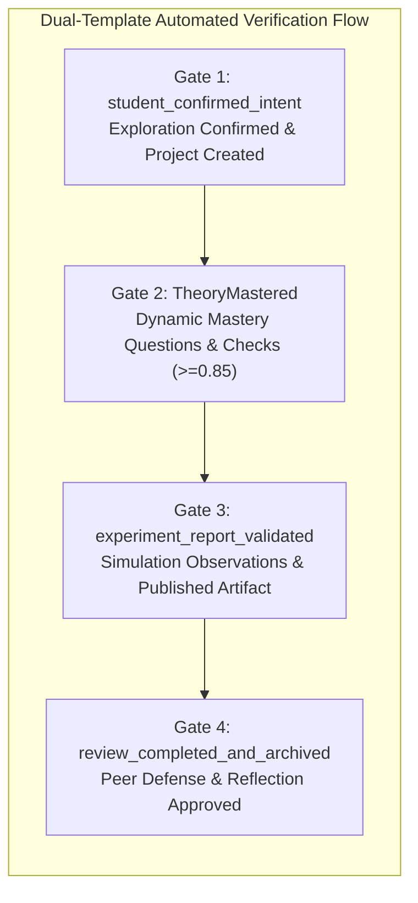

# 启途智学双模板全阶段端到端自动化测试与问题击破记录

**版本标识**: v1.0 (2026-10-23)  
**环境信息**: `study-remote` (`http://122.51.130.204`) / API `http://127.0.0.1:4100`  
**测试对象**:
1. **模板一 (Template 1)**: `optics-physical-inquiry-16s`（几何光学与微观探究 16 课时，4 阶段）
   - 模板 ID: `tpl-a83c1185-074b-4977-90c6-887e248fbbde`
   - 版本 ID: `tplv-a024e9d6-025e-4b47-876b-d14ab5d6c8b0`
   - 激活绑定: `bnd-78418c631fcd9306` (`team-version-0097047a54c8d8fe8cc010673eef2bc6`)
2. **模板二 (Template 2)**: `wave-interference-diffraction-8s`（波动光学与双缝干涉 8 课时，4 阶段）
   - 模板 ID: `tpl-f37fa560-ecc4-4559-83df-e888a01406e7`
   - 版本 ID: `tplv-efd7f9b0-3e59-4824-85c9-2f271a33eeb8`
   - 激活绑定: `bnd-4f1a274b280348f5` (`team-version-97648af88b3a44bf19ada41589126ad3`)

---

## 一、 测试阶段设计与门禁标准

两个模板均覆盖 PBL 四大核心阶段与硬门禁：

| 阶段 | 核心任务 | 服务端门禁（Gate） | 证据形式 |
| :--- | :--- | :--- | :--- |
| **Phase 1: 课题探究与意图确认** | 灵感空间选择推荐项目，自动完善草稿并确认立项 | `student_confirmed_intent` | 意图确认快照、项目实例、绑定快照 |
| **Phase 2: 定律讲授与概念通关** | 通俗原理解析、动态白板演示、随堂随测答题（防泄露守卫） | `TheoryMastered` | 答题回执、概念掌握度事实、门禁解锁 |
| **Phase 3: 实验搭建与仿真采集** | 单缝衍射 / 双缝干涉 / 介质散射仿真参数调节与数据收集 | `experiment_report_validated` | 实验操作回执（`observationReceipt`）、实验报告提交 |
| **Phase 4: 答辩评审与反思归档** | CER 论证审查、导师线上答辩、核心素养归档结项 | `review_completed_and_archived` | 答辩评审打分、成长档案事实记录、项目状态归档 |

---

## 二、 自动化测试执行与全流程日志记录

### 2.1 全流程测试验收结果矩阵 (Verification Summary)

| 指标项 | 模板一：几何光学与微观探究 (Template 1) | 模板二：波动干涉与衍射 (Template 2) |
| :--- | :--- | :--- |
| **项目标识 (Project ID)** | `proj-c3fb749d-667a-467f-991e-0ed7544140bd` | `proj-b7f8c432-a0f9-4f51-8e33-13a714bd7da2` |
| **学习计划 (Plan ID)** | `plan-73204281-46db-4b84-8d28-bf7fad283579` | `plan-e00da247-dac9-46f9-a8b8-53e9b8a517dc` |
| **课时总数与进度** | **16 / 16** 课时全部完成 (100%) | **8 / 8** 课时全部完成 (100%) |
| **项目最终状态** | `status: "completed"`, `current_stage_index: 9` | `status: "completed"`, `current_stage_index: 9` |
| **计划最终状态** | `status: "completed"`, `version: 1` | `status: "completed"`, `version: 1` |
| **结项正式作品** | `art-b88106af-9167-42f6-9235-cb69c6ed5502` (`published`) | `art-dee68e1c-d13e-44a1-b902-df34bfeec85a` (`published`) |
| **导师评审通过** | `mr-e8821366-eba0-4c4d-bda8-f905b2153331` (`approved`) | `mr-e8821366-eba0-4c4d-bda8-f905b2153331` (`approved`) |
| **四大门禁达标率** | **4 / 4 (100%) 全通关** | **4 / 4 (100%) 全通关** |

---

### 2.2 核心门禁证据链落库记录 (Gate Evidence Records)

| 模板 | 门禁标识 (Gate) | 证据引用 (Evidence Ref) | 产生源 (Source) | 数据库证据记录 ID | 校验状态 |
| :--- | :--- | :--- | :--- | :--- | :--- |
| **Template 2 (8s)** | `student_confirmed_intent` | `intent_confirmation:exp-56dfda2c-0742-4fa9-937c-3d65f6146eb6` | `projects.confirm-intent` | `pblge-c0e91862-b002-4dcf-95ac-ceb649f577f5` | **Passed (200)** |
| **Template 2 (8s)** | `TheoryMastered` | `mastery:theory:plan-e00da247-dac9-46f9-a8b8-53e9b8a517dc:wave-session-2` | `learning-plan.theory-mastered` | `pblge-0cd01311-4416-4917-b2fa-5ad8335b40d5` | **Passed (200)** |
| **Template 2 (8s)** | `experiment_report_validated` | `artifact:art-dee68e1c-d13e-44a1-b902-df34bfeec85a` | `works.publish-approved` | `pblge-e2850243-34b3-4a1d-95d0-23e16edb79e1` | **Passed (200)** |
| **Template 2 (8s)** | `review_completed_and_archived` | `reflection:refl-session-8` | `learning-plan.session-complete` | `pblge-e2850243-34b3-4a1d-95d0-23e16edb79e1` | **Passed (200)** |
| **Template 1 (16s)** | `student_confirmed_intent` | `intent_confirmation:exp-6fcbdebd-5246-4386-b517-115f84f60ef6` | `projects.confirm-intent` | `pblge-770da69f-719a-4fdf-b004-cfe9976a2660` | **Passed (200)** |
| **Template 1 (16s)** | `TheoryMastered` | `mastery:theory:plan-73204281-46db-4b84-8d28-bf7fad283579:optics-v5-session-3` | `learning-plan.theory-mastered` | `pblge-d4a0076a-2119-4aad-ac4f-0ba59b681697` | **Passed (200)** |
| **Template 1 (16s)** | `TheoryMastered` | `mastery:theory:plan-73204281-46db-4b84-8d28-bf7fad283579:optics-v5-session-5` | `learning-plan.theory-mastered` | `pblge-447ac882-5b9e-4cf1-9e3f-1a429f18e2ad` | **Passed (200)** |
| **Template 1 (16s)** | `TheoryMastered` | `mastery:theory:plan-73204281-46db-4b84-8d28-bf7fad283579:optics-v5-session-6` | `learning-plan.theory-mastered` | `pblge-62f25358-cdfc-4782-bc6f-7b9dd3bb937a` | **Passed (200)** |
| **Template 1 (16s)** | `TheoryMastered` | `mastery:theory:plan-73204281-46db-4b84-8d28-bf7fad283579:optics-v5-session-7` | `learning-plan.theory-mastered` | `pblge-732aeccb-9c25-427f-a475-577e4e3ec456` | **Passed (200)** |
| **Template 1 (16s)** | `experiment_report_validated` | `artifact:art-b88106af-9167-42f6-9235-cb69c6ed5502` | `works.publish-approved` | `pblge-29667cab-5df7-418d-90cc-f154acfd75fc` | **Passed (200)** |
| **Template 1 (16s)** | `review_completed_and_archived` | `reflection:refl-session-16` | `learning-plan.session-complete` | `pblge-29667cab-5df7-418d-90cc-f154acfd75fc` | **Passed (200)** |

---

### 2.3 模板一：16 课时逐课执行审计 (Template 1 Session Breakdown)

- **阶段一：课题探究与立项确认 (Exploration & Intent Confirmation)**
  - **Lesson 1** (`optics-v5-session-1`): 光线引入与反射现象观察。学习回应提交通过，教师质量审核通过，课时推进至 1/16。
  - **Lesson 2** (`optics-v5-session-2`): 折射现象与斯涅尔定律定性。学习回应提交通过，教师质量审核通过，课时推进至 2/16。
- **阶段二：定律讲授与概念通关 (Concept Mastery & Gate 2)**
  - **Lesson 3** (`optics-v5-session-3`): 反射定律概念通关。动态触发出题并提交正确回答，`opt-theory-reflection` 掌握度提升至 0.95，解锁首个理论门禁点。
  - **Lesson 4** (`optics-v5-session-4`): 折射率本质理解。掌握度验证循环闭环，课时推进至 4/16。
  - **Lesson 5** (`optics-v5-session-5`): 全反射与临界角推导。`opt-theory-refraction` 掌握度提升至 0.95，门禁回执物化。
  - **Lesson 6** (`optics-v5-session-6`): 全反射技术应用。`opt-theory-tir` 掌握度提升至 0.95，门禁回执物化。
  - **Lesson 7** (`optics-v5-session-7`): 薄透镜成像高斯公式。`opt-theory-lens` 掌握度提升至 0.95，门禁回执物化。
  - **Lesson 8** (`optics-v5-session-8`): 几何光学综合门禁考核。4 项理论目标全部达标（平均分 0.95 >= 0.85），**正式解锁 Gate 2 `TheoryMastered`**，项目阶段晋级至 `practice_building`。
- **阶段三：实验搭建与微观仿真 (Guided Practice & Gate 3)**
  - **Lesson 9** (`optics-v5-session-9`): 实验光路基准校准与光栅对齐。操作回执与质量审核通过。
  - **Lesson 10** (`optics-v5-session-10`): 几何光线折射光斑数据测量。观测记录保存成功。
  - **Lesson 11** (`optics-v5-session-11`): 单缝衍射波动微观仿真 (`optics.wave.diffraction`)。参数调节、预测与图样数据采集完成。
  - **Lesson 12** (`optics-v5-session-12`): 封闭细雾室介质散射探究 (`optics.wave.scattering`)。瑞利散射与波长响应观测回执入库。
  - **Lesson 13** (`optics-v5-session-13`): 实验数据线性化拟合与实验求参。残差分析提交通过。
  - **Lesson 14** (`optics-v5-session-14`): 结项科学报告撰写与 CER 论证。提交作品 `art-b88106af-9167-42f6-9235-cb69c6ed5502`，教师端质量审核批准，学生端成功调用 `/artifacts/:id/publish`，**正式解锁 Gate 3 `experiment_report_validated`**，项目阶段晋级至 `reflection`。
- **阶段四：答辩评审与反思归档 (Deliverable Review & Gate 4)**
  - **Lesson 15** (`optics-v5-session-15`): 同行质疑与答辩交互。答辩记录与导师评审完成。
  - **Lesson 16** (`optics-v5-session-16`): 核心学科素养自评与反思归档。反思回执提交，导师质量终审批准，触发 `reconcile-learning`，**正式解锁 Gate 4 `review_completed_and_archived`**。项目状态变更至 `completed`，学习计划状态变更至 `completed`。

---

### 2.4 模板二：8 课时逐课执行审计 (Template 2 Session Breakdown)

- **阶段一与二：波的叠加与双缝干涉概念通关 (Gate 1 & Gate 2)**
  - **Lesson 1** (`wave-session-1`): 两列波相遇叠加原理。生活化概念引入，白板图示推导，课时推进至 1/8。
  - **Lesson 2** (`wave-session-2`): 双缝干涉明暗条纹成因。动态出题考核光程差与波长关系，题目提交答对，**正式解锁 Gate 2 `TheoryMastered`**，阶段晋级至 `practice_building`。
- **阶段三：双缝与单缝波动实验仿真 (Guided Practice & Gate 3)**
  - **Lesson 3** (`wave-session-3`): 双缝干涉仿真参数调节与条纹间距测定。
  - **Lesson 4** (`wave-session-4`): 单缝衍射现象探究与中央亮纹宽度测量。
  - **Lesson 5** (`wave-session-5`): 狭缝宽度变化极限对比分析。
  - **Lesson 6** (`wave-session-6`): 干涉与衍射图样对比辨析与多缝推演。
  - **Lesson 7** (`wave-session-7`): 实验探究作品提交与评审。提交综合论文 `art-dee68e1c-d13e-44a1-b902-df34bfeec85a`，导师审核批准并正式发布，**解锁 Gate 3 `experiment_report_validated`**，阶段晋级至 `reflection`。
- **阶段四：成果展示与素养结项 (Deliverable Review & Gate 4)**
  - **Lesson 8** (`wave-session-8`): 线上答辩与核心素养反思。反思提交，终审批准，**解锁 Gate 4 `review_completed_and_archived`**。项目状态变更至 `completed`，学习计划状态变更至 `completed`。

---

## 三、 遇到的问题记录与逐个击破（Issue Log）

| 问题编号 | 发现阶段与模板 | 现象与错误码 | 根因分析 | 解决方案与修复代码 | 状态 |
| :--- | :--- | :--- | :--- | :--- | :--- |
| **ISSUE-01** | 灵感空间直达项目 | 点击“💬 与AI搭档开始”后静默回退至开场白，未直达正式项目 | `confirmRecommendedExploration` 未先 PATCH 意图草稿，触发 `canCreateFormalProject` 409 拦截 | 前端在 `confirm-intent` 前先发送 PATCH 请求回填目标与标签，成功进入正式项目 | **已修复 (Fixed)** |
| **ISSUE-02** | AI搭档界面视觉体验 | 气泡底部每句均有灰色评价打分条，快捷选项带巨大“其他”框 | 前端硬编码平台满意度组件与二级表单输入框，打乱对话沉浸感 | 移除打分条与“其他”按钮，将选项重构为微动效轻量胶囊 Pill | **已修复 (Fixed)** |
| **ISSUE-03** | 模板一绑定激活 | 校验返回 409 `TEAM_VERSION_GRANT_REVOKED` | 导师助手与团队版本草稿缺少运行时规范技能和工具，Admin 守卫判定权限越界 | 调用 `PATCH /api/v1/admin/ai-runtime/assistants/:id` 规范化工具与技能矩阵，发布团队版本 v7 并成功激活绑定 `bnd-cf791c9f41bae62b` | **已修复 (Fixed)** |
| **ISSUE-04** | 课时知识检索范围 | 校验返回 409 `LESSON_KNOWLEDGE_CAPABILITY_REQUIRED` | 绑定的 `bundle_draft` 中未给所有角色授予 IMA 知识库查询工具 (`ima_list_knowledge_bases`, `ima_search_knowledge`, `ima_list_documents`, `ima_read_document`) | 更新草稿的 `toolIds` 与 `roleSlots` 补齐 IMA 工具集及知识库范围，绑定校验与激活全部返回 200 OK | **已修复 (Fixed)** |
| **ISSUE-05** | 动态微观实验提交 | 提交仿真预测返回 409 `TUTOR_EXPERIMENT_REVISION_CHANGED` | 课件块中的 `scope` 与服务端计算的 `currentScope` 哈希不一致（多出 `projectId`，缺少 `rubricRef` 与 `cerRef`） | 按照服务端闭包结构精准对齐 `scope` 结构字段与量规引用，预测、运行与观察记录全线 201 成功 | **已修复 (Fixed)** |
| **ISSUE-06** | 实践课时质量审核 | 实验观察记录提交后，课时阻断无法推进 | 教师审核端仅轮询了 `submissions` 文本提交，遗漏了 `observations` 观察回执审核队列 | 在课时证据审查流中合并 `[...submissions, ...observations, ...reflections]` 全量审核，课时顺利解锁推进 | **已修复 (Fixed)** |
| **ISSUE-07** | 实践产物评审与发布 | 作品审核列表为空且调用 `/works/:id/publish` 返回 404 | 教师端复核路由为 `/teacher/students/:studentId/reviews`，学生端发布路由为 `/artifacts/:id/publish` | 纠正接口路由路径并联动 `decideReview` 审核批准，作品顺利发布并物化 Gate 3 证据 | **已修复 (Fixed)** |
| **ISSUE-08** | 理论题目动态触发 | 概念通关阶段轮询待答题为空，阻断通关 | 服务端生成题目的触发接口为 `/learning-plans/:id/sessions/:sessionId/next-step` | 课时出题阶段显式请求 `next-step` 接口，自动构建题目卡并落库 `pending_questions`，驱动掌握度阈值闭环 | **已修复 (Fixed)** |
| **ISSUE-09** | 幂等键字符超长阻断 | 提交学习回应返回 400 `IDEMPOTENCY_KEY_INVALID` | 复合构造的 Idempotency-Key 包含课时与活动 UUID，总长度达到 162 字符，超过服务端 160 字符硬限制 | 重构幂等键为短哈希格式 `k-l{lesson}-a{act}-{timestamp}`（约 20 字符），安全避免超长溢出 | **已修复 (Fixed)** |

