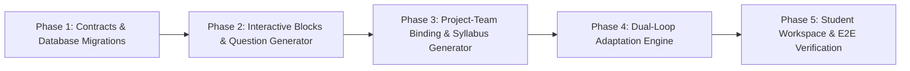

# 启途智学自适应 PBL 与多智能体协同实施计划

> **文档标识**：`docs/plan/antigravity/implementation-plan.md`  
> **版本**：v1.0.0  
> **生效基线**：2026-10-18  
> **前置依赖**：[`./research-report.md`](./research-report.md) · [`./architecture-design.md`](./architecture-design.md)  
> **责任领域**：`packages/contracts` / `services/api` / `apps/student-center`  

---

## 1. 实施路线图与阶段划分

本实施计划将调研报告与架构方案落地为 5 个有序递进的工程阶段（Phases），确保每一阶段均具备独立的可测试性与可验证性，严守“服务端状态权威”与“`TheoryMastered` 门禁强校验”底线。

---

## 2. 分阶段工作分解（WBS）与代码落地地图

### Phase 1：领域数据模型、契约与数据库迁移（预计周期：第 1–2 周）

#### 目标：
建立前后端统一的强类型接口定义，完成数据库实体表与索引迁移。

#### 具体任务：
1. **统一契约定义** (`packages/contracts/src/pbl-dynamic.ts`)：
   - 导出 `SyllabusNode`、`PblSyllabus`、`PblProjectPlan`、`PlanAdjustmentEvent`。
   - 导出 `InteractiveBlock` 联合类型（`QuizBlock`、`OptionsBlock`、`BoardBlock`、`SimulationBlock`、`MilestoneBlock`）。
   - 导出交互提交动作 `InteractiveBlockActionDto` 与响应 `InteractiveBlockResultDto`。
2. **数据库迁移脚本** (`database/migrations/0030_pbl_dynamic_syllabus_and_interactive.sql`)：
   - 创建 `pbl_syllabi` 与 `pbl_syllabus_nodes` 表（支持树形依赖与 `is_remedial` 标记）。
   - 创建 `pbl_project_plans` 表（持久化 `adaptation_history` JSONB 与 `expected_revision` 乐观锁）。
   - 创建 `interactive_block_events` 表（记录每一次块下发、学生作答选择、耗时与判定事实，附带 `idempotency_key` 唯一索引）。
3. **ORM 映射与仓储层** (`services/api/src/modules/projects/entities/*`)：
   - 编写 TypeORM 实体类，集成事务保存与乐观并发控制。

---

### Phase 2：OpenMAIC 交互资产协议与 DeepTutor 问答引擎（预计周期：第 3–4 周）

#### 目标：
实现服务端交互块下发、幂等交互路由，以及基于迷思概念驱动的苏格拉底问答生成器。

#### 具体任务：
1. **交互块管理服务** (`services/api/src/modules/tutor/interactive-block.service.ts`)：
   - 实现 `generateBlock()`：根据当前教学阶段和目标概念装配安全交互块。
   - 实现 `handleAction()`：接收前端点击或作答，校验幂等键，调用判分/评估逻辑，返回下一步引导。
2. **DeepTutor 问答与干扰项生成器** (`services/api/src/modules/tutor/question-generator.service.ts`)：
   - 对接 `mastery` 领域，提取当前未达标概念（`linkedConceptIds`）。
   - 结合学科迷思库（`misconception-catalog`）生成具针对性的干扰项（Distractors）。
   - 校验生成题目（单解、无歧义、绝不直接透露最终答案）。
3. **渐进式提示阶梯服务** (`services/api/src/modules/tutor/hint-ladder.service.ts`)：
   - 管理学生在当前概念上的提示等级（Level 1 $\to$ Level 2 $\to$ Level 3）。
   - 确保达到上限时收敛到方向引导，触发宏观调整机制。
4. **SSE 网关协议扩展** (`services/api/src/modules/tutor/tutor-sse.service.ts`)：
   - 新增 `interactive.quiz`、`interactive.options`、`interactive.board` 等专用事件帧。

---

### Phase 3：项目与团队深度绑定及动态大纲生成（预计周期：第 5–6 周）

#### 目标：
打通意图确认到正式项目立项的原子化绑定链路，基于模板与学生目标生成初始项目大纲。

#### 具体任务：
1. **项目-模板-团队原子化绑定服务** (`services/api/src/modules/projects/project-binding.service.ts`)：
   - 拦截未确认意图的项目创建请求（`IntentConfirmed` 门禁强校验）。
   - 在单一数据库事务中原子写入 `pbl_projects`、`project_team_bindings`、`project_knowledge_bindings`。
2. **动态大纲生成器** (`services/api/src/modules/projects/pbl-syllabus.service.ts`)：
   - 解析模板 `PblPhaseSpec`，结合学生探究课题生成初始多级 `SyllabusNode` 树。
   - 将不同大纲节点指派给团队中对应的角色（概念教练、实践导师、评审顾问）。
3. **门禁控制与状态机推进器** (`services/api/src/modules/projects/pbl-gate.service.ts`)：
   - 实施 `TheoryMastered` 强硬门禁：概念教练打分 $< 85\%$ 时严格锁死实践沙箱。
   - 提供只读门禁状态查询接口给前端工作区。

---

### Phase 4：双循环自适应调谐引擎（微观与宏观调谐）（预计周期：第 7–8 周）

#### 目标：
打通“学生回答 $\to$ 迷思诊断 $\to$ 微观提示调谐 $\to$ 宏观大纲重构”的完整闭环。

#### 具体任务：
1. **微观调谐器** (`services/api/src/modules/tutor/micro-adaptation.service.ts`)：
   - 分析每一轮学生的自然语言输入或选项点击。
   - 判断是否存在典型认知偏差，动态调整下一轮的 Socratic 发问策略与提示等级。
2. **宏观计划调谐编排器** (`services/api/src/modules/projects/pbl-plan-adaptor.service.ts`)：
   - 监控节点的卡点指标（滞留轮次 $> 6$ 或提示达到 Level 3 仍未掌握）。
   - 触发大纲重构动作：在大纲树中原子插入补救节点（`isRemedial: true`），调整预期里程碑。
   - 向 `audit_logs` 记录调谐事件，向班主任仪表盘推送干预消息。
3. **知识追踪同步** (`services/api/src/modules/mastery/mastery-tracing.service.ts`)：
   - 交互块的判分事实同步更新至学生的掌握度图谱。

---

### Phase 5：前端工作区沉浸式渲染与端到端集成验证（预计周期：第 9–10 周）

#### 目标：
在 `apps/student-center` 中重构 Tutor 研学工作区，完整呈现交互资产与团队协同状态，通过自动化测试验收。

#### 具体任务：
1. **交互资产组件库** (`apps/student-center/features/tutor/components/interactive/*`)：
   - `QuizBlockView`：渲染选择题、选项单选/多选、答错引导提示。
   - `OptionChipsView`：渲染动态生成的探究路径选项卡。
   - `BoardBlockView`：安全渲染 Mermaid 流程图或 LaTeX 推导公式。
   - `MilestoneBlockView`：展示当前节点交付物与门禁达标状态。
   - `HintLadderBar`：直观展示当前提示阶梯等级（1/3、2/3、3/3）。
2. **多智能体协同侧边栏** (`apps/student-center/features/tutor/components/team-sidebar/*`)：
   - 展示团队中 Leader、概念教练、实践导师等各成员的就绪/活跃状态。
   - 展示随大纲推进的接管切换动画与当前发言者标识。
3. **端到端集成与安全验证**：
   - 编写并发交互与幂等测试套件（`tooling/verify-dynamic-pbl.cjs`）。
   - 验证离线/弱网重试、断点恢复与权限越权拦截。

---

## 3. 质量门禁与验收测试标准

| 验收维度 | 检验标准 | 验证方式 |
| :--- | :--- | :--- |
| **契约完整性** | `pnpm typecheck` 零类型报错，契约包被前后端无缝共享 | 静态类型分析 |
| **门禁不可穿透性** | `TheoryMastered` 未达成时，任何调用代码沙箱运行接口的请求一律返回 `403 FORBIDDEN` | 自动化集成测试 |
| **交互块幂等性** | 携带相同 `blockId` 的多次提交仅计算一次掌握度事实，后续调用返回已保存事实 | 并发接口压测 |
| **动态调谐有效性** | 模拟学生连续 3 次选择迷思干扰项，系统必须按预期插入 `isRemedial: true` 节点，且大纲版本递增 | E2E 场景回放 |
| **UI 健壮性** | 所有交互块必须覆盖 `loading`、`empty`、`error`、`offline` 状态，无半渲染崩溃 | 浏览器组件单元测试 |
| **未成年人合规** | 交互日志与会话轨迹不得包含明文敏感个人身份信息，审计日志完备可追溯 | 安全合规扫描脚本 |

---

## 4. 产出文件索引与后续指引

完成本计划所涉及的交付物清单：
1. **调研报告**：[`./research-report.md`](./research-report.md)
2. **架构方案**：[`./architecture-design.md`](./architecture-design.md)
3. **实施计划**：[`./implementation-plan.md`](./implementation-plan.md)

后续开发执行将严格按照 Phase 1 至 Phase 5 的步骤展开，在各阶段完成后提交对应的 PR 并附带质量门禁验证说明。
