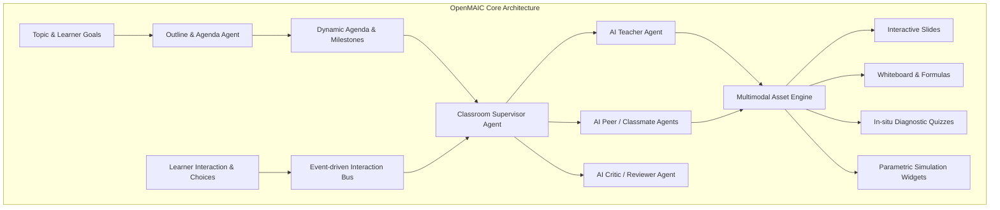
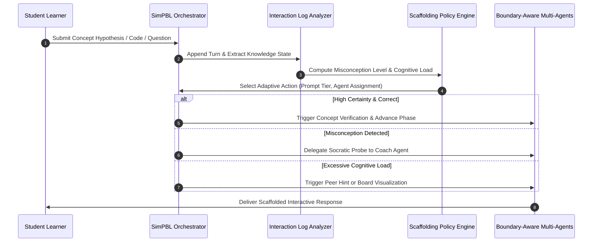
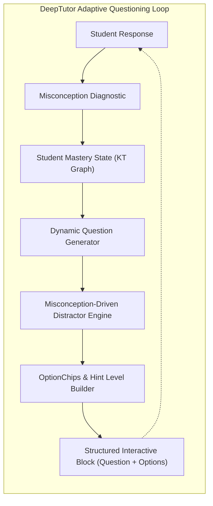

# 动态项目式学习（PBL）与多智能体协同深度调研报告

> **文档标识**：`docs/plan/antigravity/research-report.md`  
> **版本**：v1.0.0  
> **调研日期**：2026-10-18  
> **核心主题**：项目与团队深度绑定、大纲制定、计划生成、学生回答驱动的动态调整（融合 OpenMAIC 与 DeepTutor 范式）  
> **责任领域**：`projects` / `ai-tutor` / `team-runtime` / `mastery` / `apps/student-center`  

---

## 1. 调研背景与核心问题

现代项目式学习（Project-Based Learning, PBL）强调以学习者为中心，通过真实的探究任务构建深层次理解与实践技能。然而，传统的在线或 AI 教学系统普遍面临以下痛点：
1. **交互形态单一**：大多数 AI 助教仅停留在无状态的纯文本气泡对话，缺乏白板、图表、测验、沙箱实验等沉浸式互动资产。
2. **教学计划静态僵化**：项目任务大纲与执行计划在立项时一旦固定，便无法根据学生在实际探索过程中的认知阻滞、概念混淆或超前进展进行灵活调谐。
3. **团队协作缺乏角色感**：单一全能的大模型在多角色（引导教练、实践导师、同行伙伴、评审专家）之间频繁角色漂移，缺乏明确的职责边界与协同工作流。
4. **探究与实践门禁脱节**：学生在未建立扎实理论基础（TheoryMastered）前即盲目进入代码编写或实验操作，导致认知过载和挫败感。

针对上述挑战，本次调研围绕 **OpenMAIC**（多智能体交互课堂与 PBL 桌面工作区）、**SimPBL**（基于交互轨迹的自适应脚手架框架）以及 **DeepTutor**（苏格拉底问答生成与结构化选项交互）三大主流学术与工业前沿系统，深度解析其核心机制，并探索如何将其无缝融合到「启途智学」现有的 Monorepo 架构与门禁规范中。

---

## 2. 核心技术范式深度调研与解析

### 2.1 OpenMAIC：动态多模态资产驱动的多智能体课堂

**OpenMAIC**（THU-MAIC）是清华大学开源的多智能体交互教学系统，其在 2025–2026 年的发展中形成了两大核心分支：**OpenMAIC Classroom** 与 **OpenMAIC-Project**。

#### 核心机制解析：
1. **Agenda（统一教学日程与大纲引擎）**：
   - 教学大纲不是静态文档，而是由结构化节点构成的动态状态机（Dynamic Agenda）。
   - 每个大纲节点绑定一组**教学目标（Learning Objectives）**与**交互资产定义（Interactive Asset Specifications）**。
   - 课程序列支持条件跳转与分支展开：若学生在某概念节点的诊断互动中表现不佳，Agenda 引擎动态插入补充子节点（Prerequisite Sub-node）。
2. **多角色具身协同（Role-based Embodied Collaboration）**：
   - 课堂中不仅有主讲教师（Teacher），还引入了不同认知特征的 AI 同伴（Classmates，例如好奇提问型、容易误解型、逻辑严谨型）以及评审员（Critic）。
   - AI 同伴主动提出困惑或与真实学生发起微辩论（Peer Discussion），极大降低了真实学生在探究过程中的孤独感与被动接受感。
3. **交互资产流式注入（Interactive Blocks Injection）**：
   - OpenMAIC 将对话输出从单一 Markdown 升级为带有类型元数据的**交互块协议（Interactive Blocks Protocol）**。
   - 资产包括：`slide`（教学幻灯片）、`board`（矢量白板与推导步序）、`quiz`（即时形成性小测验）、`simulation`（参数化仿真实验台）。
4. **OpenMAIC-Project 的工作区解耦**：
   - 严格区分**探索立项会话（Planner Session）**与**项目执行阶段会话（Learning-Phase Session）**。
   - 实践沙箱（Workbench）配置受控的 Code/Terminal/Browser 工具集，通过权限门禁受控暴露给学生。

---

### 2.2 SimPBL：基于交互日志的自适应多智能体脚手架

**SimPBL**（ACL 2026, 清华大学）针对项目式学习（PBL）中真实导师资源稀缺、学生认知负担沉重的问题，提出了由数据驱动的自适应脚手架与边界感知协作架构。

#### 核心机制解析：
1. **边界感知协作（Boundary-Aware Collaboration）**：
   - 子智能体拥有严格的领域边界（Domain Boundaries）。例如：概念教练（Concept Coach）只负责探究与逻辑引导，严禁越权修改项目状态；评审员（Reviewer）只负责比对评分标准量规（Rubrics），不提供直接解法。
   - 所有智能体的输出均被视为“建议/候选”，由中央编排器（Orchestrator）进行聚合、合规性审计并决定下发策略。
2. **基于交互日志的自适应脚手架（Interaction-Log Scaffolding）**：
   - 系统持续从学生的多模态交互历史（输入耗时、改动频次、选项点击、代码报错信息）中提取隐式认知状态（Cognitive State）。
   - 根据认知负荷动态升降脚手架级别（Scaffolding Levels）：从高阶启发（Socratic Question）到方向性提示（Directional Clue），再到结构化选项（Constrained Options），最后在极端困难时才提供受限线索（Bounded Clue），严禁直接泄露完整解答。
3. **实证教学收益**：
   - 论文实测表明，引入自适应脚手架与多智能体协作后，学生的期末项目成果质量与概念测试得分显著提高 14%–28%，且认知过载发生率降低 35%。

---

### 2.3 DeepTutor：苏格拉底智能问答与结构化选项交互

**DeepTutor** 代表了智能辅导系统（Intelligent Tutoring System, ITS）在交互问答与形成性评估方面的成熟范式。

#### 核心机制解析：
1. **动态问题生成器（Dynamic Question Generator）**：
   - 突破静态题库限制，根据学生当前的知识图谱掌握度（Knowledge Tracing）与近期上下文即时合成问题。
   - 生成的问题具有强烈的苏格拉底引导属性（Socratic Probing），要求学生解释“为什么这样做”、“核心依据是什么”，而非简单回答是非。
2. **基于迷思概念的选项构建（Misconception-Driven Option Selection）**：
   - 在选择题（Quiz）或路径选择（Options）交互中，干扰项（Distractors）并非随机编写，而是专门针对该学科历史高频迷思概念（Misconceptions）进行聚类生成。
   - 当学生选择某一特定干扰项时，系统能够精确捕获其潜意识中的认知偏差，并在下一轮对话中实施精准对症反思引导。
3. **阶梯式提示指示器（Hint Ladder & OptionChips）**：
   - 提供多级阶梯提示（`Level 1: Reflective Question` $\to$ `Level 2: Directional Clue` $\to$ `Level 3: Bounded Hint`）。
   - 界面采用即时可选的 `OptionChips`，既支持文本键入，也支持点击结构化选项，兼顾了移动端/桌面端交互效率与思维聚焦。

---

## 3. 启途智学项目式学习融合矩阵

将 OpenMAIC、SimPBL、DeepTutor 与启途智学现有架构进行对照映射与能力融合：

| 核心维度 | 启途智表现状 | OpenMAIC / SimPBL 参考 | DeepTutor 参考 | 启途智学目标融合方案 |
| :--- | :--- | :--- | :--- | :--- |
| **大纲与日程** | 静态 `PblPhaseSpec` 阶段定义 | 动态 Agenda 与自适应课程树 | 细粒度知识概念依赖图谱 | **自适应项目大纲（Adaptive Syllabus）**：以模板阶段为主干，根据探究意图与认知状态动态展开子里程碑与任务树 |
| **执行计划生成** | 开题时一次性生成任务清单 | 计划-执行双会话分离、多 Agent 协同编制 | 按掌握度分级生成探究任务 | **多智能体联合计划编制（Team Plan Generation）**：立项后由 Leader Agent 与子教练共同生成分阶段落地计划，含交付物与门禁标准 |
| **交互资产形态** | 主要为 Markdown 文本与 OptionChips | 幻灯片、白板、交互仿真、即时测验 | 结构化问题、迷思干扰项选项、提示阶梯 | **结构化交互资产协议（`interactiveBlocks`）**：支持 `quiz`、`options`、`board`、`simulation`、`milestone` |
| **动态调整机制** | 手动推进阶段、单一掌握度阈值 | 基于交互日志的动态脚手架升降 | 依据学生回答动态诊断迷思并选题 | **双循环动态调谐引擎（Dual-Loop Adaptation）**：微观循环调整对话探究与选项生成，宏观循环调整项目任务计划与阶段进度 |
| **团队协同绑定** | `PblTemplate` 绑定 `PblTeamWorkflowSpec` | 角色化协同、Orchestrator 边界隔离 | 单一导师多级提示 | **项目-模板-团队全生命周期绑定**：正式立项原子化绑定，各阶段由专属子智能体接管，统一由 Leader 调度与审计 |
| **安全与门禁** | `IntentConfirmed`、`TheoryMastered` 硬门禁 | 教学目标达标检查 | 概念掌握度打分 | **服务端权威门禁拦截**：任何客户端请求无法直接写入状态，`TheoryMastered` 强拦截实践沙箱，敏感数据全面脱敏与审计 |

---

## 4. 关键技术方案可行性与落地权衡

### 4.1 方案选型与技术收益
1. **服务端驱动（Server-Driven UI / Interactive Blocks）**：
   - 采用服务端统一下发交互块的方式，前端仅负责渲染受控组件（Controlled Components）并将用户交互以幂等动作回传。
   - **收益**：避免客户端篡改判分或题目状态；保证未成年人数据与内容的严格安全审计；跨多端（Web、平板、移动端）零重复开发业务逻辑。
2. **多智能体分工与边界控制**：
   - 采用「Leader 编排器 + 阶段专业教练（概念教练、实践导师、评审顾问）」拓扑结构。
   - **收益**：各角色职责明确、提示词专业化；各阶段上下文高度专注，避免单上下文过长导致的幻觉与角色混乱。
3. **双循环调谐设计（Micro & Macro Adaptation）**：
   - **微观循环（对话级）**：根据学生的每一轮回答（包括文本回答质量、选项点击偏好、小测答对率），即时调整下一轮的脚手架深度（Socratic Probe vs. Direct Clue）。
   - **宏观循环（计划级）**：若学生在某一阶段概念持续卡点，自动在当前大纲下动态插入微型补救任务（Remedial Task），调整后续实践里程碑的预期时间，并向班主任仪表盘输出干预预警。

### 4.2 必须遵循的工程底线
1. **学生未确认意图时不得创建正式项目**：前期探究阶段保持探索态，由启途智学助手引导；学生点击显式立项按钮后，才触发原子化绑定事务。
2. **`TheoryMastered` 之前绝对禁止进入实践阶段**：无论学生如何要求或调用接口，概念掌握度 $\ge 85\%$ 并通过门禁检验前，沙箱实践类工具（Code/Terminal）严格处于未授权锁定状态。
3. **状态转换与 AI 决策服务端唯一所有**：模型不能直接修改数据库字段，所有状态迁移由服务端领域服务根据模型输出的结构化提案进行强类型校验后写入。

---

## 5. 结论

通过将 OpenMAIC 的**动态多模态交互资产协议**与 **Agenda 驱动机制**、SimPBL 的**边界感知多智能体脚手架**、以及 DeepTutor 的**迷思概念驱动问题生成与选项选择**深度融入启途智学的 PBL 架构，能够构建出极具自适应性、高互动性且符合教育认知规律的新一代智能探究学习平台。具体落地架构与分阶段实施计划详见后续架构方案与计划文档。
