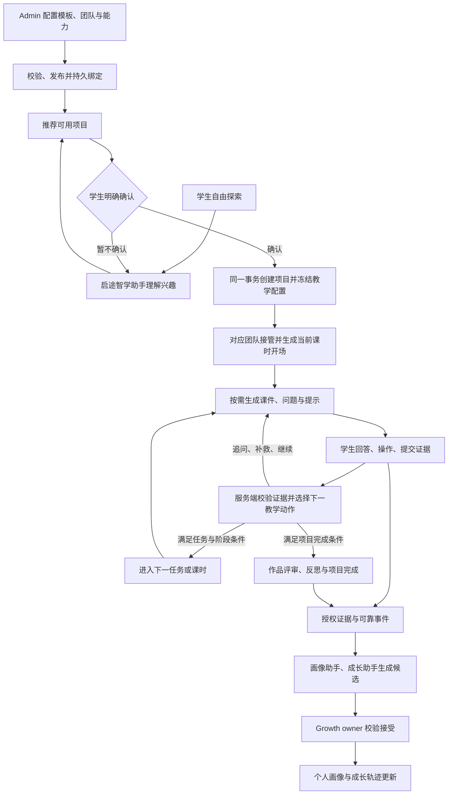
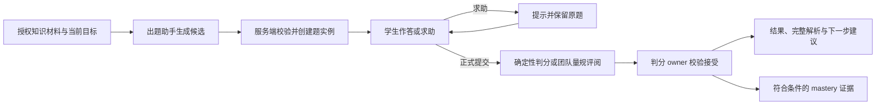

> 状态：历史记录恢复（2026-10-26）。正文保留 df05d5b 中的原始日期与验收边界，不代表当前部署状态；现行规则见 [工程入口](../../../README.md) 和各责任域文档。

# Agent 驱动的项目式学习与个人成长需求

> 日期：2026-10-21。版本：需求评审稿 v1。
> 状态：待评审的需求方案；尚未执行本稿实施与验收。
> 适用产品：启途智学。以光学模板为首个完整案例，能力应能复用于其他项目模板。
> 本文描述目标行为和验收条件，不代表功能已完成、配置已发布或线上已经验收。本轮仅整理需求，不修改模板、运行配置或业务代码。

## 1. 需求结论

学生在 AI搭档自由探索时，由“启途智学助手”理解兴趣、回答问题并推荐可用项目。学生选择并明确确认后，系统创建正式项目，冻结该项目的模板与教学配置，由对应团队按课时任务接管。

模板规定驱动问题、学习目标、阶段、课时任务、证据要求和完成条件。Agent 根据这些约束、知识库材料和学生当前表现，按需生成课件、问题、提示和反馈。课件与问答都出现在对话中；学生可以拖动参数、放大查看、提交回答和保存探究证据。

管理员可以修改模板、助手、团队成员、模型、Skills、MCP 工具和知识范围。保存、校验、发布和绑定均须持久化。新配置对新项目生效，既有项目保留已确认的教学版本，当前禁用和撤权仍立即限制运行。

个人画像和成长轨迹由两个专用助手持续处理授权学习证据，生成结构化候选，经服务端校验接受后更新现有页面。学习过程、团队协作、工具调用和成长结论都应可追溯。

### 1.1 本次范围

| 范围 | 本次需求 |
| --- | --- |
| Admin 配置 | 配置和修改模板、课时、助手、团队、模型、Skills、MCP、知识库；发布版本并持久绑定 |
| 自由探索 | 默认助手对话、理解兴趣、推荐已有模板、选择与显式确认 |
| 项目学习 | 团队接管、课时任务、动态课件、知识库练习、评阅解析、补救与人工支持 |
| 右侧预览 | 与冻结模板一致的阶段和课时；真实团队状态、历史和工具调用 |
| 个人成长 | 授权证据覆盖、专用助手生成、服务端接受、个人画像与成长轨迹展示 |
| 交付验收 | 配置到学生使用，再到成长更新的完整链路，以及失败、重试和恢复 |

学生主入口继续使用 `/student/tutor`，灵感空间 `/student/inspiration` 保留探索与项目跳转。个人画像、成长轨迹和 Admin 功能均使用现有页面，不新增顶层导航。

### 1.2 动态生成的含义

| 模板提前确定 | Agent 在互动中生成 | 服务端负责判定 |
| --- | --- | --- |
| 目标、任务边界、先修条件、课时顺序 | 情境、讲解、追问、例子、板书和练习题 | 当前课时任务、允许的教学动作 |
| 允许的课件组件、工具和参数域 | 组件组合、初始参数、对照方案和观察提示 | 组件与参数有效性、工具权限 |
| 证据要求、评价量规、答案披露策略 | 评阅建议、错因解释、补救活动 | 正式判分、掌握度、作品通过、阶段转换 |
| 角色职责、团队、知识范围 | 按需委派和协作内容 | 实际路由、能力边界、历史版本 |

预先建设的是可复用的交互组件、仿真模型和生成协议。课件正文、练习内容及教学顺序中的具体动作在运行时生成。模板无需预装每一节完整课件，也不要求学生每次都看同一份材料。

## 2. 角色与术语

| 名称 | 含义与职责 |
| --- | --- |
| 启途智学助手 | 自由探索的默认助手；整理兴趣并推荐已发布、可用的项目模板 |
| 项目模板 | 可重复使用的课程设计，包含阶段、课时、目标、任务和评价要求 |
| 学生项目 | 学生确认后产生的个人项目实例，关联冻结模板和个人学习进度 |
| 团队 | 承担项目教学的真实助手成员及角色、课时分工和协作规则 |
| 助手 | 具有受治理指令、模型、Skills 和工具权限的执行身份 |
| Skill | Agent 可调用的教学能力说明及输入输出约束；本身不授予工具权限 |
| MCP 与工具 | 受 Admin 管理的执行通道，如授权知识检索、注册仿真和证据提交 |
| 教学配置包 | 沿用既有 TeachingBundle 与 binding，将模板、团队及其能力组成可冻结的版本合同 |
| 课件实例 | 某次互动生成、校验并持久保存的课件，含内容、参数、来源与版本 |
| 领域 owner | 对业务事实拥有写入责任的服务端模块，例如 mastery、projects、works、growth |
| 学情画像分析助手 | 汇总学生当前兴趣、先备知识、学习偏好、优势及下一步问题 |
| 成长轨迹生成助手 | 根据历次学习证据生成阶段总结和变化说明，与正式成长事件共同展示 |

一个团队可以只有一个助手，也可以包含多个助手。同一助手可承担多个获批角色。默认由一个前台导师维持连续对话，后台专家按任务需要参与，不要求每轮调用全部成员。

## 3. 完整用户流程

### 3.1 自由探索与推荐

- **EXP-01**：未进入正式项目时，服务端解析的接待身份为“启途智学助手”。学生可以持续探索，不强制立项。
- **EXP-02**：推荐只引用真实存在、已发布且教学绑定有效的模板。卡片展示项目目标、适合原因、预期产物、课时安排、先修要求和团队简介。
- **EXP-03**：已有进行中的同类项目应提供“继续学习”。新建另一项目须有明确的新建意图，不能因重复推荐而重复立项。
- **EXP-04**：学生可以换方向、查看详情、调整个人目标或拒绝推荐。无合适模板时明确说明并继续探索，不虚构可用项目。
- **EXP-05**：推荐卡点击查看、自由聊天、系统生成计划草稿都不等于确认。确认按钮应明确表达“确认开始该项目”，并展示将采用的目标和安排。
- **EXP-06**：确认时重新验证模板、绑定和访问权限。卡片版本已失效时刷新候选并说明变化；不能静默更换学生已选择的课程。
- **EXP-07**：重复点击、断网重试和刷新恢复返回同一个确认结果。确认事务失败时保留探索草稿，不留下半创建项目。

### 3.2 接管与持续学习

- **RUN-01**：确认成功后，项目名称、当前导师、课时任务和右侧团队同步切换；保留本次探索中与项目有关的学生目标和已授权摘要。
- **RUN-02**：按冻结的实际课时和任务选择责任角色。发言名称、真实执行助手、模型身份和工具记录必须对应，不能只更换头像或显示名称。
- **RUN-03**：项目新会话自动生成启发式开场，说明当前任务并提出一个可回应的问题。恢复已有会话时继续未完成任务，不重复开场或重新出题。
- **RUN-04**：学生可在当前目标内追问、请求例子或提示。服务端依据证据选择下一动作，不因聊过某个知识点就完成任务。
- **RUN-05**：暂停、退出、切换项目后可以恢复课件状态、待答题、当前任务和已保存证据。迟到的旧请求不能覆盖新项目界面。
- **RUN-06**：当前导师不可用时显示明确状态并保留进度。替代助手仅可来自已冻结且当前获授权的替代规则；否则等待修复或教师支持。

## 4. Admin 配置、修改和持久化

### 4.1 可配置内容

| 对象 | 必须支持的配置或修改 | 发布前校验 |
| --- | --- | --- |
| 模板 | 名称、说明、适用学段、先备要求、驱动问题、目标、阶段、产物和量规 | 目标覆盖、先修关系、阶段门禁和证据要求 |
| 课时 | 数量、顺序、时长预算、任务、责任角色、检查点、交互能力要求 | 课时 ID 稳定、任务与目标一致、排期有效 |
| 团队 | 增删成员、替换成员、角色分工、负责人、课时路由和协作方式 | 角色映射到真实成员，没有缺失的必需职责 |
| 助手 | 名称、教学指令、用途、启用状态、Skill、工具与知识权限 | 指令和工具不越权，能力满足分配任务 |
| 模型 | 供应商与模型二元组、用途路由和获批替代策略 | 实际目录可用，不仅保存同名裸模型 ID |
| Skills | 选择已发布版本、设置任务适用范围；创建和编辑草稿后评测发布 | canonical ID、版本、内容摘要及输入输出合同有效 |
| MCP 与工具 | 连接、启停、工具白名单、schema 版本、参数域、超时与调用限额 | 连接可用和调用获准分别检查；禁止隐式继承所有工具 |
| 知识库 | 选择或维护知识库，添加、更新、停用资料，修改检索范围、用途和内容版本策略 | 知识来源、对象权限与项目授权范围可核验；保留历史引用的版本信息 |
| 教学策略 | 题型、难度范围、提示、解析披露、补救与人工介入规则 | 不允许绕过理论、作品和阶段 owner |
| 画像与成长 | 两个用途对应的助手、模型、字段合同、触发、刷新和接受策略 | Admin 配置与 Worker 实际执行使用同一身份 |

**CFG-01**：所有配置进入服务端持久存储。重新登录、浏览器刷新、服务重启或切换管理员终端后，回读结果一致。

**CFG-02**：模板库可绑定一个助手或一个团队。单助手按同一绑定合同表达，不另建特殊执行路径；不能只存显示名称或浏览器本地关联。

**CFG-03**：编辑器与已有 Admin 管家入口共用后端配置 owner。自然语言配置先形成可查看的改动，正式结果必须以服务端保存、校验、发布和回读为准。

**CFG-04**：支持草稿保存、差异预览、校验、发布、绑定、停用及版本回看。校验失败或部分操作失败时，展示具体资源和原因，重试不能重复创建资源。

**CFG-05**：修改共享助手或团队前展示引用关系及影响范围。更新使用资源 revision 检查并发冲突；后提交者不能覆盖未看到的修改。

**CFG-06**：Skill 草稿、MCP 登记、目录存在和模型连接成功各有独立状态，均不能单独表示学生运行已就绪。Skill 目录不完整时阻止全数组覆盖，不静默删除未知绑定。

### 4.2 配置生效范围

| 操作 | 新项目 | 已有项目 |
| --- | --- | --- |
| 编辑未发布草稿 | 无影响 | 无影响 |
| 发布新模板、成员或能力版本并激活新绑定 | 新确认项目使用新版本 | 继续使用原冻结版本 |
| 当前 Admin 禁用成员、模型、工具或知识授权 | 立即受限 | 立即受限；不能以历史快照绕过撤权 |
| 新增知识库、Skill 或成员权限 | 随新绑定审核后使用 | 不自动扩大旧项目权限 |
| 修订某学生课时计划 | 按其项目规则处理 | 产生可审计 plan revision，保留已完成任务和证据 |
| 将已有项目迁移到新教学版本 | 不适用 | 必须显式迁移，展示目标、进度和证据映射；不得静默替换 |
| 回退发布选择 | 后续确认可选择既有有效版本 | 不回写历史学习事实 |

**CFG-07**：正式确认须在同一事务冻结 `templateVersionId`、排期 profile、`bindingId`、`teamVersionId`、角色映射、助手与 Skill 版本、工具合同、模型策略、知识 grant 及其 hash。`confirmIntent`、`confirmPlan` 两条入口遵守同一规则。

**CFG-08**：缺失或无效绑定时拒绝创建正式项目。历史缺少完整快照的项目必须通过显式兼容或迁移流程处理，不在读取时套用最新配置。

## 5. Agent 驱动的动态课件

### 5.1 生成输入和结果

**CW-01**：生成输入包括冻结模板、当前课时任务、目标、已授权知识材料、学生已提交证据、待解决误解、可用组件和参数范围。生成器必须消费实际模板正文，不能仅给固定课件贴上模板 ID。

**CW-02**：生成内容至少支持以下形式，按教学需要组合，不要求每次全部出现。

| 形式 | 动态内容示例 | 学生交互 |
| --- | --- | --- |
| Mermaid 图 | 学生当前假设、变量关系、探究流程 | 展开、放大、查看关联任务 |
| KaTeX 公式与板书 | 当前问题的公式、单位和分步解释 | 阅读、复制、查看对应示意 |
| BoardBlock | 预测、证据、疑问和修订记录 | 选择任务、提交或修订自己的内容 |
| 受控概念示意 | 光线、法线或变量的低风险教学提示 | 在获批范围内调整示意、比较变化 |
| 注册实验卡 | 单缝衍射、封闭细雾室散射 | 拖动参数、运行、比较、填写观察 |
| 问答与检查卡 | 当前目标的选择题、解释题或数据分析题 | 作答、求助、提交、查看反馈 |

**CW-03**：Agent 输出闭合结构的课件候选，由服务端校验后以 `TutorReplyBlock` 和 SSE 交付。所需新字段或 block 须先扩展共享合同。禁止直接执行模型输出的任意 HTML、JS、外部脚本或浏览器工具。

**CW-04**：注册组件负责交互和计算，Agent 负责选择活动、解释和追问。拖动不应每一步都等待模型回答；模型计算与渲染可以及时更新，具有教学意义的操作或提交才触发后续分析。

### 5.2 对话内体验

- **CW-05**：课件嵌入生成它的那条对话，后续讲解可引用该实例；不把核心学习活动转移到不相关页面。
- **CW-06**：参数控件显示名称、当前值、单位和允许范围。参数变化后同步更新图像或图表；计算中、超范围和不可用分别显示。
- **CW-07**：支持全屏或等价的放大视图。进入和退出后参数、待填答案、图表和对话位置保持一致，不重新生成实例。
- **CW-08**：支持键盘与触控操作、数值输入、退出全屏和焦点恢复。窄屏可折叠侧栏，课件不得遮挡输入框。
- **CW-09**：历史可查看当时的课件内容、参数和结果。新尝试建立新记录；过期 action 由服务端重新签发，不能直接重放旧写操作。
- **CW-10**：资料不足或生成失败时提供重试、已有获准材料或教师支持，并明确来源和状态。不得把静态备用材料标为本轮动态生成。

### 5.3 从拖动结果到探究证据

以单缝探究为验收案例，学生先预测缝宽变化的影响，再使用当前任务允许的参数完成对照。课件保留原预测、两组参数、模拟结果和学生解释。团队据此追问，学生最后把观察引用到报告。

**CW-11**：滑块移动只改变预览，不能自动证明掌握。学生提交观察后，服务端校验并持久化；界面收到证据 owner 回执后才显示“已保存”。

**CW-12**：课件和观察记录至少能追溯课件实例、生成版本、项目、课时、任务、目标、action、参数与单位、模型版本、结果来源、学生说明和证据引用。生成记录还须追溯助手、Skill 版本及知识来源。

**CW-13**：正式 action 使用服务端稳定 ID、项目和课时作用域、plan revision 及幂等键。服务端验证参数并复算或核验模型结果，不信任浏览器自行提交的结果。

**CW-14**：历史实例保存已生成内容和必要快照，不在每次打开时重新调用模型。引用与快照只保存必要材料，不复制整库全文。历史查看与重新取得工具操作权限分开处理。

**CW-15**：模型计算、模拟观察、真实测量使用不同来源标识。计算值不能标作实测，超出注册模型域时明确拒绝或显示不能作定量判断。

**CW-16**：`TheoryMastered` 前只提供低风险概念提示，不开放正式实践工具。正式仿真和真实实验都要再次验证门禁与对象权限；真实实验另需教师审核的安全方案。

## 6. 知识库出题、团队判断与完整解析

### 6.1 动态题目

**QA-01**：理论单元学习后可自动发起巩固，也允许学生主动申请。第 8 课时的综合诊断复用平时证据；不能先要求 `TheoryMastered` 才允许做用于形成理论掌握证据的题。

**QA-02**：出题助手根据当前目标、学生已有作答和授权知识材料生成候选。题型首期支持选择、数值与简短解释；逐步支持光路说明、图表和探究论证。每种题型必须有服务端支持的作答与评价合同。

**QA-03**：每题记录目标、来源、适用条件、难度、标准答案或量规、解析和生成版本。题目必须可回答、条件充分，数值题校验单位、允许误差和计算结果；开放题接受量规允许的多种合理表述。

**QA-04**：知识库不可用、来源失效或缺少依据时，明确本轮无法生成已核验题目。可按策略使用已批准备用题，但必须标注来源；不得伪造知识库引用。

**QA-05**：候选经校验后进入既有题实例与待答题 owner。题目、选项及提交动作使用服务端稳定 ID，绑定项目、课时、目标和 revision。刷新保留题目，提示请求不覆盖待答题。

### 6.2 判断和答案披露

- **QA-06**：闭合答案优先按服务端规则判分。需要语义判断的答案由团队提供带量规和证据的评阅候选，正式结果由既有 owner 接受。
- **QA-07**：团队可分工出题、检查题目质量、评阅和解释。分工记录应真实可查；模型之间意见一致不自动等于掌握证明。
- **QA-08**：提交前不向浏览器下发隐藏答案和完整解析。求助提供分级提示，保留当前题，不自动判错。
- **QA-09**：首期巩固练习默认在有效提交并取得判定后展示完整解析，包括结果、理由或步骤、错因、适用条件、可核验来源及后续建议。答对也能查看解析。
- **QA-10**：正式诊断可按 Admin 策略延后揭示。查看答案或完整解析后必须记录披露状态；原题之后的作答不能再当作独立完成证据，需生成等价新题验证。
- **QA-11**：评阅分歧、题意不清、来源冲突或置信不足时进入复核，不强行判错。学生可提出异议并保留原答案和评阅版本。
- **QA-12**：复用现有题目、判分和 mastery owner，不另建独立题目状态库。未达标时补救同一目标，满足服务端条件后才进入实践。

现有“不给完整答案”的泛化策略需要细化为“未提交或未到披露条件不揭示”。只修改提示词或在前端隐藏答案，不能满足该需求。

## 7. Skills 的产品要求

下列为能力需求，不表示这些名称已经注册或发布。实施时优先组合已有技能；确需新增的 Skill 必须通过运行时目录注册，客户端只提交 canonical ID。

| 能力 | 调用时机 | 输入 | 输出与验收 |
| --- | --- | --- | --- |
| 动态课件生成 | 开场、概念困难、对照探究、复习 | 当前目标、证据、材料、组件目录 | 可校验课件候选与交互说明；不同证据能产生适当变化 |
| 知识库巩固题生成 | 理论单元后、综合诊断、补救后 | 目标、授权来源、已作答历史、题型策略 | 有来源、有答案或量规、可实例化的题目候选 |
| 作答评阅与解析 | 学生提交后 | 题实例、答案、量规、来源、披露策略 | 评阅候选、完整解析和补救建议 |
| 探究证据指导 | 学生预测、操作、比较和写报告时 | 已保存观察、任务要求、报告版本 | 证据缺口、下一步问题、CER 修订建议 |
| 学情画像分析 | 对话与学习证据更新后 | 授权证据窗口、当前画像版本 | 闭合字段的画像候选及依据 |
| 成长总结 | 阶段、作品、反思或掌握证据更新后 | 历史与新增证据、当前成长版本 | 成长候选、变化说明和证据引用 |

**SK-01**：每项 Skill 声明允许的输入输出、所需工具、适用阶段、失败行为和版本。安装或绑定 Skill 不自动取得其声明的工具权限。

**SK-02**：评测覆盖内容正确性、结构有效性、教学适配、来源真实性、权限、答案披露和失败处理。发布制品可持久读取并支持多实例运行，不依赖管理员本机文件。

**SK-03**：绑定时固定 Skill 版本和内容摘要。Agent 运行中不能自行修改、安装或发布 Skill，也不能把本地草稿当成已启用能力。

## 8. 右侧项目预览与团队记录

### 8.1 项目进度

**VIEW-01**：沿用右侧“项目进度”区域，以“模板阶段 → 课时 → 当前任务”展示。阶段名、顺序、课时数和任务要求来自同一冻结模板及学习计划。

**VIEW-02**：展示当前课时、已完成项、未完成证据、锁定原因、下一项任务及计划修订说明。预览未来课时不代表解锁操作权限。

**VIEW-03**：项目生命周期状态、模板课程阶段、教学课时和任务为不同概念，由后端一次解析并返回一致投影。前端不以阶段序号当课次，不根据目标数量计算当前课时。

**VIEW-04**：对话头部、课件、右侧进度、项目详情和学习计划使用相同的项目、模板版本、profile、课时和 plan revision。计划更新后不允许同时显示两个版本的进度。

### 8.2 团队智能体

| 可查看内容 | 展示要求 |
| --- | --- |
| 团队与成员 | 冻结团队、真实成员、角色、承担课时、当前前台导师 |
| 实时状态 | 就绪、等待、运行中、失败、离线；显示当前任务和更新时间 |
| 历史记录 | 按项目、课时、成员和 run 查看历史任务、对外回复及协作摘要 |
| 工具调用 | 调用者、工具用途、开始结束时间、结果状态、可公开摘要与允许的来源链接 |
| 失败与重试 | 失败原因、可恢复状态、重试关联；不把重试计为多次成功 |

**VIEW-05**：历史须持久化并支持游标分页；刷新后能查看早期 run，不能仅保留当前 SSE 窗口。历史成员名称与职责保留当时版本。

**VIEW-06**：状态必须来自真实任务与工具事件。已配置但未调用显示“暂无调用”；请求历史失败显示加载失败，不显示空历史。

**VIEW-07**：学生可见的是学习协作过程和工具摘要。系统提示词、内部推理、密钥、原始敏感参数、其他学生资料和未揭示答案不得进入侧栏。

**VIEW-08**：自由探索只展示当前接待助手及其实际活动，不能显示尚未选择的光学团队正在执行。

## 9. 光学 16 课时安排建议

### 9.1 调整依据与版本边界

现有 [16 课时源码](../../../packages/ai-client/src/quiz-bank/optics/curriculum.ts) 已有四阶段安排。其 [实践目标](../../../packages/ai-client/src/quiz-bank/optics/content.ts) 包含光路搭建、角度与物像距采集、折射率与焦距拟合。单缝衍射和散射模拟不能直接证明这些目标已完成。

建议保留 16 个学习单元作为首期参考，在新模板版本中把在线实践目标调整为注册模型配置、对照观察、数据分析和证据报告。保留四个理论门禁目标，散射和衍射继续属于非门禁实践模块。16 是试运行安排，不是已证明适合所有学段的固定长度。

新实践目标需重新定义描述、证据和量规，并分配适当的新 objective ID；不能沿用旧 ID 却悄悄把“求折射率与焦距”改成“观察波动现象”。目标总数可继续采用 12 个，但语义对应必须明确。旧模板和旧项目保留原合同。

如继续使用旧版几何光学实践目标，就必须提供对应的获批实验与真实证据条件。示例数据可以训练数据分析，但不能冒充学生亲自采集的测量或完成搭建任务。

### 9.2 建议课时表

以下是新版本的任务设计草案，不是预制课件清单。每行的材料、问题和展示内容均由 Agent 在实际互动中生成。

| 课时 | 模板阶段 | 核心任务 | 动态互动 | 学生应提交的证据 |
| --- | --- | --- | --- | --- |
| 1 | 项目探索 | 从生活光学现象明确观察对象 | 情境卡、观察与解释分类板 | 现象描述、个人疑问 |
| 2 | 项目探索 | 形成驱动问题、假设与变量设计 | 假设关系图、对照方案板 | 个人目标、预测和变量方案 |
| 3 | 理论学习 | 理解光线模型、平面镜和虚像 | 光路示意、分步作图提示 | 自主作图与虚像解释 |
| 4 | 理论学习 | 掌握反射规律与角度基准 | 法线示意、变式问答 | 作答、解释和修订记录 |
| 5 | 理论学习 | 理解折射与介质条件 | 授权材料、低风险示意、生成题 | 条件判断和解释 |
| 6 | 理论学习 | 理解全反射条件及边界 | 条件对照、反例和检查题 | 条件推理和作答 |
| 7 | 理论学习 | 理解透镜成像 | 分步光路图与像的性质对照 | 成像判断、自主解释 |
| 8 | 理论学习 | 汇总四目标证据并补救 | 知识库综合题、团队评阅、完整解析 | 既有 mastery owner 的评估引用 |
| 9 | 实践探究 | 配置获准模型并确定观测方法 | 模型说明、参数范围、预测表 | 方法、单位、参数与控制变量方案 |
| 10 | 实践探究 | 单缝衍射对照探究 | 缝宽等获准参数拖动、图像比较 | 原预测、模拟观察及解释 |
| 11 | 实践探究 | 封闭细雾室散射对照探究 | 获准条件和观察方向比较 | 来源明确的对照观察与边界说明 |
| 12 | 实践探究 | 分析已有数据与模型局限 | 数据表、趋势图、获准分析操作 | 观察引用、趋势解释、不确定性 |
| 13 | 实践探究 | 构建主张、证据和推理 | CER 板书、团队追问 | 学生自写的报告草稿与证据引用 |
| 14 | 实践探究 | 按量规修订并提交作品 | 证据缺口提示、版本对比 | 报告修订版与作品提交回执 |
| 15 | 成果评审 | 答辩并回应质疑 | 基于学生作品的动态问答 | 答辩回答和正式评审记录 |
| 16 | 成果评审 | 反思、迁移和后续计划 | 预测与结论对照、迁移问题 | 学生反思及满足条件的成长记录 |

### 9.3 排期规则

- 本表第 1、2 课时是正式立项后的项目内探索。立项前自由探索不自动记为已完成课时，学生也不必等到第 2 课时才确认创建。
- 建议保留每课 60 分钟作为排期预算，允许暂停和分次完成。第 7 课时按先备情况分步处理，不强行一次覆盖所有高级内容。
- 第 8 课时汇总已有评估并补救，不要求所有诊断都挤在该课。未满足理论门禁时继续同目标学习，不能按课次放行。
- 第 14 课时提交不等于作品通过，第 16 课时结束不等于项目自动归档。均需相应 owner 接受。
- Agent 可在模板允许范围内调整例子、提示和练习量。调整课时顺序、数量、目标或正式任务须由 learning-plan owner 产生修订；新增教学能力需经过配置版本治理。
- 适用学段、先备水平、每周频率和实际课时预算在模板发布前必须确定。本文不据未提供的年龄信息承诺统一难度。

## 10. 个人画像与成长轨迹

### 10.1 两类结果的职责

个人画像回答“当前对什么感兴趣、具备什么基础、哪些方面表现出优势、下一步需要什么支持”。成长轨迹回答“何时做过什么、依据是什么、相比此前有什么变化”。

**GROW-01**：Admin 为“画像分析”和“成长总结”分别绑定助手、模型、Skill、字段合同和策略。两类结果分别保存版本与来源，由同一 Growth owner 提供组合投影；不要求两个助手每次同时完成。

**GROW-02**：Tutor 提供学习证据，画像与成长助手提出候选，Growth owner 校验接受。客户端、Tutor 或分析助手不能直接写正式画像、成长记录、掌握度或项目状态。

### 10.2 输入覆盖与更新

| 证据来源 | 可用内容 | 不得据此推断 |
| --- | --- | --- |
| 自由探索和项目对话 | 学生表达的兴趣、目标、问题、解释和求助，以及必要上下文 | AI 说出的结论不等于学生已理解 |
| 理论作答 | 原答案、评估结果、提示与解析披露情况、修订记录 | 看过答案后的复述不等于独立掌握 |
| 课件与实验 | 学生预测、获接受的观察、解释及其版本 | 拖动次数或点击“运行”不等于能力提升 |
| 项目与课时 | 冻结目标、任务进展、owner 确认的完成事件 | 课时位置不等于阶段完成 |
| 作品与反馈 | 学生作品版本、量规结果、采纳反馈与修订 | 生成的报告草稿不等于学生作品通过 |
| 反思 | 学生已提交的反思和后续行动 | 不能由一句挫败表达生成固定负面标签 |

**GROW-03**：“所有对话”指覆盖权限和保留期内的相关已完成回合，包含自由探索、项目对话及学生与不同助手的互动，不能依赖是否产生 team run。重试、失败、取消和 AI 输出应保留各自语义。

**GROW-04**：服务端装配有界的学习摘要和必要内容，不能只把 opaque ID 交给模型，也不能每次把全量聊天复制到提示词、日志或画像。所需新证据引用类型须经共享合同和 owner 审核，不能把对话伪装成其他现有证据类型。

**GROW-05**：已完成回合和学习事件可靠入队；短时间多事件可以合并。每个用途维护已覆盖事件与时间水位，支持历史补处理、Worker 重启恢复和失败重试。

**GROW-06**：画像和成长页展示最近更新时间、证据覆盖至何时、是否待分析或待复核。覆盖不足时明确说明，不声称已经处理全部历史。

**GROW-07**：学生新证据到达后按 Admin 刷新策略自动处理，无需学生手动寻找助手。证据撤回、删除或授权变化后，相关结论应重新核验、失效或重算。

### 10.3 个人画像字段

核心字段复用 [现有成长合同](../../../packages/contracts/src/growth.ts)，不另建自由格式画像。

| 字段 | 展示含义 | 依据和限制 |
| --- | --- | --- |
| `priorKnowledge` | 当前先备知识描述 | 基于真实作答和解释，不能替代 mastery 事实 |
| `targetLevel` | 学生希望达到的目标 | 优先采用学生确认目标，不由模型擅定 |
| `timeBudgetMinutesPerWeek` | 每周可投入时间 | 仅采纳明确提供或确认的信息，未知为 null |
| `preferences` | 已观察或自述的学习偏好 | 可修订，不形成固定“学习类型”标签 |
| `interests` | 兴趣方向 | 区分偶然提及与持续表达，允许学生纠正 |
| `strengths` | 有证据支持的具体优势 | 描述可观察行为，不生成无依据的能力排名 |
| `nextQuestions` | 值得继续探究的问题 | 与当前项目和证据缺口相关 |
| `version` | 画像结果版本 | 服务端分配，模型不能自行覆盖当前版本 |

字段不足时展示“待观察”。学生可提交更正或补充，owner 核验后更新，不开放直接改写正式推断结果的客户端入口。

### 10.4 成长轨迹字段与页面

| 字段或展示项 | 来源与用途 |
| --- | --- |
| `milestones` | 专家提炼的里程碑描述；必须关联已有可核验事件 |
| `studentSummary` | 面向学生的阶段总结，说明具体变化和依据 |
| `strengths` | 在这段学习中体现的优势，与画像保持可解释关系 |
| `nextQuestions` | 后续探究、补救或迁移方向 |
| `evidenceRefs` | 服务端可回查且获授权的证据引用 |
| `confidence` | 结论依据的充分程度；不是学生能力分数 |
| `version` | 成长助手结果版本，与画像版本独立 |
| 正式时间线条目 | 继续读取 Growth owner 的阶段、作品、反思和掌握事件 |

**GROW-08**：`/student/profile` 显示当前画像与必要成长摘要；`/student/growth` 同时展示正式事件和已接受的 AI 成长总结。只在画像页显示总结不算成长轨迹完成。

**GROW-09**：每类结果在两个页面引用相同的已接受版本；允许画像与成长分别更新，必须分别标出更新时间。新增覆盖水位、分析状态、证据说明等字段应在共享合同中明确，不能假定现有类型已有。

**GROW-10**：区分“发生的学习事实”和“AI 对事实的总结”。AI 总结不能产生假的掌握、作品通过、阶段完成或量化成长分数。

### 10.5 候选接受与可见范围

- **GROW-11**：默认通过 Admin 审核的规则自动接受证据充分、合同有效的结果；冲突或需要人工判断的候选进入审核。所有接受均经过同一 owner，不能由 Worker 改数据库状态。
- **GROW-12**：校验真实证据对象的归属、有效性、时间、撤回状态和结论依据。无依据、未知字段、越权引用和伪造里程碑拒绝展示。
- **GROW-13**：版本基于当前 accepted revision，由服务端分配。重复事件不重复生成成长条目，晚到结果不能覆盖较新结果。
- **GROW-14**：失败或待审核时保留可用的上次结果并标明状态；没有结果时显示形成中，不显示默认零分或负面结论。
- **GROW-15**：学生看自己的证据与结果；班主任按当前有效分配读取必要详情；家长读取独立脱敏投影，默认不含原始对话、音频及内部风险信息。

## 11. 后端统一与权限要求

### 11.1 复用现有业务责任

| 内容 | 唯一责任 |
| --- | --- |
| 模板正文、排期、绑定与教学配置版本 | 既有 templates、binding 和 Admin 治理链 |
| 正式项目及生命周期 | projects |
| 个人课时计划、任务、修订 | learning-plan |
| 当前题、作答和评估 | 既有 TutorQuiz 与 learning-plan 对应 owner |
| 掌握度、理论门禁 | mastery 及现有评估链 |
| 教学会话、结构化回复 | ai-tutor |
| 委派、任务状态、团队事件与历史 | team-runtime 与 Worker |
| 实验观察、作品、反馈 | 既有实验协议及 works/feedback 证据链 |
| 画像候选、接受、成长记录与投影 | growth |

**DATA-01**：继续使用模块化单体和异步任务，不新增第二套课程、PBL 状态机、mastery 数据库或成长事实库。`ProjectTemplateSpec` 是课程合同，其他页面结构只能由其投影产生。

**DATA-02**：同一次运行解析提供项目版本、实际课时任务、责任助手、能力、门禁和右侧展示上下文。禁止按标题、团队名称、成员正则、ID 前缀或固定 1–16 推断授权。

**DATA-03**：知识访问取冻结项目 grant、当前 Admin 授权、当前助手与工具授权、对象权限及任务范围的交集。自由探索使用独立的获批探索范围，不提前借用尚未确认项目的权限。

**DATA-04**：IMA 的列库、搜索、列文档和读文档均检查范围。文档引用须有服务端维护的项目来源和有效期；签名有效不等于本项目有权读，过期引用重新检索。

**DATA-05**：知识材料只作为证据，不能修改角色、工具、教学门禁或答案披露规则。引用来源不证明学生掌握，不虚构页码、书名或检索成功。

**DATA-06**：确认、配置、答题、课件保存、作品、成长事件及异步任务均考虑幂等性。跨模块写入使用既有命令、事件与 outbox；显示成功必须有相应 owner 回执。

### 11.2 交互错误和恢复

| 情况 | 用户可见行为 |
| --- | --- |
| 加载中 | 展示具体正在加载的对象，保留输入和布局 |
| 暂无数据 | 区分没有项目、没有调用、没有证据和画像形成中 |
| 断网 | 保留未提交输入与可用历史；标记待提交，不显示保存成功 |
| 权限失败或撤权 | 停止受限操作，展示可理解的状态，不泄露越权对象 |
| 模型、Skill、MCP 或知识服务不可用 | 明确失败环节，按批准策略重试或请求支持 |
| 生成内容未通过校验 | 不执行非法内容，允许重新生成或返回获准材料 |
| 部分配置失败 | 展示已保存和失败项，可按同一操作记录恢复 |
| plan revision 冲突或 action 过期 | 保留学生输入，重新取得上下文与动作，再决定提交 |
| 评阅或画像处理较慢 | 显示处理中或待复核，不提前显示结论 |

后台日志应包含必要的事件、版本、任务和错误码，支持排查但不记录秘密或未脱敏原始学生对话。具体错误码在实施合同中沿用或扩展，不能只返回通用“失败”。

## 12. 验收场景

以下场景是交付要求。测试使用隔离学生、项目与数据，不通过手工注入掌握度或正式成长事实制造成功。

| 编号 | 场景 | 通过条件 |
| --- | --- | --- |
| AC-01 | 配置光学模板的助手、团队、Skill、工具和知识库 | 服务端保存、校验、发布、绑定和重启回读一致 |
| AC-02 | 修改团队成员、助手模型和 Skill 版本 | 新项目使用新绑定；旧项目保持冻结语义；当前撤权对两者生效 |
| AC-03 | 目录缺失、配置部分失败或并发编辑 | 不显示全部成功，不删未知绑定；明确冲突，可幂等恢复 |
| AC-04 | 学生提问后接收推荐但未确认 | 默认助手处理，数据库不产生正式项目 |
| AC-05 | 确认推荐并重复提交 | 只创建一个项目，配置完整冻结，团队正确接管 |
| AC-06 | 确认时绑定失效 | 确认整体失败并可恢复；不存在无绑定项目 |
| AC-07 | 对同一课时给出不同理解和误解 | Agent 依据证据改变提示、课件或问题，仍服务同一目标 |
| AC-08 | 拖动单缝参数并全屏、退出、刷新 | 图表正确响应，状态保持，历史内容不重新生成 |
| AC-09 | 门禁前调用实践、跨项目复用 action、提交非法参数 | 服务端拒绝，不能仅靠界面隐藏按钮 |
| AC-10 | 保存模拟观察并重试 | 收到唯一证据回执，来源标明模拟，报告可引用原记录 |
| AC-11 | 理论单元后使用知识库生成题 | 真实授权检索，来源可回查，题实例和量规可持久恢复 |
| AC-12 | 求助、提交、查看完整解析并再次练习 | 求助保留原题；提交后按策略揭示；披露后不伪造独立掌握 |
| AC-13 | 开放答案由团队评阅，学生提出异议 | 有真实任务、量规和 owner 判定；复核保留旧版本 |
| AC-14 | 到达第 8、14、16 课时但条件未满足 | 不自动理论通过、批准作品或归档 |
| AC-15 | 调整冻结模板的展示或修订个人计划 | 头部、对话、课件、右栏、详情和计划版本一致 |
| AC-16 | 多轮团队任务、工具失败、历史分页和刷新 | 可查实际早期记录及失败重试，不用演示事件填充 |
| AC-17 | 快速切换项目或学生上下文 | 旧请求、旧 SSE 与旧图片结果不覆盖新上下文 |
| AC-18 | 自由探索无 team run，之后完成项目回答和反思 | 各类有效证据仍触发配置的画像与成长助手 |
| AC-19 | 两类助手生成并经 owner 接受结果 | 画像与成长页自动更新，来源、独立版本及覆盖时间正确 |
| AC-20 | 重复、乱序、延迟事件及 Worker 重启 | 无重复里程碑，旧候选不覆盖新结果，可恢复覆盖水位 |
| AC-21 | 无证据、证据撤回、知识撤权或分析失败 | 待观察、失效、重算或保留带状态旧结果，不编造完成 |
| AC-22 | 学生、家长、班主任查看同一学习过程 | 后端对象权限有效，字段按角色投影，不暴露原始敏感内容 |
| AC-23 | 知识材料夹带指令或 Agent 生成任意脚本 | 不能改变权限和门禁，非法内容不执行 |
| AC-24 | 新光学模板实践目标发布 | 新目标、证据、量规与课时一致，未改变四个理论门禁和旧项目语义 |

验收报告必须分别标明源码存在、配置存在、已发布启用、真实请求成功、浏览器体验和教学试运行结果。类型检查或模拟测试不能替代真实模型、知识检索、数据库持久化及完整浏览器流程。

## 13. 实施分组与本稿采用的默认值

以下顺序是拆分后续工作的建议，不是本轮实施承诺。整个需求完成需要覆盖所有分组。

| 顺序 | 交付内容 | 完成标志 |
| --- | --- | --- |
| 1 | 模板、团队及能力版本的配置发布与冻结 | 可持久绑定，两个确认入口一致，历史项目语义稳定 |
| 2 | 自由探索、推荐、接管及统一课时上下文 | 一个学生可从探索进入并恢复正确的项目任务 |
| 3 | 动态课件、观察证据、知识库出题与团队解析 | 对话内完成一次可回查的学习与评估循环 |
| 4 | 团队历史、工具记录和完整右侧课时投影 | 跨刷新、跨 run 可查，展示与执行一致 |
| 5 | 画像与成长的证据覆盖、自动接受与双页面展示 | 从真实学习事件自动形成可解释的两类结果 |
| 6 | 新光学模板试运行与全链路验收 | 运行上述验收场景，再根据实际学习证据调整排期 |

本稿采用以下默认值，供后续产品评审逐项确认。

- 16 课时保留为参考，推荐发布面向注册在线模型的新模板版本；不原地修改旧版几何光学实践目标。
- 巩固题在有效提交后给完整解析；诊断题按 Admin 策略揭示，并记录答案披露状态。
- 以一个前台导师维持对话，后台团队按任务协作；成员数量和职责可配置。
- 课件由 Agent 动态生成结构化内容，使用受控组件和注册模型；运行时任意代码执行不在首期范围。
- 画像和成长按事件增量更新，低风险且证据充分的候选可按获批策略自动接受，需要人工判断的候选进入审核。
- 模板发布前确定学段、先修、课时预算、知识材料及教学评价标准；正式上线前确定刷新时限、容量预算和数据保留策略，并据此验收。

## 14. 与既有文档的关系及本轮边界

本文是本次用户目标的需求入口。实现责任继续归现有文档和模块；方案获评审后再同步责任域合同，不建立另一套运行时事实源。

| 参考 | 用途 |
| --- | --- |
| [Admin 治理](../../admin/platform-governance.md) | 配置控制权、模型、工具和模板入口 |
| [学生 AI搭档](../../student/tutor.md) | 对话、结构化回复、身份和权限 |
| [学生成长](../../student/growth.md) | 两类专家、正式成长事实和角色投影 |
| [课时与团队合同](./theme-session-team-ima-design.md) | `ProjectTemplateSpec`、排期、绑定和路由 |
| [光学模型与证据边界](./optics-scattering-diffraction-analysis.md) | 注册模型、门禁、观察与 CER |
| [模板、团队与助手协作报告](./optics-template-runtime/10-template-team-assistant-knowledge-architecture.md) | 当前工作树的配置与运行接线线索 |
| [画像与成长接线设计](./profile-growth-projection/05-evidence-routing-design.md) | 证据装配、用途绑定、owner 接受和投影 |
| [管家验证记录](./optics-template-runtime/11-copilot-verification-20261021.md) | 已有定向验证及尚未完成的浏览器、生产边界 |

已有材料的状态记录对应不同日期与工作树，部分结论已经被后续改动更新。本文不重新认证这些完成度，不将旧报告中的失败或成功推广为当前生产结论。

本轮开始时工作区已有 Admin 管家、学生实验组件、contracts、API 绑定和实验、parent 画像、两组实施文档、锁文件及调试脚本等改动。它们不属于本次需求编写；本轮保留这些文件，仅新增本文并追加方案入口链接。

本轮检查说明：

- 已对开始时的 85 个改动文件保存哈希基线。入口 README 原始字节保留为完整前缀，本轮只追加需求链接。
- 首次复核发现以下文件在本轮期间发生其他修改，本轮没有编辑或回滚它们：`OpticsDiffractionScatteringCard.tsx`、`runtime-source.ts`、`platform-registry.service.ts`、`.agents/admin-skills/qitu-project-configurator/SKILL.md`、`admin-copilot/copilot.resources.ts`。其业务行为不在本次文档验证范围。
- 全库 `validate-docs.py` 检查发现已有管家实施文档的管理 Skill 链接缺失。`check-codex-plan.mjs` 还报告来源锁中 10 条零来源记录的校验问题、来源锁与交付状态的基线不一致，以及本轮并发新增的 `student-tutor-qa-fixes-20261021.md` 缺少状态声明。这些文件不由本稿修改，不据此宣称全库文档检查通过。
- 本稿单独检查本地链接、明确状态、需求编号、验收场景编号、代码围栏和空白格式；本轮不执行业务测试、模型调用或部署。
