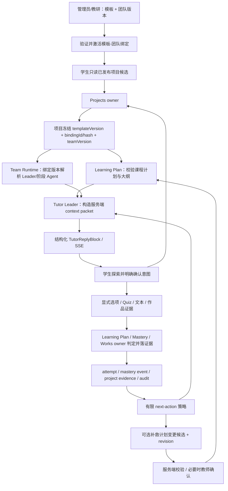

# 自适应 PBL 架构方案

> 状态：`proposal / 待 Issue 与架构评审`
> 基线：2026-10-18
> 调研依据：[调研报告](./research-report.md)
> 责任域：`projects` / `learning-plan` / `mastery` / `ai-tutor` / `team-runtime` / `apps/student-center`

## 1. 架构决策

采用“**不可变模板 + 明确绑定 + 项目计划快照 + 有证据的有限自适应**”。继续运行在启途现有模块化单体内，不引入独立 PBL 微服务或第二套掌握度/问答状态机。

- 模板版本定义学习目标、四阶段、阶段门禁、必需交付物、量规和支持 Agent 角色。
- 一份发布版模板通过一个有效 `PblTemplateTeamBinding` 绑定一份不可变团队版本。学生不选择团队；服务端解析唯一绑定。
- 学生明确确认意图后，Projects owner 在正式立项事务/命令链路中冻结模板版本、绑定版本与团队版本；任何后续管理端修改只影响新项目。
- `learning-plan` 复用现有课程生成/目标 DAG/掌握逻辑，把学生选择的目标、时长和模板结构变成服务端计划。`PlanOutline` 是计划结构投影，逐节教学计划继续按需惰性展开。
- Tutor 按服务端 context packet 与有限决策策略选择下一个教学动作。回答产生的作答/提示/作品事件可调整“下一条教学动作”；项目阶段只由 Projects/Learning Plan/Works owner 按现有状态机与门禁推进。
- Team Runtime 的 Leader 对话，子 Agent 只通过 typed task 返回候选；AI 提案不等同于掌握事实、阶段转换或作品验收。

## 2. 目标数据流



## 3. 领域合同

### 3.1 模板、团队版本和绑定

复用 `project_template_versions`；新增/完善 `admin_team_versions`（规范化 `PblTeamWorkflowSpec`、版本号、`specHash`、发布状态、审计创建者），并增加 `pbl_template_team_bindings` 绑定记录。

```ts
interface PblTemplateTeamBinding {
  id: string;
  templateVersionId: string;
  teamVersionId: string;
  status: 'draft' | 'validated' | 'active' | 'retired';
  bindingHash: string;
  validation: { valid: boolean; errors: string[]; warnings: string[]; checkedAt: string | null };
  activatedAt: string | null;
  retiredAt: string | null;
}

interface ProjectBindingSnapshot {
  projectId: string;
  templateVersionId: string;
  bindingId: string;
  teamVersionId: string;
  bindingHash: string;
  boundAt: string;
}
```

规则：

- 每个模板版本最多一个 `active` 绑定；若产品继续采用“一个团队版本只服务一份模板”的既有设计，则团队版本也使用部分唯一索引约束。需由产品评审确认是否接受一个团队支持多个模板后再定索引。
- 绑定激活必须校验模板/团队版本均为可发布状态、Leader 在成员列表中、各阶段 Agent 已登记且权限/路由合法；唯一索引负责并发兜底。
- 立项只接收模板/已确认意图，不接收客户端 `teamId`、`teamVersionId`、`phase` 或 gate 状态。项目从有效绑定解析团队并保存不可变引用/哈希。
- 团队/模板修改创建新版本；不能改写已有项目引用的版本。退休绑定不影响既有项目和回放。
- 迁移采用只读 shadow compare 后切流；存量模板不能唯一解析时保持不可推荐并返回明确配置错误，不按名称猜测或默认切到别的团队。

### 3.2 计划和大纲

把层级明确为三件不同的东西：

1. **模板教学设计**：已发布 `ProjectTemplateSpec`/模板版本，定义目标 DAG、四阶段、门禁、证据和量规。
2. **学生项目计划**：既有 `GeneratedPlan`/`learning_plans`，结合学生选择与排期生成课次和教学目标；首期优先使用确定性生成器，LLM 只能补充待审候选文案或题目变体。
3. **计划大纲/单节教学计划**：既有 `PlanOutline`/`SessionTeachingPlan`。计划确认时生成不可变大纲并随项目确认冻结；进入某课次时再惰性展开该课次教学计划。

不新建与上述结构重复的 `PblSyllabus`、`PblProjectPlan` 或第二套学习课次表。若确有项目任务颗粒度缺口，先扩展现有目标/模块/证据或 `SessionTeachingPlan` 的稳定合同，并用兼容迁移说明数据 owner。

如果引入模型规划：模型输出只包括候选的目标呈现顺序、目标解释、活动形式与题目草案；validator 检查 schema、所有 objective ID 属于冻结模板、DAG 无环、阶段顺序合法、课时合计正确、必需交付物完整、门禁不弱化。失败时明确返回错误，不静默修复后创建项目。

### 3.3 面向回答的动态教学动作

`TutorNextAction` 应是受限联合类型，而不是自由文本命令：

```ts
type TutorNextAction =
  | { kind: 'ask_socratic'; objectiveId: string; promptIntent: string }
  | { kind: 'offer_hint'; objectiveId: string; hintLevel: number }
  | { kind: 'offer_example'; objectiveId: string; exampleRef: string }
  | { kind: 'ask_check'; objectiveId: string; questionRef: string }
  | { kind: 'review_evidence'; evidenceRef: string }
  | { kind: 'recommend_remediation'; adjustmentId: string }
  | { kind: 'recommend_teacher_support'; reasonCode: string };
```

候选依据只读服务端结构化状态：当前项目/课次/目标、待回答题、attempt 与 error type、提示等级、显式选择的 action ID、mastery projection、有效提交及评审状态。模型可生成友好的文字/题目候选，但策略只在 allow-list 动作中选择；没有足够证据时应该追问或提供选择，不推测儿童情绪或自动下定论。

建议策略顺序：待答问题 → 当前门禁/对象范围校验 → 学生显式请求 hint/explain/例子 → 针对当前目标反馈/补充题 → 新目标/任务建议。此顺序不得改变阶段状态。

### 3.4 结构化互动块

继续扩展既有 `TutorReplyBlock` 和 UI renderer，不新增平行的 `interactiveBlocks` 容器：

- MVP 复用 `options`、`quiz`、`interactive_experiment`、`circuit_experiment`、`pbl_card`。
- Quiz 题目应绑定服务端 pending question/question ID 和 objective ID；答案/解析由服务端持有。使用现有 `/tutor/sessions/:id/interactive/:quizId/answer` 幂等接口或 `learning-plan` answer owner，明确唯一判分路径，不双写。
- 对 options 选择增加稳定 `optionId/actionId`（兼容旧 `optionLabel`），服务端按回复/项目版本验证 ID，再把已选动作绑定到 Tutor turn；禁止直接传 `advance` 或 `mastered`。
- `board` 可在需要且安全渲染合同评审通过后追加；`simulation` 只接入注册的受控组件模板，禁止模型生成任意可执行 HTML/JS。
- 阶段/里程碑状态从 API 投影只读展示，不因学生打开卡片或点击选项而推进。

### 3.5 有边界的宏观计划调整

MVP 只允许“当前目标下补一项可选补救活动”与“建议人工协助”，不调整核心目标、必做交付物、目标依赖或阶段。宏观变更记录必须具备：

```ts
interface ProjectPlanAdjustment {
  id: string;
  projectId: string;
  planId: string;
  baseRevision: number;
  nextRevision: number;
  trigger: 'repeated_assessment_error' | 'explicit_stuck' | 'teacher_request';
  evidenceRefs: string[];
  action: 'append_optional_remediation' | 'recommend_teacher_support';
  status: 'proposed' | 'accepted' | 'rejected' | 'applied';
  policyVersion: string;
  idempotencyKey: string;
}
```

同一基础 revision 使用乐观锁。变更追加新 revision，不覆盖已确认的大纲/历史快照；不能改写 `ProjectStage`、`TheoryMastered` 或 gate evidence。任何“跳过必做任务”“替换核心目标”“放行实践”的建议必须拒绝或交由具备权限的领域命令/教师流程。

### 3.6 光学散射与衍射领域落地

`optics-physical-inquiry` 沿用同一套项目计划和门禁，当前源码实际覆盖 14 个目标（探索 2、理论 4、实践 6、评审 2）。散射与衍射是实践目标和非门禁波动模块；`TheoryMastered` 之前可以展示低风险模拟提示，但不能开放实践工具，也不能把模拟结果直接计入掌握度。

- 现有 `optics_experiment` block 和 `OpticsDiffractionScatteringCard` 是前端可视化原型。它们可以继续作为 renderer，但必须补齐 `specVersion`、`objectiveId`、服务端控制范围、稳定 `actionId` 和幂等事件；当前仅通过 `onSelectOption` 发送摘要文本，不能作为正式实验证据。
- 衍射实验固定单缝模型和受控变量（`lambda`、`slitWidth`、`screenDistance`），记录中央亮纹宽度/第一暗纹位置；散射实验以封闭细雾室的侧向可见性比较为主，记录粒子尺度、波长、观察角度和可见性。模型输出标记为模拟，不宣称替代真实测量。
- Tutor 运行时采用 `Observe -> Predict -> Manipulate -> Measure -> Explain -> Challenge -> Submit` 微循环；服务端策略根据 observation/prediction/measurement/CER evidence 和结构化 misconception 选择追问、提示、例子、检查题、补救或教师介入。
- 不新增“散射/衍射”一级导航，也不新增第二套 mastery 表；项目详情投影计划、阶段和证据，Tutor 工作区承载连续问答和实验卡，理论页只保留复习/门禁检查。
- 领域专用目标 DAG、分支示例、实验合同和试点指标见 [光学散射与衍射领域方案](./optics-scattering-diffraction-analysis.md)。

## 4. 责任边界与接口流

| 责任 | Owner | 读/写边界 |
|---|---|---|
| 确认学生意图并创建正式项目 | `projects` | 幂等命令；服务端解析 active binding；事务/命令链路冻结版本引用并审计。 |
| 生成/校验计划、大纲、课次 | `learning-plan` | 学生只传可选目标/排期；计划和大纲服务端生成、验证、持久化；确认后不可改写。 |
| 评估回答、掌握度与 `TheoryMastered` | `learning-plan` / `mastery` | 服务端题目判分；owner 事务写 attempt/event/projection；重复幂等不重复计分。 |
| 提示策略与学生可见回复 | `ai-tutor` | 从 server-issued scope 读取当前上下文；输出合法 TutorReplyBlock 候选，不写项目/成长事实。 |
| Agent 任务路由 | `team-runtime` | 仅由冻结绑定解析的 Leader/成员；typed task、route allow-list、租约、重试、correlation；返回候选。 |
| 作品证据/评审 | `works` / `feedback` / Teacher owner | Agent 评审只能候选；正式通过由 owner/教师命令判定。 |
| 页面交互 | `apps/student-center` | 只渲染服务端投影；加载/空/错误/离线/权限失败；不写 gate、掌握度、阶段或 audit。 |

沿用现有 API 和 SSE 优先。只有功能缺口明确且现有接口无法表达时才增加 DTO/route：`optionId` 是当前优先的窄增量；不另造 `pbl-dynamic` 大型新 API 面。

## 5. 权限、数据与可靠性

- 每次项目/课次/题目/绑定读取都做后端对象级授权；不能依赖前端隐藏 team/agent/option。
- Team context 中阶段、门禁、mastery、学生 ID 等继续是服务端签发字段；客户端不可伪装状态。
- 原始回答仍留在既有 Tutor/attempt 存储和既有访问控制中；计划调整只保存事件引用、reason code、revision/hash，不复制对话正文、语音、私有提示词或答案全文。
- 项目和团队绑定变更、计划 revision、提交答案、生成题目等写入需幂等、审计；跨域事实走 owner command/outbox。
- 模型/Worker 不可用时返回可理解错误并保留既有只读计划；不得静默改绑、降级至演示数据或改变 Agent。
- 对局部交互超时支持重试和 replay；重复提交不能重复产生 mastery event、门禁事件或调整 revision。

## 6. 非目标

- 新增一个独立的 PBL 微服务、第二个课程/掌握度数据库、自由形式的通用 Agent 自治编排。
- 用模型输出绕过人工治理发布模板，或由 Agent 自动完成项目阶段转换。
- 跨项目/跨学生传播原始会话记忆；用家长端/教师端暴露原始对话实现“解释性”。
- 完整复制 OpenMAIC 任意 HTML 交互、DeepTutor 的所有个人工作区能力、自动化教师替代。
- 在试点前承诺提升分数、留存率或完成率。

## 7. 相关启途事实源

- [`../../student/projects.md`](../../student/projects.md)、[`../../student/learning-plan.md`](../../student/learning-plan.md)、[`../../student/tutor.md`](../../student/tutor.md)
- [`../../design/pbl-template-team-binding-architecture.md`](../../design/pbl-template-team-binding-architecture.md)
- [`../../design/pbl-reference-implementation-and-chat-history.md`](../../design/pbl-reference-implementation-and-chat-history.md)
- [`../../design/20261018-pbl-dynamic-interaction-openmaic.md`](../../design/20261018-pbl-dynamic-interaction-openmaic.md)
- [`../../sdk/team-runtime.md`](../../sdk/team-runtime.md)
