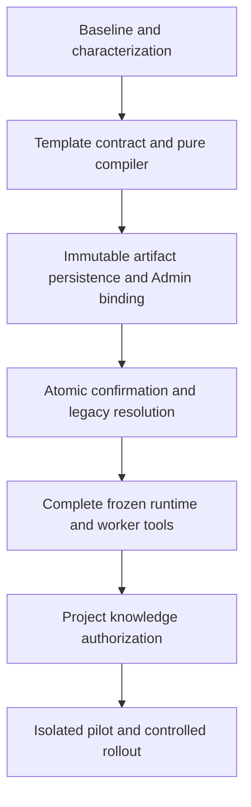

# PBL 能力链实施计划

> 状态：首批源码已实现，本地全量离线复核已通过，未发布/未部署。2026-10-19，参考源码 `43a0307` 加当前工作树。
> 目标设计见 [总架构](./architecture.md)，机器可读进度见 [交付状态](./delivery-status.json)，实际结果见 [验证记录](./validation-20261019.md)。本计划不把历史测试计为本轮执行。

## 1. 按可验证切片推进

保留现有模板、绑定、项目、学习计划和掌握度 owner。本轮先交付模板合同、纯编译器和 Tutor 身份一致性，不同时引入新数据库、Admin 发布中心或一组新微服务。Issue #54 跟踪能力链工作，文档收口与可重跑校验由 #57 跟踪。

Tutor 展示与执行身份不一致可先独立修复，但这不等于 M4 的冻结能力解析已全部完成。

## 2. 分阶段交付与边界

| 切片 | 当前状态 | 交付范围 | 不据此宣称完成 |
| --- | --- | --- | --- |
| M0 基线 | 部分完成 | 固定源码/历史证据、识别读写分叉、保留用户文档改动 | 所有 characterization tests、真实数据库或线上复核 |
| M1 模板合同 | 源码已实现，本地离线全量通过 | 唯一合同、strict parse、显式新模板/bootstrap、新 slug 实际正文生成草稿、反思 kind 与课时标题/活动保存 | 0036 迁移部署、profile/digest 冻结和生产启用 |
| M1 纯编译器 | 源码已实现，本地离线全量通过 | 实际模板/profile、真实成员/角色、模型 pair、精确 Skill refs、工具/KB 上限的确定性编译 | artifact 入库、激活或项目确认冻结 |
| M1 身份修复 | 源码已实现，本地离线全量通过 | 真实助手贯穿 Tutor/SDK 显示、模型、skills/tools、trace 和当前 IMA 授权 | 全局配置迁移、Worker closures、助手/Skill 历史版本回放 |
| M2 发布接线 | 未开始 | 持久化不可变制品，接既有 validate/activate，Admin 预览差异 | 新 Skill 已发布或所有模板已迁移 |
| M3 确认冻结 | 未开始 | 两个确认入口同事务保存 artifact ref，旧项目显式迁移/重确认 | 读时用当前 active 自动补旧项目 |
| M4 完整运行 | 未开始 | 冻结 session/task、能力解析、Worker closures、候选接受重验 | metadata 存在即工具执行成功 |
| M5 知识授权 | 未开始 | 四 IMA 工具的项目交集、参数过滤、限期 provenance | Admin 列库/PDF 可读即学生可读 |
| M6 试点发布 | 未开始 | 隔离试点、灰度、当前撤权、回滚和线上验收 | 本地测试即真实学习效果 |

### M1 验收

当前实现使用 `theme.drivingQuestion` 和 `curriculum.profiles`，旧 `curriculum.ts` 只保留从主合同派生的兼容类型。新模板 `pbl-optics-inquiry-16s@v2-16s`、profile `optics-16x60-v2`、API slug `optics-physical-inquiry-16s` 与 bootstrap key `optics-physical-inquiry:16s-v2` 均独立；只有显式 `--curriculum-16s` 才选择新 bootstrap，默认旧 v1 不变。模板创建 validator 已接线，8/14/16 检查点只请求 owner 验证。

新模板草稿读取已解析版本的 `content.pbl`，不再给全局常量贴新版本 ID。旧 slug 仍走 legacy generator。反思 block kind 已修正直存；新计划保存课时标题与活动指导，旧无标题计划保留通用显示，0036 迁移尚未部署。两个确认只核对同版本并冻结既有 binding snapshot，尚无 profile/content digest/Skill artifact 冻结或确认时完整重解析。

当前 `getAssistantRuntime` 用 Admin assistant 当前能力字段作为教学写源；runtime-only `getAgentRuntime` 保留。SDK 每轮回读、核对配置 hash、provider/model pair 与助手身份，缺身份或中途变更拒绝。它不是目标 `agent_configs` 全局迁移，也不是历史制品运行时。

- 合同只有一个真源，拒绝非法或非整数 session index、缺目标、循环依赖、缺 profile 和门禁逃逸；16 课时使用新版本，旧 v1 不变。
- 纯编译器无数据库、网络、时钟或随机 ID。输入为已解析的版本化数据，输出 payload 与 digest，不读当前目录替换历史包。
- 验证角色对应真实成员、模型为 `(modelProviderId, modelId)`、Skill 为精确 canonical ID/version/package digest、工具含 schema 引用、KB 上限不越治理范围。
- 规范化测试覆盖对象键顺序、语义顺序、集合顺序、非法数值、换行以及输入未被修改；时间和审计字段不参与教学 digest。
- Tutor 测试核对显示作者、实际 runtime 助手与模型调用身份一致，缺角色/停用时拒绝。没有改变学习事实 owner。

### M2 与 M3 验收

扩现有 binding 制品存储，不另建发布工作流。定义编译版本和新 hash 合同，保留旧 `bindingHash` 语义。制品从批准起不可变，旧包按 hash 可读取；缺包拒绝，不降级当前文件。激活需预期 revision/digest，防校验到激活之间配置漂移。

`confirmIntent` 和 `confirmPlan` 在原事务内冻结制品引用、排期和版本完整性。任一失败回滚，同幂等键返回同一确认结果。既有严格快照保护继续有效；历史无制品项目不能读时升级，须记录迁移来源并显式确认。探索仍用 draft/exploration。

### M4 与 M5 验收

先迁移同一能力字段的调用者，再移除旧写端，禁止长期双写掩盖冲突。runtime 按冻结任务解析成员；工具 schema 与 closures 来自同一有效授权。Worker 未接 closures 时明确不支持工具任务，不能宣称完成。

冻结上限与当前 Admin、真实助手、对象权限和任务门禁求交。当前禁用/撤权立即生效，新增 Skill/模型/KB 不自动扩大旧项目。IMA 四工具逐项按 [治理合同](./mcp-tool-governance.md) 验证；检索结果必须有服务端 provenance，不能靠模型自报 KB 或 ref 签名放行。

## 3. 教学能力扩展

先保留基础 `tutor-guided-learning`，按 [目录](./skills-catalog.md) 分批编写和评测 8 项候选，再评估 6 项扩展。当前计划是 1+8+6，不是已发布 15 项。未完成不可变包与授权闭环前，不把外部文件直接加入学生 runtime。

首个行为试点选单缝衍射：学生问题与预测、单变量比较、模拟观察、数据解释、CER、反思。action、observations、rubric 引用由既有 owner 接受；`run`、摘要、滑块、课时数字不能写成掌握或作品通过。通过此闭环后再扩散射、协作、完整 16 课时。

## 4. 验证、发布与回滚

先在隔离合成 fixture 测试。跨 workspace 按依赖顺序构建 contracts、database、ai-client 和实际依赖，记录解析路径，避免 UNC `node_modules` 快照造成假通过。测试日志记录命令、源码/工作树基线、结果和未覆盖范围。

可重跑入口为 `node tooling/verify-pbl-capability.mjs --focused` 和 `node tooling/verify-pbl-capability.mjs`。runner 构建 contracts/database/infra/agent-memory/ai-client/model-runtime，再编译 API；test-only workspace loader 和 declaration paths 避免解析 UNC 安装快照，不修改 `node_modules`。首轮测试 cwd 失败仍保留；本次修正 runner/fresh 输出的完整重跑为 1040 项 API 测试通过，含初始化测试，不等于真实数据库或生产验收。详见 [当前测试轮次](./validation-20261019.md)。

发布前需独立核验数据库事务、并发确认、断线重放、证据幂等、撤权、完整权限失败状态及受控真实模型请求。生产部署和 Git 推送仍是独立步骤，须记录实际构建 SHA、环境和健康检查，不能引用旧发布当本轮部署。

只读核对发现 `study-remote` 有两处既有 preferences 未提交改动。用户已授权保留并隔离发布，不回滚、不顺手提交为本轮成果。实际部署或推送完成后另附 release 证据，当前不预写成功。

关闭新功能或回滚应用不得移除已有门禁、授予旧项目新权限或丢弃证据。必需制品/授权不可用进入受限状态，不能静默改绑助手、KB 或模型。数据库采用兼容性扩展，先保留旧读路径，迁移验收后再删除旧字段。

教师盲评保留分歧与失败样例。实际记录候选接受、证据完整、恢复、token、耗时和费用；无对照研究不报告学习提升、留存提升或成本下降百分比。
