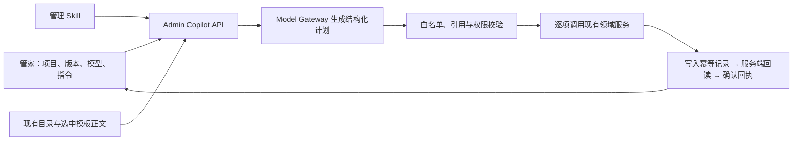

> 状态：历史记录恢复（2026-10-26）。正文保留 df05d5b 中的原始日期与验收边界，不代表当前部署状态；现行规则见 [工程入口](../../../../README.md) 和各责任域文档。

# 管家项目配置：本轮实施说明

> 状态：2026-10-21 / 已实现源码和隔离行为测试；未部署、未连接真实模型或修改真实业务资源。完整学生学习闭环仍有后续任务。

## 使用方式

进入原有 `/admin/copilot`，选择「项目」及「版本」，使用「启途智学管家」和一个可用的模型二元组。没有已有项目时选择「全局配置 / 新建项目」。

可输入：

> 为当前光学项目创建概念教练与实验指导助手，组成团队；沿用当前课时内容，把团队关联到新模板版本。新建一个单缝衍射教学 Skill，发布后绑定给概念教练。知识库使用已有的光学资料库，不删除已有授权。缺少必要配置时告诉我。

管家读取真实目录和选中版本，生成有依赖顺序的配置计划。每项结果可展开「回读详情」。网络失败或部分失败后，用「重试未完成操作」继续原计划；不会因当前选择了另一个项目而改变该次重试目标。

这里的「项目」是**项目模板库中的项目及其版本**。不会通过此页面修改某个学生已确认项目的阶段或快照。

## 已实现的功能

| 能力 | 实现与边界 |
| --- | --- |
| 已有项目选择 | 调用已有模板列表和版本详情接口，按会话保存选择；处理 loading、empty、权限/网络错误，旧请求不能覆盖新的选择 |
| 真实模型调用 | `POST /api/v1/admin/copilot/turns` → Model Gateway；传递 `modelProviderId` 和 `modelId`，不再由浏览器关键词返回模拟结果 |
| 多资源编排 | 单轮最多 24 个步骤；允许引用前序成功回执的字段，失败依赖明确阻断 |
| 助手 | 创建、修改角色/指令/模型/技能/工具/MCP；服务端校验真实引用 |
| 团队 | 创建、修改成员与 leader、角色、协作设置；保留稳定成员 slotId |
| 工作流 | 更新团队 `pblSpec`；复用既有解析器，不能关闭 `TheoryMastered` 或开启 Agent 自主推进 |
| 模板库 | 创建、修改可编辑元数据、从选中版本克隆新版本；支持 `contentPatch.linkedTeamId`，保留未修改的课时正文 |
| Skill | 创建隔离草稿；以精确 digest 发布后进入教学运行时目录，再绑定 canonical ID。已有内容修改使用新 ID |
| MCP | 创建/修改自定义连接登记；保持 `disabled / not_configured`。现有 IMA 使用专用配置服务进行开关和授权调整 |
| 知识库 | 创建平台库、修改库授权、修改平台知识引擎与工具配置；沿用 revision 校验 |
| 模型配置 | 创建/修改非秘密的提供商与模型信息；通过助手更新完成模型分配。凭据仍在专用模型设置页填写 |
| 助手预览 | 其他助手使用真实指令、Skill 和模型生成回复；团队作为配置上下文。该预览不执行管理操作，也不冒称团队运行 |

### 不应误解为已完成的事项

- 自定义 MCP 登记成功不等于已有通用执行驱动，也不等于工具真实调用成功。
- 空知识库创建成功不等于文档导入、索引完成或远端 IMA 知识库创建成功。
- 新模板版本和 `linkedTeamId` 保存成功不等于 template/team binding 已验证激活。
- 本轮没有增加通用团队版本发布、模板发布审批或教学包编辑工作台；这些继续由已有治理流程及后续任务处理。
- 学生 Tutor、IMA 项目权限、完整团队历史等剩余问题见 [协作架构报告](./10-template-team-assistant-knowledge-architecture.md)。

## 技术实现

关键代码：

- [共享合同](../../../../packages/contracts/src/admin-copilot.ts)：19 类操作、请求、计划、结果合同。
- [管家页面](../../../../apps/admin-console/app/(console)/copilot/page.tsx)、[项目目录 Hook](../../../../apps/admin-console/lib/copilot/use-project-catalog.ts)。
- [服务编排](../../../../services/api/src/modules/admin-copilot/copilot.service.ts)、[操作适配器](../../../../services/api/src/modules/admin-copilot/copilot.operations.ts)。
- [输入/引用验证](../../../../services/api/src/modules/admin-copilot/copilot.protocol.ts)、[Skill/MCP 资源登记](../../../../services/api/src/modules/admin-copilot/copilot.resources.ts)。
- [管理 Skill](../../../../.agents/skills/qitu-project-configurator/SKILL.md)：统一存放于 `.agents/skills`，以 `runtime: admin` 限制执行范围；Skills 中心可查看。

### Skills 中心与管家的加载关系

先前把管理 Skill 单独放在 `.agents/admin-skills`，但 Skills 中心只读取 `.agents/skills`，造成管理能力在中心不可见。现已统一目录，服务端按范围加载：

| 层级 | 入口与行为 |
| --- | --- |
| 文件目录 | `.agents/skills/<canonical-id>/SKILL.md`；管理技能声明 `runtime: admin`、`status: published`、`version: 1.0.0` |
| 技能中心 | `GET /api/v1/admin/ai-runtime` → `PlatformRegistryService.getSnapshot()` → `loadRuntimeSkillCatalog()`；展示教学和 Admin 技能，标注 Admin 专用、查看正文；目录来源的内容仍为只读 |
| 管家 | `POST /api/v1/admin/copilot/turns` → 校验 Admin → `managementSkill()` 从同一目录按 `qitu-project-configurator` 精确取值 → 检查 admin / ready / published → 正文加入 system message |
| 操作执行 | 模型输出 JSON 候选计划 → 白名单、只读权限、引用和版本检查 → 领域服务执行 → 回读、幂等回执、审计；Skill 文本本身不执行代码或授予权限 |
| 教学 | `loadTutorRuntimeSource()` 只返回 teaching（旧版未声明范围的 Skill 兼容为 teaching）；普通助手通过 `enabledSkills` 选择教学能力 |

管理 Skill 由管家服务显式加载，不依赖普通助手的 `enabledSkills`，也不是模型自行搜索磁盘。把新 Skill 放入目录仅表示可发现，不会让管家自动执行全部 Skill。Admin 专用技能不能通过单项、矩阵全选或批量操作绑定给普通助手；后端创建/更新和教学运行时再次拦截。未知 `runtime` 展示为不可用，不能回退成教学技能。

管理 Skill 缺失、正文为空、范围错误、未发布或撤销时返回 `COPILOT_SKILL_UNAVAILABLE`。目录读取的内容 hash 与实际管家加载 digest 来自同一解析结果；审计记录加载版本的 digest。教学提示构建也会排除 Admin 内容，即使调用方误传入完整目录。

## 权限、幂等与审计

1. 控制器和服务都校验 Admin。只读模式在服务端拒绝所有模型提出的写操作。
2. 模型只能输出闭集命令，不接受任意 URL 请求、SQL、Shell、学习事实写入或凭据字段。
3. 管理指令的计划、每项写入、每项成功回读分别使用既有 `IdempotencyStore`。回读失败不会重新创建已提交资源；助手和团队创建另外使用稳定资源 ID。
4. 依赖引用只允许向前，禁止原型字段和循环引用。重试使用首次计划与首次确认的回执，避免 revision 因回读最新状态而漂移。
5. 助手/团队更新携带 `expectedUpdatedAt`，在领域服务事务内锁定并检查对应行。变化时返回 `COPILOT_RESOURCE_CHANGED`，需要新计划。
6. 保留各领域原有审计，另外记录管家计划的 Skill digest、模型 pair、操作种类及目标模板，不把完整模型提示词复制进审计。
7. 管家不拥有项目阶段、mastery、作品审批、成长事实的写权限。

常见失败：

| 错误/状态 | 含义与处理 |
| --- | --- |
| `COPILOT_INPUT_INVALID` | 非法字段、引用、模型选择或计划格式；检查输入后重新生成 |
| `COPILOT_READ_ONLY` | 当前模式不允许配置写入 |
| `COPILOT_SKILL_UNAVAILABLE` | 管理 Skill 未安装、不可读、范围错误、正文为空或未发布 |
| `ASSISTANT_SKILL_SCOPE_INVALID` | 尝试把 Admin 专用或未知范围 Skill 绑定给普通助手 |
| `COPILOT_RESOURCE_CHANGED` | 配置在计划生成后发生变化，重新读取并发起新计划 |
| `COPILOT_DEPENDENCY_FAILED` | 前序资源没有成功回读，依赖步骤未执行 |
| `partial` | 部分步骤成功；成功项保留，失败项可重试，不伪装跨领域原子事务 |

## 部署与运行要求

- 部署 API、Admin 应用、更新后的 contracts，以及 `.agents/skills/qitu-project-configurator`。无需维护 `.agents/admin-skills`；已有线上进程需使用新构建，不能仅移动文件而继续运行旧加载代码。
- Skill 创建/发布要求 `QITU_PROJECT_ROOT/.agents/skills` 为可写的持久化目录。只读部署会返回失败。多副本部署需要共享该目录，后续应迁为不可变制品存储。
- 管家依赖真实数据库幂等存储和现有模型/知识配置；缺失时不会回退为模拟成功。
- 复用既有幂等保留期 24 小时。页面拒绝自动重试超过 23 小时的操作，避免记录清理后重复执行；超过期限须先核对资源状态。

## 验证

- 可复现入口：`node tooling/verify-admin-copilot.mjs`。按 contracts → database → infra → agent-memory → ai-client → model-runtime 构建，隔离输出后编译 API、运行管家、注册表及技能运行时行为测试，并检查管家与 Skills 页面的导入图。
- 定向行为测试覆盖多资源依赖、模型 pair、错误版本、角色与只读拒绝、重复请求、失败回读恢复、草稿/发布边界、模板正文保留和工作流门禁。
- [后续验证与结果](./11-copilot-verification-20261021.md) 记录本轮命令、结果和环境限制。源码通过不等于线上真实请求成功。
