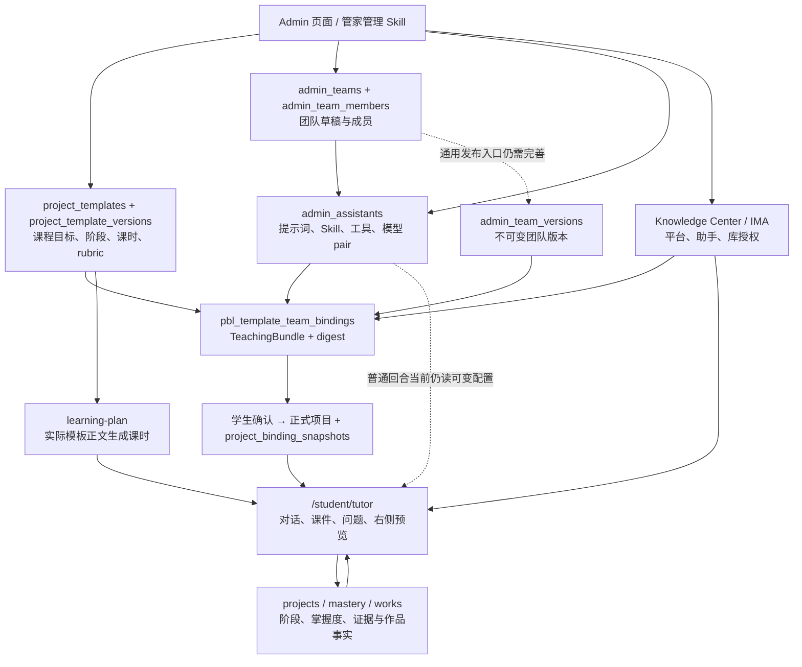

> 状态：历史记录恢复（2026-10-26）。正文保留 df05d5b 中的原始日期与验收边界，不代表当前部署状态；现行规则见 [工程入口](../../../../README.md) 和各责任域文档。

# 项目模板、团队、助手、知识库与学生 AI 搭档协作报告

> 状态：2026-10-21 / 当前工作树源码复核；部分文件有并行修改，结论区分已实现、已接线与待验收。未核验生产数据库、线上配置或真实模型请求。

## 一、当前架构

这是一个 Monorepo 下的模块化单体：Admin 管配置，API 各领域维护业务事实，Worker 执行异步任务，学生 AI 搭档是学习交互入口。

### 每个模块真正负责什么

| 模块 | 责任 | 不应承担的责任 |
| --- | --- | --- |
| 项目模板 | 教什么、阶段目标、课时安排、证据/rubric 要求 | 不直接决定某学生已掌握或已完成 |
| 团队 | 谁承担哪个角色、阶段任务、协作方式 | 不凭团队名称获得项目授权 |
| 助手 | 单个角色的指令与能力配置 | 不自行越过项目门禁 |
| Skill | 可复用教学/管理规则 | 不是权限凭证，也不是任意代码执行权限 |
| 知识库/IMA | 提供有授权、可追溯的学习材料 | 检索命中不等于学生已经掌握 |
| 教学包与绑定 | 将实际模板、团队、角色、技能、工具、模型和知识授权组成版本合同 | 不接受前端伪造 digest/状态 |
| 学习计划 | 按冻结课程合同生成、修订学生课时与任务 | 不再维护第二套课程 schema |
| AI 搭档 | 汇集上下文、呈现课程交互、接收回答与证据 | 不把模型建议直接写成完成事实 |

## 二、字段如何衔接

| 上游字段 | 下游字段/解析位置 | 含义与注意点 |
| --- | --- | --- |
| `project_templates.id` | `project_template_versions.templateId` | 模板主对象与不可变内容版本分开 |
| `project_template_versions.content.pbl` | `ProjectTemplateSpec` → `generatePlanFromTemplate` | 新 16 课时路径消费实际模板正文；通用/旧路径仍有生成器分支 |
| `content.phases`、`content.pbl.phases`、`stages` | Admin 模板编辑器、阶段投影 | 当前兼容多个表示，存在编辑与运行语义漂移风险 |
| `content.linkedTeamId` | Admin 编辑与历史团队解析路径 | 可变团队引用，**不是正式 binding 的替代品** |
| `admin_team_members.slotId`、`assistantId` | 团队成员与角色映射 | slot 是成员位置；assistant 是执行身份；应分别保留 |
| `admin_team_versions.id` | binding 的 `teamVersionId` | 学生项目应使用不可变团队版本 |
| `TeachingBundleDraft.roleMap` | `roleSlotId → memberId → assistantId` | 必须命中真实成员，不能根据“导师/教练”等名字推断授权 |
| `scheduleProfileId`、`sessionRoutes` | 冻结排期中的 `sessionIndex → roleSlotId` | 课时索引与阶段索引不同；当前新增显式路由字段，运行时消费仍需收口 |
| `enabledSkills[]` | canonical Skill ID → 版本、digest | 展示名不能替代 ID；读取到文件不等于发布 |
| `toolIds[]`、`mcpServerIds[]` | 工具 schema / driver / 当前授权 | MCP 连接登记与执行器可用是两种状态 |
| `(modelProviderId, modelId)` | `ModelGateway` / `modelByPurpose` | 模型 ID 可能跨提供商重名，必须保留二元组 |
| `knowledgeBaseIds`、`knowledgeGrant` | 冻结知识范围与当前授权交集 | 平台新增库不能自动扩大旧项目权限 |
| binding 的 `bindingHash`、`bundleDigest` | `project_binding_snapshots` | 项目确认时冻结语义；不能运行时根据标题重新匹配 |
| `LearningPlan.templateVersion`、session/task | Tutor 课时上下文 | 应指向同一冻结版本、profile、session 与 revision |
| `TutorReplyBlock`、SSE、动作实例 ID | 学生界面与领域 owner 回执 | 显示、提交证据、判断完成是不同步骤 |

相关代码：

- [模板编辑器](../../../../apps/admin-console/app/(console)/settings/templates/page.tsx)。
- [绑定合同](../../../../packages/contracts/src/project-binding.ts)、[教学包合同](../../../../services/api/src/modules/templates/teaching-bundle.types.ts)。
- [教学目录编译适配](../../../../services/api/src/modules/templates/teaching-bundle.catalog.ts)、[绑定服务](../../../../services/api/src/modules/templates/templates-binding.service.ts)。
- [学习计划服务](../../../../services/api/src/modules/learning-plan/learning-plan.service.ts)。
- [Tutor 服务](../../../../services/api/src/modules/ai-tutor/tutor.service.ts)、[IMA 客户端](../../../../services/api/src/modules/ai-tutor/ima-mcp.client.ts)。

## 三、已确认的接线情况

### 1. 管家配置入口已经改为真实编排

本轮新增服务端管理 Skill 和命令适配器，替换浏览器关键词模拟。选择项目后传递模板与版本 ID，并加载实际版本正文。一次请求可以完成多资源创建、修改、引用和回读。见 [实施说明](./09-copilot-implementation-20261021.md)。

它复用已有 owner，没有创建另一套模板、团队或 PBL 数据库。不过，普通团队 CRUD 保存的是 `admin_teams`，本轮不把它伪装成已发布 `admin_team_versions`。模板新版本也不自动发布。

### 2. 教学包编译已有新接线，不能继续沿用“完全没有调用”的旧结论

当前工作树的 `TemplateBindingService.validateBinding` 会在有 draft 和目录依赖时调用 `TeachingBundleCatalog.compile`，写回 payload/digest。activate 会再次编译比对，以识别配置漂移；实验服务已开始读取冻结教学包。

这些是并行工作树中的实现，不是本轮管家功能单独完成的生产发布。全量回归曾暴露 bootstrap/session-role fixture 失败，不能只看类型通过就认定配置发布已验收。

### 3. 普通 Tutor 回合仍未全部消费冻结能力

`TutorService.executeTurn` 仍调用 `PlatformRegistryService.getAssistantRuntime(conversationAssistantId)`，读取当前助手指令、技能、模型与工具。团队身份可来自冻结 team version，但其能力仍可能随 Admin 的后续修改而变化。

因此：

- 旧项目的“导师是谁”与“导师当时能做什么”还没有完全统一。
- 管家修改共享助手后，可能影响正在运行的历史项目。应先补冻结能力解析，再扩大自动批量配置范围。
- 当前存在按阶段解析导师与 `currentTaskFor` 的逻辑；需要让同一次服务端解析提供实际 session/task、角色、模型、工具和右侧展示，避免阶段与课时错配。

### 4. IMA 仍缺完整项目范围校验

普通回合的授权回调目前传递助手身份与 toolId；`ima-mcp.client.ts` 在校验后把 `args` 转交桥接工具。该调用路径尚未把冻结项目 grant、KB/document 参数和有期限 provenance 统一交给服务端授权 owner。

已有 IMA 全局撤权、助手授权和工具白名单是必要基础，但不能代替项目级数据范围。新增 `imaGrant` 类型字段也不能单独证明调用端已经执行交集限制。

## 四、优化顺序

| 优先级 | 需要优化的内容 | 验收条件 |
| --- | --- | --- |
| P0 | 普通 Tutor 使用冻结 TeachingBundle | 修改当前助手/团队后，历史项目仍使用原指令、Skill pin、模型上限与课时路由；当前禁用/撤权立即生效 |
| P0 | IMA 项目 grant 与 provenance | 四个只读工具都验证项目、KB、文档引用及有效期；跨项目 document_ref 被拒绝，列库结果过滤 |
| P0 | 两个确认入口同事务冻结 | confirmIntent / confirmPlan 均冻结 template/version、binding、teamVersion、bundleDigest；缺失 fail closed |
| P1 | 通用团队版本与绑定发布链 | 从 Admin 编辑团队生成不可变版本，经 draft → validate → activate；无需 SQL 造数或仅靠光学 bootstrap |
| P1 | 模板内容唯一真源 | 新写入只接受 `content.pbl`；阶段/课时 UI 都投影同一版本。旧 `phases`/`stages` 兼容通过显式迁移收口 |
| P1 | 以实际 session/task 解析团队职责 | 不按标题、阶段索引或固定 1–16 计算授权；非整数/越界 session 拒绝 |
| P1 | 知识库题目与团队解析 | 带材料引用生成题目候选，复用现有题实例/判分 owner；求助不覆盖 pending，答案披露受门禁控制 |
| P1 | 团队历史与工具记录 | 按 project/run/session 分页读取脱敏记录，明确等待、运行、失败、完成；不能用少量最近消息代替完整历史 |
| P2 | Skill 不可变制品库 | 管家草稿/发布进入受治理制品存储，支持版本审批、摘要验证、多副本一致与撤销；不依赖部署目录可写 |
| P2 | 配置影响预览 | 修改共享助手前列出引用它的团队、模板版本与受影响运行路径，展示 diff 与资源 revision |

## 五、光学项目建议采用的配置闭环

1. 选中实际光学模板版本，保留 `ProjectTemplateSpec` 的阶段、目标和 schedule profile。
2. 创建/选用概念、实验、论证和反思助手；配置真实模型 pair、已发布 Skill 与受支持工具。
3. 配置真实团队成员和角色，在模板新版本中记录关联；随后发布团队版本。
4. 建立教学包草稿：明确 roleMap、sessionRoutes、skillPins、tool schema 与知识授权。
5. 服务端 compile/validate/activate 后，学生探索获得推荐；学生确认才创建正式项目并冻结快照。
6. Tutor 按冻结 session/task 调用对应角色。回答与实验产生证据，mastery/works 等 owner 判断，右侧从同一合同展示课时与阶段。

**结论：模块划分方向合理，主要优化点在版本合同的完整消费与权限交集。** 本轮管家配置入口已落地；把资源“配置好”与让学生“按同一个冻结配置稳定学习”仍须分别验收。
