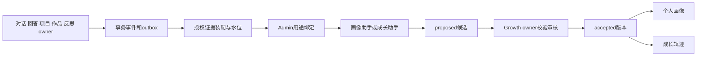

> 状态：历史记录恢复（2026-10-26）。正文保留 df05d5b 中的原始日期与验收边界，不代表当前部署状态；现行规则见 [工程入口](../../../../README.md) 和各责任域文档。

# 画像与成长统一接线设计

> 状态：待实施或部分实现的方案；当前完成情况以本目录 00-completion-audit.md 为准。

> 待实施；复用已有候选表、Growth owner和成长记录。

## 身份和路由

画像/成长两个用途统一绑定runtime身份、模型二元组、提示/schema版本。Admin保存回读、Worker执行、审核与页面读取共用解析。旧ID显式迁移，保留历史provenance。

任务携带服务端验证的route ID、trigger和taskType；event任务不能被当任意delegate任务。禁用、撤权或目录缺失保留可恢复失败，不能计为分析完成。

## 证据装配

| 来源 | 最小学习事实 | 不进入投影的内容 |
| --- | --- | --- |
| 对话 | 有界学习摘要、学生确认兴趣/目标、追问类型 | 全量聊天、系统提示、思维过程 |
| 作答/检查 | objective、owner判定、尝试与求助语义 | 未披露答案、其他学生结果 |
| 项目 | 冻结版本、课时、已确认完成事件 | 按课时位置猜出的掌握 |
| 作品 | 授权版本、审核状态、rubric证据 | 私有文件全文、未通过当通过 |
| 反思 | 已提交反思的必要摘要和引用 | 教师私密备注、未授权风险标签 |

输入含student/project scope、source event IDs、refs、窗口、水位、base accepted revision、next revision、schema/策略版本。服务端授权读取，模型只输出候选。外部检索是证据，不能改变工具、角色或门禁。

“所有对话”以覆盖水位证明：符合权限和保留策略的已完成相关回合最终进入分析。历史回放使用相同幂等键和owner，不跳审核。删除/撤回证据使受影响版本失效或重算。

## 生成和接受

1. 合并同一学生短窗口触发，重连不重复生成。
2. 服务端分配版本；模型填闭合字段，不写accepted。
3. 采用现有growth.ts schema，未知字段或无证据拒绝。
4. owner核验真实证据对象、归属、时间、撤回状态，再接受/拒绝/送人工。
5. 自动接受由Admin策略控制，调用同一owner，不由Worker SQL直写。
6. 并发revision变化时重算/合并，不覆盖较新版本。
7. 既有Admin页面提供候选列表、详情和审核，展示来源摘要/错误码，不暴露原始对话。

## 双页面字段

| 个人画像 | 成长轨迹 |
| --- | --- |
| priorKnowledge、targetLevel、timeBudgetMinutesPerWeek | milestones、studentSummary |
| preferences、interests、strengths、nextQuestions | strengths、nextQuestions、confidence |
| version、updatedAt、覆盖时间/证据状态 | version、evidenceRefs、最新证据时间 |

核心字段复用已有合同；覆盖时间/分析状态需先补共享合同。资料不足显示待观察。两个页面取同一accepted version；AI总结不变成掌握度或项目完成事实。家长使用独立最小字段投影。
