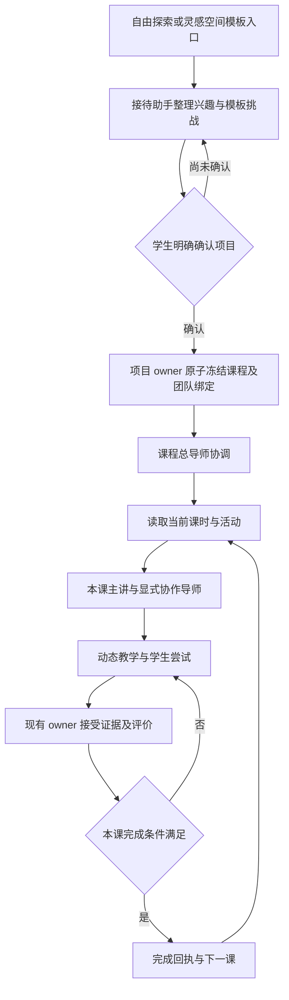

# 职责、教学合同与真实调用链

状态：待实施设计。本文提到的新增字段和校验均是建议，不表示当前 API 已支持。

## 四类职责

| 角色 | 负责什么 | 不能做什么 |
| --- | --- | --- |
| 启途智学助手 `qitu-intake-assistant` | 自由探索、整理兴趣、推荐模板、解释确认步骤 | 不能作为团队或 Team Run 的 leader；不主讲正式课时，不批准理论门禁或实践 |
| 领域总导师 `optics-leader` | 项目问题、课程协调、任务分配、证据缺口和跨课衔接 | 不能把自己的建议写成课时完成、mastery 或报告通过事实 |
| 课时主讲与协作导师 | 按本课目标解释、生成课件、指导操作、评议学习产物 | 不按阶段名称猜助手；不绕过已冻结技能、知识范围和 owner |
| 现有服务端 owner／教师 | 项目确认、计划 revision、判分、证据接受、课时完成、门禁、作品审核和归档 | 不以聊天次数、课件翻页、模型称赞或团队任务成功代替学生完成 |

正式光学团队建议保留四位领域导师：总导师、概念教练、实验向导、评审导师。接待助手位于项目团队之外。画像与成长助手消费批准后的最小证据投影，不默认加入每轮课堂讨论。

接待助手不只是从界面隐藏：团队创建／更新、团队版本发布、模板及教学包校验、运行任务启动均须拒绝其 leader 身份；正式课程的主讲、协作和阶段协调引用也须拒绝该助手。按 canonical 身份执行明确产品规则，不用中文名称匹配，不修改历史快照冒充修复。

自由探索使用单助手对话与既有兴趣确认 owner，不为了记录可观测性给接待助手创建 leader Team Run。已有兴趣任务需要执行时，应通过其现有 owner 的受治理路径处理；不能将其改名为“接待负责人”继续保留同样的 leader 权限。

## 从入口到项目接管

灵感空间传递准确 `templateVersionId`，展示模板自己的挑战开场、预期成果和真实导师团队。确认前不生成正式项目或课程完成记录。允许已授权的领域导师做挑战介绍，但不得因此启动正式课程、授予项目知识权限或把接待助手设为 leader。

学生确认后，`confirmIntent`／`confirmPlan` 仍在现有事务冻结模板、绑定、团队版本及 hash；正式第 1 课由课程导师发起。第 1–2 课是现象观察和问题设计，不能再次以“确认兴趣／创建项目”为主要完成任务。

## 团队如何进入每一课

采用“每个活动一位主讲，按需协作”。总导师协调课程，不必每轮先发言；其他导师不为表现活跃而重复回答。

建议在现有 `ProjectTemplateSpec` 的 session 下补充：

| 配置 | 当前基础 | 建议补充 |
| --- | --- | --- |
| 主讲 | `leadAssistantId` | 草稿中可选择真实成员；发布后固定到版本 |
| 方法与授权 | `requiredSkillIds`、`teachingRequirements` | 与主讲及协作成员的已发布能力分别校验 |
| 课内过程 | `blocks`、`activityGuidance`、`activityRequirements` | 给活动配置协作成员、触发条件、候选输出用途与接收 owner |
| 开场 | 当前为通用函数拼接 | 版本化 `opening`：情境、学习目标、首个问题／动作和公开选项 |
| 完成 | `completionSpec`、checkpoints | 核对质量评价、证据类型、教师责任及前置门禁，不能依赖课次自动通过 |

`opening` 和活动协作配置是对现有合同的扩展，须同步 parser、validator、编译、bootstrap、hash、API、运行时与测试；不另建 curriculum JSON、团队计划库或第二套 PBL 状态机。

协作配置必须写明：**哪位导师，在什么活动、什么证据条件下，提交什么候选结果，谁接受结果**。例如，第 11 课由实验向导主讲，学生提交已保存的模拟观察后，概念教练受邀解释模型适用范围；评审导师按冻结 rubric 提出证据缺口。未触发者显示待命，不伪装为已经协作。

已有 `pbl.plan` 只是规划候选任务，不能承载所有解释、判分和作品审批。实施时应在现有 Team Runtime 的任务目录、路由和候选 schema 中显式接入课堂协作用途；没有已注册执行器的用途在发布检查时阻断，不能只给界面添加导师头像。

每个课堂协作任务应绑定实际 `projectId`、模板／绑定版本、plan revision、learning session、activity、证据引用及幂等键。当前 `pbl.plan` 输入还不足以表达完整课内协作；需补 owner 接受检查，拒绝过期 revision 和跨课结果。团队候选到达后仍需对应 owner 回执，前端分别呈现“建议已生成”和“证据已接受”。

## 课时助手添加和编辑的正确入口

1. **编辑课程草稿**：选择主讲、活动协作、开场和完成规则，写回唯一的 `content.pbl`。不能仅改绑定 JSON 中的路由。
2. **添加已有助手到团队**：通过现有 Admin 团队 owner 更新成员；新增助手则走助手创建／编辑，核对 canonical Skill、模型对和工具后发布新的团队版本。
3. **编译与预览**：从草稿内容和指定团队快照生成教学包，逐课检查真实成员、技能、工具、知识范围、评价执行器和完成合同。
4. **发布及启用**：走现有试点／发布证据门和 binding 校验激活；成功必须有服务端回读，不把“草稿已保存”显示成“已生效”。
5. **新项目采用新版本**：当前有效旧项目继续保留其冻结语义；迁移须单独评估证据兼容性。缺快照恢复接口不能用于偷换有效旧项目课程。

目前新策略的导师下拉框受冻结 `leadAssistantId` 限制是正确的运行保护；缺的是上游课程草稿编辑能力。不能通过放宽编译器、允许客户端随意传 `teamId` 或运行时猜成员来“打通”。

## 每轮运行顺序

1. 校验学生对象权限、当前有效计划 revision、冻结课程和当前课时／活动，检查本活动门禁。
2. 读取该活动实际主讲、必要协作及待答题状态；加载被冻结且仍获当前授权的能力交集。
3. 从 owner 已接受的证据与许可范围内检索材料形成上下文；资料未核验就明确说明。
4. 主讲提出讲解、图示、例子、检查题或注册模拟等有界候选；普通教学可说明结论，待答题按其 owner 策略保护答案。
5. 学生作答／操作，由现有答题、观察和作品 owner 校验并保存，收到回执后才能显示“已保存”。
6. 策略根据反馈选择继续讲解、同目标补救、协作评议、教师介入或申请课时完成。SSE 与刷新均读取相同 owner 结果。

总导师不获得直接 `advance_stage`、`mark_mastered` 或 `approve_artifact` 能力。完成第 8 课不自动放行实践，完成第 14／16 课不自动批准报告或写入成长事实。
