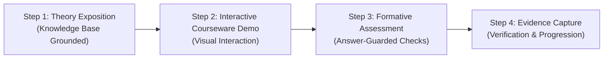
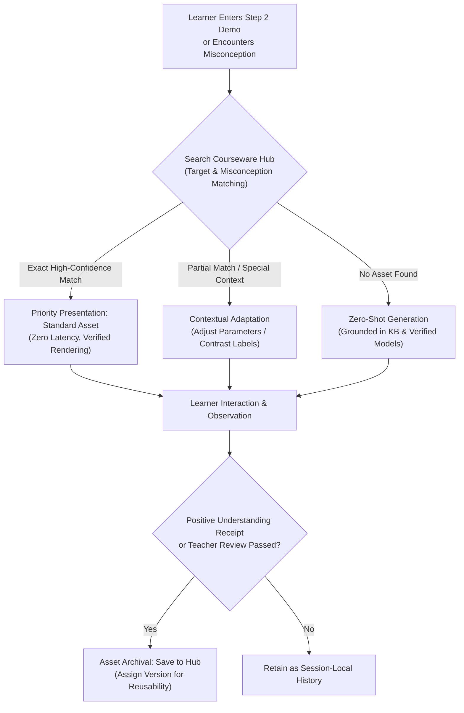

# 干涉与衍射：8 课时项目课程审查稿

状态：按用户最新要求重设计的课程方案，尚未实施或发布。**本专题只安排干涉和衍射**，取代此前综合光学及“散射与衍射”的推荐课表。原线上配置、历史记录和已冻结项目不因此改变。

## 项目挑战与学习范围

项目名称建议为“光为什么会出现明暗条纹？——干涉与衍射探究”。驱动问题：面对不同狭缝产生的条纹，我们怎样通过可复核的比较，解释它们的形成，并预测改变条件后的结果？

最终成果为一份“明暗条纹探究档案”：双缝干涉与单缝衍射各一组比较证据、一份两者关系说明、一次根据反馈完成的修订，以及个人反思。允许学生选择图文、讲解卡或短演示，但保留参数、记录来源和证据引用。

沿用原模板 13–15 岁的受众范围作为本稿起点，建议 **8 课 × 60 分钟**。核心路线侧重观察、预测、解释和变量比较；公式计算按基础选择，不把三角函数或推导能力设为所有学生的默认前提。课数和时长是建议，尚非已发布排期。

**明确零基础初学者假设（Zero-Base Learner Assumption）**：
- 默认学生未学习过波动光学，没有波长、频率、相位差、波前或相干条件的预备知识，也不预设几何光学成像推导能力。
- 教学切入点必须基于日常生活与可直接感知的宏观现象（如水波相遇、肥皂泡彩色条纹、眯眼看路灯光晕），从直观经验逐步抽象出物理模型。
- 教学全过程严格遵循“感知现象 → 通俗理论建立 → 交互课件直观验证 → 随堂检查小步内化 → 证据收录”的认知阶梯，禁止跳过概念建立直接进行数学推导或公式计算。

基础只补波长、波的叠加、相干条件的直观理解、控制变量、读图和模型范围。散射、反射、折射、全反射、透镜、偏振、薄膜干涉、光栅和量子双缝不进入本轮课表。学科问题可作为后续兴趣记录，不自动扩展当前项目。

## 八课安排

| 课 | 小步问题与目标 | 交互设计，可推荐或动态生成 | 必须保留的学习证据 | 主讲／协作 |
| --- | --- | --- | --- | --- |
| 1 | **条纹从哪里来？** 观察单缝、双缝图样，区分看到的现象与自己的猜想，确定想比较的问题 | 模板挑战开场；授权图片、图样或获准的低风险预览；学生标注相似与不同，不先背分类结论 | 现象对照卡、一个可探究问题 | 总导师；概念教练按需参与 |
| 2 | **两列波相遇会怎样？** 用同相／反相示意理解增强、减弱，认识稳定条纹需要合适条件 | 推荐适用的波叠加课件，或现场生成逐步图示、判断题和错因反馈；水波只作类比，不把光解释为介质质点运动 | 叠加解释、稳定条纹条件检查、第一份预测 | 概念教练 |
| 3 | **双缝为什么出现明暗？** 连接两条传播路径、到达时的相位关系和条纹位置，分清缝间距与每条缝的宽度 | 先预测、标路径，再解释；按需生成光路板、路径比较题；正式交互依赖新增注册模型及实践门禁 | 带标注的双缝解释图、一次基于路径的判断与修订 | 概念教练；实验向导协作 |
| 4 | **怎样改变干涉条纹间距？** 先只改缝间距，再分别比较波长或屏距，始终一次一个变量 | 使用获准的双缝模型提出假设、设置对照、记录结果；AI 按学生记录生成表格、追问或同目标练习 | 至少一组只改变一个变量的可追溯记录、预测与解释；余变量分次拓展 | 实验向导；概念教练解释规律 |
| 5 | **只有一条缝为何仍有图样？** 观察单缝衍射的中央亮带、两侧条纹及其变化，理解孔径范围内波的叠加 | 推荐已有单缝课件或生成观察板；正式比较须通过门禁；学生先描述，导师再解释 | 单缝特征标注、初步解释、与双缝观察的区别 | 概念教练；实验向导协作 |
| 6 | **缝越窄，图样怎样变？** 固定波长与屏距，比较缝宽和中央亮带宽度；有余力再改波长 | 复用注册单缝模型；先预测再运行并保存观察；根据混淆点动态生成比较题、例子或简短计算 | 单缝对照记录、变量／单位说明、修订后的解释 | 实验向导 |
| 7 | **干涉和衍射怎样联系？** 比较两组证据，区分缝间距与缝宽的影响，并认识有限宽双缝图样中的两种效应 | 生成并列证据板；推荐适用资源；对有限宽双缝展示细条纹与包络的关系；不以“有无明暗条纹”简单二分 | 证据比较卡、一次基于证据的预测；可选择解释一张未见过的图样 | 概念教练；总导师组织，评审导师提问 |
| 8 | **别人能复核我的解释吗？** 完成探究档案、回应质疑、修订与反思 | 学生展示；团队根据实际证据提问；动态提供修订建议；原作品／教师 owner 接受最终产物 | 最终作品版本、两类现象证据引用、答辩回应和反思；审核回执另行确认 | 评审导师；总导师收束 |

课堂设计参考波叠加、相干光源及双缝解释的学科关系；第 2–3 课先建立直觉再连接图样，是本课程的教学设计选择，不是已经验证的学习效果。[OpenStax：杨氏双缝干涉](https://openstax.org/books/university-physics-volume-3/pages/3-1-youngs-double-slit-interference)

### 不跨步的课内“四步闭环”节奏

为确保零基础学生顺利建构认知，每课均统一执行结构化四步教学法：

1. **Step 1：知识库支撑的通俗理论教学（Theory Teaching from Knowledge Base）**
   - 依赖 Admin 授权的项目教材知识库（IMA 教材库），主讲导师采用通俗的生活化比喻（如水波碰撞、音叉共振）系统讲解物理概念与定性机理。
   - **提示词放行**：此阶段解除过度严苛的“不得直接给出解释”限制，允许模型完整讲清原理，并辅以图文定义和历史科学故事。
2. **Step 2：动态交互课件演示（Interactive Courseware Demonstration）**
   - 针对刚讲解的理论点，自动挂载或推荐对应的交互式演示课件（如光程差几何动态板书、单缝波前分割演示、双缝干涉条纹微调器）。
   - 引导学生动手尝试（“拖动狭缝宽度，看看屏上的中央亮斑发生了什么？”），从可复现的动态视觉中直观验证理论。
3. **Step 3：随堂出题与小步检查（Formative Assessment Check）**
   - 紧密围绕刚才课件演示中的现象与参数变化，下发 1~2 道小步选择或定性预测题（如“将狭缝间距加大一倍，条纹是变密还是变疏？”）。
   - **提示词切换**：此时激活阶梯防泄露保护（`safety.answer_leak.guard`），严禁直接泄露正确选项，按阶梯提示（Hint 1~3）引导学生自主思考。
4. **Step 4：证据留痕与课时推进（Evidence Capture & Session Completion）**
   - 学生的答题分析、课件调节记录或反思，形成本课时合规证据（`session_response` / `experiment_observation`）。
   - 证据由服务端 Works Owner 记录，满足课时标准后确认完成，解锁下一课。

每次只交给学生一个主要动作：看一个现象 → 听懂一个概念 → 做一次课件探究 → 检验一次理解 → 记录证据。未理解就更换例子、推荐课件或生成补救，不因聊满若干轮就结束，也不连续展示多页公式后立刻要求独立报告。

第 1–2 课不安排正式实践活动。建议课内时间分配为通俗讲解 20、课件演示 20、检查出题 15、证据总结 5 分钟；第 3–6 课可按回顾 5、讲解 15、课件探究 25、检查 10、反思 5 分钟组织。第 7 课按回顾 5、对比讲解 20、双缝衍射包络演示 20、检查 10、反思 5 分钟；第 8 课按档案整理 15、答辩检查 20、修订反思 25 分钟组织。时间是计划分配，不是完成依据；正式实践前置条件不满足时先补救，不按课号自动放行。

## 理解与数学分层

| 层次 | 干涉 | 衍射 | 使用方式 |
| --- | --- | --- | --- |
| 核心理解 | 合适条件下波叠加形成稳定明暗；能用路径／相位示意解释并作预测 | 能描述单缝图样，用波的叠加解释；能比较缝宽变化前后结果 | 全体学生应提供自己的解释与比较证据，不只选择现象名称 |
| 比例关系 | 在批准模型条件下比较缝间距、波长、屏距对条纹间距的影响 | 在批准模型条件下比较缝宽、波长、屏距对中央亮带宽度的影响 | 优先用图表和“增大／减小”预测；按基础引入比例 |
| 选学计算 | 小角度近似下使用 \(\Delta x\approx\lambda L/d\) | 远场、小角度下使用 \(W\approx2\lambda L/a\)，W 为两侧第一暗纹间距 | 先明确 d 是缝中心间距、a 是单缝宽、L 是屏距；再使用公式，不要求统一推导 |

干涉条纹位置的小角度关系见 [OpenStax：干涉的数学描述](https://openstax.org/books/university-physics-volume-3/pages/3-2-mathematics-of-interference)。单缝暗纹条件及中央亮带边界见 [OpenStax：单缝衍射](https://openstax.org/books/university-physics-volume-3/pages/4-1-single-slit-diffraction)。上述教学公式仅用于相应模型域，不能推广到任意装置，也不把模拟结果称为真实测量。

第 7 课必须处理联系：有限宽度的双缝图样中，干涉细条纹受衍射包络影响，二者可以同时存在。入门只需辨认“细条纹间距”和“整体包络宽度”，缺级与强度积分不作为本轮要求。[OpenStax：双缝衍射](https://openstax.org/books/university-physics-volume-3/pages/4-3-double-slit-diffraction)

## 动态课件资产化、迭代复用与题目生成机制

系统彻底改变“课件一次性会话随机生成、用完即弃”的现状，建立**可索引、可沉淀、可迭代的课件资产库（Courseware Asset Hub）**。

### 1. 课件资产模型规范（Courseware Asset Specification）

每个动态课件（包括板书与微型仿真）均遵循版本化规范：
- `assetId`：稳定全局资产 ID（如 `asset-optics-double-slit-path-v1`）。
- `topic`：所属主题域（`superposition` | `interference` | `diffraction` | `combined_envelope`）。
- `kind`：表现载体（`board` 矢量关系拓扑板、`optics_simulation` 微观光学仿真器、`katex_breakdown` 公式拆解卡）。
- `specVersion`：规范版本（如 `wave-interactive.v2`）。
- `parameters`：参数域及初始设定（如波长范围 380–750 nm、缝宽 10–100 μm、缝间距 100–500 μm、屏距 1–3 m）。
- `learningObjectives`：绑定的课时目标 ID 集合。
- `provenance`：来源与演变谱系：
  - `bundled`：平台教研冻结的标准资产；
  - `adapted`：在既有资产基础上针对学生误区微调的衍生版本（保留 `parentAssetId`）；
  - `generated`：依据教材知识库现场生成的全新资产（记录首发项目及会话 ID）。
- `reusableScore`：基于后续学生交互满意度（“听懂了”比例）与教师评审沉淀的质量权重。

### 2. 课件流转四层闭环（Hit -> Adapt -> Generate -> Archive Loop）

1. **优先推荐已有资产（Hit & Recommend）**：
   - 当学生学习第 2 课波叠加或第 3 课双缝光程差时，系统优先匹配平台高赞课件资产，实现秒级即时载入，确保物理准确性与视觉体验一致性。
2. **按需改编（Adapt & Personalize）**：
   - 当学生把“缝宽 $a$”与“缝间距 $d$”混淆时，导师读取已有双缝课件，在衍生版本中高亮双缝几何标注并加粗间距对比线，定向破除混淆。
3. **知识库依托下的现场生成（Zero-Shot Generate）**：
   - 当遇到特定课件库未覆盖的新型探究问题时，由主讲导师调用 `pbl-dynamic-lesson` Skill 与合规数学物理模型现场生成；生成内容严格受参数边界约束。
4. **沉淀归档与持续生长（Asset Curation & Archival）**：
   - 优质生成课件在经历真实的“操作—答题通过”验证或教师好评后，自动收录至课件资产库，使教学课件资产随每个项目的运行不断丰富。

### 3. 干涉与衍射专题核心课件资产清单规划

| 资产 ID | 资产名称 | 载体类型 | 核心教学作用 | 适用课时 |
| --- | --- | --- | --- | --- |
| `asset-wave-superposition-2d` | 两列简谐波空间相遇叠加动态板 | `board` | 演示同相增强（波峰遇波峰）与反相减弱（波峰遇波谷） | 第 2 课 |
| `asset-double-slit-path-diff` | 双缝干涉光程差与相位关系几何板 | `board` | 直观展示路程差 $\Delta r = r_2 - r_1 = d\sin\theta$，标注亮暗条件 | 第 3 课 |
| `asset-double-slit-slider-sim` | 双缝干涉参数微调仿真课件 | `optics_simulation` | 支持调节缝距 $d$、波长 $\lambda$ 与屏距 $L$，实时展示条纹疏密变化 | 第 3、4 课 |
| `asset-single-slit-huygens` | 单缝衍射惠更斯子波波阵面分割图 | `board` | 将单缝切分为连续子波源，解释为什么中央最亮、两侧渐暗 | 第 5 课 |
| `asset-single-slit-slider-sim` | 单缝衍射缝宽可变仿真课件 | `optics_simulation` | 支持拖动缝宽 $a$，观察中央亮带扩展或收缩的现象 | 第 5、6 课 |
| `asset-interference-diffraction-dual`| 有限宽双缝干涉与衍射包络对比板 | `board` | 同屏对照细条纹（干涉效应）与外轮廓包络（衍射效应）的物理联系 | 第 7 课 |

### 4. 提示词分阶与教学放行策略（Phase-Gated Prompting）

传统“一刀切”的严格防泄露提示词会误杀理论讲授，新方案实行**分阶段提示词策略**：

1. **Step 1 理论讲授模式（Exposition Prompt）**：
   - 角色指令：“作为物理导师，面向零基础初中生，使用通俗易懂的语言、生活类比（水波、声音）讲透物理本质与定性规律。允许并鼓励输出完整的概念定义、几何示意、物理意义解释与启发性例子。此阶段严禁敷衍或机械反问‘你觉得呢’。”
2. **Step 2 课件演示模式（Interactive Demo Prompt）**：
   - 角色指令：“引导学生操作指定的课件资产（挂载 `board` 或 `optics_simulation`），明确提出观察焦点（如‘请拖动滑块使缝隙变窄，仔细看屏幕上的亮斑宽度’）。鼓励学生用直白语言陈述眼睛看到的物理事实。”
3. **Step 3 随堂检查模式（Formative Check Prompt）**：
   - 角色指令：“根据刚才演示的现象下发 1~2 道单步检查题。**严格激活答案防泄露守卫（safety.answer_leak.guard）**。严禁直接告知正确选项或结论；在学生提交答案前只提供阶梯提示（Hint 1 观察引导，Hint 2 概念回忆）；由服务端判分并记录作答记录。”
4. **Step 4 课时完成与反馈模式（Completion & Feedback Prompt）**：
   - 角色指令：“当学生作答达标后，结合其证据给予肯定并总结思维进阶点；若存在认知偏差，给出同目标变式例子进行温和纠偏，确认无误后引导推进下一课。”

## 团队与 Skill 安排

启途智学助手仅负责立项前接待、推荐和确认引导，不进入正式授课团队，不担任任何 Team Run leader。领域总导师 `optics-leader` 协调课程；课时主讲由具体 session 指定。

| 真实成员 | 建议主讲课时 | 核对的教学方法能力 |
| --- | --- | --- |
| `optics-leader` | 1；跨课协调 | 问题设计、团队协调、视觉解释 |
| `optics-concept-coach` | 2、3、5、7 | 理解诊断、概念检查、视觉解释、同目标迁移 |
| `optics-experiment-guide` | 4、6 | 预测、实验比较设计、数据解释、注册模型活动 |
| `optics-review-assessor` | 8 | CER、作品修订、答辩与反思 |

具体课时同时按需使用 `pbl-dynamic-lesson`；其他能力只能采用实际发布的 canonical Skill。此表是能力核对要求，不会自动授予 Skill 或工具。协作仍需显式触发条件、任务输出和接收 owner，不能只改成员头衔。

现有 `optics-wave-inquiry` 与动态活动工具的注册模型范围需要核对后扩展；仅给实验向导勾选一个技能并不会获得双缝实验。变更技能包需新 digest、团队版本和绑定审查，不能覆盖旧项目的冻结 pin。

## 当前能力与必须补齐的内容

| 部分 | 当前源码事实 | 本专题需要的工作 |
| --- | --- | --- |
| 干涉内容 | `optics.wave.interference` 是已有质化模块，`gradingGated=false` | 补逐课目标、训练／评价来源和完成合同；概念条目存在不等于干涉课程可完成 |
| 单缝衍射 | 已有注册模型与观察路径 | 核对科学模型域、参数、归一化显示和证据协议后复用；不是本轮重新验收通过的声明 |
| 双缝干涉 | 现有活动 schema／参数验证只接受 diffraction 和 scattering | 新增经过注册和验证的双缝模型、前后端协议、观察持久化、授权路由和测试；不把双缝偷偷塞进旧单缝模式 |
| 第 7 课联系 | 当前模型不能完成有限宽双缝联合比较 | 新双缝模型支持合法的缝宽参数与衍射包络；可先有明确标注的教学示意，但缺正式工具时不能伪造实践回执 |
| 前置理论门禁 | 旧综合光学将实践与四个几何光学理论目标关联 | 为新模板明确审查专题前置理论和准备要求，复用原 owner，不能仅删旧章节或关闭门禁 |
| 新课完成与知识 | 当前线上 16 课缺完整逐课规则和知识授权 | 在新合同逐课配置证据、质量评价、教师责任、来源范围，并完成发布回读 |

双缝模型建议从等幅、同频、固定相位关系、相同偏振的单色远场模型开始；约束缝宽、中心间距、波长和屏距的合法组合。有限宽双缝的归一化图样应包含衍射包络；用数值／曲线测试验证，不靠绘制几条明暗线冒充物理结果。正负波幅不等于负光强，显示始终区分模型计算、模拟观察和真实测量。

用户本次要求授权了课程主题重设计，并不代表未经验证即可在生产注册新实验模型。新增模型通过现有 Admin／后端治理、参数和安全检查后才能被课程调用。真实装置操作不进入本轮试点范围。

## 新版本与门禁处理

使用新的模板版本、8×60 排期 identity、团队快照及教学绑定，仍写入既有 `ProjectTemplateSpec`。不改旧 16 课 bootstrap，不原地覆盖先前散射方案或已发布课程内容，不另建 curriculum schema／mastery 数据库。

既有 `optics.wave.interference`、`optics.wave.diffraction` 的质化模块引用不被直接改为门禁通过目标。新专题的理论准备目标、判分与 `TheoryMastered` 策略需要在原 owner 内完成显式映射和审查；不把散射／衍射实践结果注入理论掌握度，也不把“上完第 2 课”当作门禁已通过。

第 1–2 课可使用已批准的低风险图示和预览；正式双缝／单缝实践必须再次核验学生、项目、冻结版本和门禁。前置合同或新双缝模型尚未就绪时，发布检查应明确阻断完整实践课程启用。

## 验收与实施顺序

1. **核对课程**：逐课确认 13–15 岁核心理解目标、数学选学层次、主讲、学习证据及评价责任。新课程正式基础目标、工具和来源齐备才可进入试点。
2. **先打通干涉**：实现注册双缝模型与观察协议，验证参数域、条纹间距变化及有限缝宽包络；完成第 2–4 课“解释—预测—运行—记录—反馈”的真实请求链。
3. **打通衍射**：复用并核验单缝活动，完成第 5–6 课，保证缝宽 a 不与中心间距 d 混用。
4. **核对联系与作品**：第 7 课依据两类真实记录比较，第 8 课完成作品、反馈修订、反思与 owner 回执。
5. **验收恢复及权限**：推荐、生成、改编三路径至少各有一个真实案例；跨项目、过期 revision、撤权、pending 替换、重复保存和断网恢复均通过。
6. **验收全程**：新项目完成第 1–8 课的真实教学与必要教师评价，保存脱敏来源、任务和证据回执；不以手工注入门禁或课堂通过数据制造成功。

学生端进度应显示真实已完成课数／8 和当前活动。课程结束至少能看到：一组双缝干涉证据、一组单缝衍射证据、两者关系解释、最终作品版本及反思。任何团队“建议已生成”均不代替这些完成事实。

## 源码核查入口

- [现有光学概念与模块](../../../../packages/ai-client/src/quiz-bank/optics/content.ts)。
- [当前活动候选 schema](../../../../services/api/src/common/tutor-runtime/lesson-activity.schema.ts)。
- [当前模型参数校验](../../../../services/api/src/modules/ai-tutor/tutor-experiment.validation.ts)。
- [项目实验活动与观察服务](../../../../services/api/src/modules/ai-tutor/tutor-experiment.service.ts)。
- [模板与排期合同](../../../../packages/contracts/src/pbl-learning.ts)：当前 schedule 支持 8 课，课长支持 60 或 120 分钟；本稿建议 60 分钟，不隐含修改合同为其他时长。

本轮是文档重设计与来源核验，没有执行或宣称新的课程行为测试、模型接入和线上发布。
