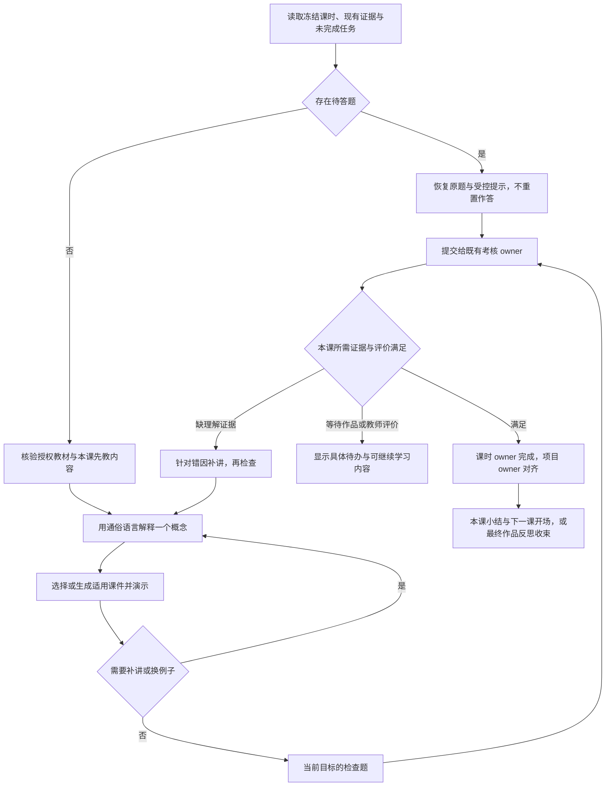
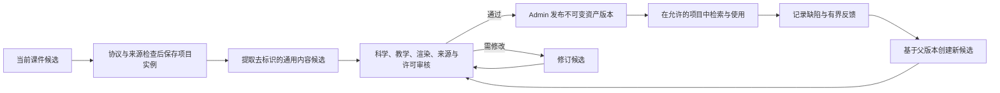

# 零基础理论教学与可迭代课件资产实施计划

> 状态：工程实现与 study-remote 部署已完成，新八课版本已配置为试点；真实课堂评价与正式模板发布尚未完成。

日期：2026-10-23。本文件保留教学与资产机制的实施设计，实际代码、配置、部署及验证边界见 [08 实现与部署记录](./08-courseware-implementation-20261023.md)。八课范围沿用 [05 课程设计](./05-interference-diffraction-curriculum.md)，前序试点事实见 [06 实施记录](./06-implementation-and-acceptance.md)。05 保留课表与目标，不再单独维护另一份资产协议。

## 1. 用户目标与设计决定

默认学生尚未学习本课概念。导师应先依据项目可访问的知识库讲清必要理论，配合动态课件建立直观理解，然后提供与已教内容对应的题目，依据正式回执完成课时。遇到困难先补讲和换例子；不以连续反问代替教学，也不在教学开始前要求学生解释尚未接触的理论。

生成课件应成为可恢复、可改编、可审核复用的教学内容。已接受的课件先保留为项目内实例；适合复用的内容提取为去除学生信息的候选资产，经审核发布后供其他项目在适当环节选用。内容资产、学生学习证据和完成事实各自保留原有 owner。

- “零基础”是教学起点，不把未知水平写成低掌握度或错误记录。续学读取已有证据，避免重新从第一课讲起；有经核验的先备理解时可以调整讲解深度，不能自行跳过必需目标。
- 每课只围绕当前小目标组织“讲解 → 演示 → 检查 → 反馈与收束”。复杂概念可以在讲解与演示之间往返，不能把四步变成固定轮数或阅读时长门禁。
- 理论教学发生在每课需要新概念的地方，并不限于项目的 `concept_mastery` 阶段。项目阶段、课内活动与本轮教学方式必须分别解析。
- `TheoryMastered` 保留为实践前置条件。理论期的动态交互首先使用分步板书、标注、展开解释和已批准的只读 `wave_preview`；参数操作、实验 action 与 observations 仍走正式实践合同。
- 学生答对、点赞或说“听懂了”可以作为有界反馈，不能单独证明课件科学正确、学生掌握或资产可以公开。

## 2. 源码基线与增量缺口

以下仅为本轮本地源码核对；没有重新验证线上配置或真实课堂。

| 范围 | 当前事实 | 本次需要补齐 |
| --- | --- | --- |
| 基础提示词 | `gateway-tutor.provider.ts` 已有 `tutor.chat.v3-zero-base-four-step`、零基础与四步描述 | 从笼统提示变为由冻结课程、教材依据、当前活动和待答题共同决定的上下文；处理工具与提示词之间的冲突 |
| 课时合同 | 八课 `wave-curriculum.ts` 已有目标、开场、`activityGuidance`、完成与质量要求 | 补本课先教内容、来源要求、演示目标、课件选择规则和出题覆盖关系；新版本承载，不原地覆盖 v1 |
| 课件执行 | 已有板书生成、资料推荐、带来源改编和注册波动协议 | 明确教学展示时机、项目内实例恢复、复用版本选择与改编谱系 |
| 来源校验 | 推荐与改编验证本轮已读的 `sourceRefs`；`origin=generated` 板书目前不携带来源 | 为“基于知识库新创作”的内容补受治理来源协议，不能伪称现有 generated 分支已证明教材依据 |
| 出题与完成 | 形成性候选和正式考核有既有 owner；课时完成与项目对齐独立 | 教过的目标才能进入对应检查；正式目标考核在当前活动自然出现；完成后可靠衔接下一课 |
| 持久化 | 对话中已有课件与学习记录；跨项目课件资产库尚未实现 | 增加内容版本、审核状态、来源授权和检索复用，不能把聊天历史或头像素材库当作教学资产库 |

源码入口：[提示词](../../../../services/api/src/modules/ai-tutor/gateway-tutor.provider.ts)、[课时投影](../../../../services/api/src/modules/ai-tutor/tutor-lesson-program.ts)、[活动候选](../../../../services/api/src/modules/ai-tutor/tutor-lesson-activity.ts)、[来源核验](../../../../services/api/src/modules/ai-tutor/tutor-activity-context.ts)、[八课合同](../../../../packages/ai-client/src/quiz-bank/optics/wave-curriculum.ts)。

## 3. 从第一课到最后一课的教学路径

### 3.1 在现有活动中组织教学

沿用 `review / theory / check / practice / reflect` 和既有活动进度，不另建 PBL 或课程状态机。讲解与教学演示作为 `theory` 内的内容步骤；低风险观察也可用于 `review`。正式实验只在当前冻结活动允许且门禁通过时调用，不因处于“演示模式”而获得额外工具权限。

课堂展示回执只表示某段说明或课件已被服务端接受并交付，用于续学和避免漏教。翻页、播放完毕、停留时长均不证明理解。学生选择“看懂了，做一道题”表达开始检查的意愿，不写掌握度。未回答或表示“不知道”时，正常补讲，不自动记录错误尝试。

现有活动可能要求 `session_response` 的质量评价。实施前逐课核对这些要求：不能让每次展示都等待教师签字，也不能把已读回执冒充 `quality.accepted`。若要调整普通教学活动的完成条件，须在新模板合同中显式配置并由原 owner 验证；必需的教师评价、作品审批和正式掌握证据继续保留。

### 3.2 课时完成与续学

检查阶段区分“练习反馈”与“正式掌握证据”。动态形成性题继续用于诊断与补救；需要 mastery 的活动调用现有正式考核服务。不能通过换一个 `assessmentType` 字符串将临时题升级为正式题；未来若增加正式动态出题，须另外完成考核版本、校准与 owner 合同。

答题后由 learning-plan/mastery 写判分事实，works/feedback 接受相应产物与评价。课时 owner 检查全部完成条件，projects owner 再执行阶段对齐，最后回读下一可学课。单次正确、单课 `theoryMastered`、浏览器点击均不能直接解锁整个项目实践。

完成与对齐若不能处于同一事务，使用现有幂等/outbox 机制保证可恢复：明确显示“作答已保存，进度同步中”，重试原请求，不要求学生重答。重新进入时恢复课件版本、讲解位置、原题和已接受的证据，不重放整门课。

## 4. 知识库如何进入教学与提示词

### 4.1 先形成有来源的教学依据

1. 按冻结目标和本课范围检索项目授权知识库，实际读取相关材料；权限取冻结 grant、当前 Admin 授权、助手/工具与对象权限的交集。
2. 将来源中的定义、直观解释、必要前提、模型限制整理为有界教学依据，并绑定本课目标。优先解释术语和图示，再引入需要的公式；不把整份教材塞入提示词。
3. 生成讲解与课件时，区分“教材支持的结论”“导师创作的类比”“模拟示意”，保留实际来源版本/hash 和可核验位置；页码仅在源文档提供时记录。
4. 检索无结果、来源过期、相互冲突或授权撤回时，显示具体状态并提供重试或教师补充材料入口。可用仍获授权、依据已核验的材料继续；不能用模型常识填充后声称完成了知识库理论教学。

检索材料和课件正文均为不可信内容，不能覆盖角色、工具、提示词、答案披露或完成规则。资产复用也要复核来源授权，不能借缓存绕过知识库范围。

### 4.2 提示词分层与本轮选择

| 层 | 控制来源 | 要加入或调整的内容 |
| --- | --- | --- |
| 全局教学原则 | Admin 管理的运行时策略 | 零基础起点、先教再测、清楚讲解、单步负荷、基于真实来源；避免所有学科都收到固定光学例子 |
| 课程与课时 | 冻结 `ProjectTemplateSpec` 与教学包 | 先教概念、术语解释、来源要求、演示用途、必需证据；题目覆盖已教目标 |
| 当前回合 | 服务端课时投影 | 当前活动、已有内容交付记录、学生求助、pending、可用资产版本与实际工具权限 |
| 方法与领域 | 已发布 Skill 和真实成员 | 视觉解释、补救、波动模型边界等；canonical ID、digest 和工具 pin 仍由绑定决定 |

建议的 `teachingSpec`、教学内容交付记录及资产选择投影均为待设计字段，须进入现有 contracts、validator、编译器、API 与测试。它们只补教学内容与展示上下文，不复制掌握度、课时完成或项目阶段状态。

以下是计划采用的提示词片段，尚未修改运行时代码：

> 你正在教授一个尚未学过本课概念的学生。先依据本轮核验的教材，把当前目标涉及的术语、现象和因果关系讲清楚。一次只引入必要概念，给一个独立例子，并明确类比的边界。随后选择当前活动允许的课件，告诉学生看哪里、比较什么；没有可执行操作时不要要求拖动或运行。完成这段教学后再邀请学生做与已教内容对应的小步检查。学生表示不懂时，换一种说明或演示，不将求助判错。不根据聊天轮数、课件观看或自己的判断宣布掌握、完成课时或开放实践。

检查补充片段：

> 如果服务端有待答题，保留同一题目实例。只使用公开题干、选项及允许的提示；不通过板书、复用课件或相同数值例题透露答案，也不自动换题。由考核 owner 判分；收到结果后围绕具体误区补讲，再由服务端决定下一步。

`safety.answer_leak.guard` 是既有审计标签，不是新增 Skill，也不是由模型开关的授权。普通教学可以解释概念和独立示例；有 pending 时，披露约束优先于“讲解模式”。需同步审查 `buildSystemPrompt`、课时 guidance、Skill 指令、活动工具描述与输出检查，避免提示词允许教学、执行器却仍禁止所有讲解的冲突。

## 5. 将动态课件沉淀为内容资产

### 5.1 三类对象与保存范围

| 对象 | 保存什么 | 使用范围 |
| --- | --- | --- |
| 项目内课件实例 | 已接受的结构化块、精确内容版本/hash、当前课时关联、展示位置、来源核验记录 | 原项目权限范围内恢复与继续教学；不包含可跨项目复用的动作授权 |
| 候选内容版本 | 从实例提取的通用讲解、图示与参数预设，移除学生姓名、原始回答、项目 ID、实例 token 和私有答案 | 受限审核；可以自动提交候选，不能自动公开 |
| 已发布资产版本 | 已核验内容、适用目标与前提、来源和许可范围、渲染/模型版本、审核记录 | 在发布可见范围与目标项目有效授权的交集内复用 |

这是内容资源扩展，拟由现有 knowledge 内容服务承接元数据、检索和版本权限，Tutor 保存实例引用；works/feedback 继续保存学生学习证据。实现前确认存储接口与迁移，不另建课程/掌握状态库，不把教学课件塞进仅用于外观的 `visual-assets`。复用 assetId 不复用学生的 questionId、actionId、observationId 或完成记录。

### 5.2 最小版本合同（字段为建议，尚非 API）

| 字段组 | 需要表达的约束 |
| --- | --- |
| `assetId / assetVersionId / contentHash` | assetId 表示稳定内容系列，版本独立且不可变；保存实际结构化内容，不只保存图片或链接 |
| `parentAssetVersionId / changeSummary` | 改编明确指向父版本；记录修改理由、差异与审核；旧版仍可按权限重放 |
| `objectiveRefs / prerequisiteRefs / useCases` | 用稳定概念引用及显式模板映射描述目标，标记讲解、演示、补救、复习；不复制某个学生 plan 中的目标 ID |
| `audience / language / explanationLevel` | 零基础、数学需求、阅读负荷、适用年龄；难度标记供选择，不推断学生能力 |
| `content / rendererVersion / modelVersion` | 复用闭集块与注册渲染器；资产目录不接受任意 HTML/JS；模型型内容明确计算版本 |
| `sourceManifest / rights / visibility` | 实际来源 ID、版本/hash、有界定位、许可和可见范围；授权由当前 owner 复核 |
| `requiredCapabilities / parameterPreset` | 只声明所需能力与获准预设，不授予能力；参数组合仍由服务端当前模型域检查 |
| `reviewStatus / reviewRecord / withdrawnAt` | 候选、审核、发布、撤回由 Admin 内容流程管理，不能由模型或学生评分改变 |
| `generationMetadata` | 记录使用的提示词/策略版本、Skill digest、模型 pair 与内容版本；不保存密钥或原始学生上下文 |

来源的 `evidence_ref` 是有期限的本轮读取凭据，不能原样存成永久访问许可。持久版本只保留有界来源清单；跨回合或跨项目使用前重新读取/核验，签发当前 scope 的引用。没有源版本时保存可复核内容摘要 hash 并标明版本未知；不能捏造版本号、页码或教材授权。

### 5.3 从生成到复用的生命周期

运行时校验保证实例符合协议，不等于已经通过公共教材质量审核。对新生成课件，只有内容被接受后才保存实例；失败重试不能产生多个同义候选。候选提取使用实例身份与内容 hash 幂等，资产审核与发布继续使用修订号和审计。内容 hash 去重不能跨租户泄露资产是否存在。

质量反馈分别记录科学错误、目标匹配、阅读理解困难、渲染故障和教师建议；样本数与适用范围一并呈现。学生自评不能直接形成“学习效果分”，点击量或满意度不能决定发布。初期采用可解释的适配规则和审核等级，不引入缺乏验证的 `reusableScore`。

### 5.4 在合适的时候选择课件

选择顺序为：**权限与安全筛选 → 当前目标/用途/前提匹配 → 来源和版本兼容 → 适龄与误区匹配 → 复用、改编或生成**。

- 没有 pending 且正在讲授新概念：选择零基础解释与演示；学生混淆概念时选择同目标对照板；不按模板标题或热门程度插入课件。
- 存在 pending：资产同样受答案披露检查；当前实现不允许的板书不能借“复习”旁路显示。求助保留题目，允许的提示通过原接口输出。
- 原版本适配时直接复用；只需换例子或标注时产生可追溯衍生版本；没有合适内容时按核验教材生成。改编后重新校验来源、模型域和范围，不能继承父版的审核结论。
- 模板明确引用的资产冻结精确版本/hash；动态选择只能来自冻结策略允许的来源与能力范围，并在首次实例化时固定精确版本。重新进入不自动换成 latest。旧项目没有新资产协议或权限时，不静默升级。
- 每次使用再次核验当前权限、撤回状态与模型兼容性；资产缓存和已签名引用均不扩大权限。来源撤回或发现错误时停止继续展示受影响内容并给出替代路径，保留必要审计，不抹掉学生已有证据或自动撤销其掌握事实。

## 6. 干涉与衍射首批资产及教学示例

以下名称是计划中的内容系列，不是已发布目录 ID。课时匹配以实际冻结目标与活动为准。

| 内容系列 | 先讲清什么 | 动态演示 | 随后检查 | 调用边界 |
| --- | --- | --- | --- | --- |
| 波与叠加入门 | 波峰、波谷、波长；同向和反向叠加；类比与光的区别 | 分步显现两列波与叠加示意、切换已批准的只读示例 | 用自己的话解释一个新示例 | 对应准备目标；门禁前只读 |
| 稳定条纹条件 | 为什么不是任意两个光源都能形成稳定条纹 | 对比稳定/变化相位关系的概念板 | 判断一个独立情境并说明理由 | 对应相干准备目标；不要求先会相位公式 |
| 双缝路径解释 | 两条路径、到达关系、缝宽 a 与缝间距 d 的区别 | 路径逐步标注；突出 a/d 对照 | 看新位置作定性解释 | 教学示意不伪装实验记录 |
| 双缝受控比较 | 固定其他条件，只比较一个变量 | 已授权的有限宽双缝模型与对照记录 | 比较预测和模拟观察 | TheoryMastered、当前实践活动及 v2 参数域均须通过 |
| 单缝解释与比较 | 一条有宽度的缝也涉及波的叠加；中央亮带与两侧结构 | 先示意，再在获准实践中比较缝宽 | 区分观察、解释与模型限制 | 示意和正式实验各走自身协议 |
| 干涉与衍射联系 | 细条纹与整体包络分别描述什么 | 并列展示解释板与本学生获准引用的观察 | 用两组证据解释一张新图样 | 通用资产不携带其他学生观察；证据由当前项目 owner 注入 |

示例：第 2 课学生说“我不知道波是什么”。导师先依据授权教材解释波的重复变化，再展示分步板书，标明波峰、波谷和波长；随后演示两列波相遇的两种情况，允许学生反复看、要求换一个例子。到检查环节才给独立的新情境题；专题准备目标仍由正式考核确认。板书展示回执和学生答题回执分别保存。

示例：后续项目同样混淆 a 与 d。系统先筛选获准的“双缝路径解释”版本，复用其标注板，必要时新增对照步骤形成衍生候选。展示时重新实例化当前项目的课件和动作；原项目的名字、答案、来源凭据与实验回执都不进入新实例。

第 1–2 课不会为了演示滑块而绕过门禁。正式探究复用当前受治理的单缝与有限宽双缝模型，不扩展旧单缝/散射绑定。理论教学可用分步示意完成；如果未来确需新增门禁前交互类型，另行审查只读/低风险协议，不能将正式实验改名为课件放行。

## 7. 实施顺序与交付边界

| 阶段 | 交付内容 | 验收后才能进入下一步的条件 |
| --- | --- | --- |
| P0 教学合同与入口 | 逐课梳理“先教内容—教材依据—演示—检查—完成”；核对真实入口与评价阻塞；在既有合同设计新版本 | 不预设零基础学生会概念；第 1–8 课均有连续任务与具体完成 owner |
| P1 知识与提示词 | 接入教学依据、当前方式选择和先教再测；补知识库新创作的来源合同，更新 validator/工具描述/Skill/输出检查 | 实际来源进入讲解与课件；未教内容不突然出题；pending 不能被模式切换绕过 |
| P2 项目内课件恢复 | 精确内容版本、来源清单、内容交付记录与续学引用；教学反馈和学习事实分别保存 | 刷新、断网、重试不丢课件、不改题、不重复写证据 |
| P3 资产候选与审核 | 在 knowledge 内容服务增加受限候选、内容版本、父子关系、审核发布与撤回；独立 Issue 承载实施 | Admin 可预览并回读状态；学生信息已移除；来源和许可明确 |
| P4 检索复用与改编 | 按目标、时机与权限选择；精确版本实例化；反馈驱动新候选 | 命中、改编、无命中生成均有可复核案例；跨项目不携带实例授权 |
| P5 八课端到端验收 | 新模板/团队版本与教学包编译，受治理试点完成全程教学、补救、实践、作品与反思 | 源码、配置、启用、实际请求、课堂评价分别记录；旧项目语义不变 |

首个可交付切片是“一节零基础理论课：教材读取 → 讲解与课件 → 检查补救 → 正式目标回执 → 课时完成与恢复”。资产发布后台可以随后交付，但 P2 即保留版本和来源，避免日后只能从聊天文本重建资产。

前轮发现的量化累计尝试扣分及正式考核入口问题，作为学习连续性的关联缺陷单独复现和修复。当前新专题准备目标为 concept，不能把量化计分问题当作所有课程卡住的统一原因，更不能据此降低所有门禁。计划更新本身不表示缺陷已修复。

Admin 编辑与审核复用现有模板/知识内容入口，不新增顶级导航；若后续确需改变信息架构，先更新产品文档并评审。新字段、提示词策略和 Skill 内容通过现有发布链生成新版本、digest 与 binding，不能修改旧项目 hash 或读取时换绑。部署及行为验收需在后续实施中单独记录。

## 8. 验收场景

| 场景 | 必须看到的行为 |
| --- | --- |
| 从未学过且回答“不知道” | 先讲术语、概念和例子，再演示；不自动判错、不先发复杂考题 |
| 教材可用或不可用 | 实际读取后可核验来源；无来源、冲突、过期和撤权均明确说明，不冒充教材事实 |
| 教学与检查切换 | 题目对应已教目标；有 pending 时不透露答案、不另建题；求助后恢复原题 |
| 形成性题答对 | 展示真实反馈；未满足正式证据时不能写 mastery 或完成课时 |
| 理论演示与正式实验 | 门禁前可播放允许的分步示意；伪造资产或参数也无法调用受限实验 |
| 理论学习后继续下一课 | 条件满足后由课时/项目 owner 推进；未满足时显示具体补救或评价待办 |
| 命中、改编与新生成 | 分别回读精确版本、父版本和核验来源；模型未调用或候选失败不显示成功 |
| 草稿、审核与发布 | 项目内保存不等于跨项目公开；答对或点赞不自动发布；Admin 发布回读才显示可复用 |
| 跨学生与跨项目复用 | 不含原学生数据、原 question/action ID、凭据或原项目证据；当前授权重新计算 |
| 版本修订与撤回 | 老实例不自动换新版；撤权/撤回停止后续使用受影响内容，提供可追溯恢复路径 |
| 刷新、删除聊天与并发提交 | 按对象删除合同恢复/清理；保留项目时续接未完成内容；旧响应不覆盖新课，重试幂等 |
| 完整八课 | 逐课学习并接受必要教师评价；双缝和单缝观察、最终作品、反思由对应 owner 接受 |

验证顺序：合同与权限测试 → 教学模式/来源/资产版本定向行为测试 → 学生与 Admin 界面恢复检查 → 隔离环境真实模型和知识库请求 → 受治理课堂试点。跨 workspace 验证按依赖图构建 contracts、database、ai-client 等包后进行。fixture 可验证拒绝路径和幂等性，不能用预填掌握度或作品通过替代学生学习验收。

## 9. 实施状态（2026-10-23）

对应代码、学生端/Admin 界面、数据库迁移与新试点配置已部署到 study-remote。先教再测、课件保存与恢复、候选审核发布、版本复用均已接通。验证结果与精确版本身份见 [08 实现与部署记录](./08-courseware-implementation-20261023.md)。真实课堂评价仍需师生参与，自动化 fixture 不替代学习效果验收。
