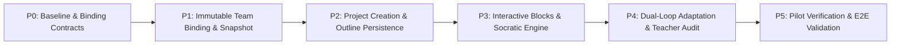

# 启途智学自适应 PBL 与多智能体协同融合实施计划

> **文档标识**：`docs/plan/combined/implementation-plan.md`
> **版本**：v1.0.0
> **生效基线**：2026-10-18
> **前置依赖**：[`./architecture.md`](./architecture.md) · [`../antigravity/implementation-plan.md`](../antigravity/implementation-plan.md) · [`../codex/implementation-plan.md`](../codex/implementation-plan.md)
> **责任领域**：`packages/contracts` / `packages/database` / `services/api` / `apps/student-center` / `apps/admin-console`

---

## 1. 目标闭环流程

```text
教研发布不可变模板与团队版本
  -> 校验并激活唯一 PblTemplateTeamBinding
  -> 学生在灵感空间明确确认意图（Intent Gate）
  -> 服务端原子立项并冻结 ProjectBindingSnapshot 快照
  -> 服务端生成/校验个性化学习计划与 PlanOutline 大纲
  -> Tutor Leader 编排 + 阶段子 Agent（教练/向导/评审）协同
  -> 学生点击选项/作答 Quiz/查看推导板
  -> learning-plan / mastery owner 记录正式学习证据并更新掌握度
  -> 微观循环：自适应提问与三级提示阶梯（Hint Ladder）
  -> 宏观循环：检测卡点并追加带有 revision 的补救计划，同步教师端
  -> 强硬门禁：TheoryMastered 严格校验放行实践沙箱与结题
```

---

## 2. 分阶段实施工作分解（Roadmap & WBS）



### P0 — 基线核查、绑定契约与决策门（预计：第 1 周）
* **范围**：`packages/contracts`、`packages/database`、基线对比。
* **具体任务**：
  1. 核查当前模板/团队的真实绑定实现，确认“一模板一有效团队”规则与部分唯一索引规范。
  2. 导出 `PblTemplateTeamBinding`、`ProjectBindingSnapshot`、`PlanOutlineNode`、`ProjectPlanAdjustment` 等统一契约接口。
  3. 定义 Problem Details 标准错误码（如 `PBL_INTENT_NOT_CONFIRMED`、`THEORY_NOT_MASTERED`、`BINDING_CONFLICT`）。
* **验收标准**：`pnpm --filter @qitu/contracts typecheck` 零错误；无任何业务行为破损。

---

### P1 — 不可变团队版本与模板绑定持久化（预计：第 2 周）
* **范围**：`packages/database`、`services/api`、`apps/admin-console`。
* **具体任务**：
  1. 数据库迁移脚本：新增 `pbl_template_team_bindings` 与 `admin_team_versions` 表，建立防止并发重复激活的部分唯一索引。
  2. 完善管理端配置校验服务：验证团队成员、Leader 存在性、各阶段 Agent 路由与 TheoryMastered 门禁配置。
  3. 管理后台页面（`/settings/teams` 与 `/settings/templates`）增加绑定验证、激活、退休与生效项目快照预览。
* **验收标准**：同一模板版本无法并发激活多份有效绑定；存量项目快照不可被修改。

---

### P2 — 立项事务接线与计划大纲持久化（预计：第 3–4 周）
* **范围**：`services/api/src/modules/projects`、`services/api/src/modules/learning-plan`。
* **具体任务**：
  1. 在学生显式确认意图的命令中原子解析 active 绑定，同一事务写入 `pbl_projects` 并固化 `ProjectBindingSnapshot`。
  2. 实现 `PlanOutlineStore` 的 PostgreSQL 持久化，支持按大纲节点组织探究任务，课次计划按需惰性展开。
  3. 接入模型大纲候选生成与校验器：严格校验 Schema、目标引用合法性、DAG 无环性与总课时。
* **验收标准**：未确认意图前无法生成正式项目；立项事务失败零残留；同键重试保证幂等。

---

### P3 — OpenMAIC 交互块与 DeepTutor 问答引擎（预计：第 5–6 周）
* **范围**：`services/api/src/modules/ai-tutor`、`apps/student-center`。
* **具体任务**：
  1. 扩展 `TutorReplyBlock`：集成 `QuizBlock`、`OptionsBlock`、`BoardBlock`、`SimulationBlock` 与 `MilestoneBlock`。
  2. 问答生成与干扰项服务：基于学科迷思库生成具针对性的 Distractors，严格过滤答案泄密。
  3. 统一交互路由：所有作答与选择统一经由服务端接口判分，唯一写入 `answer_attempts`，杜绝重复计分。
  4. 前端渲染组件开发：在 `features/tutor/components/` 下落地 `QuizBlockView`、`OptionChipsView`、`BoardBlockView` 与 `HintLadderBar`。
* **验收标准**：相同题目重复提交仅记录一次；前端覆盖 loading/empty/error/offline 状态；`TheoryMastered` 达成前实践入口严格禁用。

---

### P4 — 双循环自适应调谐与教师介入审计（预计：第 7–8 周）
* **范围**：`services/api/src/modules/learning-plan`、`services/api/src/modules/ai-tutor`、教师工作台。
* **具体任务**：
  1. 落地微观三级提示阶梯控制器（Hint Ladder Controller），依据学生错误类型动态匹配提示深度。
  2. 落地宏观计划调谐服务：检测卡点指标，在执行计划大纲中原子追加 `isRemedial: true` 节点并递增 revision。
  3. 班主任工作台集成：向班主任推送脱敏卡点预警摘要与介入建议，严禁泄露学生原始对话正文。
* **验收标准**：过期 revision 提交返回 409 冲突；计划追加完整留痕审计；班主任只能看到自己负责的学生卡点。

---

### P5 — 单模板全流程试点与端到端验证（预计：第 9–10 周）
* **范围**：全端集成验证、安全合规审查。
* **具体任务**：
  1. 选择一个 4 周标准 PBL 模板（如“雷霆战机”或“动能探究”）进行端到端闭环验证。
  2. 回放链路：开题意图确认 $\to$ 绑定快照 $\to$ 大纲推进 $\to$ 迷思干扰项作答 $\to$ 提示升级 $\to$ 理论达标放行 $\to$ 沙箱实践 $\to$ 作品答辩。
  3. 运行全量安全审计与断网恢复测试（`tooling/validate-preferences.mjs` 等）。
* **验收标准**：零越权、零未成年人数据泄露、零门禁旁路；所有单元与集成测试绿灯。

---

## 3. 质量门禁与验证命令

| 维度 | 检查内容 | 检验工具/方式 |
| :--- | :--- | :--- |
| **类型安全** | Monorepo 契约包与全端消费层零类型错误 | `pnpm typecheck` |
| **逻辑覆盖** | 状态机转换、幂等去重、门禁拦截与卡点检测测试 | `pnpm test` |
| **构建完整性** | 前端各端与后端服务成功构建 | `pnpm build` |
| **路径合规** | 部署与沙箱工作目录严格遵循 `/root/qitu-zhixue` | `pnpm check:basepath` |
| **安全合规** | 杜绝提交密钥、未成年人隐私与敏感对话 | 安全扫描脚本 |
