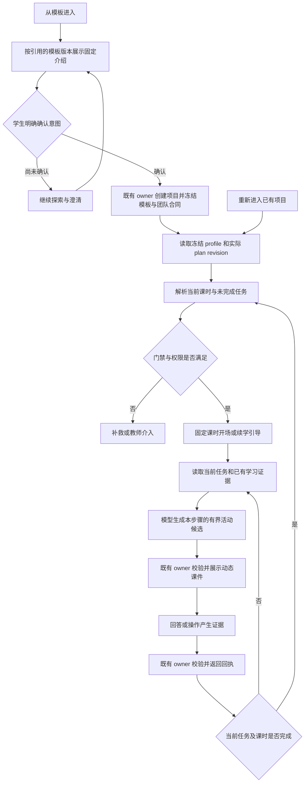

# 模板固定开场、逐课课件生成与续学方案

日期：2026-10-22。状态：方案草案，尚未实施逐课开场机制。本轮已修复标题触发的无权限预设实验、探索侧栏与团队状态；模板命名、开场卡片美化与课程编排改造分别验收。

补充口径：固定的是模板的课时计划、导入文案、目标、约束和证据要求。具体板书、例子、选择练习、提示及允许的实验参数方案，应在每个当前教学步骤中依据计划、授权知识与学生回答动态生成，不是从预设课件清单直接播放。模板标题出现“散射、衍射”等词不能触发实验插卡。

## 内容生成与运行状态

| 固定的教学设计 | 按当前步骤动态生成 | 服务端 owner 决定的事实 |
|---|---|---|
| 目标、课时顺序、活动时间、固定开场、评价标准、可用角色与工具 | 贴合学生观察的讲解、BoardBlock、Mermaid、KaTeX、同目标练习与补救、注册实验的候选参数 | 当前任务、题目实例及判分、接受的证据、TheoryMastered、作品审批、下一可学课时 |

运行顺序为：读取冻结计划和未完成任务 → 读取允许使用的学习证据和教材 → 当前角色模型生成一个活动候选 → 既有 `tutor_propose_lesson_activity` 等 owner 工具校验 scope、版本、权限和内容 → 返回已接受的结构化课件 → 学生回答或操作 → owner 回执驱动下一步。生成失败应显示重试或继续交流入口；不能展示一个要求预测却没有任何可提交动作的灰色实验卡。

注册的仿真引擎和参数域可以复用，它们是受控工具，不代表整节课使用固定内容。理论过关前只做允许的现象说明和低风险提示；实验操作仍检查门禁和安全审核。生成了课件不等于完成了学习。

右侧状态应覆盖两类对象。模板探索展示实际接管团队、当前会话范围内的协作状态，以及明确标注的立项前准备，不显示虚构的课时完成率。学生显式确认项目后，展示真实冻结课时、当前任务与证据进度。团队状态从对应 project/session 的安全投影读取，支持处理中、等待、失败和重试，切换会话后旧响应不能覆盖新会话；不能只支持 projectId 而遗漏已由团队接管的探索。

## 1. 要达到的行为

已有模板的教学内容和课时安排应决定学生每次进入时看到的开场白。学生从模板进入，先看该模板预设的项目介绍；明确确认意图后，进入对应课程；以后回到项目时，继续当前课时和未完成任务。自由探索保留开放的兴趣引导。

“固定”指固定的学习目标、核心导入语、首个任务、证据要求和顺序。允许服务端填入课时标题、上次已保存的进度和实际导师名称，不允许模型临时改写课程目标或跳过关卡。教师已经编写的固定文案，应导入版本化模板内容，不能用通用欢迎语覆盖。

## 2. 已有能力与缺口

| 责任域 | 源码已有 | 仍需完成 |
|---|---|---|
| 模板合同 | `ProjectTemplateSpec`、curriculum profile、`PblTemplateSession` 的目标、活动时长、`learningGoal`、`activityGuidance`、证据和完成条件 | 将固定开场、首个任务及续学说明纳入同一版本合同，并完成校验、编译和投影 |
| 项目与计划 | 确认时冻结模板、binding、团队版本/hash；`resolveTutorTeachingContext` 解析实际课时、任务和角色 | 开场读取该冻结上下文，覆盖首次进入、下一课和断点续学 |
| Tutor 开场 | `tutor-opening.ts` 生成介绍；`persistTutorOpening` 在空会话中保存首轮，避免刷新重复写入 | 当前空会话判断不能覆盖同一对话中的课时切换；介绍不能替代每课固定导入 |
| 学生展示 | 本轮新增模板主题、实际导师、探究问题、开聊选项的卡片 | 根据受治理的开场内容展示课时、目标、任务、证据和继续入口 |
| 历史清理 | 永久删除、权限、幂等；删除后进入待选择页 | 删聊天保留课程进度时，重新进入应生成续学引导，不能回到第一课 |

这些是不同事实：源码支持课时、Admin 保存了课程草稿、绑定已启用、真实学生能完成整节课，不能相互替代。

## 3. 四种开场情境

| 进入情境 | 展示内容 | 下一步 | 数据边界 |
|---|---|---|---|
| 自由探索 | 兴趣邀请、生活观察、作品想法 | 对话梳理方向 | 不自动创建正式项目 |
| 模板介绍，尚未确认 | 固定项目介绍、驱动问题、预期作品、课程路线和实际导师 | 了解挑战、表达观察、显式确认意图 | 只使用探索记录；预览课程不代表已创建计划或完成课时 |
| 第一次进入可学课时 | 该课固定导入、目标、第一项行动、证据要求 | 提交回答或进入本课允许的交互 | 开场不产生掌握或完成事实 |
| 回到未完成课时 | 已有回执支持的进度、当前任务、还缺什么、本课续学语 | 继续未完成的步骤 | 不重开项目、不重置题目、不重复保存证据 |

当前课完成后，下一课的固定开场只在 owner 确认完成且目标课时可进入后出现。门禁未通过时显示缺失证据与补救入口；不能因对话轮数、课时序号或“点击继续”自动放行。

## 4. 模板数据如何组织

在既有 `ProjectTemplateSpec` 内设计两处内容，以下名称为方案建议，尚不是已实现 API。

1. 模板级 `explorationIntro`：固定介绍、驱动问题、成果说明、立项前可选行动，引用真实 role slot。
2. `PblTemplateSession` 内的 `openingSpec`：稳定 ID、内容版本、固定导入语、目标引用、首个 task 引用、证据要求和续学文案。复用现有 `learningGoal`、`activityGuidance` 和证据合同，避免复制两套目标或 rubric。

课时开场是内容，实例化后的答题、实验与证据仍由既有 owner 合同处理。静态模板中不保存学生专属 action ID 或 quiz 实例 ID；服务端校验当前任务后创建稳定实例，再绑定按钮。

必须先解决立项时序：现有光学 16 课时设计的前两项包含观察准备和意图确认。不能为了按课时展示它们而提前创建正式项目，也不能在立项后把准备活动自动记为已完成。建议立项前使用现有 exploration/draft owner 承载候选活动和有界证据；确认后由项目与计划 owner 冻结合同，明确校验哪些准备证据可以承接。若要调整正式课程的起点或课时总数，应发布新的 profile/模板版本，不能原地改变旧版本。该承接方式是实施第一阶段必须评审和测试的具体问题。

文案可以引用有界变量，如本课标题、当前任务标题、导师姓名及已接受回执的简短摘要。服务端负责填值与转义。不得由浏览器或模型传入任意项目状态、角色、知识库范围或工具路由。

所有展示内容仍使用闭集 `TutorReplyBlock`，优先复用 text、board、questions、options 等块；若确需新的内容类型，须同步修改 contracts、validator、持久化、SSE、前端安全渲染和测试。不能让模型生成任意 HTML/JS。

## 5. 运行时流程

下一教学动作只能由既有服务端策略选择。`sessionIndex`、project stage index、数组位置和 task ID 不是同一种身份；不得按固定的全局 1–16 映射到助手或门禁。

## 6. 显示与去重

课时卡片建议按“第几课及标题 → 本课目标 → 导师固定导入 → 现在做什么 → 提交什么证据 → 下一步按钮”排列。课程总览可以展开查看，默认聚焦当前任务。长模板名允许换行，手机端单列；开场首次进入显示卡片顶部，答题后的正常回复保留自动滚动。

同一课已显示的开场不因刷新、重连或切换窗口重复落库。建议将项目、冻结模板/profile、plan revision、实际 learningSession/task、开场内容 hash、会话代次纳入幂等范围，复用既有 Tutor 回合与幂等存储。课时进入记录与课时完成记录必须区分，不另建课程状态机。

删除聊天只清除对话、保留课程 owner 的进度时，显式重新进入项目应显示当前课的续学说明。删除项目则沿用项目永久删除合同。删除当前探索后停留在待选择页，不能自动创建替代会话。

会话名称：模板探索使用该探索关联模板名；正式项目使用项目冻结的标题。课时标题作为副标题随当前课变化，不为每课额外创建一个“我的项目”条目。

## 7. Admin 配置与发布

在现有模板编辑中增加“项目介绍 / 逐课开场 / 续学引导”的内容编辑与预览，复用已有课时列表和真实团队角色。显示固定文案来源、引用课时、目标、任务、证据及内容版本；缺少内容或引用不存在时阻止发布，不能静默改用自由探索开场。

流程为：复制为新模板草稿 → 迁入教师原有文案和活动指导 → 校验每课引用及角色 → 编译教学合同/hash → 审核发布新版本 → 验证/启用 binding → 用隔离学生场景验收。

不原地改写已冻结的模板版本、团队版本或历史快照。16 课时等排程沿用各自 profile 身份，已有项目保留原语义；需要迁移的历史项目，另走明确的配置恢复或迁移 owner 流程。知识库权限继续取冻结 grant 与当前授权的交集。

## 8. 光学课程示例

源码中的 `optics-16x60-v2` 首两项设计已包含观察与假设准备，可作为固定导入的来源，但进入哪个课时仍由冻结 profile 和实际进度决定。

| 内容来源 | 开场示意 | 学生先做什么 | 证据 |
|---|---|---|---|
| 光的宏观现象与观察指标 | 今天从镜面、水面或透镜现象开始。先分清“看到什么”和“为什么会这样”。 | 描述一个现象，并指出可比较的角度、距离或像的性质 | 带指标与单位的观察表、观察与解释的区分记录 |
| 提出探究假设与实验方案 | 从已有观察表挑一个可测量的问题，试着提出能被检验的假设。 | 区分自变量、因变量和控制变量，纸面设计比较方案 | 假设与变量表、待确认的探究意向书 |
| 实践类课时 | 先回看已通过的理论证据，再明确本次操作、记录方式与限制。 | 由服务端检查 TheoryMastered、实验版本、参数和所需安全审核后执行 | owner 接受的观测记录及 CER/rubric 引用 |

立项前只预览或整理允许的探索材料，不提前创建正式项目。排到某课不等于 TheoryMastered，通过理论也不等于作品已获批准。散射、衍射仍属于既有实践/非门禁模块，不新增理论门禁目标。

## 当前线上授权与验证

2026-10-22 初次核查发现光学模板 binding `bnd-b10c985b5c562687` 缺少动态课件授权。现已通过 Admin owner 为 5 位教学助手补齐已发布的 `pbl-dynamic-lesson` 和 `tutor.propose_lesson_activity`，发布团队版本 `team-version-a58887ab25161859429dd88ff3cfac06`，校验并启用新 binding `bnd-ac6adb20d4f27968`。`optics-16x60-v2` 的 16 课时路由、模型选择、原有技能和知识范围保持不变；前两课的实际角色仍是 `qitu-intake-assistant`。

新确认项目冻结新绑定；旧项目保留原教学包和权限。需要使用新能力时，从灵感空间重新进入模板并显式确认新项目。需要保留旧项目进度的迁移，应走专门的 owner 审核流程，不在读取时静默增加能力。原授权缺口已解决，但固定逐课开场和完整教学闭环仍按本方案验收，不因配置回读成功而认定完成。

本次真实请求已验证：同一观察课根据不同学生观察生成不同板书，模型调用活动工具，服务端接受并保存，刷新恢复、同键重试及分步图示可用。板书格式不符合闭集协议时返回有界修正反馈，允许模型在本轮修正候选；拒绝的候选不落库、不产生完成事实。后台 `pbl.plan` 仍只生成结构化规划候选，按任务范围排除需要交互执行器的技能，避免把 Tutor 的课堂工具授权当成后台规划的执行能力；未扩展后台工具权限。实际规划任务已回读 `succeeded`。

已有 `projectTutorLessonProgram` 会把实际冻结课时的目标、活动指导、时长和证据要求投影给模型；`createLessonActivityChannel` 校验当前角色的已发布技能和工具 pin，并在接受候选前重新检查 plan revision、课时、目标和角色。应接通并扩展这条已有链路，不再添加关键词插卡或另一套课程数据库。

生成节奏以本课未完成任务为单位：先判断学生当前缺少什么，再选一个讲解板书、追问、练习或补救活动。完成证据仍由 learning-plan、quiz/mastery、experiment、works 等已有 owner 接受。单轮只接受有界活动；多次点击、重连和生成重试复用原幂等范围，不能产生两道并行待答题。模型未调用工具、候选被拒绝、知识库不可用、超时或撤权，均显示明确状态和可用的继续入口，不显示“已生成”或“已完成”。

### 首批动态课件的验收范围

| 场景 | 必须看到的行为 | 禁止误判 |
|---|---|---|
| 同一课，不同观察 | 根据当前回答生成不同例子与板书，仍围绕同一个冻结目标 | 复用同一套预设课件并换标题 |
| 同目标求助、答错和答对 | 求助保留 pending 题；判分由 owner 完成；补救后再检查同一目标 | 以模型评价、对话轮数或点击继续推进课时 |
| 中断、刷新与删除聊天后重进 | 恢复当前任务、已有答题及证据回执；显示本课续学引导 | 从第一课重新开始或重复记证据 |
| 理论未过关的实践请求 | 明确显示缺少的条件，给允许的理论支持 | 因当前课名称包含实验而放行工具 |
| 正常实践课 | 只用注册模型、参数域和稳定 action；保存后可回读 observations 与证据引用 | 将滑块运行或摘要当成实测和掌握事实 |
| 新绑定与旧项目并存 | 新项目获得经校验的新能力；旧项目保持冻结权限，撤权即时收紧 | 直接给所有历史项目增加技能和知识范围 |

第一批先验收一个理论课的“观察 → 生成板书 → 检查题 → 补救 → owner 证据回执”，再验收满足门禁的注册实践课。之后逐项覆盖报告审批与反思归档。不能以三次正常 SSE 回复代替这两条教学闭环。

## 9. 实施顺序与验收

| 顺序 | 可评审交付 | 必须验证 |
|---|---|---|
| 1 | 盘点各模板已有固定文案、排程和角色，形成缺口表 | 每段文案有模板版本及具体课时来源，缺失内容明确列出 |
| 2 | 在现有合同内补齐开场设计、validator 和新版本编译 | 非法 task/目标/角色引用被拒绝；hash 覆盖开场内容 |
| 3 | Admin 回读技能目录与当前助手授权，发布新团队版本并校验新 binding | 真实角色、canonical skill ID、精确 digest 和工具 pin 一致；不改旧项目 |
| 4 | 接入 Tutor 的逐课进入、动态候选生成、owner 接受与续学选择 | 不按标题猜团队；实际课时指导进入请求；跨课、跨 revision、刷新与重连不串课 |
| 5 | Admin 预览及学生课时卡片、活动失败与恢复入口 | 固定文案与已发布内容一致；手机、夜间、断网和权限失败可用 |
| 6 | 隔离场景完成真实教学闭环，再决定发布范围 | 目标 → 动态课件 → 练习与补救 → 理论门禁 → 实践取证 → 报告审批 → 反思归档 |

关键回归还包括：更改模板名不改变授权；新模板不改变旧项目；删聊天后保留本课进度；删项目不留下可恢复的对话入口；当前题求助不覆盖 pending 或自动判错；未通过门禁的按钮不能绕过服务端校验。

本方案的完成标准是“按正确的课时和证据继续教学”，不能只以开场卡片显示成功或单轮模型回复成功判定整套课堂通过。

## 10. 对应源码

- [模板与课时合同](../../packages/contracts/src/pbl-learning.ts)
- [现有光学课时内容](../../packages/ai-client/src/quiz-bank/optics/curriculum.ts)
- [冻结教学合同编译](../../services/api/src/modules/templates/teaching-bundle.compiler.ts)
- [实际课时与角色解析](../../services/api/src/modules/ai-tutor/tutor-teaching-context.ts)
- [现有首轮生成](../../services/api/src/modules/ai-tutor/tutor-opening.ts)
- [现有首轮保存](../../services/api/src/modules/ai-tutor/tutor-opening.store.ts)
- [学生端 AI 搭档说明](./tutor.md)
